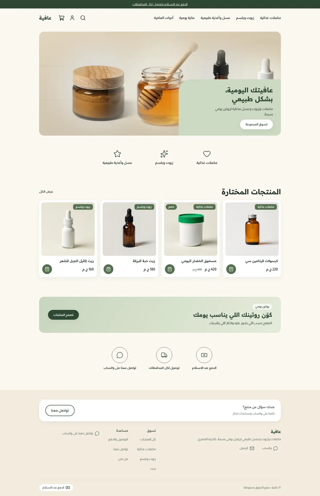
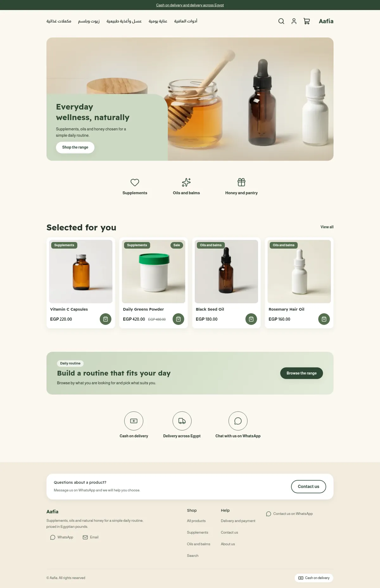
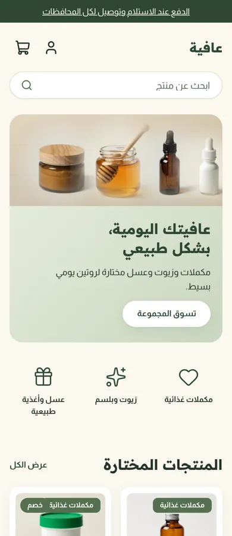
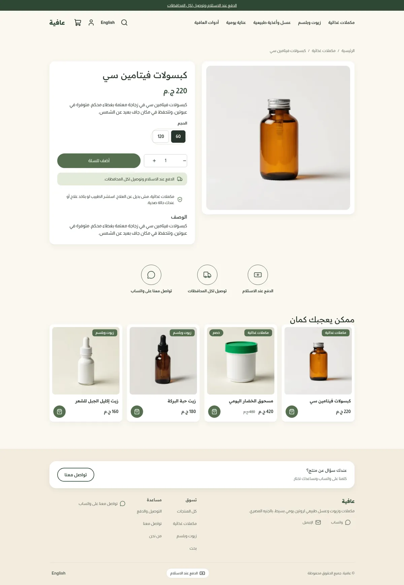
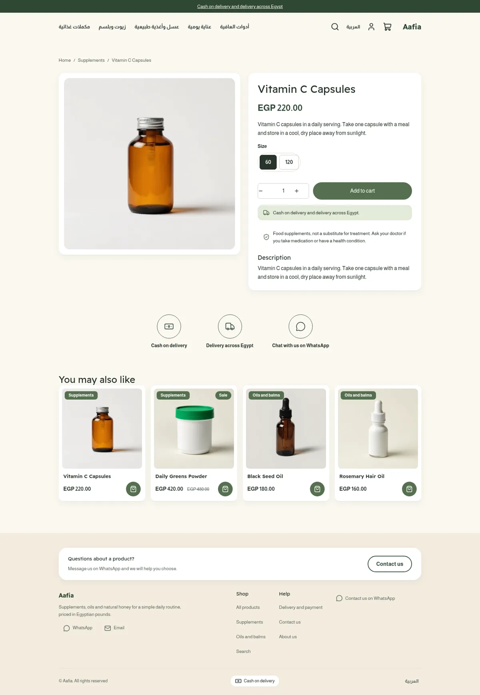
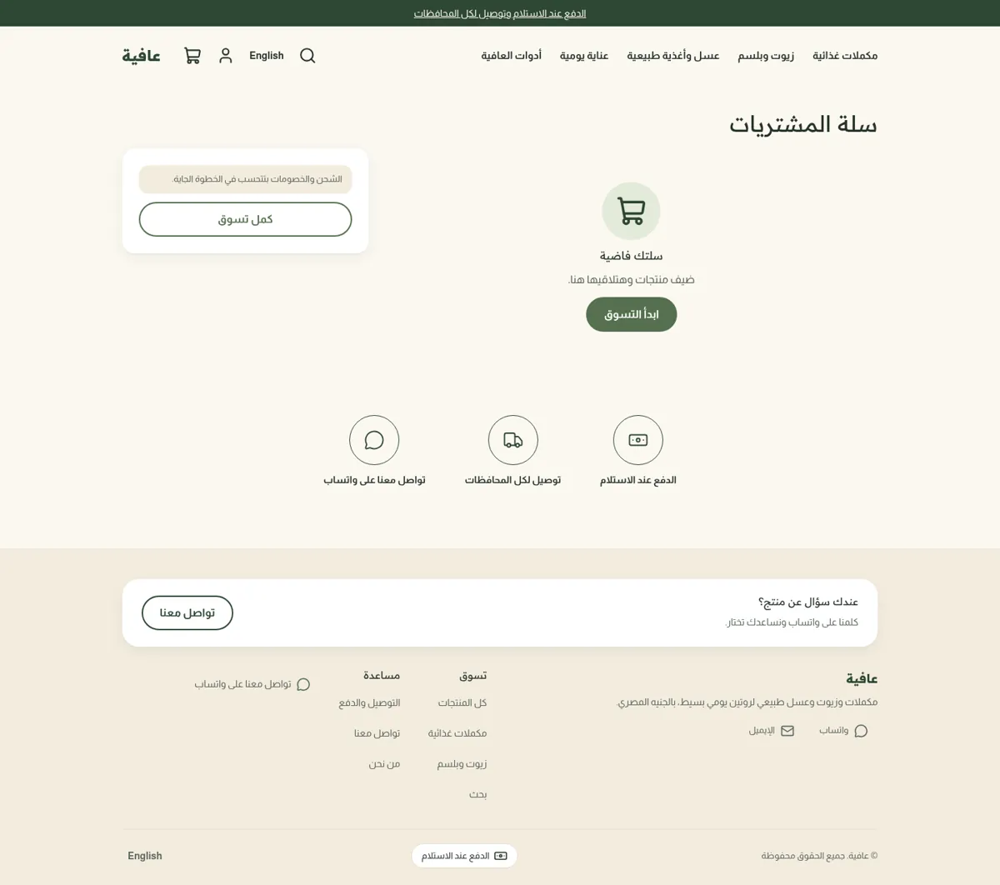
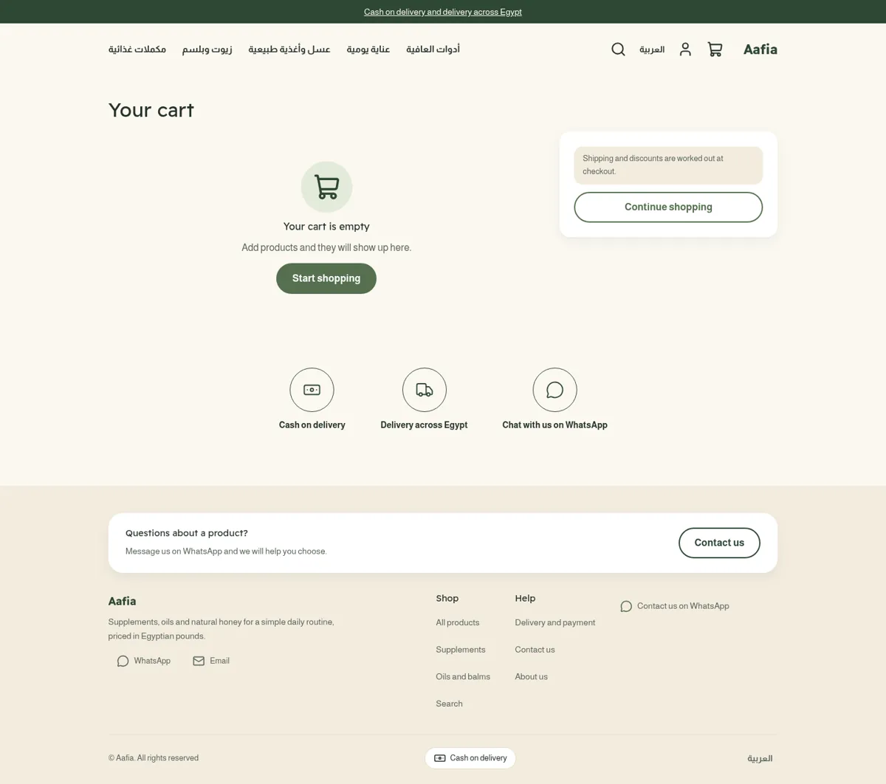
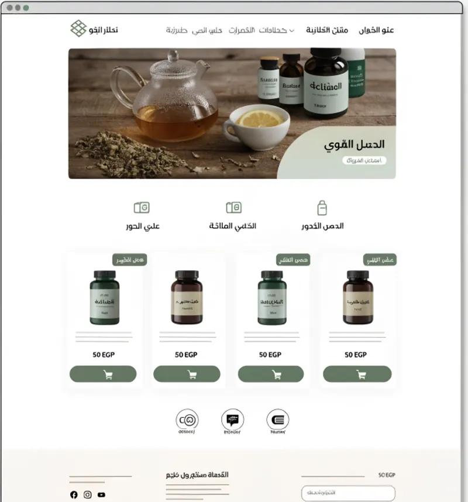
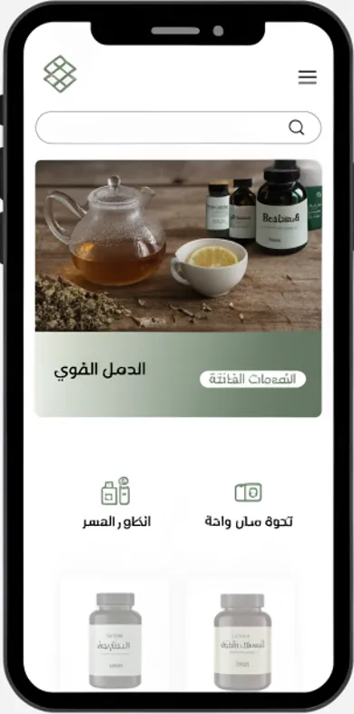

# Tutorial: Aafia, a natural wellness store

Aafia is a full store theme for a shop that sells supplements, oils, honey and
everyday care. It is warm beige with sage and forest green: a rounded banner with
a soft panel pinned to one corner, a row of line-icon categories, white product
cards with a green category chip and a round button, a soft gradient routine
banner and three round trust badges. It is right-to-left in Arabic and
left-to-right in English from the same files.

The theme writes **every page type itself**: home, product, collection, search,
cart, 404 and content page, with an announcement bar, header and footer as
editable sections.

| Page | Arabic, desktop | English, desktop | Arabic, phone |
| - | - | - | - |
| Home |  |  |  |
| Product |  |  | |
| Cart |  |  | |

The design brief was this mockup (placeholder Arabic and a made-up logo, which
Aafia replaces with a plain wordmark and real copy):

 

## What is in the folder

```
theme.json                 id, version, tokens (sage, forest, beige), fonts
layout/theme.snf           announcement, header, <main>, footer
groups/                    announcement.json, header.json, footer.json
templates/                 index, product, collection, search, cart, 404, page
sections/                  hero, af-benefits, af-quiz, af-trust, featured-products,
                           related-products, header, footer, announcement-bar,
                           product-main, collection-main, search-main, cart-main,
                           page-main, not-found
blocks/                    benefit, trust, menu-link, footer-column, footer-link,
                           social-link, contact-line, payment-method, product-*
snippets/                  product-card, price, button
locales/                   ar.json, en.json (same keys)
assets/theme.css           the only stylesheet; colours come from tokens
```

## Run it

```bash
npx sneferu dev .      # http://127.0.0.1:4100, /?locale=en for English
npx sneferu format .
npx sneferu validate .
```

## Excerpts

The product card carries the benefit chip (the category) and a round button, and
prints the price through the money filter:

```
<span class="af-chip-tag">{{ product.category.title }}</span>
...
<hk-icon name="shopping-bag" size="20" />
```

The hero image is an editable `image` setting, so a merchant swaps the banner
without touching the theme. Its default is a hosted URL, not a bundled asset.
