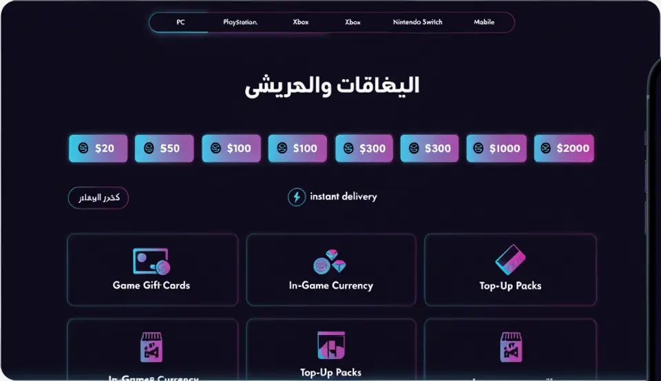
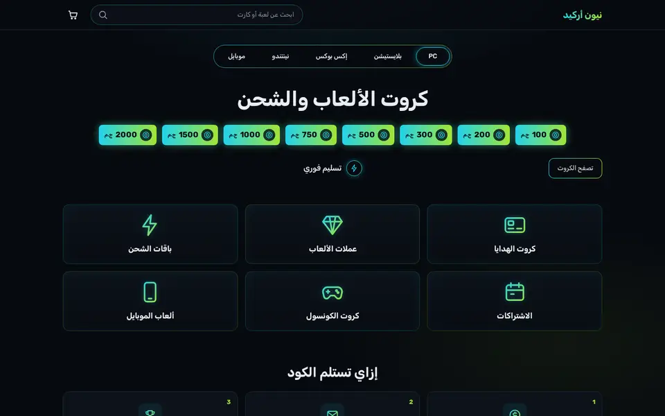
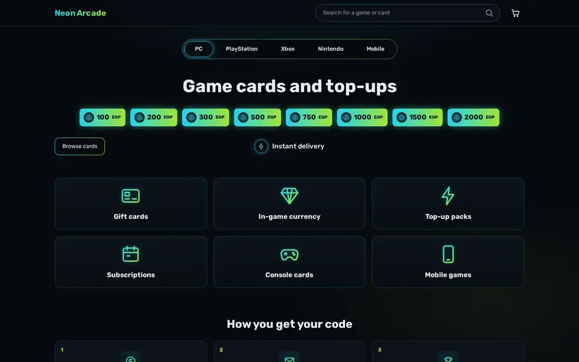
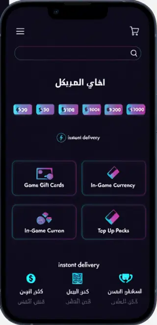
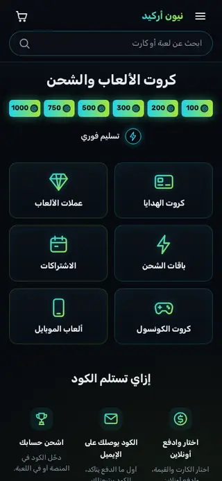

# Tutorial: Arcade, a neon gaming top-up store

Arcade is a home page for a shop that sells game gift cards, in-game currency
and top-up packs as codes. It is near-black with neon cyan and lime: a row of
platform tabs, a big title, a row of amount chips, an "instant delivery" line,
six category tiles, three "how you get your code" steps, a product grid and a
FAQ. It is right-to-left in Arabic and left-to-right in English from the same
files.

| Mockup | Live, Arabic | Live, English |
| - | - | - |
|  |  |  |
|  |  |  |

The mockup was generated as a design brief. Its Arabic is placeholder text, its
prices were in dollars, and its cyan-to-magenta glow became cyan-to-lime. Live:
[demo-arcade.hekana.com](https://demo-arcade.hekana.com) and
[/en](https://demo-arcade.hekana.com/en).

What the theme uses: plain HTML for structure, `hk-section`, `hk-stack`,
`hk-grid`, `hk-heading`, `hk-button`, `hk-product-grid`, `hk-icon` and
`hk-search-form`, five block types (tab, chip, tile, step, question) that the
template seeds with the page's items, one snippet for the two glyphs the icon
set lacks, `<details>` for the phone menu and the FAQ, and one stylesheet.
There is no JavaScript. Version 1.2.0 is built on Sneferu 0.4; the 0.2
workarounds it replaced are listed in `../../GAPS-gaming.md`.

## Upgrading from 1.0

In 1.1.0 the numbered settings and locale-text fallbacks became blocks and
localized settings; values saved under 1.0 are not carried over, so the sections
start from the new defaults.

## Pages

Arcade writes only the home page (`templates/index.sneferu`). The product,
collection, search, cart, content page and 404 templates come from the SDK's
default store ([page types](../../../docs/guide/16-page-types.mdx)), drawn with
Arcade's tokens, fonts and layout. `assets/theme.css` restyles what the default
store would otherwise draw in its own way (the block "Cart, product, collection,
search and 404 pages"):

- product cards on collection and search pages use the home grid's card: dark
  surface, thin line, cyan glow on hover, lime price;
- the sale badge, the active sort or filter chip and the cart count use dark
  text on the neon colours;
- the cart summary, the delivery note and the cart drawer sit on the surface
  colour instead of the page background.

The header group holds the cart drawer: it opens when an item is added (a
setting of the header section) and from the cart icon.

| Page | URL in `sneferu dev` |
| - | - |
| Product | `/products/sample-2` |
| Collection | `/category/gift-cards`, `/products` |
| Search | `/search?q=card` |
| Cart | `/cart` |
| Content page | `/pages/about` |
| 404 | any other path |

## Files

```
assets/theme.css
blocks/chip.sneferu
blocks/faq-item.sneferu
blocks/step.sneferu
blocks/tab.sneferu
blocks/tile.sneferu
groups/footer.json
groups/header.json
layout/theme.sneferu
locales/ar.json
locales/en.json
sections/arcade-categories.sneferu
sections/arcade-faq.sneferu
sections/arcade-footer.sneferu
sections/arcade-header.sneferu
sections/arcade-hero.sneferu
sections/arcade-products.sneferu
sections/arcade-steps.sneferu
snippets/glyph.sneferu
templates/index.sneferu
theme.json
```

Next to the theme: `README.md` and `docs/` (this tutorial and its pictures).
The CLI skips both: they are never checked and never pushed.

## Data it needs

| What | Used by |
| - | - |
| A collection for the product grid: `featured` by default (products marked featured, or the newest) | the product grid, through its `collection` setting |
| Categories with the handles `gift-cards`, `game-currency`, `top-ups`, `subscriptions` | the menu links and the default tile and tab links, as `/category/<handle>` (each tile and tab link is a setting) |

Prices are in piastres in the data and printed by `hk-product-grid`, for example
`EGP 99.00` in English; on the Arabic page the currency comes after the
number.

## 1. Start from the starter

```bash
npx @hekana/sneferu init arcade
cd arcade
```

Delete the starter's `sections/hero.sneferu`, `sections/featured.sneferu` and
`blocks/chip.sneferu`; this theme writes its own.

## 2. Manifest and tokens

```json title="theme.json"
{
  "id": "arcade",
  "name": "Arcade",
  "version": "1.2.0",
  "author": "Hekana",
  "description": "A dark gaming store for gift cards and top-ups: neon cyan and lime, amount chips, category tiles, redeem steps.",
  "category": "gaming",
  "engine": "hk2",
  "engineCompatibility": "^2.0.0",
  "defaultLocale": "ar",
  "locales": ["ar", "en"],
  "settings": {},
  "tokens": {
    "colors": {
      "primary": "#22D3EE",
      "secondary": "#0D141C",
      "accent": "#A3E635",
      "background": "#070A0F",
      "text": "#E6EDF3",
      "muted": "#8B98A9",
      "surface": "#0C1219",
      "line": "#1C2A36"
    },
    "layout": { "contentWidth": "1200px" },
    "fonts": {
      "heading": "Rubik",
      "body": "Rubik"
    }
  }
}
```

- `defaultLocale` is `ar`, so `/` renders Arabic (right to left) and `/en`
  English.
- Every colour is a token. Besides the five required keys there are `muted`,
  `surface` and `line`; each becomes a variable such as `--hk-color-surface`.
- `primary` is the cyan and `accent` the lime. The stylesheet names them
  `--arc-cyan` and `--arc-lime` and builds one gradient from them.

## 3. Fonts

`tokens.fonts` in `theme.json` names the font: `"fonts": { "heading": "Rubik",
"body": "Rubik" }`. Rubik is in the Sneferu font catalogue and has Arabic and
Latin glyphs. Hekana serves the font files and writes the `@font-face` rules
and the `font-family`, so the theme has no font files and the stylesheet sets
no family. (`sneferu dev` loads the same family from Google Fonts.)

## 4. Icons

Icons are `<hk-icon>` from the bundled Lucide set:
`<hk-icon name="shopping-cart" size="24" class="ic" />`. They draw with
`currentColor`, so CSS sets their colour, and `class="ic"` lets the stylesheet
size them. Two glyphs the set lacks, the coin on the amount chips and the gem on
the in-game currency tile, stay inline SVG in `snippets/glyph.sneferu`:

```html title="snippets/glyph.sneferu"
<svg
  class="ic ic-{{ name }}"
  viewBox="0 0 24 24"
  width="24"
  height="24"
  fill="none"
  stroke="currentColor"
  stroke-width="1.8"
  stroke-linecap="round"
  stroke-linejoin="round"
  aria-hidden="true"
>
  <circle cx="12" cy="12" r="8.5" /><path d="M9 9.5l3-2 3 2v5l-3 2-3-2z" />
  <path d="M6 3.5h12l3.5 5L12 21 2.5 8.5 6 3.5z" /><path d="M2.5 8.5h19M9 3.5L12 21l3-17.5" />
  
</svg>
```

The page-wide gradient used by the tile icons is declared once in the layout
(next step) as `<linearGradient id="arc-grad">`, and the CSS points icons at it
with `stroke: url(#arc-grad)`.

## 5. Layout: header and footer

```html title="layout/theme.sneferu"
<svg class="arc-defs" width="0" height="0" aria-hidden="true">
  <defs>
    <linearGradient id="arc-grad" x1="2" y1="2" x2="22" y2="22" gradientUnits="userSpaceOnUse">
      <stop offset="0" stop-color="#22D3EE" />
      <stop offset="1" stop-color="#A3E635" />
    </linearGradient>
  </defs>
</svg>
<hk-section-group name="header" />
<main class="arc-main"><hk-slot name="content" /></main>
<hk-section-group name="footer" />
```

The header and the footer are [section groups](../../../docs/guide/18-section-groups.mdx): the layout places
`<hk-section-group name="header" />` and `<hk-section-group name="footer" />`, `groups/header.json` and
`groups/footer.json` start them with `arcade-header` and `arcade-footer`, and the merchant edits them once for the
whole store. The header also holds the cart: the cart link carries `data-hk-open="cart-drawer"` and
`<hk-cart-count />`, and `<hk-cart-drawer>` lists the lines (a plain link to the cart page without JavaScript).

```html title="sections/arcade-header.sneferu"
<header class="arc-header">
  <hk-container>
    <div class="arc-bar">
      <details class="arc-menu">
        <summary aria-label="{{ t('menu') }}"><hk-icon name="menu" size="24" class="ic" /></summary>
        <nav class="arc-menu-panel">
          <a href="{{ url('/') }}">{{ t('nav_home') }}</a>
          <a href="{{ url('/products') }}">{{ t('nav_all') }}</a>
          <a href="{{ url('/category/gift-cards') }}">{{ t('cat_gift_cards') }}</a>
          <a href="{{ url('/category/game-currency') }}">{{ t('cat_currency') }}</a>
          <a href="{{ url('/') }}#faq">{{ t('nav_faq') }}</a>
        </nav>
      </details>
      <a class="arc-logo" href="{{ url('/') }}">{{ store.name }}</a>
      <hk-search-form placeholder="{{ t('search_placeholder') }}" class="arc-search" />
      <a class="arc-cart" href="{{ url('/cart') }}" data-hk-open="cart-drawer" aria-label="{{ t('cart') }}"><hk-icon
          name="shopping-cart"
          size="24"
          class="ic"
        /><hk-cart-count /></a>
    </div>
  </hk-container>
  <hk-cart-drawer open-on-add="{{ section.settings.drawer_on_add }}">
    <hk-cart-items />
    <hk-cart-summary />
  </hk-cart-drawer>
</header>
<hk-schema>
  {
    "name": "Header",
    "version": 1,
    "templates": ["header"],
    "settings": {
      "drawer_on_add": {
        "type": "boolean",
        "label": "Open the cart when an item is added",
        "default": true
      }
    }
  }
</hk-schema>
```


- `<hk-search-form class="arc-search">` is the search box: a form that sends
  the shopper to the store's search page. The stylesheet draws the rounded
  field around its input and button (`form.arc-search input`,
  `.sn-search-button`).
- `<details>`/`<summary>` is the phone menu; it opens without JavaScript.
- Every internal link goes through `url()`: `url('/products')` is `/products`
  in Arabic and `/en/products` in English, so a shopper on the English page
  stays in English.

```css title="assets/theme.css (root and header)"
/* Arcade: near-black ground, neon cyan + lime. Colours come from theme.json tokens. */
[data-hk-theme='arcade'] {
  --arc-cyan: var(--hk-color-primary);
  --arc-lime: var(--hk-color-accent);
  --arc-grad: linear-gradient(90deg, var(--arc-cyan), var(--arc-lime));
  --arc-glow: 0 0 0 1px rgba(34, 211, 238, 0.35), 0 0 18px rgba(34, 211, 238, 0.18);
  min-height: 100vh;
  line-height: 1.6;
  background:
    radial-gradient(900px 420px at 50% -120px, rgba(34, 211, 238, 0.12), transparent 70%),
    radial-gradient(700px 360px at 85% 30%, rgba(163, 230, 53, 0.06), transparent 70%),
    var(--hk-color-background);
}
:where([data-hk-theme='arcade'] a) { color: inherit; text-decoration: none; }
:where([data-hk-theme='arcade'] h1, [data-hk-theme='arcade'] h2, [data-hk-theme='arcade'] p) { margin: 0; }
.arc-defs { position: absolute; width: 0; height: 0; overflow: hidden; }
.ic { width: 24px; height: 24px; flex: none; }
/* Block wrappers take no room: tabs, chips, tiles and steps lay out as before. */
[data-hk-theme='arcade'] [data-hk-block] { display: contents; }

/* Header */
.arc-header { position: sticky; top: 0; z-index: 10; background: rgba(7, 10, 15, 0.85); backdrop-filter: blur(10px); border-bottom: 1px solid var(--hk-color-line); }
.arc-bar { display: flex; align-items: center; gap: 16px; min-height: 64px; }
.arc-logo { display: inline-flex; align-items: center; min-height: 44px; font-weight: 700; font-size: 20px; letter-spacing: 0.01em; background: var(--arc-grad); -webkit-background-clip: text; background-clip: text; color: transparent; }
.arc-search { flex: 1; max-width: 460px; margin-inline-start: auto; flex-wrap: nowrap; align-items: center; gap: 12px; min-height: 44px; padding-inline: 18px 4px; border-radius: 999px; border: 1px solid rgba(34, 211, 238, 0.35); background: rgba(12, 18, 25, 0.8); color: var(--hk-color-muted); font-size: 14px; }
.arc-search:hover, .arc-search:focus-within { border-color: var(--arc-cyan); }
form.arc-search input { min-height: 44px; padding: 0; border: 0; outline: 0; background: transparent; color: var(--hk-color-text); font-size: 14px; }
form.arc-search input::placeholder { color: var(--hk-color-muted); }
form.arc-search .sn-search-button { border: 0; border-radius: 999px; background: transparent; color: var(--hk-color-muted); }
form.arc-search .sn-search-button:hover { color: var(--arc-cyan); }
.arc-cart { position: relative; display: inline-flex; align-items: center; justify-content: center; width: 44px; height: 44px; border-radius: 12px; color: var(--hk-color-text); }
.arc-cart:hover, .arc-menu summary:hover { color: var(--arc-cyan); }
.arc-menu { position: relative; display: none; }
.arc-menu summary { list-style: none; display: inline-flex; align-items: center; justify-content: center; width: 44px; height: 44px; cursor: pointer; color: var(--hk-color-text); }
.arc-menu summary::-webkit-details-marker { display: none; }
.arc-menu-panel { position: absolute; inset-inline-start: 0; top: 52px; min-width: 220px; display: grid; padding: 8px; border-radius: 14px; background: var(--hk-color-surface); border: 1px solid var(--hk-color-line); box-shadow: 0 16px 40px rgba(0, 0, 0, 0.5); }
.arc-menu-panel a { padding: 12px 14px; border-radius: 10px; min-height: 44px; }
.arc-menu-panel a:hover { background: rgba(34, 211, 238, 0.08); color: var(--arc-cyan); }
```

- `:where(…)` keeps the link and heading resets at zero specificity, so a
  single class such as `.arc-chip` still sets its own colour.
- `[data-hk-block] { display: contents; }` takes the wrapper `<div>` of every
  block out of the layout, so tabs, chips, tiles and steps sit directly in
  their flex or grid row.

## 6. Words: settings and locale files

Copy the merchant may change is a setting with `"localized": true` and a
default in both languages, so the editor shows one field per language and
`{{ section.settings.title }}` prints the one for the page:

```json title="sections/arcade-hero.sneferu (schema excerpt)"
"title": {
  "type": "text",
  "label": "Title",
  "localized": true,
  "default": { "ar": "كروت الألعاب والشحن", "en": "Game cards and top-ups" },
  "maxLength": 80
}
```

Interface words (menu, cart, search, "View all", empty states, footer) live in
`locales/ar.json` and `locales/en.json`, with the same keys. The first lines of
the English file:

```json title="locales/en.json (excerpt)"
{
  "menu": "Menu",
  "cart": "Cart",
  "nav_home": "Home",
  "nav_all": "All products",
  "nav_faq": "Questions",
  "search_placeholder": "Search for a game or card"
}
```

## 7. Hero: tabs, title, amount chips

```html title="sections/arcade-hero.sneferu"
<hk-section padding-y="32" mobile-padding-y="16" class="arc-hero">
  <nav class="arc-tabs" aria-label="{{ t('platforms') }}">
    
      <hk-block of="{{ block }}" />
    
  </nav>
  <hk-stack gap="28" mobile-gap="20" align="center">
    <hk-heading
      text="{{ section.settings.title }}"
      level="h1"
      size="44"
      tablet-size="36"
      mobile-size="24"
      align="center"
      class="arc-title"
    />
    <div class="arc-chips">
      
        <hk-block of="{{ block }}" />
      
    </div>
    <div class="arc-actions">
      <hk-button
        label="{{ section.settings.button }}"
        href="{{ section.settings.button_link }}"
        variant="outline"
        size="sm"
        class="arc-browse"
      />
      <span class="arc-instant">
        <span class="arc-instant-icon"><hk-icon name="zap" class="ic" /></span>
        {{ section.settings.note }}
      </span>
    </div>
  </hk-stack>
</hk-section>
<hk-schema>
  {
    "name": "Arcade hero",
    "version": 1,
    "settings": {
      "title": {
        "type": "text",
        "label": "Title",
        "localized": true,
        "default": {
          "ar": "كروت الألعاب والشحن",
          "en": "Game cards and top-ups"
        },
        "maxLength": 80
      },
      "button": {
        "type": "text",
        "label": "Button",
        "localized": true,
        "default": {
          "ar": "تصفح الكروت",
          "en": "Browse cards"
        },
        "maxLength": 30
      },
      "button_link": {
        "type": "link",
        "label": "Button link",
        "default": "/category/gift-cards"
      },
      "note": {
        "type": "text",
        "label": "Note next to the button",
        "localized": true,
        "default": {
          "ar": "تسليم فوري",
          "en": "Instant delivery"
        },
        "maxLength": 40
      }
    },
    "blocks": {
      "allowed": ["tab", "chip"],
      "max": 16
    }
  }
</hk-schema>
```

```html title="blocks/tab.sneferu"
<a class="arc-tab" href="{{ url(block.settings.link) }}">{{ block.settings.label }}</a>
<hk-schema>
  {
    "name": "Platform tab",
    "version": 1,
    "settings": {
      "label": {
        "type": "text",
        "label": "Label",
        "localized": true,
        "default": {
          "ar": "PC",
          "en": "PC"
        },
        "maxLength": 24
      },
      "link": {
        "type": "link",
        "label": "Link",
        "default": "/products"
      }
    }
  }
</hk-schema>
```

```html title="blocks/chip.sneferu"

  <a class="arc-chip" href="{{ url('/search') }}">
    <span class="arc-chip-icon"></span>
    <span class="arc-chip-amount">{{ block.settings.amount | money: 'whole', 'major' }}</span>
    <span class="arc-chip-short">{{ block.settings.amount }}</span>
  </a>

<hk-schema>
  {
    "name": "Amount chip",
    "version": 1,
    "settings": {
      "amount": {
        "type": "number",
        "label": "Amount (EGP)",
        "default": 100,
        "min": 0,
        "max": 100000
      }
    }
  }
</hk-schema>
```

- The hero takes two block types: `tab` (a label and a link) and `chip` (an
  amount). It loops over its blocks twice, tabs into the `<nav>` and chips
  into the chip row. The template seeds five tabs and eight chips.
- The first tab glows: CSS picks it with
  `.arc-tabs > [data-hk-block]:first-child .arc-tab`.
- The amounts are whole pounds, so `money: 'whole', 'major'` reads them as
  pounds and prints `EGP 100` / `100 ج.م`. On phones a plain number replaces it
  (`.arc-chip-short`) so six chips fit in one row. A chip with amount `0` is
  skipped.

```css title="assets/theme.css (hero)"
/* Hero: platform tabs, title, amount chips */
.arc-tabs { display: flex; justify-content: center; gap: 4px; width: fit-content; max-width: 100%; margin: 0 auto 40px; padding: 4px; border-radius: 999px; border: 1px solid transparent; background: linear-gradient(var(--hk-color-background), var(--hk-color-background)) padding-box, linear-gradient(90deg, rgba(34, 211, 238, 0.7), rgba(163, 230, 53, 0.55)) border-box; overflow-x: auto; scrollbar-width: none; }
.arc-tab { display: inline-flex; align-items: center; min-height: 44px; padding-inline: 26px; border-radius: 999px; font-size: 14px; font-weight: 500; color: var(--hk-color-text); white-space: nowrap; border: 1px solid transparent; }
.arc-tab:hover { color: var(--arc-cyan); }
.arc-tabs > [data-hk-block]:first-child .arc-tab { border-color: var(--arc-cyan); box-shadow: 0 0 14px rgba(34, 211, 238, 0.45), inset 0 0 10px rgba(34, 211, 238, 0.15); }
.arc-title { font-weight: 700; letter-spacing: 0; }
.arc-chips { display: flex; flex-wrap: wrap; justify-content: center; gap: 12px; }
@media (min-width: 1024px) { .arc-chips { flex-wrap: nowrap; } }
.arc-chip { display: inline-flex; align-items: center; gap: 6px; min-height: 44px; padding-inline: 10px 12px; border-radius: 8px; background: var(--arc-grad); color: #04131A; font-weight: 700; font-size: 17px; white-space: nowrap; box-shadow: 0 0 16px rgba(34, 211, 238, 0.35), 0 0 22px rgba(163, 230, 53, 0.18); transition: transform 0.15s, box-shadow 0.15s; }
.arc-chip:hover { transform: translateY(-2px); box-shadow: 0 0 22px rgba(34, 211, 238, 0.55), 0 0 30px rgba(163, 230, 53, 0.3); }
.arc-chip-icon { display: inline-flex; width: 26px; height: 26px; align-items: center; justify-content: center; border-radius: 50%; background: rgba(4, 19, 26, 0.85); color: var(--arc-cyan); }
.arc-chip-icon .ic { width: 18px; height: 18px; }
.arc-chip-short { display: none; }
.arc-actions { width: 100%; display: grid; grid-template-columns: 1fr auto 1fr; align-items: center; gap: 16px; }
.arc-browse { justify-self: start; }
.sn-btn.arc-browse { display: inline-flex; align-items: center; line-height: 1; min-height: 44px; padding-inline: 18px; border-radius: 12px; border: 1px solid transparent; font-size: 14px; color: var(--hk-color-text); background: linear-gradient(var(--hk-color-background), var(--hk-color-background)) padding-box, linear-gradient(90deg, var(--arc-cyan), var(--arc-lime)) border-box; }
.arc-instant { display: inline-flex; align-items: center; gap: 10px; font-weight: 500; font-size: 17px; }
.arc-instant-icon { display: inline-flex; width: 34px; height: 34px; align-items: center; justify-content: center; border-radius: 50%; border: 1.5px solid var(--arc-cyan); color: var(--arc-cyan); box-shadow: 0 0 12px rgba(34, 211, 238, 0.4); }
.arc-instant-icon .ic { width: 18px; height: 18px; }
```

- The tab bar's gradient border is two backgrounds: the page colour on
  `padding-box` and the cyan-to-lime gradient on `border-box`.
- On phones the chips become a six-column grid and the 7th and 8th are hidden
  (step 11).

## 8. Category tiles

```html title="sections/arcade-categories.sneferu"
<hk-section padding-y="24" mobile-padding-y="16" class="arc-cats">
  
    <hk-heading text="{{ section.settings.heading }}" level="h2" size="24" mobile-size="20" class="arc-h2" />
  
  <hk-grid columns="3" mobile-columns="2" gap="16" mobile-gap="12">
    
      <hk-block of="{{ block }}" />
    
  </hk-grid>
</hk-section>
<hk-schema>
  {
    "name": "Category tiles",
    "version": 1,
    "settings": {
      "heading": {
        "type": "text",
        "label": "Heading (optional)",
        "localized": true,
        "default": {
          "ar": "",
          "en": ""
        },
        "maxLength": 60
      }
    },
    "blocks": {
      "allowed": ["tile"],
      "max": 12
    }
  }
</hk-schema>
```

```html title="blocks/tile.sneferu"
<a class="arc-tile" href="{{ url(block.settings.link) }}">
  <span class="arc-tile-icon">
    
      
    
      <hk-icon name="{{ block.settings.icon }}" class="ic" />
    
  </span>
  <span class="arc-tile-title">{{ block.settings.title }}</span>
</a>
<hk-schema>
  {
    "name": "Category tile",
    "version": 1,
    "settings": {
      "title": {
        "type": "text",
        "label": "Title",
        "localized": true,
        "default": {
          "ar": "كروت الهدايا",
          "en": "Gift cards"
        },
        "maxLength": 32
      },
      "link": {
        "type": "link",
        "label": "Link",
        "default": "/category/gift-cards"
      },
      "icon": {
        "type": "select",
        "label": "Icon",
        "options": [
          "credit-card",
          "gem",
          "zap",
          "calendar",
          "gamepad-2",
          "smartphone",
          "trophy",
          "gift",
          "monitor",
          "headphones",
          "key",
          "sparkles"
        ],
        "default": "credit-card"
      }
    }
  }
</hk-schema>
```

- `hk-grid columns="3" mobile-columns="2"` gives three tiles a row on desktop
  and two on phones.
- Each tile is a block: a localized title, a link (default
  `/category/<handle>`) and an icon picked from a list of `hk-icon` names plus
  `gem`, which draws the glyph from `snippets/glyph.sneferu`. The template
  seeds six tiles.

```css title="assets/theme.css (tiles)"
/* Category tiles */
.arc-h2 { font-weight: 700; }
.arc-cats .sn-inner > h2 { margin-bottom: 16px; }
.arc-tile { display: flex; flex-direction: column; align-items: center; justify-content: center; gap: 12px; min-height: 120px; padding: 18px 12px; border-radius: 14px; text-align: center; background: linear-gradient(180deg, rgba(13, 20, 28, 0.95), rgba(9, 13, 19, 0.95)); border: 1px solid rgba(34, 211, 238, 0.22); box-shadow: inset 0 0 24px rgba(34, 211, 238, 0.05); transition: border-color 0.15s, box-shadow 0.15s; }
[data-hk-block]:nth-child(even) > .arc-tile { border-color: rgba(163, 230, 53, 0.2); }
.arc-tile:hover { border-color: var(--arc-cyan); box-shadow: var(--arc-glow); }
.arc-tile-icon .ic { width: 52px; height: 52px; stroke: url(#arc-grad); stroke-width: 1.6; filter: drop-shadow(0 0 6px rgba(34, 211, 238, 0.35)); }
.arc-tile-title { font-weight: 600; font-size: 17px; }
```

## 9. How you get your code

```html title="sections/arcade-steps.sneferu"
<hk-section padding-y="48" mobile-padding-y="32" class="arc-steps">
  <hk-stack gap="24" align="center">
    <hk-heading
      text="{{ section.settings.heading }}"
      level="h2"
      size="28"
      mobile-size="20"
      align="center"
      class="arc-h2"
    />
    <div class="arc-step-list">
      
        <hk-block of="{{ block }}" />
      
    </div>
  </hk-stack>
</hk-section>
<hk-schema>
  {
    "name": "How to redeem",
    "version": 1,
    "settings": {
      "heading": {
        "type": "text",
        "label": "Heading",
        "localized": true,
        "default": {
          "ar": "إزاي تستلم الكود",
          "en": "How you get your code"
        },
        "maxLength": 60
      }
    },
    "blocks": {
      "allowed": ["step"],
      "max": 4
    }
  }
</hk-schema>
```

```html title="blocks/step.sneferu"
<div class="arc-step">
  <span class="arc-step-icon"><hk-icon name="{{ block.settings.icon }}" class="ic" /></span>
  <span class="arc-step-n"></span>
  <strong class="arc-step-title">{{ block.settings.title }}</strong>
  <span class="arc-step-text">{{ block.settings.text }}</span>
</div>
<hk-schema>
  {
    "name": "Step",
    "version": 1,
    "settings": {
      "icon": {
        "type": "select",
        "label": "Icon",
        "options": ["credit-card", "wallet", "mail", "trophy", "zap", "key", "gamepad-2", "shield-check"],
        "default": "credit-card"
      },
      "title": {
        "type": "text",
        "label": "Title",
        "localized": true,
        "default": {
          "ar": "اختار وادفع أونلاين",
          "en": "Pick and pay online"
        },
        "maxLength": 60
      },
      "text": {
        "type": "text",
        "label": "Text",
        "localized": true,
        "default": {
          "ar": "اختار الكارت والقيمة، وادفع أونلاين.",
          "en": "Choose the card and the amount, then pay online."
        },
        "maxLength": 140
      }
    }
  }
</hk-schema>
```

Each step is a block. The step number is a CSS counter (`counter-reset` on the
list, `content: counter(arc-step)` on `.arc-step-n`), so it follows the
merchant's order. The copy is factual for a Hekana digital store: codes are
sent automatically by email once an online payment is confirmed.

```css title="assets/theme.css (steps)"
/* How to redeem */
.arc-step-list { counter-reset: arc-step; margin: 0; padding: 0; width: 100%; display: grid; grid-template-columns: repeat(3, minmax(0, 1fr)); gap: 16px; }
.arc-step { counter-increment: arc-step; position: relative; display: flex; flex-direction: column; align-items: center; text-align: center; gap: 6px; padding: 24px 16px; border-radius: 14px; background: var(--hk-color-surface); border: 1px solid var(--hk-color-line); }
.arc-step-icon { display: inline-flex; width: 52px; height: 52px; align-items: center; justify-content: center; border-radius: 14px; color: var(--arc-cyan); background: rgba(34, 211, 238, 0.08); margin-bottom: 6px; }
.arc-step-icon .ic { width: 28px; height: 28px; stroke: url(#arc-grad); }
.arc-step-n::before { content: counter(arc-step); }
.arc-step-n { position: absolute; top: 12px; inset-inline-start: 14px; font-size: 13px; font-weight: 700; color: var(--arc-lime); }
.arc-step-title { font-size: 16px; }
.arc-step-text { font-size: 14px; color: var(--hk-color-muted); }
```

## 10. Products and FAQ

```html title="sections/arcade-products.sneferu"
<hk-section padding-y="40" mobile-padding-y="28" class="arc-products">
  <hk-stack gap="20">
    <div class="arc-row-head">
      <hk-heading text="{{ section.settings.heading }}" level="h2" size="28" mobile-size="20" class="arc-h2" />
      <a class="arc-more" href="{{ url('/products') }}">{{ t('view_all') }}</a>
    </div>
    
      <hk-product-grid
        products="{{ collection(section.settings.list).products }}"
        limit="{{ section.settings.count }}"
        columns="4"
        tablet-columns="3"
        mobile-columns="2"
        class="arc-grid"
      />
    
      <p class="arc-empty">{{ t('empty_products') }}</p>
    
  </hk-stack>
</hk-section>
<hk-schema>
  {
    "name": "Featured products",
    "version": 1,
    "settings": {
      "heading": {
        "type": "text",
        "label": "Heading",
        "localized": true,
        "default": {
          "ar": "كروت مختارة",
          "en": "Featured cards"
        },
        "maxLength": 60
      },
      "list": {
        "type": "collection",
        "label": "Collection",
        "default": "featured"
      },
      "count": {
        "type": "range",
        "label": "Products",
        "default": 8,
        "min": 2,
        "max": 24,
        "step": 1
      }
    }
  }
</hk-schema>
```

The `list` setting is a `collection` picker that defaults to `featured`, and
`collection(section.settings.list)` reads what the merchant picks.
`hk-product-grid` renders a card per product (`sn-product-card`, `sn-title`,
`sn-price`); the stylesheet gives them the dark tile look. With no products the
section shows the `empty_products` line instead. Each question is a
`faq-item` block; the template seeds five.

```html title="sections/arcade-faq.sneferu"
<hk-section padding-y="48" mobile-padding-y="32" class="arc-faq">
  <div id="faq" class="arc-faq-wrap">
    <hk-heading text="{{ section.settings.heading }}" level="h2" size="28" mobile-size="20" class="arc-h2" />
    
      <hk-block of="{{ block }}" />
    
  </div>
</hk-section>
<hk-schema>
  {
    "name": "FAQ",
    "version": 1,
    "settings": {
      "heading": {
        "type": "text",
        "label": "Heading",
        "localized": true,
        "default": {
          "ar": "أسئلة شائعة",
          "en": "Questions"
        },
        "maxLength": 60
      }
    },
    "blocks": {
      "allowed": ["faq-item"],
      "max": 12
    }
  }
</hk-schema>
```

```html title="blocks/faq-item.sneferu"

  <details class="arc-faq-item">
    <summary>{{ block.settings.question }}<hk-icon name="chevron-down" class="ic" /></summary>
    <p>{{ block.settings.answer }}</p>
  </details>

<hk-schema>
  {
    "name": "Question",
    "version": 1,
    "settings": {
      "question": {
        "type": "text",
        "label": "Question",
        "localized": true,
        "default": {
          "ar": "الكود بيوصل إمتى؟",
          "en": "When does the code arrive?"
        },
        "maxLength": 120
      },
      "answer": {
        "type": "textarea",
        "label": "Answer",
        "localized": true,
        "default": {
          "ar": "بعد ما الدفع الأونلاين يتأكد، الكود بيتبعت أوتوماتيك على الإيميل اللي كتبته في الطلب.",
          "en": "Once your online payment is confirmed, the code is sent automatically to the email on your order."
        },
        "maxLength": 600
      }
    }
  }
</hk-schema>
```

```css title="assets/theme.css (products, FAQ, footer)"
/* Products */
.arc-row-head { display: flex; align-items: center; justify-content: space-between; gap: 16px; }
.arc-more { display: inline-flex; align-items: center; min-height: 44px; font-size: 14px; color: var(--arc-cyan); }
.arc-grid .sn-product-card { display: flex; flex-direction: column; gap: 8px; padding: 10px 10px 14px; border-radius: 14px; background: var(--hk-color-surface); border: 1px solid var(--hk-color-line); transition: border-color 0.15s, box-shadow 0.15s; }
.arc-grid .sn-product-card:hover { border-color: var(--arc-cyan); box-shadow: var(--arc-glow); }
.arc-grid .sn-product-card img { width: 100%; aspect-ratio: 4 / 3; object-fit: cover; border-radius: 10px; background: #0A1016; }
.arc-grid .sn-title { font-weight: 500; font-size: 15px; padding-inline: 4px; }
.arc-grid .sn-price { padding-inline: 4px; font-weight: 700; color: var(--arc-lime); }
.sn-was { opacity: 1; color: var(--hk-color-muted); font-weight: 400; margin-inline-start: 6px; font-size: 13px; }
.arc-empty { color: var(--hk-color-muted); }

/* FAQ */
.arc-faq-wrap { max-width: 820px; margin-inline: auto; display: grid; gap: 10px; scroll-margin-top: 80px; }
.arc-faq-wrap > h2 { margin-bottom: 8px; text-align: center; }
.arc-faq-item { border-radius: 12px; background: var(--hk-color-surface); border: 1px solid var(--hk-color-line); }
.arc-faq-item[open] { border-color: rgba(34, 211, 238, 0.45); }
.arc-faq-item summary { list-style: none; display: flex; align-items: center; justify-content: space-between; gap: 12px; min-height: 52px; padding: 12px 18px; cursor: pointer; font-weight: 500; }
.arc-faq-item summary::-webkit-details-marker { display: none; }
.arc-faq-item summary .ic { width: 18px; height: 18px; color: var(--arc-cyan); transition: transform 0.15s; }
.arc-faq-item[open] summary .ic { transform: rotate(180deg); }
.arc-faq-item p { padding: 0 18px 16px; color: var(--hk-color-muted); }

/* Footer */
.arc-footer { margin-top: 32px; padding-block: 40px 28px; border-top: 1px solid var(--hk-color-line); background: rgba(12, 18, 25, 0.6); }
.arc-footer-grid { display: flex; justify-content: space-between; gap: 32px; flex-wrap: wrap; }
.arc-footer-brand { max-width: 420px; display: grid; gap: 8px; }
.arc-footer-brand p { color: var(--hk-color-muted); font-size: 14px; }
.arc-footer-links { display: flex; flex-wrap: wrap; gap: 4px 20px; }
.arc-footer-links a { display: inline-flex; align-items: center; min-height: 44px; font-size: 14px; color: var(--hk-color-muted); }
.arc-footer-links a:hover { color: var(--arc-cyan); }
.arc-copy { margin-top: 20px; font-size: 13px; color: var(--hk-color-muted); }
```

## 11. The page and the phone layout

The template lists the five sections and seeds their blocks. The excerpt shows
the first block of each list; the file has all of them.

```html title="templates/index.sneferu (excerpt)"
<hk-sections />
<hk-schema>
  {
    "sections": [
      {
        "type": "arcade-hero",
        "blocks": [
          {"type": "tab", "settings": {"label": {"ar": "PC", "en": "PC"}, "link": "/products"}},
          … 12 more
        ]
      },
      {
        "type": "arcade-categories",
        "blocks": [
          {"type": "tile", "settings": {"title": {"ar": "كروت الهدايا", "en": "Gift cards"}, "link": "/category/gift-cards", "icon": "credit-card"}},
          … 5 more
        ]
      },
      {
        "type": "arcade-steps",
        "blocks": [
          {"type": "step", "settings": {"icon": "credit-card", "title": {"ar": "اختار وادفع أونلاين", "en": "Pick and pay online"}, "text": {"ar": "اختار الكارت والقيمة، وادفع أونلاين.", "en": "Choose the card and the amount, then pay online."}}},
          … 2 more
        ]
      },
      { "type": "arcade-products" },
      {
        "type": "arcade-faq",
        "blocks": [
          {"type": "faq-item", "settings": {"question": {"ar": "الكود بيوصل إمتى؟", "en": "When does the code arrive?"}, "answer": {"ar": "بعد ما الدفع الأونلاين يتأكد، الكود بيتبعت أوتوماتيك على الإيميل اللي كتبته في الطلب.", "en": "Once your online payment is confirmed, the code is sent automatically to the email on your order."}}},
          … 4 more
        ]
      }
    ]
  }
</hk-schema>
```

```css title="assets/theme.css (tablet and phone)"
@media (max-width: 1023px) {
  .arc-chips { gap: 10px; }
  .arc-tab { padding-inline: 16px; }
}
@media (max-width: 639px) {
  .arc-bar { flex-wrap: wrap; gap: 4px 8px; min-height: 56px; padding-block: 6px 10px; }
  .arc-menu { display: block; }
  .arc-logo { font-size: 17px; margin-inline-end: auto; }
  .arc-search { order: 3; flex-basis: 100%; max-width: none; margin: 0; min-height: 44px; }
  .arc-tabs { display: none; }
  .arc-tab { padding-inline: 14px; font-size: 13px; }
  .arc-chips { width: 100%; display: grid; grid-template-columns: repeat(6, minmax(0, 1fr)); gap: 6px; }
  .arc-chip { min-height: 44px; padding-inline: 4px; gap: 3px; justify-content: center; font-size: 12px; border-radius: 6px; }
  .arc-chip-icon { width: 14px; height: 14px; }
  .arc-chip-icon .ic { width: 11px; height: 11px; }
  .arc-chip-amount { display: none; }
  .arc-chip-short { display: inline; }
  .arc-chips > [data-hk-block]:nth-child(n + 7) .arc-chip { display: none; }
  .arc-actions { grid-template-columns: 1fr; justify-items: center; gap: 12px; }
  .sn-btn.arc-browse { display: none; }
  .arc-instant { font-size: 14px; }
  .arc-instant-icon { width: 28px; height: 28px; }
  .arc-tile { min-height: 96px; gap: 8px; padding: 14px 8px; }
  .arc-tile-icon .ic { width: 38px; height: 38px; }
  .arc-tile-title { font-size: 14px; }
  .arc-step-list { gap: 8px; }
  .arc-step { padding: 14px 6px; background: transparent; border: 0; }
  .arc-step-icon { width: 40px; height: 40px; }
  .arc-step-n { display: none; }
  .arc-step-title { font-size: 13px; }
  .arc-step-text { font-size: 12px; }
  .arc-grid .sn-title { font-size: 13px; }
```

On phones the tab bar and the "Browse cards" button are hidden, as in the
mockup; the tiles and the menu carry the same links.

## 12. Check, preview and push

1. `npx @hekana/sneferu format` indents every file.
2. `npx @hekana/sneferu validate` prints `✔ theme arcade@1.1.0 is valid`.
3. `npx @hekana/sneferu dev` and open `http://127.0.0.1:4100`, then
   `?locale=en`. Narrow the window below 640 px.
4. Change `id` in `theme.json` to a slug of your own, then
   `npx @hekana/sneferu push . --package <your-slug> --dev-store`.
5. On a real store, create the categories with the handles from "Data it needs".

Only the home page is rendered by the theme in this release; product, category
and cart pages use the store's regular theme.
