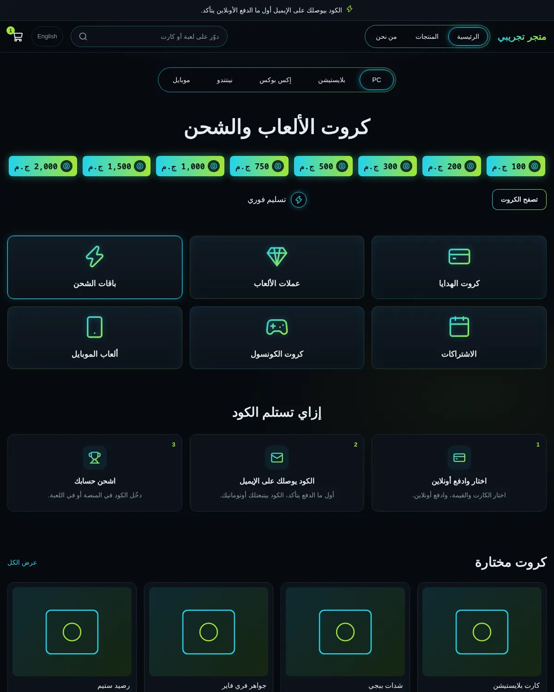
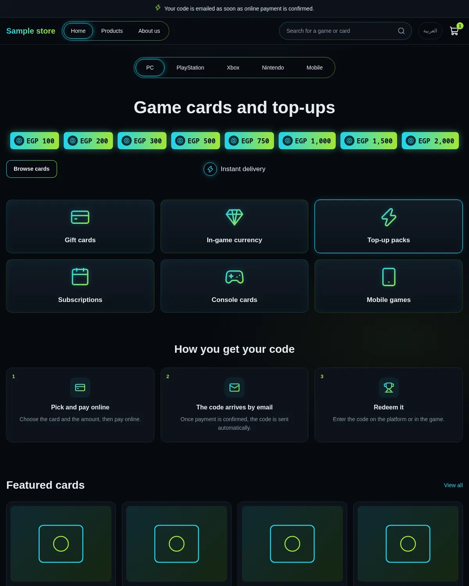
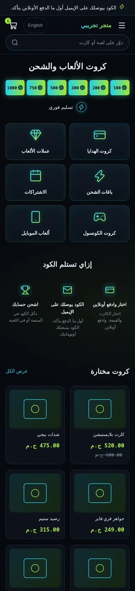
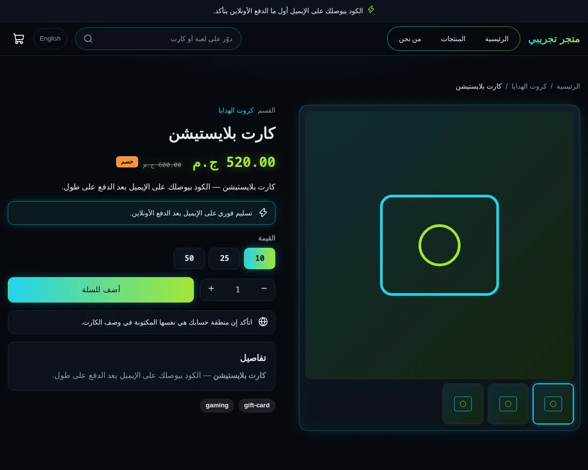
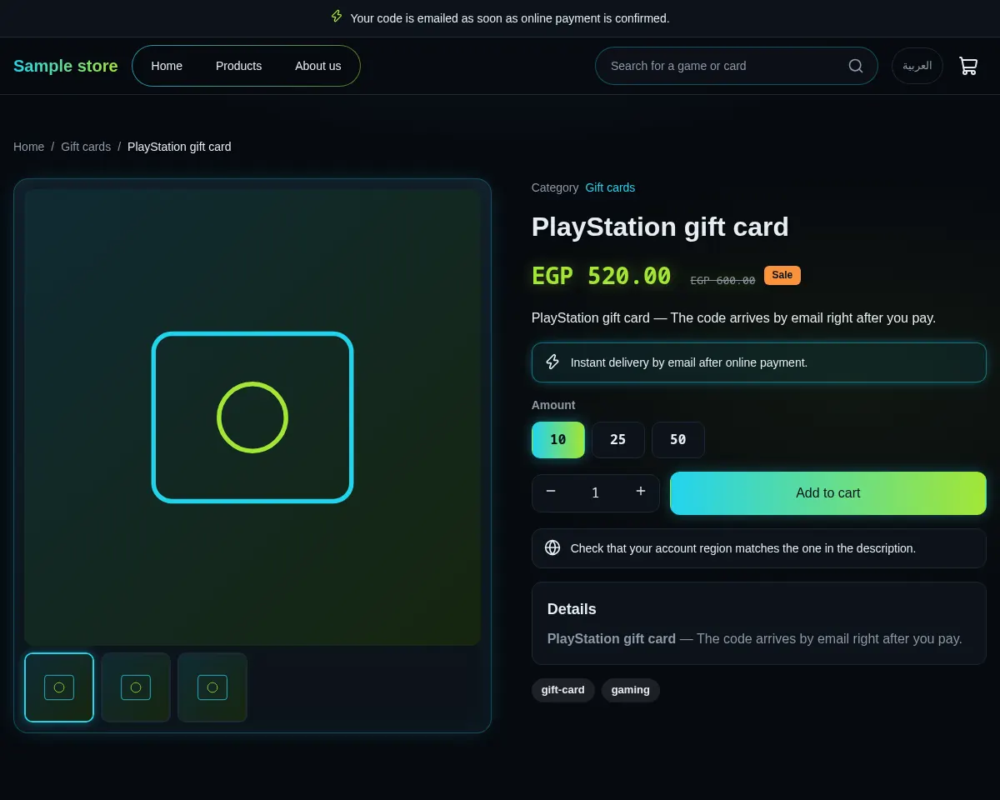
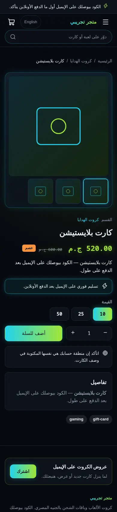
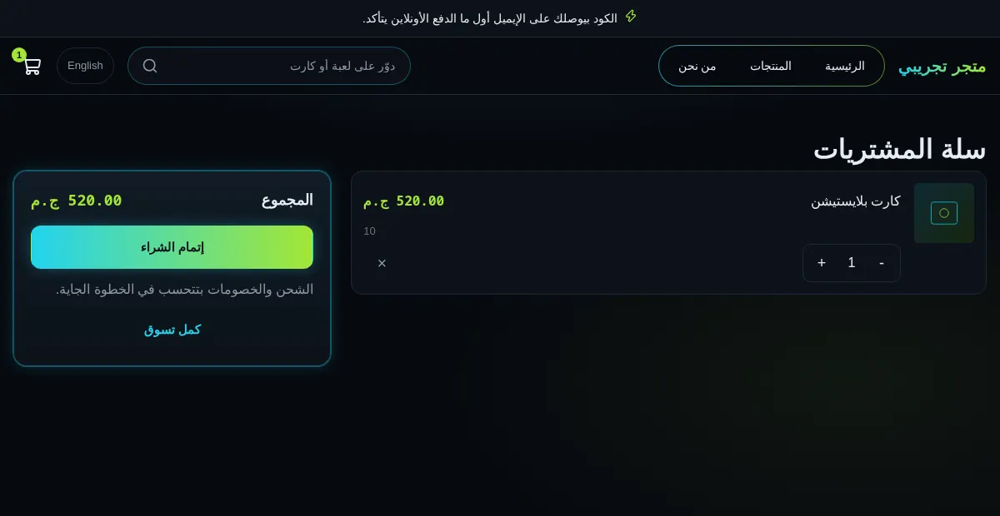
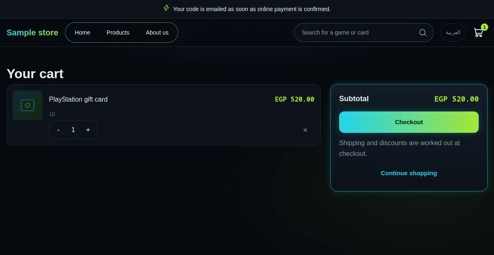
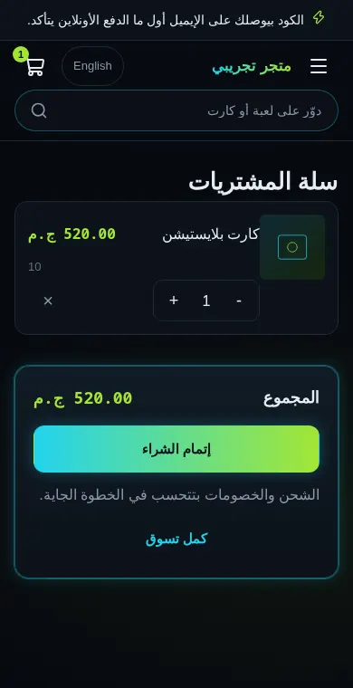

# Tutorial: Arcade, a complete neon gaming top-up store

Arcade is a full store theme for a shop that sells game gift cards, in-game
currency and top-up packs as codes. It is near-black with neon cyan and lime:
a pill menu with a glowing active tab, amount chips, category tiles, "how you
get your code" steps, glowing product cards and gradient buttons. It is
right-to-left in Arabic and left-to-right in English from the same files.

Since 2.0 it owns every page type: home, product (plus a `product.digital`
alternate for instant-delivery codes), collection, search, cart, 404 and
content pages, with an editable announcement bar, header and footer. The
Sneferu SDK default templates are only a fallback for page types a theme does
not write; this theme overrides all of them.

| Page | Arabic, desktop | English, desktop | Arabic, phone |
| - | - | - | - |
| Home |  |  |  |
| Product |  |  |  |
| Cart |  |  |  |

The design started from a mockup (`docs/mockup-desktop.webp`,
`docs/mockup-phone.webp`). Its placeholder Arabic and dollar prices were
replaced, and its cyan-to-magenta glow became cyan-to-lime. English phone
renders are in `docs/live-*-phone-en.webp`.

## What is in the folder

```
theme.json                 id, version 2.0.0, colour / font / radius / width tokens
layout/theme.snf           skip link, announcement, header, <main>, footer
groups/                    announcement.json, header.json, footer.json (default content)
templates/                 index, product, product.digital, collection, search, cart, 404, page
sections/
  arcade-announcement      one-line bar: text, link, colour scheme
  arcade-header            logo (image or text), menu, search, language, cart + drawer
  arcade-footer            newsletter box, about text, link columns, contact, social, payments
  arcade-hero, -categories, -steps, -products, -faq     the home page
  product-main, related-products, collection-main, search-main, cart-main, not-found, page-main
blocks/                    menu-link, menu-sub-link, footer-column, footer-link, social-link,
                           payment-method, contact-line, tab, chip, tile, step, faq-item,
                           product-title / -price / -excerpt / -variants / -buy / -text /
                           -description / -tags / -category
snippets/                  glyph (icons the set lacks), product-card, price, button
locales/                   ar.json and en.json (same keys)
assets/theme.css           the whole design, written with the tokens
```

## Customise it

**Tokens.** `theme.json` declares the colours (`primary` cyan, `accent` lime,
`background`, `surface`, `surface-2`, `line`, `muted`, `text`, `on-primary`,
`on-accent`, `on-sale`), the fonts (Rubik for text, JetBrains Mono for prices and
amounts), the corner radius and the content width. The CSS reads only
`var(--hk-color-<token>)` and `color-mix()` of them, so changing a token in the
editor restyles every page, glows included. There are no colour literals in
the CSS or templates.

**Sections and blocks.** Everything visible is a setting, a block or a locale
key. In the editor:

- Header: logo image or text, menu, colour scheme (`glass`, `dark`, `neon`),
  sticky, search, language switch, cart. Menu links are `menu-link` blocks (each
  can hold `menu-sub-link` blocks) and are used when the store has no menu of
  that name.
- Footer: columns (`footer-column` with `footer-link`), `contact-line`,
  `social-link`, `payment-method`, newsletter box, copyright text, colour scheme.
- Product page: reorder, add or remove the `product-*` blocks. `product-text`
  is a note with an icon and a `glow` or `muted` look; the `product.digital`
  template uses three of them as the redeem steps.
- Collection, search and related products: columns, card style (`tile`,
  `flat`, `glow`), image ratio, price and badge toggles.
- Home: tabs, amount chips, tiles, steps, FAQ and the featured collection.

**Locales.** Short UI strings (menu, "Sale", "Results for") live in
`locales/ar.json` and `locales/en.json`. Keep both files on the same keys.

## Run it

From a checkout of the SDK:

```
node packages/sneferu/dist/cli.js dev examples/themes/arcade --port 4301
node packages/sneferu/dist/cli.js format examples/themes/arcade
node packages/sneferu/dist/cli.js validate examples/themes/arcade
node packages/sneferu/dist/cli.js build examples/themes/arcade
node packages/sneferu/dist/cli.js push examples/themes/arcade
```

Open `http://127.0.0.1:4301/`, add `?locale=en` for English, and
`?template=product.digital` on a product to preview the alternate.
`push` needs an API key (guide 09). Use the `sneferu` binary instead of the
`node .../cli.js` path if you installed the package.

## Migrating from 1.x to 2.0

Nothing was renamed in the home sections, so saved home content keeps working
and no migration file is needed. New in 2.0: the announcement group and
section, header settings (logo, scheme, sticky, search, language, cart),
footer content (about text, columns, contact, social, payments, newsletter),
the product / collection / search / cart / 404 / page templates, the
`product.digital` alternate and new tokens (`surface-2`, `on-primary`,
`on-accent`, `on-sale`, a mono font). Stores that had used the SDK default
pages will now see Arcade's design on them. The header `menu` and footer
`menu` settings keep their defaults (`main`, `footer`).

There is no JavaScript in the theme beyond the SDK controllers (cart, variant
picker, quantity, gallery). Disclosure (menu on phones, FAQ, filters) uses
`<details>`. All prices are in Egyptian pounds and formatted by the runtime.
