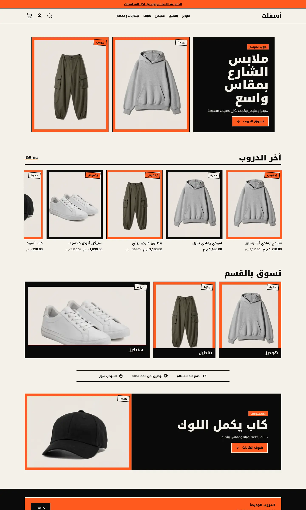
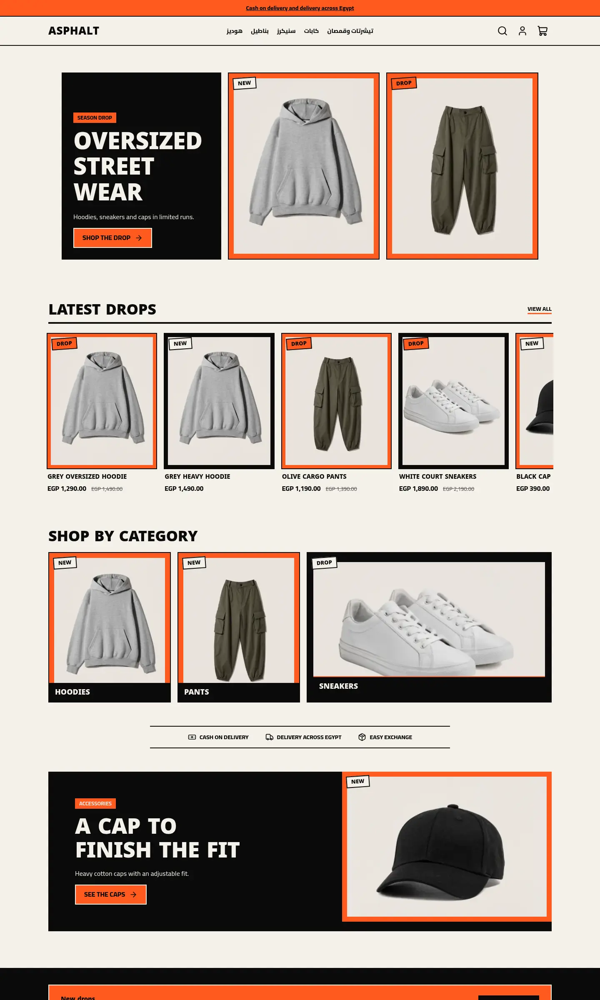
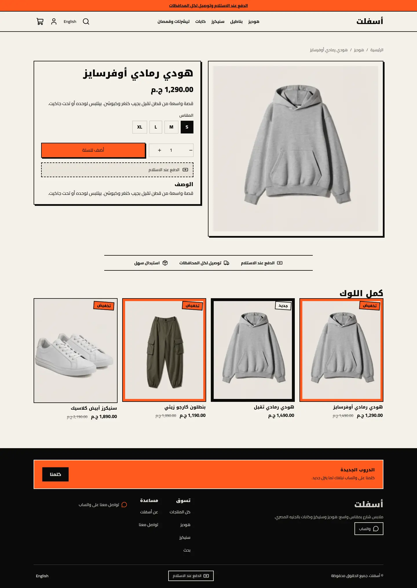
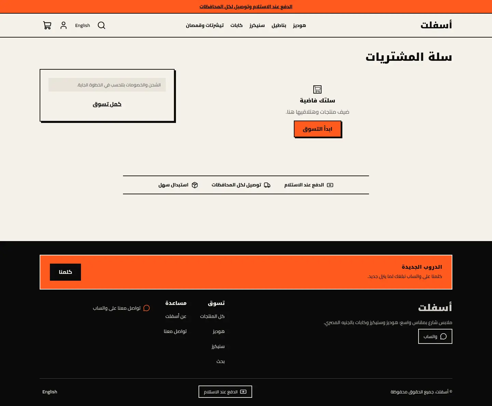
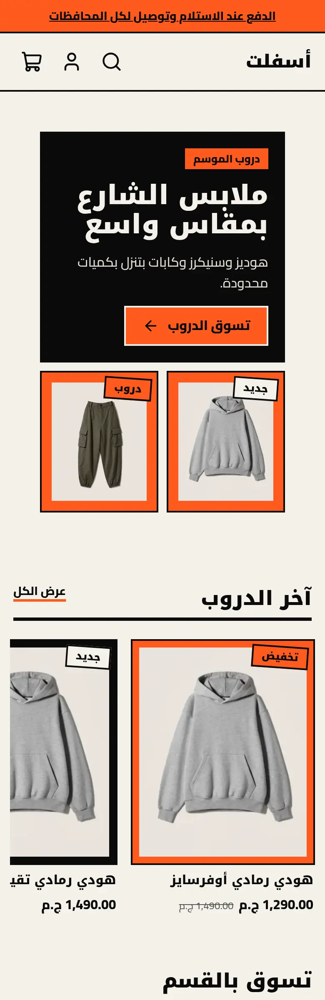
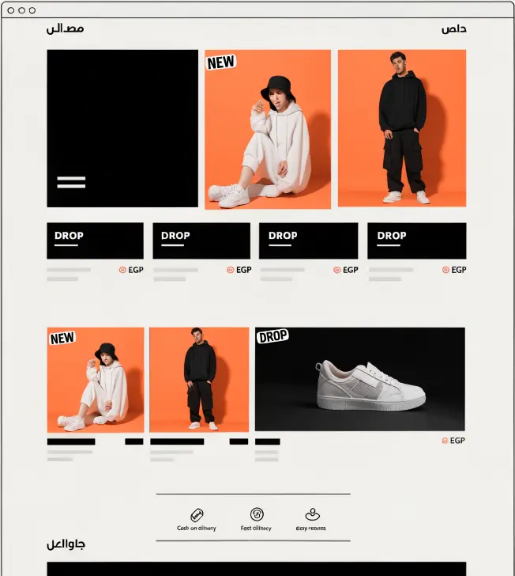
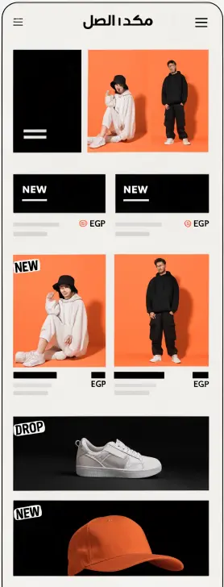

# Asphalt

A bold streetwear store theme for Sneferu: off-white ground, big black blocks, one signal-orange accent, sticker tags, a horizontal new-drop rail and size chips on cards. All seven page types, Arabic first with English.

| Home (ar) | Home (en) | Product (ar) | Cart (ar) | Home (phone, ar) |
| - | - | - | - | - |
|  |  |  |  |  |

Mockup:  

## What is in the folder

- `theme.json`: tokens (off-white, black, `#FF5A1F` accent), fonts, whole-pound money.
- `layout/theme.snf` and `groups/`: announcement, header, footer.
- `sections/`: `drop-hero`, `drop-rail`, `drop-mosaic`, `trust-strip`, `black-banner`, plus header, footer, product, collection, search, cart, page and 404 sections.
- `blocks/tile.snf`: one mosaic tile (image, sticker, label, link, background).
- `snippets/product-card.snf`: the card with a NEW / sale sticker and size chips.
- `assets/theme.css`: square corners, hard shadows, flat black and orange grounds.

## Notes

- Orange and black "grounds" are padded frames around the product photo (`as-ground-*`), chosen per tile in the editor.
- Size chips render only when the card's product carries options.
