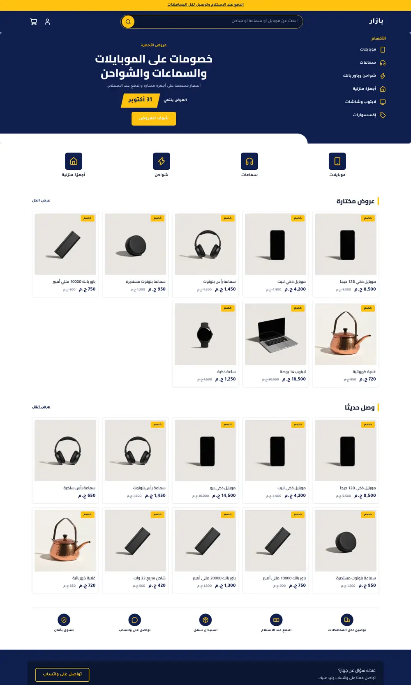
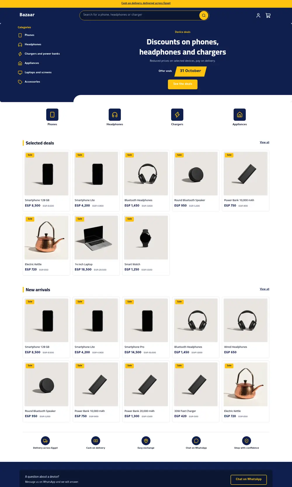
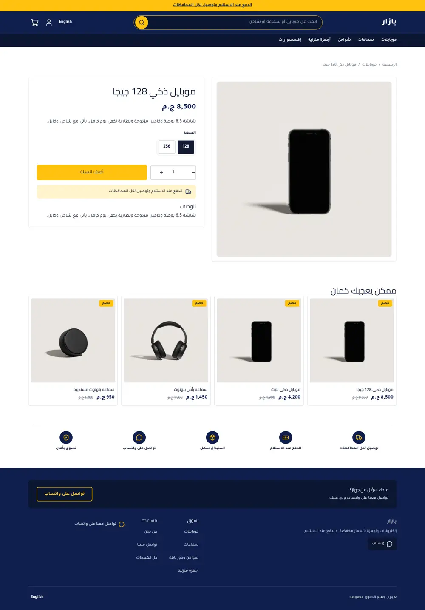

# Tutorial: Bazaar, a dense electronics deals marketplace

Bazaar is a full store theme for a shop selling phones, headphones, chargers and
appliances. It is built around density: a deep navy header with a wide search bar, a
navy category panel with icons, an editable offer banner, a row of category tiles and a
five-column grid of flat product cards with sale badges. One bright yellow accent on navy
and white.

| Home (ar) | Home (en) | Product (ar) | Cart (ar) | Home phone (ar) |
| - | - | - | - | - |
|  |  |  |  |  |

The mockup it follows: `docs/mockup-desktop.webp`, `docs/mockup-phone.webp`.

## What is in the folder

```
theme.json                  tokens (navy, yellow), fonts (Cairo, Tajawal), money: whole
layout/theme.snf            skip link, announcement, header, content, footer
groups/                     header, footer, announcement
sections/deals-hero         category panel (side-link blocks) + offer banner
sections/category-tiles     icon tiles (tile blocks)
sections/deals-grid         product grid from any collection
sections/trust-strip        icon strip (trust blocks)
sections/*-main             product, collection, search, cart, page, 404
snippets/product-card       card: image, sale badge, title, option chips, price
```

## The offer banner

There is no theme JavaScript, so a live countdown is not possible. The banner shows an
editable "offer ends" label and a date text in a yellow slab, both settings of
`deals-hero`; clear the date to hide it.

```
<strong class="bz-ends-date">{{ section.settings.ends_date }}</strong>
```

## Sale badge

Sneferu has no arithmetic filters, so the badge says "Sale" (a locale key) rather than a
percentage; `hk-price` still shows the struck-through compare-at price.
