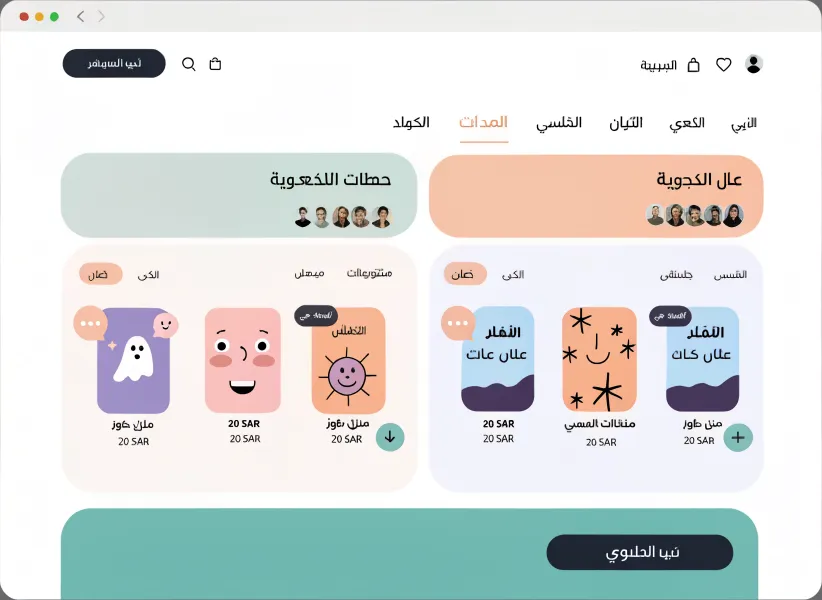
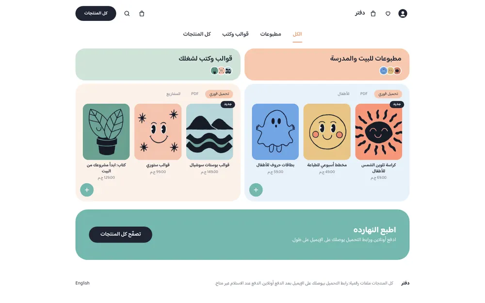
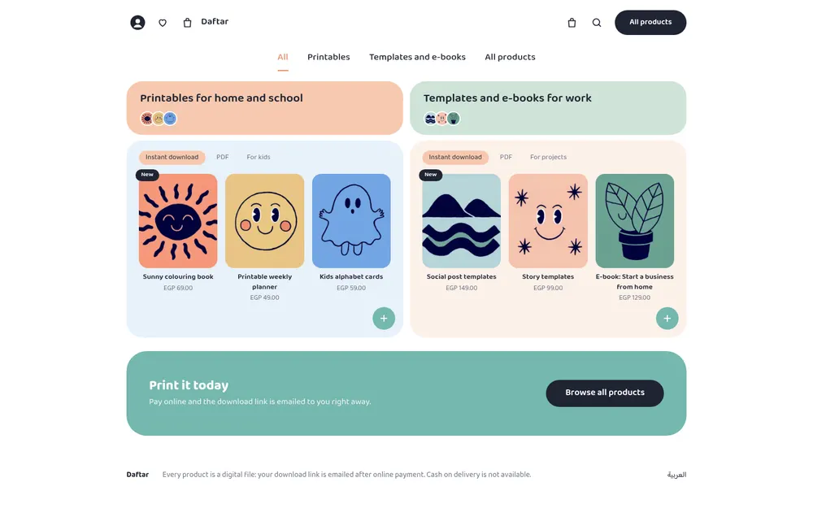
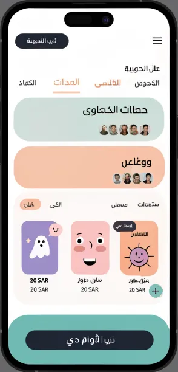
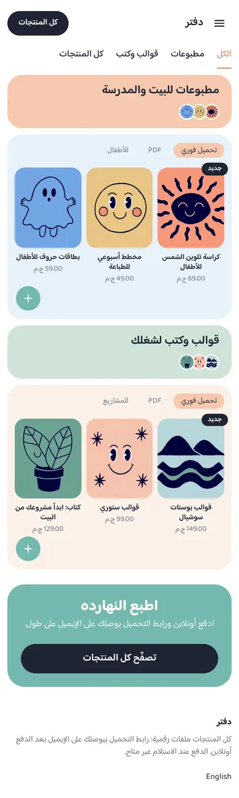
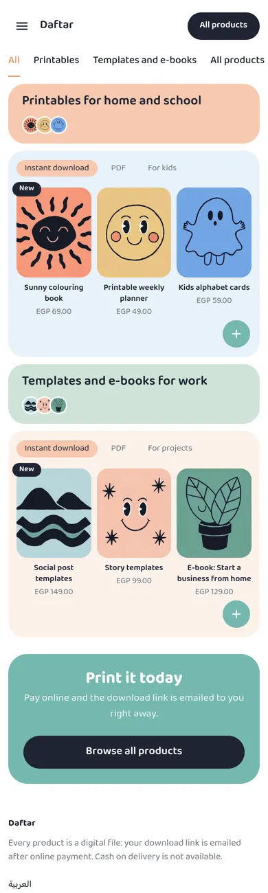

# Tutorial: Bento, a pastel bento-grid store

Bento is a home page for a shop that sells printables, templates and e-books
as digital files. Rounded pastel tiles hold two "shelves", one per product
category; each shelf has a header tile with a row of round product thumbnails,
and a panel with three product covers. A teal band closes the page. It is
right-to-left in Arabic and left-to-right in English from the same files.

| Mockup | Live, Arabic | Live, English |
| - | - | - |
|  |  |  |
|  |  |  |

The mockup was generated as a design brief; its Arabic is placeholder text,
and its lavender and pink tiles were replaced with sky blue and peach. Live:
[demo-bento.hekana.com](https://demo-bento.hekana.com) and
[/en](https://demo-bento.hekana.com/en).

What the theme uses: plain HTML for structure, `hk-product-card` for every
product (with the "New" label in its `badge` part), `hk-button` for the band's
button, `hk-icon`, shelf blocks that each read their own `collection` setting,
localized settings, `data-*` attributes for colour, and one stylesheet.
Version 1.2.0 is built on Sneferu 0.4.

## Upgrading from 1.0

In 1.1.0 the numbered settings and locale-text fallbacks became blocks and
localized settings; values saved under 1.0 are not carried over, so the sections
start from the new defaults.

## Pages

Bento writes only the home page (`templates/index.snf`). The product,
collection, search, cart, content page and 404 templates come from the SDK's
default store ([page types](../../../docs/guide/16-page-types.mdx)), drawn with
Bento's tokens, fonts and layout. `assets/theme.css` restyles what the default
store would otherwise draw in its own way (the block "Cart, product, collection,
search and 404 pages"):

- product cards on collection and search pages are pastel tiles like the home
  shelves (sand, sky, sage, peach in turn), with rounded corners;
- buttons, chips and the search field are pills; text links use the ink colour
  (peach text on white is 2.3:1);
- text on the peach accent is dark: the runtime picks the text colour with the
  higher contrast (Sneferu 0.4.x), so white-on-peach (2.3:1) no longer happens;
- the muted grey is a little darker (`#5F6474`) and the teal band's text is ink, for 4.5:1;
- on phones the header keeps a cart icon; icons, the logo and the tabs are 44 px.

The header group holds the cart drawer: it opens when an item is added (a
setting of the header section) and from the cart icon.

| Page | URL in `sneferu dev` |
| - | - |
| Product | `/products/sample-2` |
| Collection | `/category/gift-cards`, `/products` |
| Search | `/search?q=card` |
| Cart | `/cart` |
| Content page | `/pages/about` |
| 404 | any other path |

## Files

```
assets/theme.css
blocks/shelf.snf
blocks/tab.snf
groups/footer.json
groups/header.json
layout/theme.snf
locales/ar.json
locales/en.json
sections/band.snf
sections/bento-footer.snf
sections/bento-header.snf
sections/bento.snf
sections/tabs.snf
snippets/glyph.snf
templates/index.snf
theme.json
```

Next to the theme: `README.md` and `docs/` (this tutorial and its pictures),
and `.sneferu-dev/data.json` (sample data for `dev`). The CLI skips all three:
they are never checked and never pushed.

## Data it needs

Two product categories, each with at least three products that have an image.
These handles are the defaults of the two shelves' `collection` settings; the
merchant can pick other categories in the editor:

| Handle | Used by |
| - | - |
| `printables` | the first shelf |
| `templates` | the second shelf |

Prices are in piastres in the data and printed by `hk-price`, for example
`EGP 69.00` in English and `69.00 ج.م` in Arabic.

## 1. Manifest and tokens

```json title="theme.json"
{
  "id": "bento",
  "name": "Bento",
  "version": "1.2.0",
  "author": "Hekana",
  "description": "A soft pastel bento-grid theme for printables, templates and e-books",
  "category": "digital",
  "engine": "hk2",
  "engineCompatibility": "^2.0.0",
  "defaultLocale": "ar",
  "locales": ["ar", "en"],
  "settings": {},
  "tokens": {
    "colors": {
      "primary": "#1F2433",
      "secondary": "#74B8AE",
      "accent": "#E9946C",
      "background": "#FFFFFF",
      "text": "#1F2433",
      "muted": "#5F6474",
      "sage": "#CFE3D7",
      "peach": "#F7C9AF",
      "warm": "#FCF1EA",
      "sky": "#E8F1FA",
      "teal": "#74B8AE",
      "line": "#E8E6E1"
    },
    "layout": { "contentWidth": "1040px" },
    "fonts": {
      "heading": "Baloo Bhaijaan 2",
      "body": "Baloo Bhaijaan 2"
    }
  }
}
```

- `defaultLocale` is `ar` and `locales` lists both languages, so `/` renders
  Arabic (right to left) and `/en` English.
- Every colour the stylesheet uses is a token. Besides the five required keys
  there are named pastels (`sage`, `peach`, `warm`, `sky`, `teal`); each becomes
  a CSS variable such as `--hk-color-peach`.
- `contentWidth` sets `--hk-content-width`, which `.bt-wrap` uses as its
  maximum width.

## 2. Layout: header and footer

```html title="layout/theme.snf"
<div class="bt">
  <hk-section-group name="header" />
  <main><hk-slot name="content" /></main>
  <hk-section-group name="footer" />
</div>
```

The header and the footer are [section groups](../../../docs/guide/18-section-groups.mdx): the layout places
`<hk-section-group name="header" />` and `<hk-section-group name="footer" />`, `groups/header.json` and
`groups/footer.json` start them with `bento-header` and `bento-footer`, and the merchant edits them once for the
whole store. The header also holds the cart: the cart link carries `data-hk-open="cart-drawer"` and
`<hk-cart-count />`, and `<hk-cart-drawer>` lists the lines (a plain link to the cart page without JavaScript).

```html title="sections/bento-header.snf"
<header class="bt-header">
  <div class="bt-wrap bt-header-row">
    <div class="bt-start">
      <a
        class="bt-icon bt-user"
        href="{{ url('/account') }}"
        aria-label="{{ t('account') }}"
      ></a>
      <a class="bt-icon bt-hide-phone" href="{{ url('/wishlist') }}" aria-label="{{ t('wishlist') }}"><hk-icon
          name="heart"
        /></a>
      <a class="bt-logo" href="{{ store.url }}">{{ store.name }}</a>
    </div>
    <div class="bt-end">
      <a
        class="bt-icon bt-hide-phone"
        href="{{ url('/cart') }}"
        data-hk-open="cart-drawer"
        aria-label="{{ t('cart') }}"
      ><hk-icon name="shopping-bag" /><hk-cart-count /></a>
      <a class="bt-icon bt-hide-phone" href="{{ url('/search') }}" aria-label="{{ t('search') }}"><hk-icon
          name="search"
        /></a>
      <a class="bt-pill" href="{{ url('/products') }}">{{ t('all_products') }}</a>
      <details class="bt-menu">
        <summary class="bt-icon" aria-label="{{ t('menu') }}"><hk-icon name="menu" size="22" /></summary>
        <div class="bt-menu-panel">
          <a href="{{ url('/search') }}">{{ t('search') }}</a>
          <a href="{{ url('/cart') }}" data-hk-open="cart-drawer">{{ t('cart') }}</a>
          <a href="{{ url('/wishlist') }}">{{ t('wishlist') }}</a>
          <hk-locale-switch />
        </div>
      </details>
    </div>
  </div>
  <hk-cart-drawer open-on-add="{{ section.settings.drawer_on_add }}">
    <hk-cart-items />
    <hk-cart-summary />
  </hk-cart-drawer>
</header>
<hk-schema>
  {
    "name": "Header",
    "version": 1,
    "templates": ["header"],
    "settings": {
      "drawer_on_add": {
        "type": "boolean",
        "label": "Open the cart when an item is added",
        "default": true
      }
    }
  }
</hk-schema>
```


- `<hk-slot name="content" />` is where the template's sections go.
- `{{ store.name }}` and `{{ store.url }}` come from the store. Every other
  word is `t('…')`, read from `locales/ar.json` or `locales/en.json`.
- Links go through `url()`: `href="{{ url('/cart') }}"` is `/cart` in Arabic
  and `/en/cart` in English. The language switch is `<hk-locale-switch />`, which links to the
  same page in the other language.
- The phone menu is a `<details>` element: it opens and closes without script
  (themes cannot run JavaScript).
- Icons are `<hk-icon>` from the bundled Lucide set (`heart`,
  `shopping-bag`, `search`, `menu`, `plus`). The filled avatar has no match in
  the set, so it stays inline SVG in one snippet:

```html title="snippets/glyph.snf"

  <svg width="26" height="26" viewBox="0 0 26 26" aria-hidden="true"><circle
      cx="13"
      cy="13"
      r="13"
      fill="currentColor"
    /><circle cx="13" cy="10.5" r="4" fill="#FFFFFF" /><path
      d="M5.5 21.5c1.4-3.3 4.3-5 7.5-5s6.1 1.7 7.5 5"
      fill="#FFFFFF"
    /></svg>

```

## 3. The template

```html title="templates/index.snf (excerpt)"
<hk-sections />
<hk-schema>
  {
    "sections": [
      {
        "type": "tabs",
        "blocks": [
          {"type": "tab", "settings": {"label": {"ar": "الكل", "en": "All"}, "link": "#shop", "current": true}},
          … 3 more
        ]
      },
      {
        "type": "bento",
        "blocks": [
          {"type": "shelf", "settings": {"list": "printables", "title": {"ar": "مطبوعات للبيت والمدرسة", "en": "Printables for home and school"}, "note": {"ar": "للأطفال", "en": "For kids"}, "link": "/category/printables", "count": 3, "head": "peach", "panel": "sky"}},
          … 1 more
        ]
      },
      { "type": "band" }
    ]
  }
</hk-schema>
```

The home page is three sections, in this order, with their default blocks:
four tabs and two shelves. The excerpt shows the first block of each; the file
has all of them. A merchant can reorder the sections, edit the blocks or add
more in the builder.

## 4. Category tabs

```html title="sections/tabs.snf"
<nav class="bt-tabs" aria-label="{{ t('tabs_label') }}">
  <div class="bt-wrap bt-tabs-row">
    
      <hk-block of="{{ block }}" />
    
  </div>
</nav>
<hk-schema>
  {
    "name": "Category tabs",
    "version": 1,
    "settings": {},
    "blocks": {
      "allowed": ["tab"],
      "max": 8
    }
  }
</hk-schema>
```

```html title="blocks/tab.snf"
<a href="{{ url(block.settings.link) }}" aria-current="{{ block.settings.current }}">{{ block.settings.label }}</a>
<hk-schema>
  {
    "name": "Tab",
    "version": 1,
    "settings": {
      "label": {
        "type": "text",
        "label": "Label",
        "localized": true,
        "default": {
          "ar": "الكل",
          "en": "All"
        },
        "maxLength": 30
      },
      "link": {
        "type": "link",
        "label": "Link (a page, or #<collection handle> for a shelf on this page)",
        "default": "#shop"
      },
      "current": {
        "type": "boolean",
        "label": "Underlined as the current tab",
        "default": false
      }
    }
  }
</hk-schema>
```

A row of `tab` blocks: a localized label, a link and a `current` switch. The
switch prints `aria-current="true"` or `"false"`, and the stylesheet gives the
current one the accent colour and underline. The two category tabs jump to
the shelves below (`#printables`, `#templates`), the last opens the store's
product list.

## 5. The bento shelves

The section renders its `shelf` blocks; the template seeds two, each with its
own collection and pair of colours:

```html title="sections/bento.snf"
<section class="bt-bento" id="shop">
  <div class="bt-wrap bt-bento-grid">
    
      <hk-block of="{{ block }}" />
    
  </div>
</section>
<hk-schema>
  {
    "name": "Bento shelves",
    "version": 1,
    "settings": {},
    "blocks": {
      "allowed": ["shelf"],
      "max": 4
    }
  }
</hk-schema>
```

`collection(block.settings.list)` returns the category the merchant picked for
that shelf (`printables` and `templates` by default), or an empty list when none
is picked.

```html title="blocks/shelf.snf"
<div class="bt-shelf" id="{{ block.settings.list }}">
  <a class="bt-head" data-tone="{{ block.settings.head }}" href="{{ url(block.settings.link) }}">
    <h2>{{ block.settings.title }}</h2>
    <span class="bt-thumbs" aria-hidden="true">
      
        
      
    </span>
  </a>
  <div class="bt-panel" data-tone="{{ block.settings.panel }}">
    <div class="bt-chips">
      <span class="bt-chip bt-chip-on">{{ t('chip_instant') }}</span>
      <span class="bt-chip">{{ t('chip_pdf') }}</span>
      <span class="bt-chip">{{ block.settings.note }}</span>
    </div>
    
      <div class="bt-covers">
        
          <div class="bt-cover">
            <hk-product-card product="{{ p }}" class="bt-card">
              <hk-part name="badge"><span class="bt-new">{{ t('badge_new') }}</span></hk-part>
            </hk-product-card>
          </div>
        
      </div>
    
      <p class="bt-empty">{{ t('empty') }}</p>
    
    <a
      class="bt-more"
      href="{{ url(block.settings.link) }}"
      aria-label="{{ t('see_all') }}: {{ block.settings.title }}"
    ><hk-icon name="plus" size="18" stroke="2.5" /></a>
  </div>
</div>
<hk-schema>
  {
    "name": "Shelf",
    "version": 1,
    "settings": {
      "list": {
        "type": "collection",
        "label": "Collection",
        "default": "printables"
      },
      "title": {
        "type": "text",
        "label": "Title",
        "localized": true,
        "default": {
          "ar": "مطبوعات للبيت والمدرسة",
          "en": "Printables for home and school"
        },
        "maxLength": 60
      },
      "note": {
        "type": "text",
        "label": "Third chip",
        "localized": true,
        "default": {
          "ar": "للأطفال",
          "en": "For kids"
        },
        "maxLength": 30
      },
      "link": {
        "type": "link",
        "label": "Link of the title and the + button",
        "default": "/category/printables"
      },
      "count": {
        "type": "range",
        "label": "Covers",
        "default": 3,
        "min": 1,
        "max": 6,
        "step": 1
      },
      "head": {
        "type": "select",
        "label": "Title colour",
        "options": ["peach", "sage", "sky", "warm"],
        "default": "peach"
      },
      "panel": {
        "type": "select",
        "label": "Panel colour",
        "options": ["peach", "sage", "sky", "warm"],
        "default": "sky"
      }
    }
  }
</hk-schema>
```

How it works:

- `data-tone="{{ block.settings.head }}"` writes `peach`, `sage`, `sky` or `warm`, and one CSS
  rule per tone sets the background. Dynamic `style="…"` is not allowed in
  templates; `data-*` plus CSS is the way to vary a colour per item.
- The thumbnail loop (`limit: 5`) draws up to five round thumbnails from
  `p.image.url`; the covers loop takes `limit: block.settings.count`, a `range`
  setting (default 3).
- `` is false for an empty collection, so an empty category
  shows a line of text instead of an empty panel.
- `<hk-product-card product="{{ p }}" class="bt-card" />` renders a link with
  the image, `.sn-title` and the price. The extra class is how the stylesheet
  reaches it.
- `` puts the "New" badge on the first cover only. The
  badge is the card's `badge` part, so it renders inside the card's link,
  before the image, and CSS positions it over the corner.
- The shelf's `id` is the collection handle, so the tabs' `#printables` and
  `#templates` links scroll to it.

The CSS for the grid, the tiles and the covers:

```css title="assets/theme.css (excerpt)"
/* Bento shelves: a header tile over a panel, two side by side */
.bt-bento { padding-block: 0 24px; }
.bt-bento-grid { display: grid; grid-template-columns: 1fr 1fr; gap: 12px; }
.bt-shelf { display: flex; flex-direction: column; gap: 10px; }
.bt-head {
  display: flex; flex-direction: column; align-items: flex-start; gap: 8px; padding: 18px 24px 16px;
  border-radius: 28px; min-height: 84px;
}
.bt-head h2 { margin: 0; font-size: 21px; font-weight: 600; line-height: 1.3; }
.bt-thumbs { display: flex; }
.bt-thumbs img { width: 26px; height: 26px; border-radius: 50%; object-fit: cover; border: 2px solid #FFFFFF; margin-inline-end: -6px; }
.bt-panel { position: relative; padding: 18px 22px 60px; border-radius: 28px; }
.bt-chips { display: flex; gap: 8px; flex-wrap: wrap; margin-bottom: 16px; }
.bt-chip { font-size: 12.5px; padding: 3px 12px; border-radius: 999px; color: var(--hk-color-muted); }
.bt-chip-on { background: var(--hk-color-peach); color: var(--hk-color-text); }
.bt-covers { display: grid; grid-template-columns: repeat(3, 1fr); gap: 14px; }
.bt-cover { position: relative; }
.bt-card { display: flex; flex-direction: column; align-items: center; text-align: center; gap: 2px; }
.bt-card img { width: 100%; aspect-ratio: 5 / 6; object-fit: cover; border-radius: 16px; display: block; margin-bottom: 6px; }
.bt-card .sn-title { font-size: 13px; font-weight: 600; line-height: 1.35; }
.bt-card .sn-price { font-size: 12px; color: var(--hk-color-muted); }
.bt-card:hover img { transform: translateY(-2px); }
.bt-card img { transition: transform .15s ease; }
.bt-new {
  position: absolute; top: -8px; inset-inline-start: -6px; padding: 2px 10px; border-radius: 999px;
  background: var(--hk-color-primary); color: #FFFFFF; font-size: 11px; font-weight: 600;
}
.bt-more {
  position: absolute; bottom: 14px; inset-inline-end: 14px; width: 44px; height: 44px; border-radius: 50%;
  display: grid; place-items: center; background: var(--hk-color-teal); color: #FFFFFF !important;
}
.bt-more:hover { filter: brightness(.95); }
```

## 6. The teal band

```html title="sections/band.snf"
<section class="bt-band-wrap">
  <div class="bt-wrap">
    <div class="bt-band">
      <div>
        <h2>{{ section.settings.heading }}</h2>
        <p>{{ section.settings.text }}</p>
      </div>
      <hk-button label="{{ section.settings.button }}" href="{{ section.settings.link }}" class="bt-band-button" />
    </div>
  </div>
</section>
<hk-schema>
  {
    "name": "Call to action band",
    "version": 1,
    "settings": {
      "heading": {
        "type": "text",
        "label": "Heading",
        "localized": true,
        "default": {
          "ar": "اطبع النهارده",
          "en": "Print it today"
        },
        "maxLength": 80
      },
      "text": {
        "type": "textarea",
        "label": "Text",
        "localized": true,
        "default": {
          "ar": "ادفع أونلاين ورابط التحميل يوصلك على الإيميل على طول.",
          "en": "Pay online and the download link is emailed to you right away."
        },
        "maxLength": 200
      },
      "button": {
        "type": "text",
        "label": "Button",
        "localized": true,
        "default": {
          "ar": "تصفّح كل المنتجات",
          "en": "Browse all products"
        },
        "maxLength": 30
      },
      "link": {
        "type": "link",
        "label": "Button link",
        "default": "/products"
      }
    }
  }
</hk-schema>
```

The text settings are `"localized": true`, with an Arabic and an English
default, and the template prints `{{ section.settings.heading }}`: the value
for the page's language. The button link is a `link` setting that `hk-button`
keeps in the page's language.

`hk-button` renders `<a class="sn-btn sn-btn-solid">`. It brings no visual
style of its own, so the theme styles it through its class:

```css title="assets/theme.css (excerpt)"
.bt-band-button.sn-btn {
  display: inline-flex; align-items: center; justify-content: center; min-height: 48px; padding-inline: 34px; border-radius: 999px;
  background: var(--hk-color-primary); color: #FFFFFF; border: 0; font-size: 16px; font-weight: 600;
```

## 7. Phones

One media query at 639 px (the same width the `mobile-` props use) stacks the
shelves and rearranges the header. `display: contents` dissolves the two header
groups so `order` can put the menu first and the "All products" pill last:

```css title="assets/theme.css (excerpt)"
@media (max-width: 639px) {
  .bt-wrap { padding-inline: 12px; }
  .bt-hide-phone { display: none; }
  .bt-menu { display: block; }
  .bt-header-row { justify-content: flex-start; gap: 6px; }
  .bt-start, .bt-end { display: contents; }
  .bt-menu { order: -1; }
  .bt-logo { margin: 0; }
  .bt-pill { margin-inline: auto 0; min-height: 44px; padding-inline: 18px; font-size: 13px; }
```

## 8. Words

All interface text is in the two locale files, with the same keys:

```json title="locales/en.json"
{
  "menu": "Menu",
  "account": "My account",
  "wishlist": "Wishlist",
  "cart": "Cart",
  "search": "Search",
  "all_products": "All products",
  "tabs_label": "Categories",
  "chip_instant": "Instant download",
  "chip_pdf": "PDF",
  "badge_new": "New",
  "see_all": "See all",
  "empty": "No products here yet.",
  "footer_note": "Every product is a digital file: your download link is emailed after online payment. Cash on delivery is not available."
}
```

The Arabic file has the same keys in Egyptian Arabic. Prices and dates are
printed with Western digits in both languages.

```json title=".sneferu-dev/data.json (excerpt)"
{
 "ar": {
  "store": {
   "name": "دفتر"
  },
  "collections": {
   "printables": {
    "title": "مطبوعات",
    "products": [
```

That is the start of `.sneferu-dev/data.json`, the sample data `sneferu dev`
uses for this theme (split by locale).
## Reproduce it

```bash
npx sneferu init bento          # start from the starter theme
cd bento
# replace the starter files with the ones above, then:
npx sneferu format              # indent .snf, theme.json and locales
npx sneferu validate            # must print: theme bento@1.1.0 is valid
npx sneferu dev                 # http://127.0.0.1:4100, add ?locale=en for English
```

`dev` reads `.sneferu-dev/data.json` (in this folder) as sample data, so the
preview shows this store's products and the collections the sections use
(`sneferu dev --data <file>` points at another file).

To put it on a store, sign in once and push to your dev store:

```bash
npx sneferu login
npx sneferu push . --package <your-slug> --dev-store
```

The `--package` slug must equal `id` in `theme.json`, so change both to a
slug of your own; `bento` here is the slug Hekana uses for its own copy. Bump
`version` in `theme.json` before every push: a pushed version cannot be
replaced. On a live store, either create product categories with the default
handles (see "Data it needs" above) or pick the categories in the editor. During this release only the home
page (`/`, and `/en`) is rendered by the theme; product, category and cart
pages use the store's regular theme.

## Notes and limits met on the way

Version 1.0 was built on Sneferu 0.2 and worked around five SDK gaps. Version
1.1.0 uses the Sneferu 0.3 features that close them:

- Fonts: `tokens.fonts` with a catalogue font replaces `assets/fonts.css`
  (`@font-face` rules pointing at Google Fonts).
- Collections: `collection` settings, with the old handles as defaults, replace
  the handles written into the templates.
- Words: `"localized": true` settings with Arabic and English defaults replace
  empty settings printed with `default: t('…')`.
- Lists: template default blocks replace the locale-key fallback shown while a
  section had no blocks.
- Links: `url('/products')` replaces link paths in the locale files.
- Icons: `hk-icon` replaces the inline SVG set (only the filled avatar stays).
- "New" label: the card's `badge` part replaces a label placed next to the card.

Still open:

- Bundled images are served from 0.3, but this theme still ships none (no new
  art was made for 1.1.0): art comes from products, inline SVG, or an `image`
  setting with an `https://` default.
- `url()` always links within the page's language; since 1.2.0 the language
  switch is `<hk-locale-switch />`, which keeps the page.
