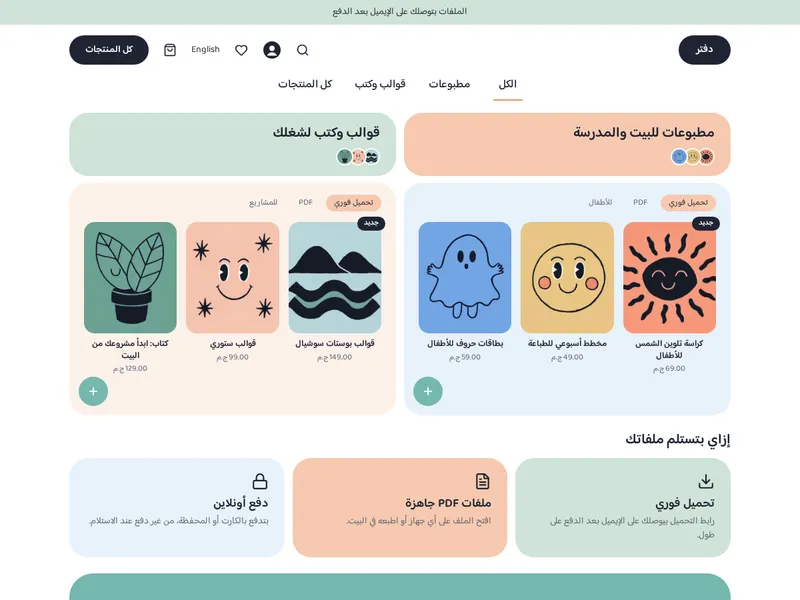
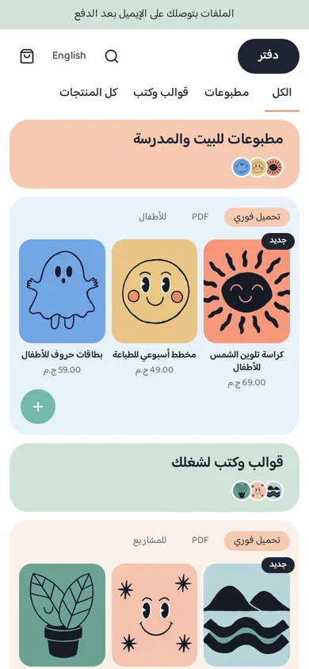

# Bento

A complete soft pastel store for printables, templates and e-books. Rounded tiles in peach, sage and sky, a teal call-to-action band, a navy pill for the main action. Every page type of the store has its own design in this theme: home, product (plus a digital alternate), collection, search, cart, checkout, 404 and content pages. The SDK's default templates are only a fallback for page types a theme does not write; Bento overrides all of them.

| Mockup | Built theme (home) |
| - | - |
|  |  |
|  |  |

More renders: [product](docs/live-product-desktop-ar.webp), [cart](docs/live-cart-desktop-ar.webp), [home in English](docs/live-home-desktop-en.webp), [product on a phone](docs/live-product-phone-ar.webp), [cart on a phone](docs/live-cart-phone-en.webp).

## What it builds

- Header: a navy logo pill (or a logo image), search, account, wishlist, language switch, cart icon with a live count, and a tab-style menu underneath. The menu comes from a menu setting; menu links added as blocks are the fallback.
- Announcement bar, and a footer with a link panel, social, contact and payment blocks, copyright text and an optional newsletter tile.
- Home: category tabs (optional section), bento shelves (title tile over a product panel), perk tiles, a teal band.
- Product: image tile and details tile with blocks (title, price, excerpt, variants, buy, notes, description, category, tags), then a related list. `product.digital` is an alternate for instant-download files.
- Collection (sort and filters), search, cart (lines and summary tiles), 404 and content page.

## Structure

```
theme.json            id, version 2.0.0, tokens (colours, fonts, radius, content width)
layout/theme.snf      announcement, header, <main>, footer groups
groups/               announcement.json, header.json, footer.json
templates/            index, product, product.digital, collection, search, cart, checkout, 404, page
sections/             bento-header, bento-footer, announcement-bar, bento, tabs, perks, band,
                      product-main, collection-main, related-products, search-main, cart-main,
                      not-found, page-main
blocks/               shelf, tab, perk, menu-link, menu-sub-link, footer-column, footer-link,
                      social-link, contact-line, payment-method, product-* blocks, chip
snippets/             product-card, price, button, glyph
locales/              ar.json, en.json (same keys)
assets/theme.css      all styling, colours only through var(--hk-color-*)
docs/                 screenshots
```

## Customize

- **Tokens** (`theme.json`): `primary` (navy), `accent`, `teal`, and the tile colours `peach`, `sage`, `sky`, `warm`, plus `line`, `on-primary`, `on-accent`. `radius.md` rounds buttons and fields; tiles use the `--bt-tile` variable in `assets/theme.css`. Fonts must come from the curated list. Keep to colours that are not purple or pink.
- **Sections and blocks**: every section has a tile colour setting (`peach`, `sage`, `sky`, `warm`) and padding or column settings. Shelves are blocks: pick a collection, a title, the number of covers and the two colours. Edit the default content in `templates/*.snf` and `groups/*.json`.
- **Text**: every visible word is a localized setting or a key in `locales/*.json`. Add a language by adding a locale file and listing it in `theme.json`.

## Run it

```bash
npx sneferu dev .          # http://127.0.0.1:4100 ; add ?locale=en, ?template=product.digital
npx sneferu format .       # normalise files
npx sneferu validate .
npx sneferu push .         # needs an API key (see the Sneferu guide)
```

`.sneferu-dev/data.json` holds the sample products and menus used by `dev`.

## Migrating from 1.x to 2.0

2.0 adds the missing page types and keeps every 1.x home setting name (`shelf`, `band`, `bento`, `tabs`), so no migration file is needed. Changes to know about: the header menu is now the tab row on every page (the home template no longer includes the `tabs` section, which still works if you add it), the footer says its note in the `about_text` setting, and the pastel colours are tokens instead of fixed values.
