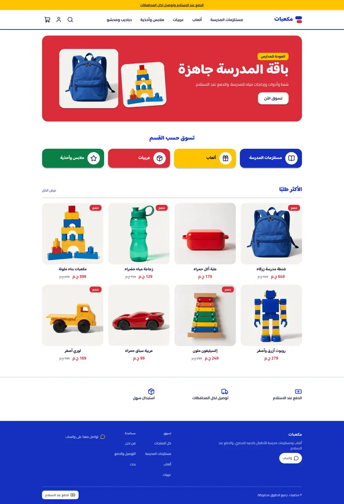
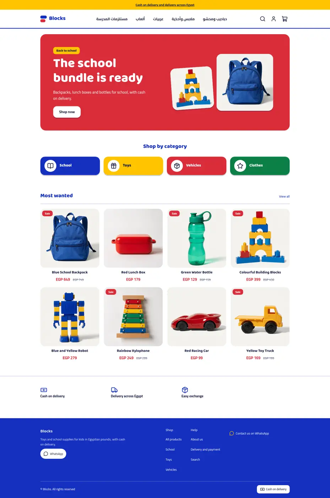
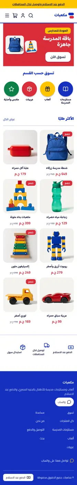
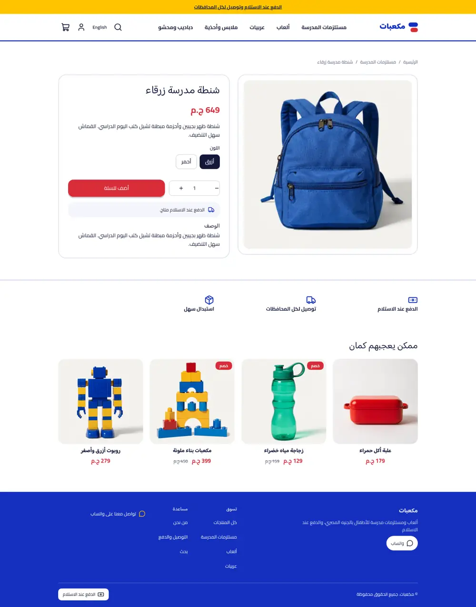
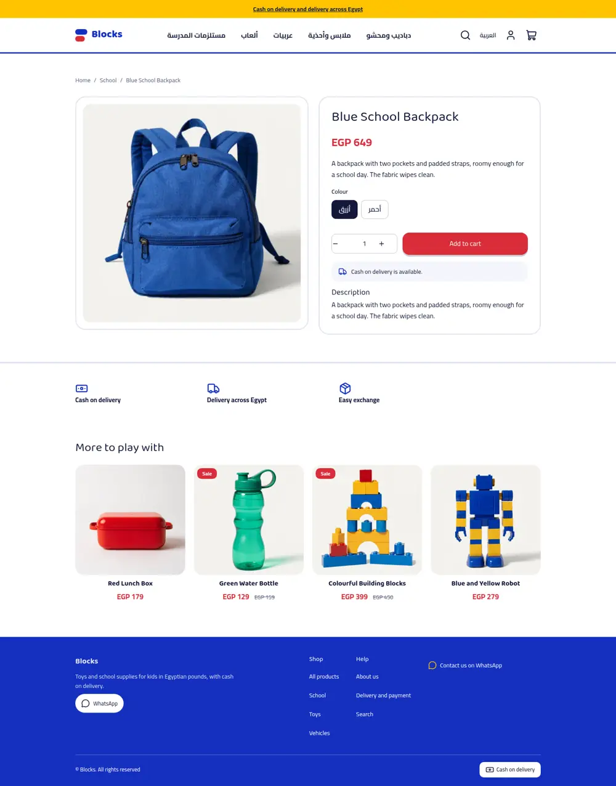
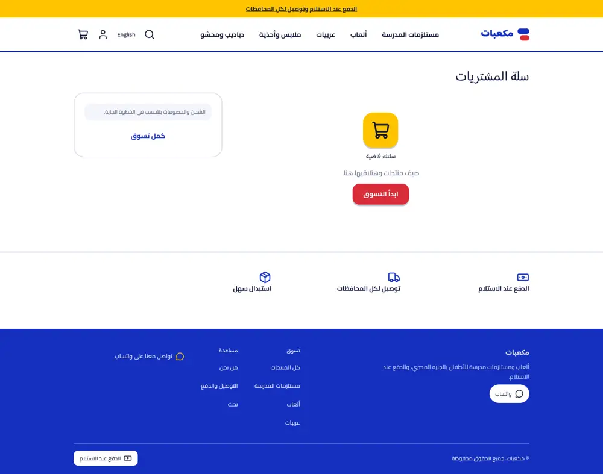
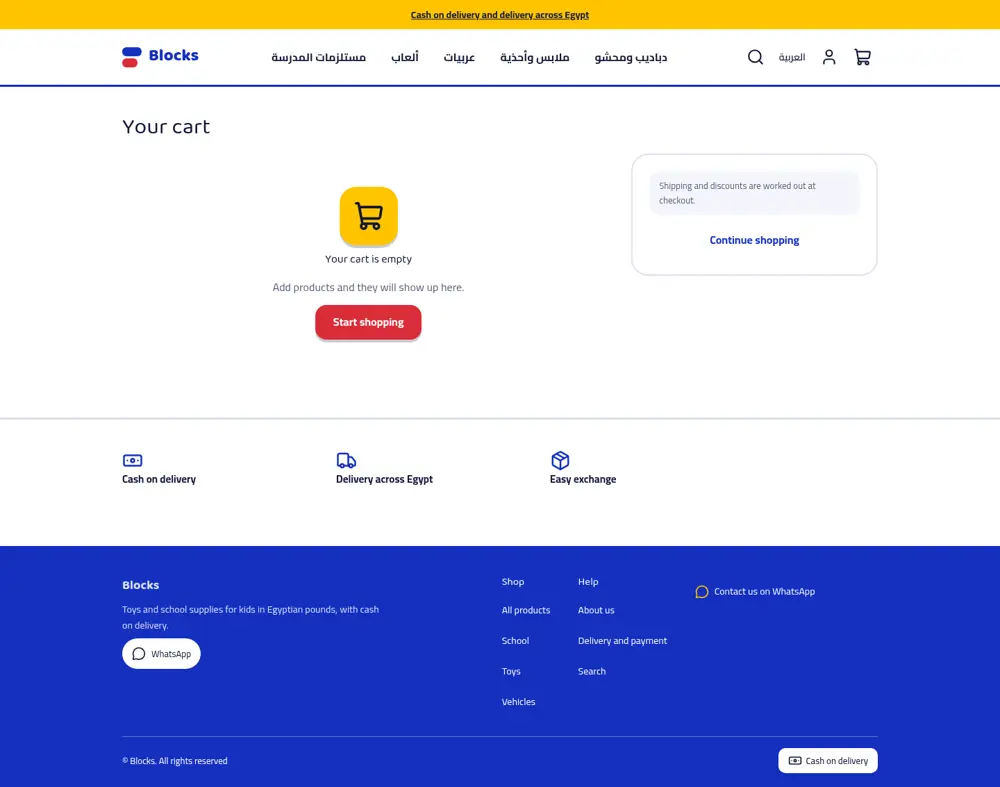
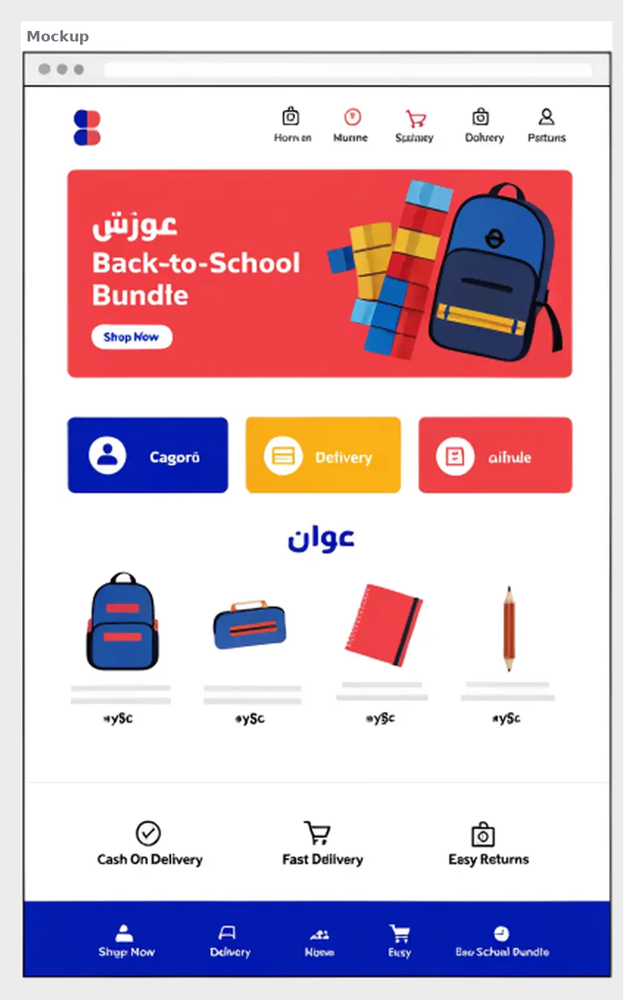
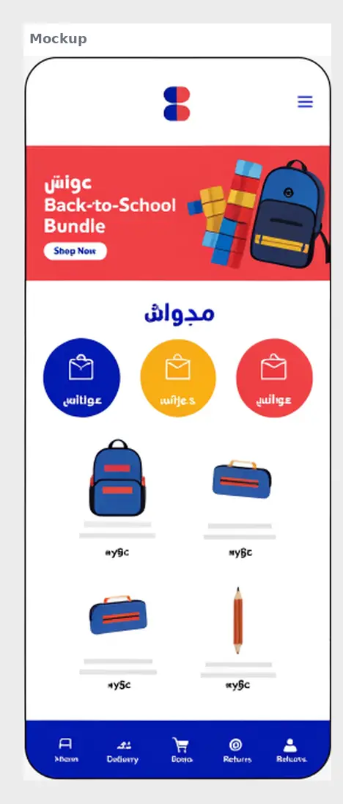

# Tutorial: Blocks, a bold primary-colour kids store

Blocks is a full store theme for kids' toys and school supplies. White ground,
three primary colours plus green, chunky rounded Arabic headings (Baloo Bhaijaan 2),
buttons with a hard bottom edge like a toy brick, and a solid blue footer. It is
right-to-left in Arabic and left-to-right in English from the same files.

It writes **every page type itself**: home, product, collection, search, cart,
404 and content page, with announcement, header and footer groups.

| Page | Arabic, desktop | English, desktop | Arabic, phone |
| - | - | - | - |
| Home |  |  |  |
| Product |  |  | |
| Cart |  |  | |

The design brief was this mockup (placeholder Arabic and a fake logo, replaced
by a plain wordmark):

 

## What is in the folder

```
theme.json         id, version, tokens (blue, red, yellow, green, ink ...), fonts, money whole
layout/theme.snf   announcement, header, <main>, footer
groups/            announcement.json, header.json, footer.json
templates/         index, product, collection, search, cart, 404, page
sections/          blocks-banner, blocks-circles, blocks-products, blocks-trust, header, footer, ...
blocks/            circle (category tile), trust, menu and footer blocks, product blocks
assets/theme.css   all colours through tokens, logical properties only
```

## Excerpts

The category tiles are one block. On desktop it is a wide coloured tile; on a
phone the same markup becomes a round icon with the label under it, by CSS only:

```html
<a class="bk-circle bk-tone-{{ block.settings.tone }}" href="{{ url(block.settings.link) }}">
  <span class="bk-circle-icon"><hk-icon name="{{ block.settings.icon }}" size="28" /></span>
  <span class="bk-circle-label">{{ block.settings.label }}</span>
</a>
```

The related row skips the current product. Loops cannot do arithmetic, so the
section fetches one more than it shows and CSS hides the fifth card:

```html

  

```
