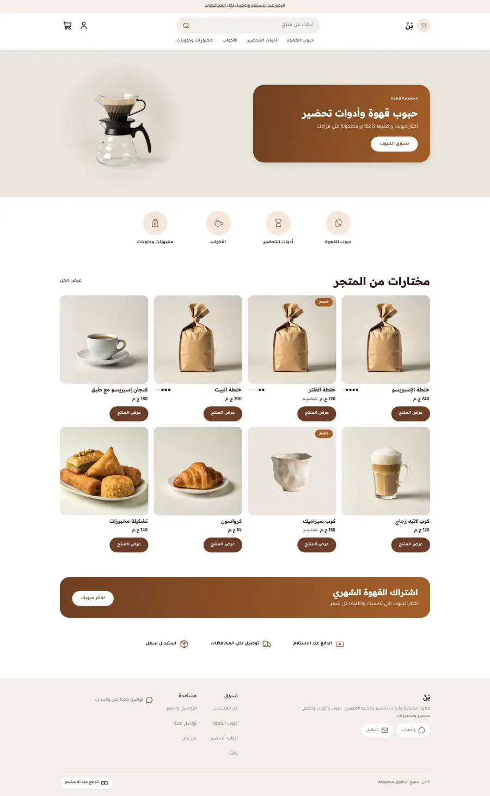
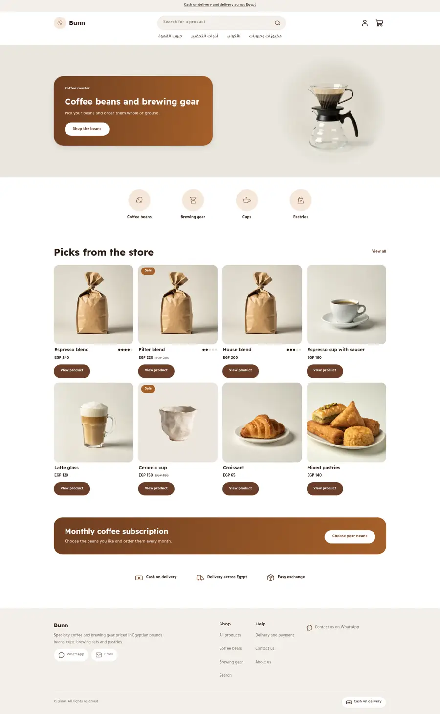
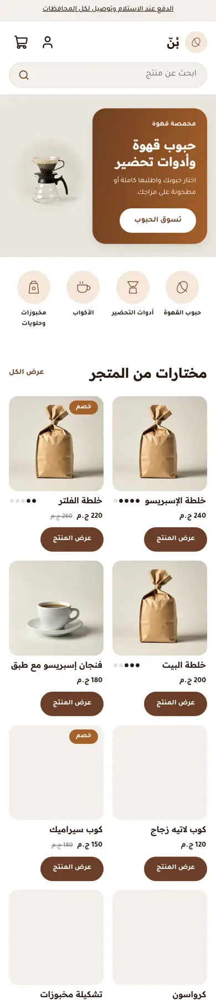
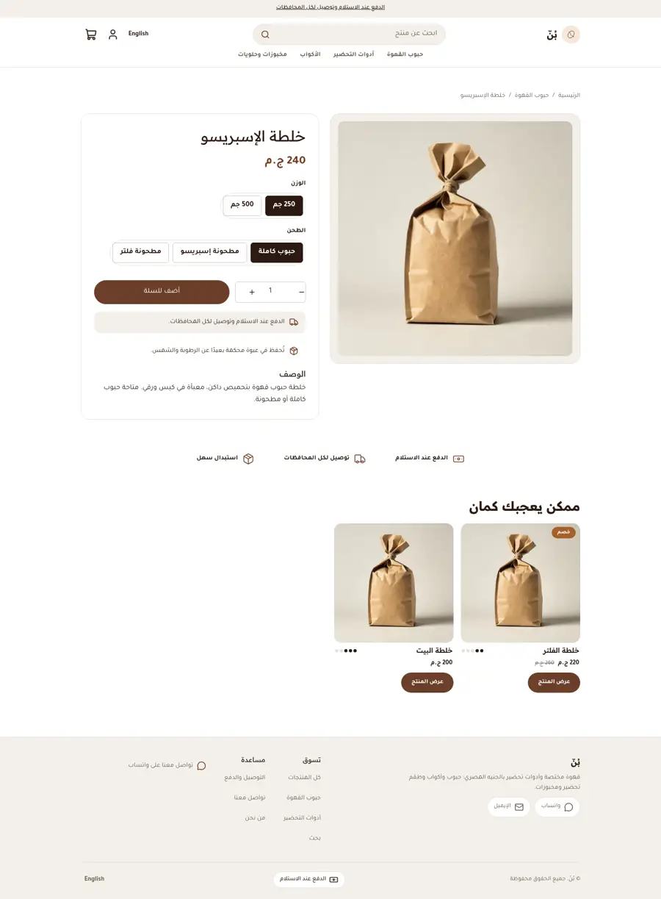
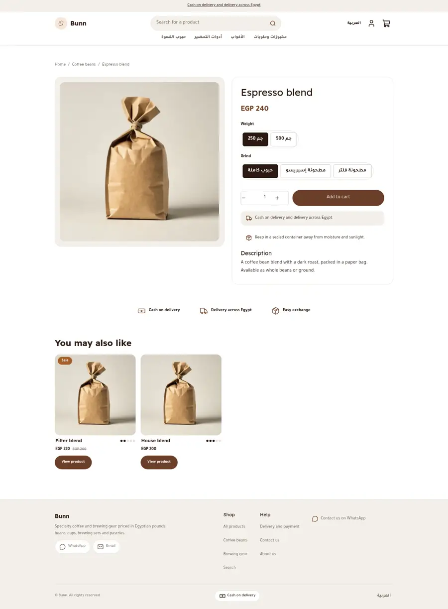
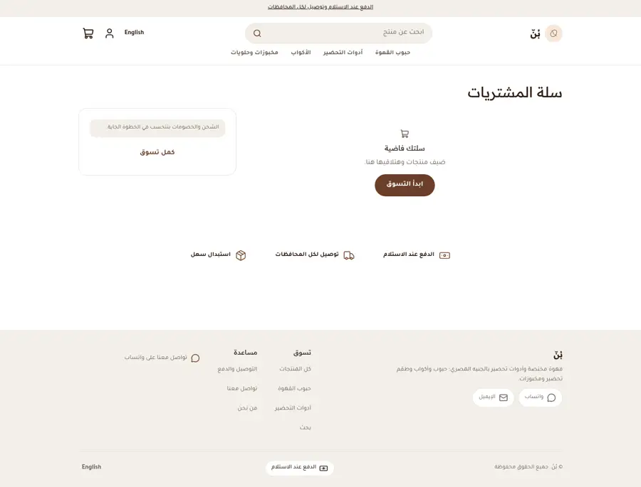
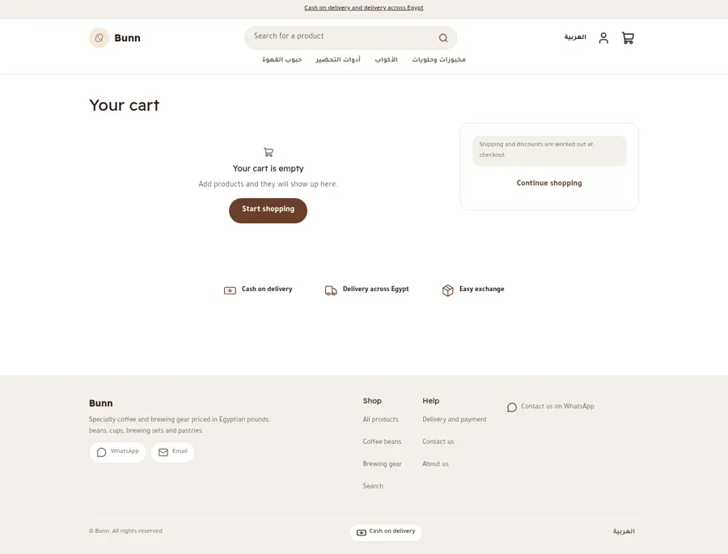
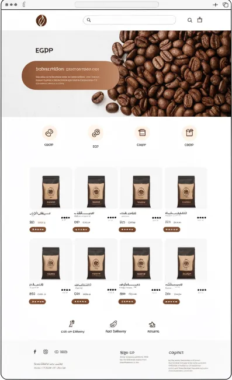
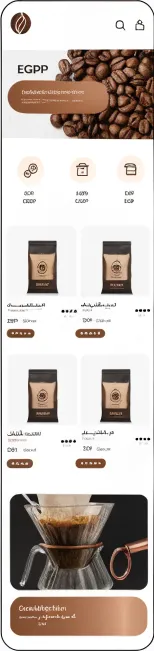

# Tutorial: Bunn, a specialty coffee store

Bunn is a full store theme for a coffee roaster: beans, brewing gear, cups and
pastries. It is white and stone with espresso brown and copper: a hero with a
copper banner card, round category tiles, soft product cards with roast-level
dots, a copper subscription banner and a three-icon trust strip. It is
right-to-left in Arabic and left-to-right in English from the same files.

It writes **every page type itself** (home, product, collection, search, cart,
404, content page) with an announcement bar, header and footer as editable sections.

| Page | Arabic, desktop | English, desktop | Arabic, phone |
| - | - | - | - |
| Home |  |  |  |
| Product |  |  | |
| Cart |  |  | |

The design brief was this mockup (placeholder Arabic, fake prices):

 

## What is in the folder

- `theme.json`: tokens (espresso, copper, stone, peach), fonts, whole-pound money.
- `sections/`: `hero`, `bn-categories`, `featured-products`, `bn-subscribe`, `bn-trust`, header, footer, and one main section per page type.
- `blocks/`: `tile`, `trust`, menu and footer blocks, product-page blocks.
- `snippets/`: `product-card`, `glyph` (inline bean, bag, cup and dripper icons), `price`, `button`.
- `templates/`: all seven page types, each seeded with default sections.

## Roast-level dots

A product tagged `roast-1` to `roast-5` shows that many filled dots on its card.
The theme loops over the product's tags and compares each one, since `contains`
is not part of the expression language:

```

  <span class="bn-roast bn-roast-3">...</span>

```

## Gradients without colour literals

The copper gradient is built from two tokens, so the merchant's colours drive it:

```css
--bn-copper-grad: linear-gradient(100deg, var(--hk-color-copper-deep), var(--hk-color-copper));
```
