# Tutorial: Cashmere, a quiet luxury leather goods store

Cashmere is a full store theme for a shop that sells leather bags, wallets, belts
and a few accessories. It is cream and taupe with one cognac accent, hairline
frames, square corners, no shadows and wide whitespace: a framed hero photo, two
or three bordered category tiles, a two-column editorial product row, a trust
strip with round icons and a craftsmanship section. Right-to-left in Arabic and
left-to-right in English from the same files.

The theme writes **every page type itself**: home, product, collection, search,
cart, 404 and content page, with announcement, header and footer groups.

| Page | Arabic, desktop | English, desktop | Arabic, phone |
| - | - | - | - |
| Home | 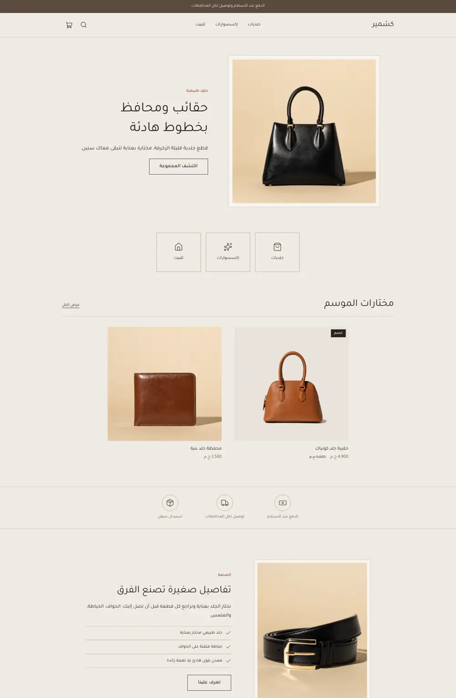 | 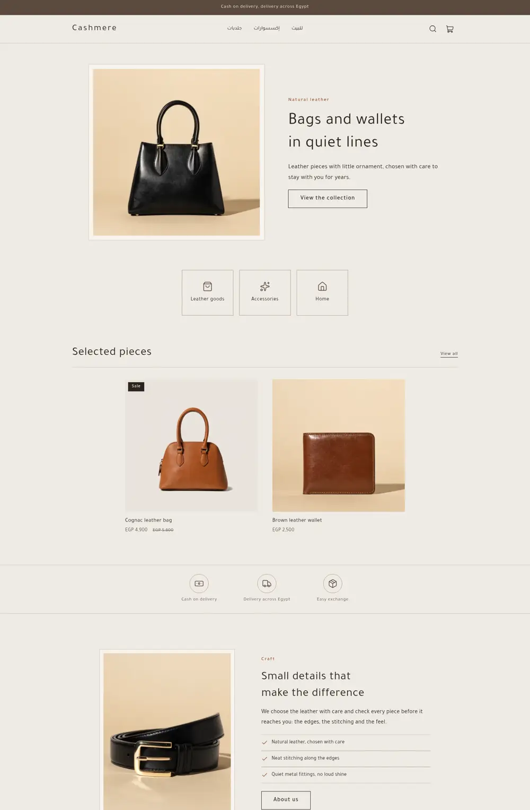 | 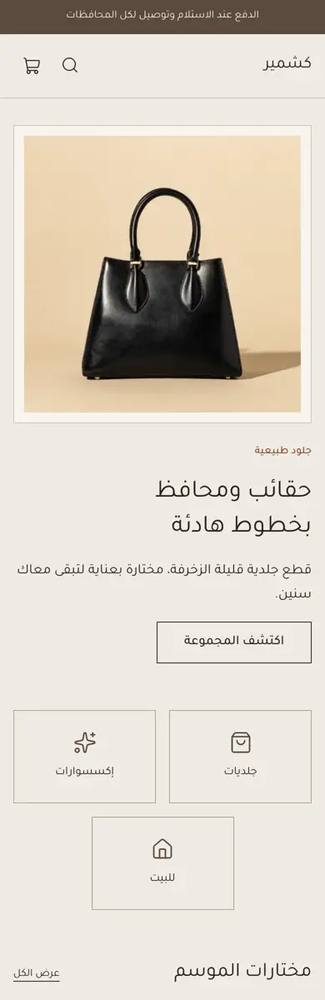 |
| Product | 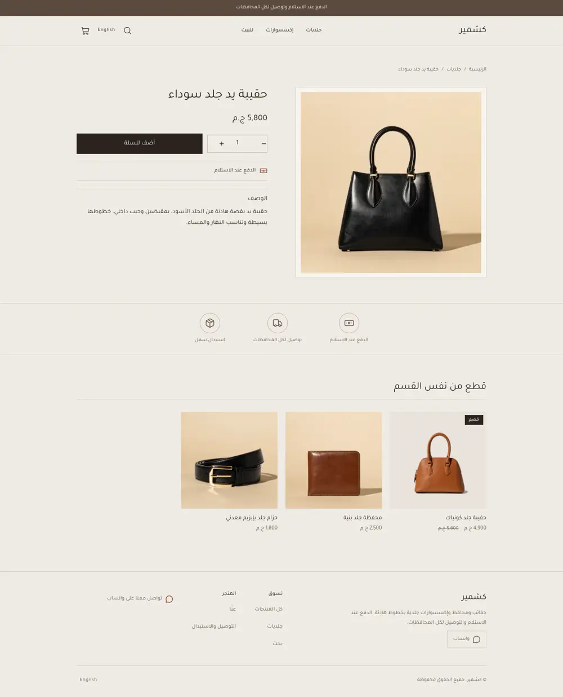 | 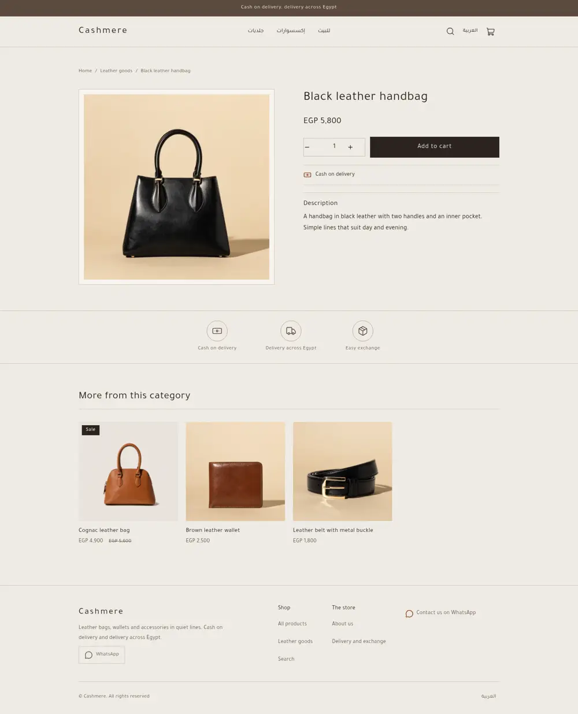 | 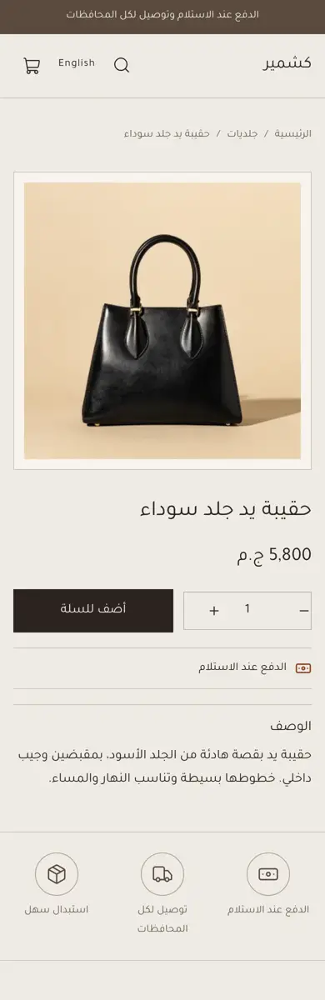 |
| Cart | 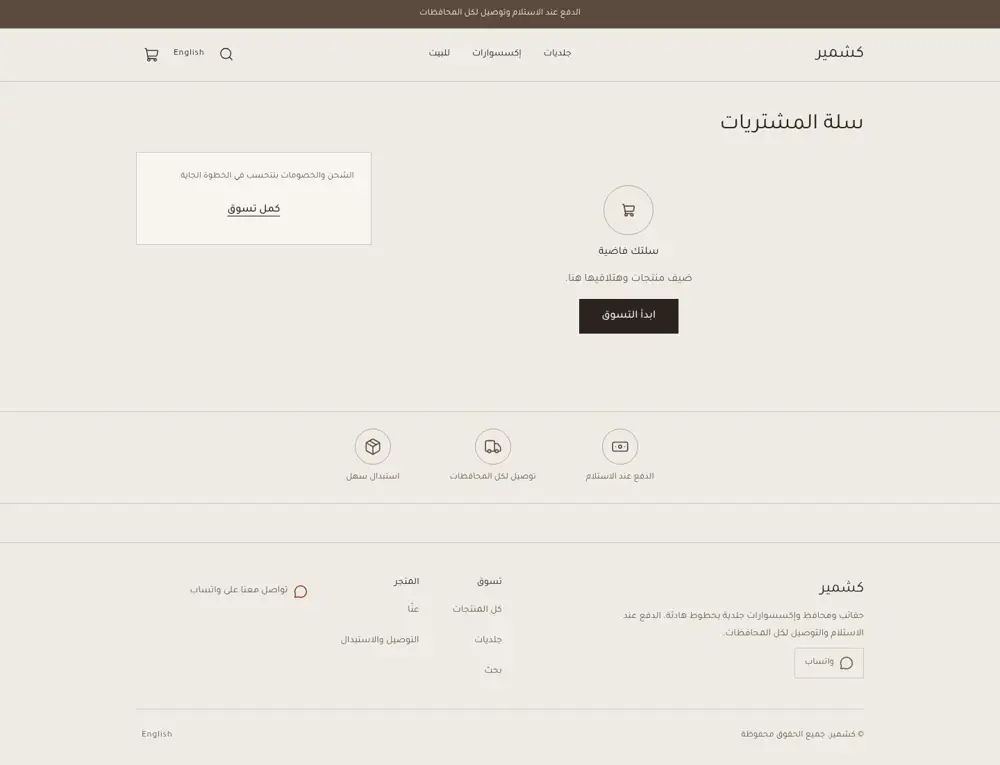 | 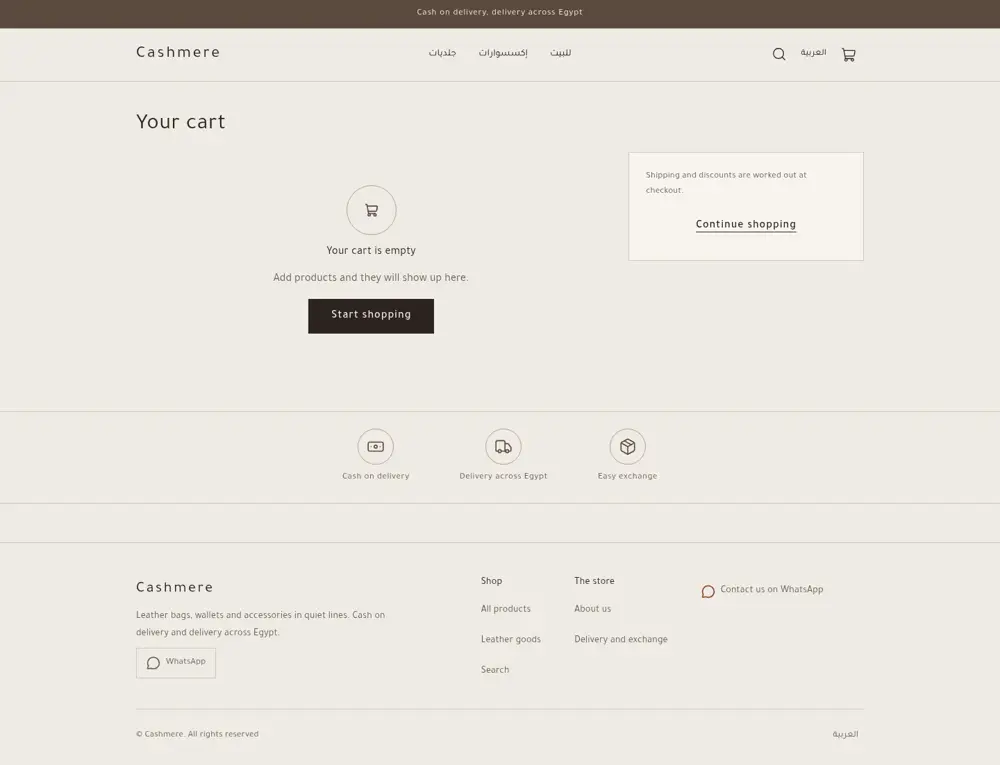 | 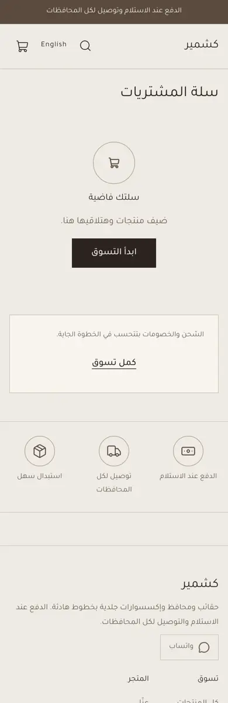 |

The design brief was this mockup (placeholder Arabic, fake logo):

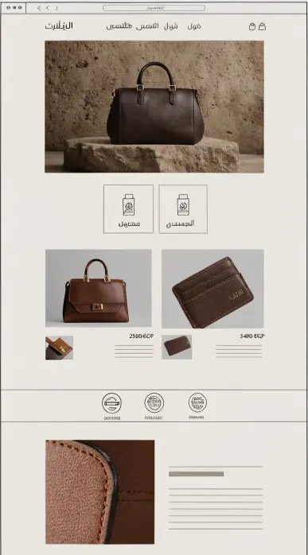 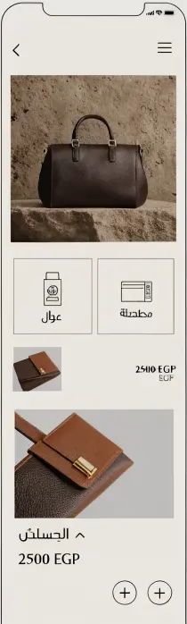

## What is in the folder

```
theme.json                 id, version, tokens, money format "whole"
layout/theme.snf           announcement, header, <main>, footer
groups/                    announcement.json, header.json, footer.json
templates/                 index, product, collection, search, cart, 404, page
sections/                  hero, category-tiles, featured-products, trust-strip, craft,
                           header, footer, announcement-bar, product-main, related-products,
                           collection-main, search-main, cart-main, not-found, page-main
blocks/                    category-tile, trust-item, craft-point, menu-link, footer-*,
                           social-link, contact-line, product-* blocks
snippets/                  product-card, price, button
locales/                   ar.json, en.json (same keys)
assets/theme.css           the only stylesheet; every colour is a token
```

## Customize it

**Tokens.** `primary` (ink, buttons), `secondary` (taupe), `accent` (cognac),
`background` (cream), `text`, `muted`, `line`, `soft`, `surface`, `taupe`. CSS reads
`var(--hk-color-<token>)`; there are no colour literals.

**Hero.** Image, heading, text and button are section settings; the image is a
plain image setting, so any photo can replace the default.

**Related products.** The product page reads `collection('related')` and falls back
to the section's collection, skipping the current product:

```
 ...  ... 
```
