# Tutorial: Cloud, a soft playful kids store

Cloud is a store theme for toys and children's clothes. A butter-yellow top with a
wavy edge holds the search pill and three age chips, coloured category pills sit
under it, products are rounded pastel tiles with centred names and prices, and a
sky-blue wavy footer closes every page. Right-to-left in Arabic, left-to-right in
English, from the same files.

The theme writes **every page type**: home, product, collection, search, cart,
404 and content page, plus announcement, header and footer groups.

| Page | Arabic, desktop | English, desktop | Arabic, phone |
| - | - | - | - |
| Home | 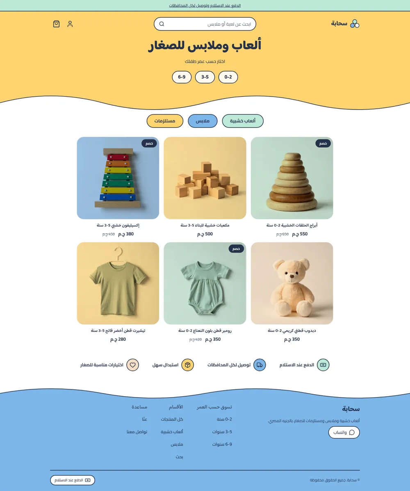 | 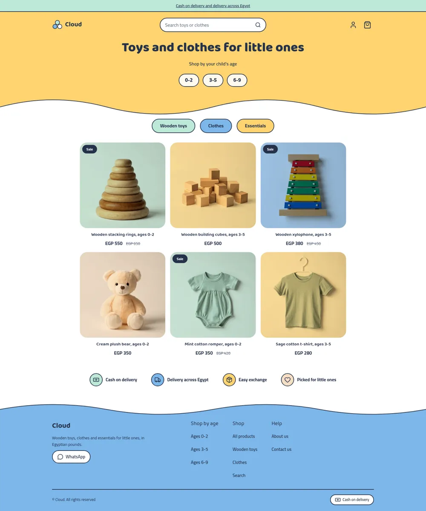 | 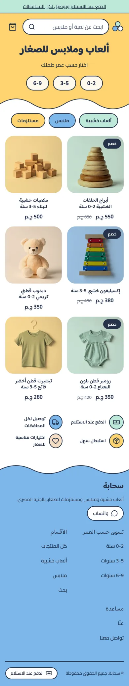 |
| Product | 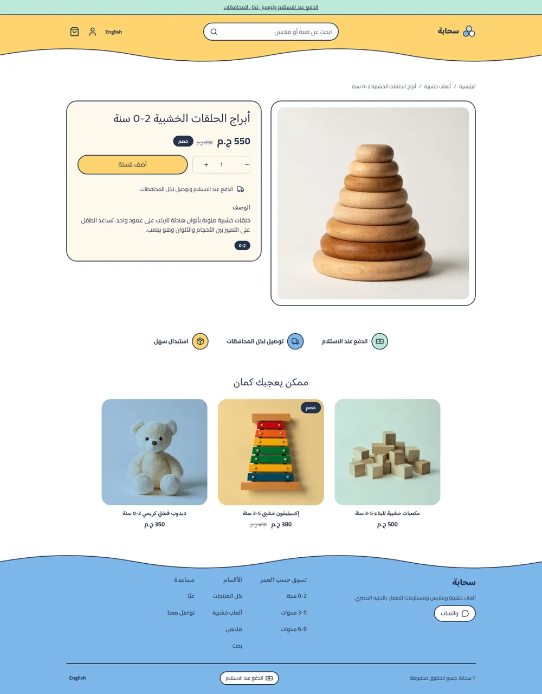 | 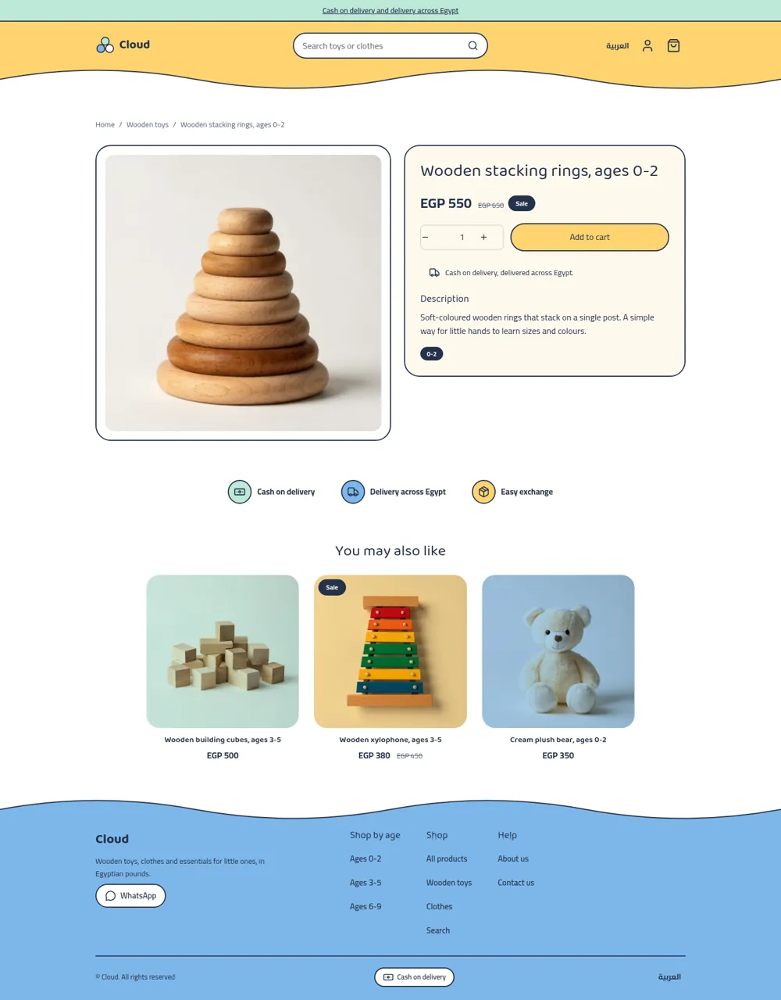 | 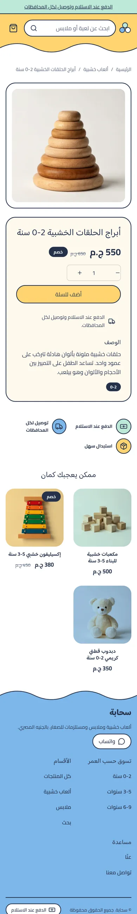 |
| Cart | 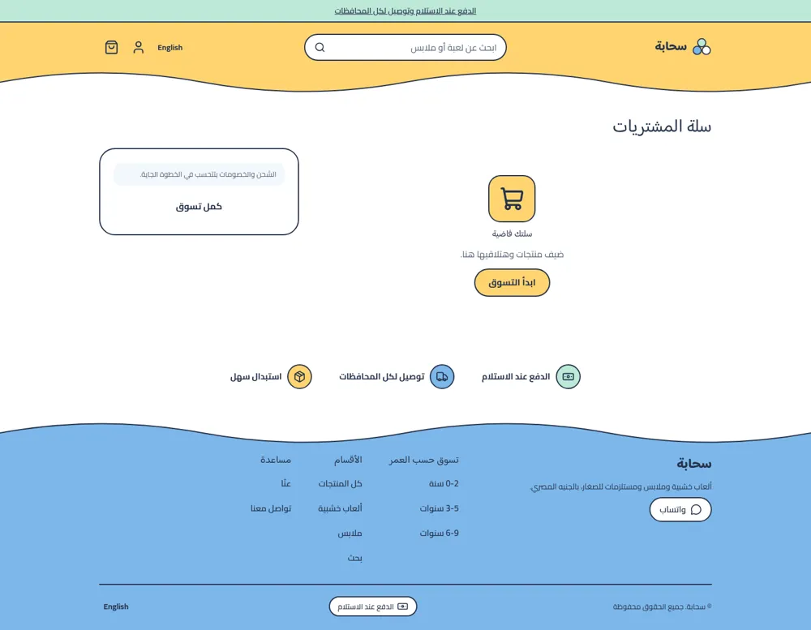 | 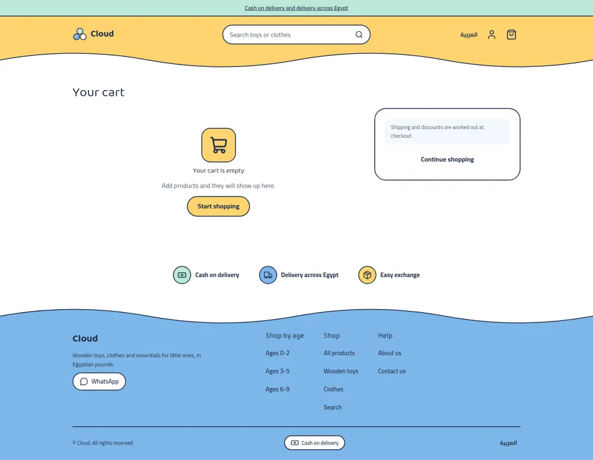 | 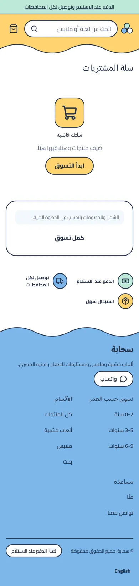 |

The design brief was this mockup (placeholder Arabic and fake logo, replaced by
real copy and a plain-text wordmark):

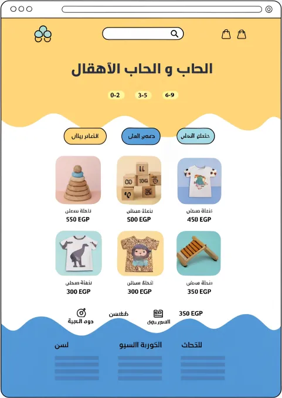 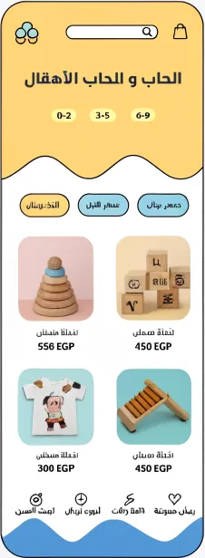

## What is in the folder

```
theme.json              id, version, tokens (butter, sky, mint, peach, cream, ink), money whole
layout/theme.snf        announcement, header, <main>, footer
groups/                 announcement.json, header.json, footer.json
templates/              index, product, collection, search, cart, page, 404
sections/               announcement-bar, header, footer, hero, category-chips, featured-products,
                        trust-strip, product-main, related-products, collection-main,
                        search-main, cart-main, not-found, page-main
blocks/                 age-chip, chip, trust, menu-link, footer-column, footer-link, social-link,
                        contact-line, payment-method, product-* blocks
snippets/               wave, mark, product-card, price, button, glyph
locales/                ar.json, en.json (same keys)
assets/theme.css        the only stylesheet; every colour is a token
```

## Annotated excerpts

The wavy edge is one inline SVG snippet. The fill takes the colour of the area
below the edge (`currentColor`), a second path draws the ink line:

```html
<svg class="cl-wave-svg" viewBox="0 0 1440 64" preserveAspectRatio="none" aria-hidden="true">
  <path class="cl-wave-fill" d="M0 32 C120 0 ... V64 H0 Z" />
  <path class="cl-wave-line" d="M0 32 C120 0 ..." />
</svg>
```

Pastel tiles come from the product's position in the grid, not from the photo,
and `mix-blend-mode: multiply` tints the photo's pale background:

```css
.cl-grid > :nth-child(4n+2) .cl-card-media { background: color-mix(in srgb, var(--hk-color-butter) 70%, var(--hk-color-background)); }
```

The header wave hides on the home page, where the hero draws its own, so the
yellow area reads as one block:

```css
[data-hk-theme='cloud']:has(.cl-hero) .cl-header-wave { display: none; }
```

Related products read the section's collection setting, skip the current product
and fetch one extra so the row stays full; a `cl-rel-N` class hides the surplus.
