# Tutorial: Console, a complete white gaming store

Console is a full store theme for a shop that sells game gift cards, currency
packs and subscriptions as codes. It is white with one royal-blue accent, pill
shapes and soft shadows: a centred menu, a search pill under the header, large
shadowed product cards, a three-way amount selector, a round platform row, a
trust strip, a FAQ and a "how you get your code" strip. It is right-to-left in
Arabic and left-to-right in English from the same files.

This theme writes **every page type itself**: home, product (plus a
`product.digital` alternate for codes), collection, search, cart, 404 and content
page, with an announcement bar, header and footer as editable sections. The SDK's
default store is only a fallback for page types a theme leaves out; Console
leaves none out.

| Page | Arabic, desktop | English, desktop | Arabic, phone |
| - | - | - | - |
| Home | 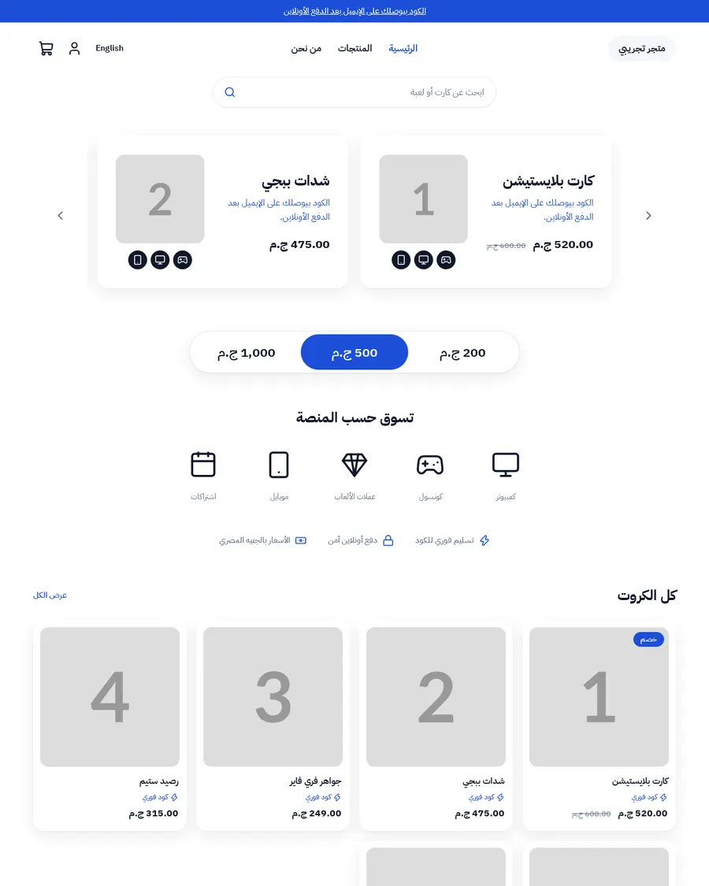 | 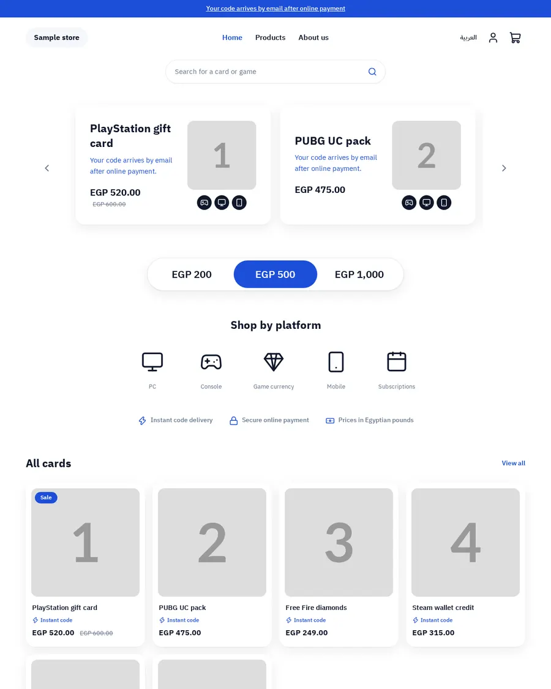 | 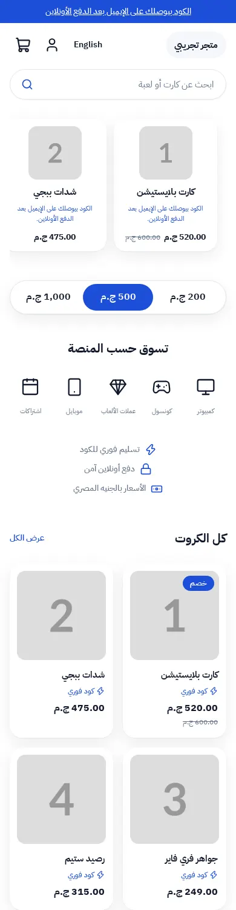 |
| Product | 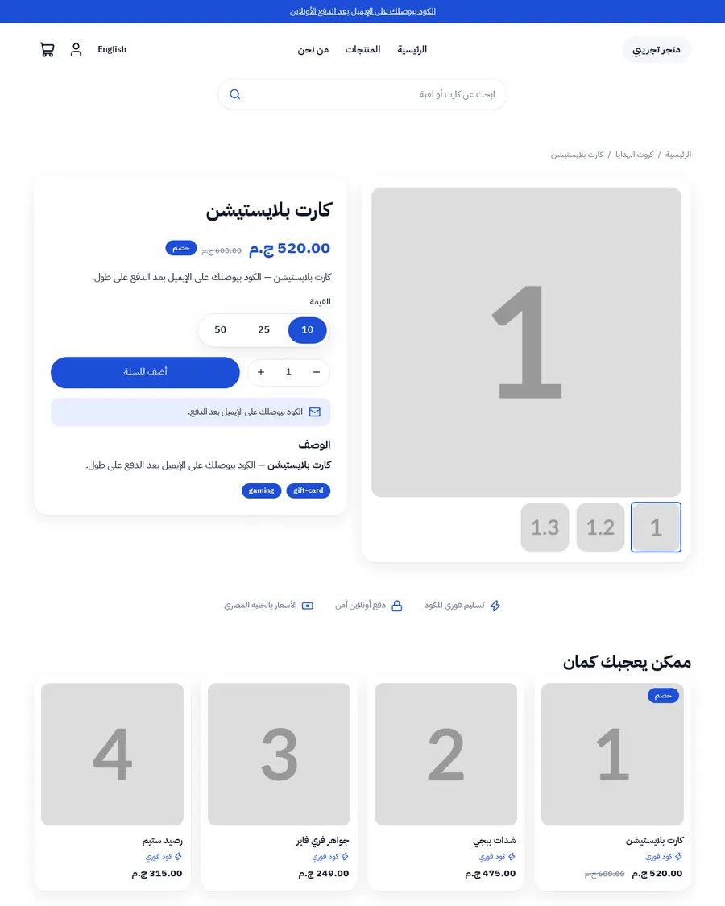 | 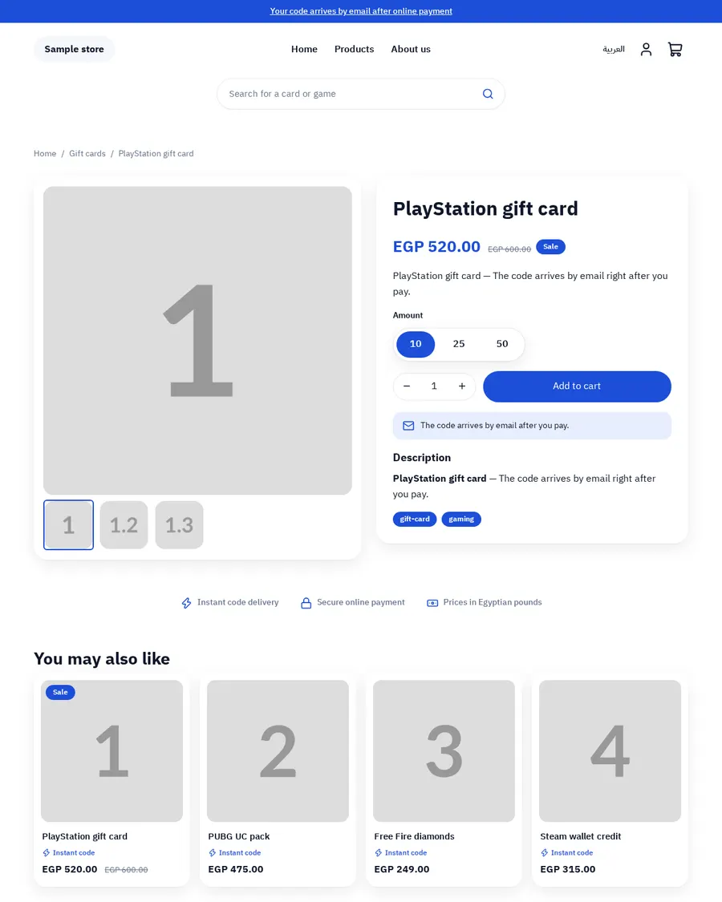 | 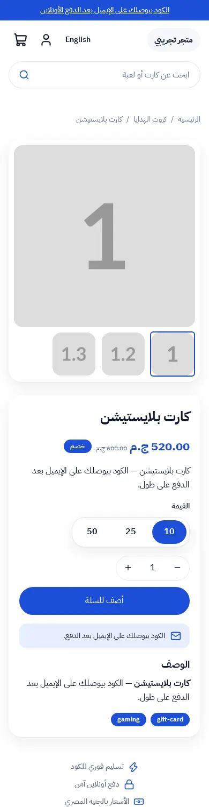 |
| Cart | 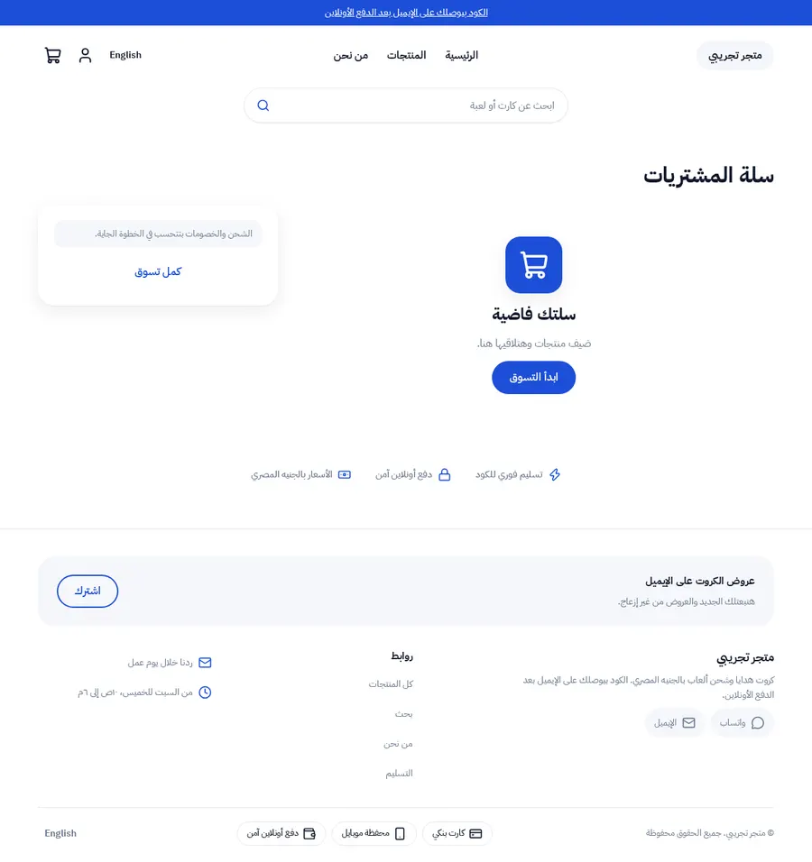 | 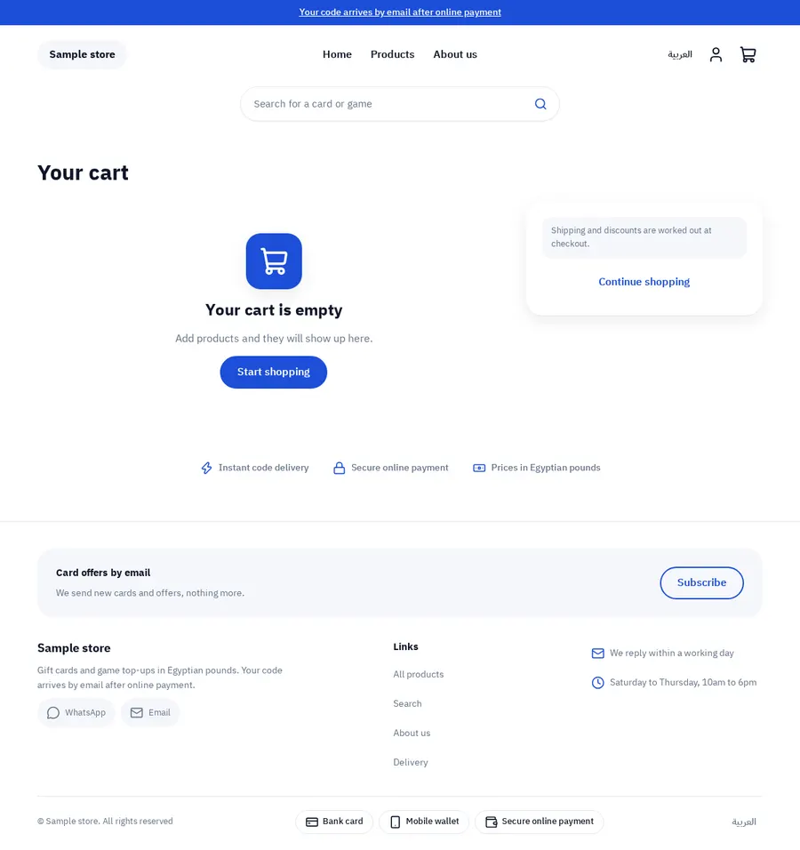 | 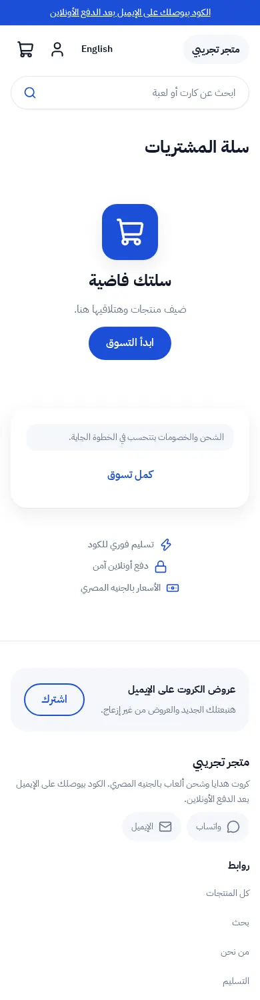 |

The design brief was this mockup (placeholder Arabic, riyal prices, brand logos
that Console replaces with plain icons):

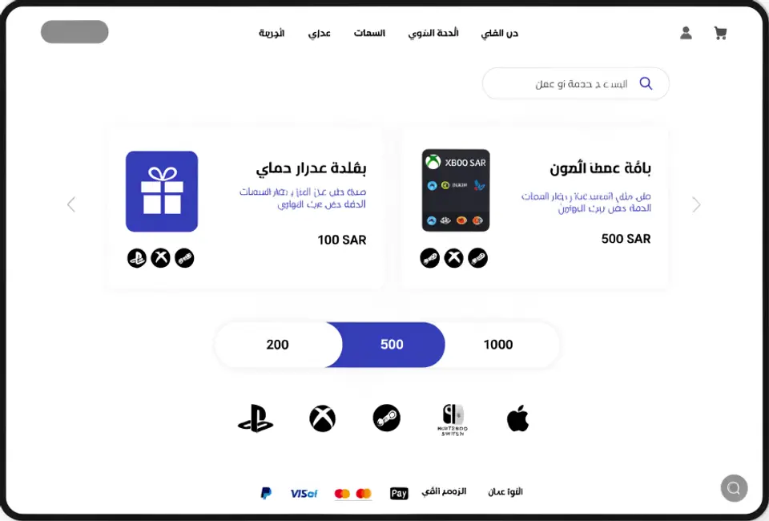 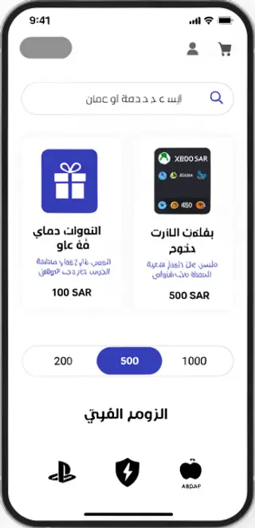

Phone shots are in `docs/live-*-phone-en.webp`.

## What is in the folder

```
theme.json                 id, version 2.0.2, tokens
layout/theme.snf           announcement, header, <main>, footer
groups/                    announcement.json, header.json, footer.json (the section groups)
templates/                 index, product, product.digital, collection, search, cart, 404, page
sections/                  announcement-bar, header, footer, product-main, related-products,
                           collection-main, search-main, cart-main, not-found, page-main,
                           console-showcase, -amounts, -platforms, -trust, -products,
                           -steps, -faq, featured-products, hero
blocks/                    menu-link, menu-sub-link, footer-column, footer-link, social-link,
                           contact-line, payment-method, product-* (title, price, excerpt,
                           variants, buy, text, description, tags, category), amount,
                           platform, trust, step, faq-item, chip
snippets/                  product-card, price, button, glyph
locales/                   ar.json, en.json (same keys)
assets/theme.css           the only stylesheet; every colour is a token
docs/                      screenshots
```

## Run it

```bash
sneferu dev .         # http://127.0.0.1:4100, /en for English, ?template=product.digital
sneferu format .      # prettier for .snf files
sneferu validate .
sneferu build .
sneferu push .        # publish (needs an API key, see the guide)
```

`sneferu dev` serves `/products/<handle>`, `/products`, `/category/<handle>`,
`/search?q=`, `/cart`, `/pages/<handle>` and a 404 for anything else.

## Customize it

**Tokens** (`theme.json`, then the theme panel). Colours `primary`, `secondary`,
`accent` (the royal blue), `background`, `text`, `muted`, `line`, `soft`, plus two
named for this theme: `surface` (card white) and `glow` (the pale blue behind
notes). The font is IBM Plex Sans Arabic for headings and body, the radius is 16
px, the content width 1120 px. CSS reads `var(--hk-color-<token>)`; there are no
colour literals in the theme.

**Sections.** Header: logo image or text, menu, search as a pill bar or an icon,
account, language, cart with a live count and drawer, colour scheme, sticky.
Footer: about text, newsletter box, link columns, social links, contact lines,
payment methods, copyright, colour scheme. Everything on the product, cart,
collection, search, 404 and content pages (titles, empty states, buttons,
columns, card style, padding) is a section setting.

**Blocks.** Menu links with dropdown links, footer columns with links, payment
methods, social links, contact lines, amounts, platforms, trust points, steps,
questions, and the product page rows (title, price, variants, buy buttons, notes,
description, tags). Add, remove and reorder them in the editor. The merchant's
store menus (`main`, `footer`) win when they exist; the blocks are the fallback.

**Locales.** Small labels live in `locales/ar.json` and `locales/en.json`
(`t('key')`). Both files have the same keys. Nothing visible is written in a
template.

## The digital product page

`templates/product.digital.snf` is for products sold as codes. It adds a
delivery note and a region note under the buy button, a three-step strip, a FAQ
and related cards. Assign it to a product in the editor.

## Migrating from 1.x to 2.0

1.x wrote only the home page and borrowed the SDK's default store for the rest.
2.0 adds every other template and the announcement, header and footer sections.
The header and footer sections are now the SDK-standard `header` and `footer`
(they replace `console-header` and `console-footer`); the home sections keep
their ids and setting names, except that `console-products` no longer draws
`hk-product-grid` and gained a `columns` setting. `migrations/1.2.0-2.0.2.json` renames `console-header` and `console-footer` to `header` and `footer`
and the borrowed `hk-*` page sections and blocks to this theme's own.
