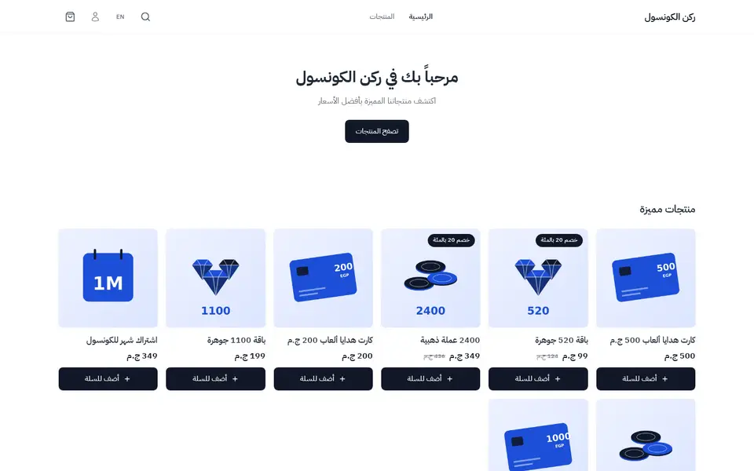
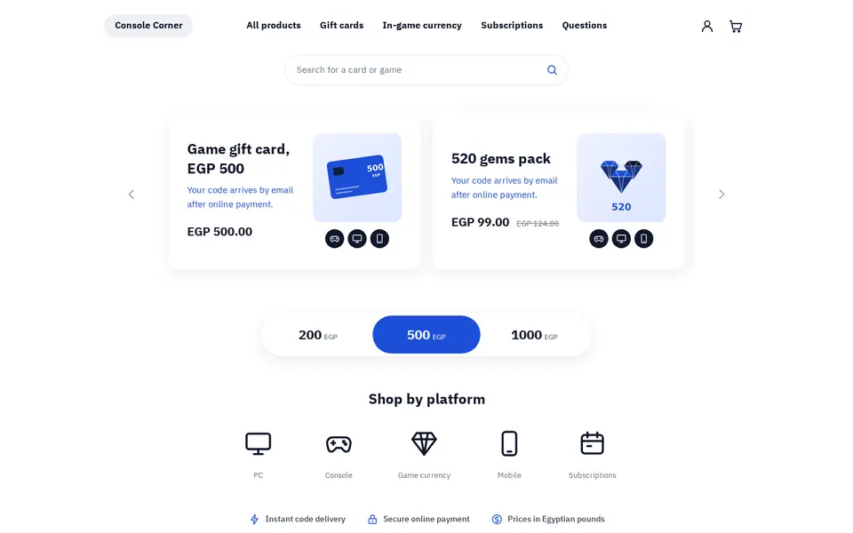
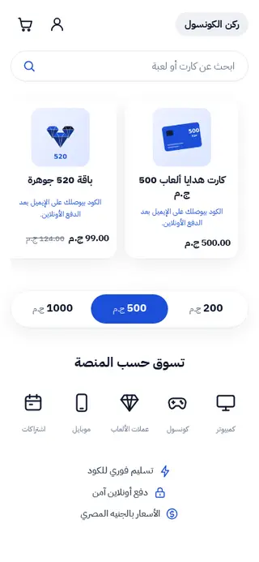
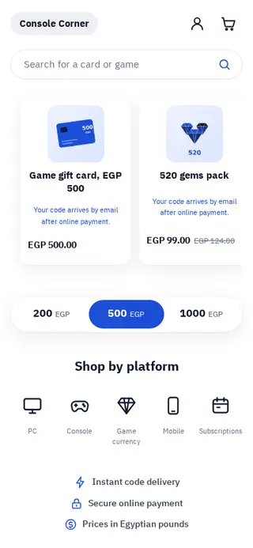

# Tutorial: Console, a clean white gaming store

Console is a home page for a shop that sells game gift cards, currency packs and
subscriptions as codes. It is white with one royal-blue accent and soft
shadows: a centred navigation, a search field, a carousel of large product
cards, a three-way amount selector, a row of platform icons, a trust strip, a
product grid and a FAQ. It is right-to-left in Arabic and left-to-right in
English from the same files.

| Mockup | Live, Arabic | Live, English |
| - | - | - |
|  |  |  |
|  |  |  |

The mockup was generated as a design brief. Its Arabic is placeholder text, its
prices were in riyals, its indigo became a true blue (`#1D4ED8`), and its
console and payment brand logos became plain icons with text labels. Live:
[demo-console.hekana.com](https://demo-console.hekana.com) and
[/en](https://demo-console.hekana.com/en).

What the theme uses: plain HTML for structure, `hk-section`, `hk-stack`,
`hk-heading`, `hk-image`, `hk-price`, `hk-product-grid`, `hk-icon` and
`hk-search-form`, a `` loop over a collection the merchant picks, a
scroll-snap carousel with anchor-link arrows, four block types (amount,
platform, trust point, question) seeded by the template, and one stylesheet.
There is no JavaScript. Version 1.2.0 is built on Sneferu 0.4; the 0.2
workarounds it replaced are listed in `../../GAPS-gaming.md`.

## Upgrading from 1.0

In 1.1.0 the numbered settings and locale-text fallbacks became blocks and
localized settings; values saved under 1.0 are not carried over, so the sections
start from the new defaults.

## Pages

Console writes only the home page (`templates/index.snf`). The product,
collection, search, cart, content page and 404 templates come from the SDK's
default store ([page types](../../../docs/guide/16-page-types.mdx)), drawn with
Console's tokens, fonts and layout. `assets/theme.css` restyles what the default
store would otherwise draw in its own way (the block "Cart, product, collection,
search and 404 pages"):

- product cards on collection and search pages use the home grid's card: white,
  rounded, a soft shadow that lifts on hover;
- the cart summary gets the same shadow, the delivery note the soft grey;
- the cart count sits on the cart icon, and the logo pill is 44 px tall.

The header group holds the cart drawer: it opens when an item is added (a
setting of the header section) and from the cart icon.

| Page | URL in `sneferu dev` |
| - | - |
| Product | `/products/sample-2` |
| Collection | `/category/gift-cards`, `/products` |
| Search | `/search?q=card` |
| Cart | `/cart` |
| Content page | `/pages/about` |
| 404 | any other path |

## Files

```
assets/theme.css
blocks/amount.snf
blocks/faq-item.snf
blocks/platform.snf
blocks/trust.snf
groups/footer.json
groups/header.json
layout/theme.snf
locales/ar.json
locales/en.json
sections/console-amounts.snf
sections/console-faq.snf
sections/console-footer.snf
sections/console-header.snf
sections/console-platforms.snf
sections/console-products.snf
sections/console-showcase.snf
sections/console-trust.snf
snippets/glyph.snf
templates/index.snf
theme.json
```

Next to the theme: `README.md` and `docs/` (this tutorial and its pictures).
The CLI skips both.

## Data it needs

| What | Used by |
| - | - |
| A collection with images: `featured` by default (products marked featured, or the newest) | the carousel and the product grid, each through its own `collection` setting |
| Categories `gift-cards`, `game-currency`, `top-ups`, `subscriptions` | the navigation and the default platform links (each platform link is a setting) |

## 1. Start from the starter

```bash
npx sneferu init console
cd console
```

Delete the starter's sections and `blocks/`.

## 2. Manifest and tokens

```json title="theme.json"
{
  "id": "console",
  "name": "Console",
  "version": "1.2.0",
  "author": "Hekana",
  "description": "A clean white gaming store for gift cards and top-ups: one royal-blue accent, large product cards, an amount selector and a platform row.",
  "category": "gaming",
  "engine": "hk2",
  "engineCompatibility": "^2.0.0",
  "defaultLocale": "ar",
  "locales": ["ar", "en"],
  "settings": {},
  "tokens": {
    "colors": {
      "primary": "#1D4ED8",
      "secondary": "#0F172A",
      "accent": "#1D4ED8",
      "background": "#FFFFFF",
      "text": "#0F172A",
      "muted": "#64748B",
      "line": "#E5E7EB",
      "soft": "#F5F7FB"
    },
    "layout": { "contentWidth": "1120px" },
    "fonts": {
      "heading": "IBM Plex Sans Arabic",
      "body": "IBM Plex Sans Arabic"
    }
  }
}
```

- `primary` and `accent` are both the blue: one accent colour is the whole
  look. `soft` is the pale grey of the FAQ rows and hover states.
- `contentWidth` is 1120 px, a little narrower than the default, for the
  amount of white space in the mockup.

## 3. Fonts and icons

`tokens.fonts` in `theme.json` picks IBM Plex Sans Arabic for headings and body
text. It is in the Sneferu font catalogue; Hekana serves the files and sets the
family, so the theme has no font files and no `font-family` rule.

Icons are `<hk-icon>` from the bundled Lucide set (`user`, `shopping-cart`,
`gift`, `gamepad-2`, `monitor`, `smartphone`, `calendar`, `zap`, `lock`,
`banknote`, `chevron-left`, `chevron-right`, `chevron-down`). The set has no
gem, so the game-currency platform keeps one inline SVG:

```html title="snippets/glyph.snf"
<svg
  class="ic ic-{{ name }}"
  viewBox="0 0 24 24"
  width="24"
  height="24"
  fill="none"
  stroke="currentColor"
  stroke-width="1.8"
  stroke-linecap="round"
  stroke-linejoin="round"
  aria-hidden="true"
>
  <path d="M6 3.5h12l3.5 5L12 21 2.5 8.5 6 3.5z" /><path d="M2.5 8.5h19M9 3.5L12 21l3-17.5" />
  
</svg>
```

## 4. Layout: header and footer

```html title="layout/theme.snf"
<hk-section-group name="header" />
<main><hk-slot name="content" /></main>
<hk-section-group name="footer" />
```

The header and the footer are [section groups](../../../docs/guide/18-section-groups.mdx): the layout places
`<hk-section-group name="header" />` and `<hk-section-group name="footer" />`, `groups/header.json` and
`groups/footer.json` start them with `console-header` and `console-footer`, and the merchant edits them once for the
whole store. The header also holds the cart: the cart link carries `data-hk-open="cart-drawer"` and
`<hk-cart-count />`, and `<hk-cart-drawer>` lists the lines (a plain link to the cart page without JavaScript).

```html title="sections/console-header.snf"
<header class="cc-header">
  <hk-container>
    <div class="cc-bar">
      <a class="cc-logo" href="{{ url('/') }}">{{ store.name }}</a>
      <nav class="cc-nav" aria-label="{{ t('nav_label') }}">
        <a href="{{ url('/products') }}">{{ t('nav_all') }}</a>
        <a href="{{ url('/category/gift-cards') }}">{{ t('cat_gift_cards') }}</a>
        <a href="{{ url('/category/game-currency') }}">{{ t('cat_currency') }}</a>
        <a href="{{ url('/category/subscriptions') }}">{{ t('cat_subscriptions') }}</a>
        <a href="{{ url('/') }}#faq">{{ t('nav_faq') }}</a>
      </nav>
      <div class="cc-icons">
        <a class="cc-icon" href="{{ url('/account') }}" aria-label="{{ t('account') }}"><hk-icon
            name="user"
            size="24"
            class="ic"
          /></a>
        <a class="cc-icon" href="{{ url('/cart') }}" data-hk-open="cart-drawer" aria-label="{{ t('cart') }}"><hk-icon
            name="shopping-cart"
            size="24"
            class="ic"
          /><hk-cart-count /></a>
      </div>
    </div>
    <hk-search-form placeholder="{{ t('search_placeholder') }}" class="cc-search" />
  </hk-container>
  <hk-cart-drawer open-on-add="{{ section.settings.drawer_on_add }}">
    <hk-cart-items />
    <hk-cart-summary />
  </hk-cart-drawer>
</header>
<hk-schema>
  {
    "name": "Header",
    "version": 1,
    "templates": ["header"],
    "settings": {
      "drawer_on_add": {
        "type": "boolean",
        "label": "Open the cart when an item is added",
        "default": true
      }
    }
  }
</hk-schema>
```


```css title="assets/theme.css (root and header)"
/* Console: white ground, one royal-blue accent, soft shadows, lots of space. */
[data-hk-theme='console'] {
  --cc-blue: var(--hk-color-accent);
  --cc-shadow: 0 1px 2px rgba(15, 23, 42, 0.04), 0 8px 28px rgba(15, 23, 42, 0.07);
  line-height: 1.6;
}
:where([data-hk-theme='console'] a) { color: inherit; text-decoration: none; }
:where([data-hk-theme='console'] h1, [data-hk-theme='console'] h2, [data-hk-theme='console'] p) { margin: 0; }
.ic { width: 24px; height: 24px; flex: none; }
/* Block wrappers take no room: amounts, platforms and trust points lay out as before. */
[data-hk-theme='console'] [data-hk-block] { display: contents; }
.cc-h2 { font-weight: 700; }

/* Header */
.cc-header { padding-block: 16px 8px; }
.cc-bar { display: grid; grid-template-columns: 1fr auto 1fr; align-items: center; gap: 24px; min-height: 56px; }
.cc-logo { justify-self: start; display: inline-flex; align-items: center; min-height: 44px; padding-inline: 18px; border-radius: 999px; background: #EEF0F4; font-weight: 700; font-size: 16px; }
.cc-nav { display: flex; gap: 32px; font-size: 16px; font-weight: 600; }
.cc-nav a { display: inline-flex; align-items: center; min-height: 44px; }
.cc-nav a:hover, .cc-icon:hover { color: var(--cc-blue); }
.cc-icons { justify-self: end; display: flex; gap: 4px; }
.cc-icon { display: inline-flex; align-items: center; justify-content: center; width: 44px; height: 44px; border-radius: 12px; }
.cc-icon .ic { width: 26px; height: 26px; }
.cc-search { flex-wrap: nowrap; align-items: center; gap: 12px; width: 100%; max-width: 480px; min-height: 52px; margin: 20px auto 0; padding-inline: 20px 6px; border-radius: 999px; border: 1px solid var(--hk-color-line); background: #fff; box-shadow: 0 1px 2px rgba(15, 23, 42, 0.04); color: var(--hk-color-muted); font-size: 15px; }
```

- The header is a three-column grid: logo at the start, navigation in the
  middle, icons at the end. Grid follows `dir`, so it mirrors in English.
- The logo is the store name in a grey pill, like the mockup's logo
  placeholder.
- The search field is `<hk-search-form class="cc-search">`: a form that sends
  the shopper to the store's search page, styled as the white pill of the
  mockup (`form.cc-search input`, `.sn-search-button`).
- Every internal link goes through `url()`, so English pages link to English
  pages.

## 5. Product carousel

```html title="sections/console-showcase.snf"
<hk-section padding-y="32" mobile-padding-y="16" class="cc-showcase">
  
    <div class="cc-carousel">
      <a class="cc-arrow cc-arrow-prev" href="#cc-start" aria-label="{{ t('carousel_start') }}"><hk-icon
          name="chevron-left"
          size="24"
          class="ic"
        /></a>
      <div class="cc-track">
        <span id="cc-start" class="cc-anchor"></span>
        
          <a class="cc-slide" href="{{ p.url }}">
            <span class="cc-slide-art">
              
                <hk-image
                  src="{{ p.image.url }}"
                  alt="{{ p.title }}"
                  aspect-ratio="1/1"
                  fit="cover"
                  radius="14"
                  loading="eager"
                />
              
                <span class="cc-slide-fallback"><hk-icon name="gift" class="ic" /></span>
              
              <span class="cc-platforms" aria-hidden="true">
                <span><hk-icon name="gamepad-2" class="ic" /></span>
                <span><hk-icon name="monitor" class="ic" /></span>
                <span><hk-icon name="smartphone" class="ic" /></span>
              </span>
            </span>
            <span class="cc-slide-body">
              <strong class="cc-slide-title">{{ p.title }}</strong>
              
                <span class="cc-slide-note">{{ section.settings.code_note }}</span>
              
                <span class="cc-slide-note">{{ p.excerpt | truncate: 70 }}</span>
              
              <hk-price amount="{{ p.price }}" compare-at="{{ p.compare_at }}" class="cc-slide-price" />
            </span>
          </a>
        
        <span id="cc-end" class="cc-anchor"></span>
      </div>
      <a class="cc-arrow cc-arrow-next" href="#cc-end" aria-label="{{ t('carousel_end') }}"><hk-icon
          name="chevron-right"
          size="24"
          class="ic"
        /></a>
    </div>
  
    <p class="cc-empty">{{ t('empty_products') }}</p>
  
</hk-section>
<hk-schema>
  {
    "name": "Product showcase",
    "version": 1,
    "settings": {
      "list": {
        "type": "collection",
        "label": "Collection",
        "default": "featured"
      },
      "count": {
        "type": "range",
        "label": "Products",
        "default": 6,
        "min": 2,
        "max": 12,
        "step": 1
      },
      "code_note": {
        "type": "text",
        "label": "Note on products delivered as a code",
        "localized": true,
        "default": {
          "ar": "الكود بيوصلك على الإيميل بعد الدفع الأونلاين.",
          "en": "Your code arrives by email after online payment."
        },
        "maxLength": 80
      }
    }
  }
</hk-schema>
```

- ``
  draws one large card per product of the collection the merchant picks
  (default `featured`, six cards): `hk-image` for the picture, `hk-price` for
  the price and the crossed-out old price.
- The blue note under the title depends on the product: for a code
  (`p.digital_kind == 'code'`) it is the section's `code_note` setting ("Your
  code arrives by email after online payment"), otherwise the product's
  `excerpt`, cut to 70 characters.
- The track is a horizontal scroll-snap row. With no JavaScript, the arrows
  are links to two empty anchors, `#cc-start` and `#cc-end`, placed at the two
  ends of the track; following one scrolls the track to that end.

```css title="assets/theme.css (carousel)"
/* Showcase carousel: scroll-snap, arrows jump to the start and the end of the track */
.cc-carousel { position: relative; display: flex; align-items: center; gap: 24px; max-width: 1040px; margin-inline: auto; }
.cc-track { flex: 1; display: flex; gap: 20px; overflow-x: auto; scroll-snap-type: x mandatory; scroll-behavior: smooth; padding: 16px 16px 28px; scrollbar-width: none; scroll-padding-inline: 16px; margin-block: -12px; }
.cc-track::-webkit-scrollbar { display: none; }
.cc-anchor { flex: 0 0 1px; }
.cc-slide { flex: 0 0 calc(50% - 10px); scroll-snap-align: start; display: flex; align-items: center; gap: 28px; padding: 32px; border-radius: 16px; background: #fff; box-shadow: var(--cc-shadow); transition: box-shadow 0.15s, transform 0.15s; }
.cc-slide:hover { transform: translateY(-2px); box-shadow: 0 2px 4px rgba(15, 23, 42, 0.05), 0 14px 36px rgba(15, 23, 42, 0.1); }
.cc-slide-art { order: 2; flex: 0 0 150px; display: grid; gap: 12px; justify-items: center; }
.cc-slide-art img { width: 150px; height: 150px; object-fit: cover; border-radius: 14px; }
.cc-slide-fallback { display: inline-flex; width: 150px; height: 150px; align-items: center; justify-content: center; border-radius: 14px; background: var(--cc-blue); color: #fff; }
.cc-slide-fallback .ic { width: 64px; height: 64px; }
.cc-platforms { display: flex; gap: 6px; }
.cc-platforms span { display: inline-flex; width: 32px; height: 32px; align-items: center; justify-content: center; border-radius: 50%; background: #0F172A; color: #fff; }
.cc-platforms .ic { width: 18px; height: 18px; }
.cc-slide-body { flex: 1; display: grid; gap: 8px; }
.cc-slide-title { font-size: 24px; line-height: 1.35; }
.cc-slide-note { font-size: 15px; color: var(--cc-blue); line-height: 1.6; }
.cc-slide-price { margin-top: 10px; font-weight: 700; font-size: 20px; }
.cc-arrow { flex: none; display: inline-flex; align-items: center; justify-content: center; width: 44px; height: 44px; border-radius: 50%; color: #94A3B8; }
.cc-arrow:hover { color: var(--cc-blue); background: var(--hk-color-soft); }
```

- In the card, the picture gets `order: 2`, so the text comes first: on the
  right in Arabic, on the left in English.
- The arrows are `hk-icon` `chevron-left` and `chevron-right`, which Sneferu
  mirrors on Arabic pages, so they point the right way in both directions with
  no CSS.

## 6. Amount selector

```html title="sections/console-amounts.snf"
<hk-section padding-y="24" mobile-padding-y="16" class="cc-amounts">
  <nav class="cc-seg" aria-label="{{ t('amounts_label') }}">
    
      <hk-block of="{{ block }}" />
    
  </nav>
</hk-section>
<hk-schema>
  {
    "name": "Amount selector",
    "version": 1,
    "settings": {},
    "blocks": {
      "allowed": ["amount"],
      "max": 3
    }
  }
</hk-schema>
```

```html title="blocks/amount.snf"
<a
  class="cc-seg-item"
  data-active="{{ block.settings.highlight }}"
  href="{{ url('/search') }}"
>{{ block.settings.amount | money: 'whole', 'major' }}</a>
<hk-schema>
  {
    "name": "Amount",
    "version": 1,
    "settings": {
      "amount": {
        "type": "number",
        "label": "Amount (EGP)",
        "default": 500,
        "min": 1,
        "max": 100000
      },
      "highlight": {
        "type": "boolean",
        "label": "Highlight",
        "default": false
      }
    }
  }
</hk-schema>
```

```css title="assets/theme.css (amount selector)"
/* Amount selector */
.cc-seg { display: grid; grid-template-columns: repeat(3, 1fr); width: 100%; max-width: 560px; margin-inline: auto; padding: 5px; border-radius: 999px; background: #fff; box-shadow: var(--cc-shadow); border: 1px solid #F1F5F9; }
.cc-seg-item { display: inline-flex; align-items: baseline; white-space: nowrap; justify-content: center; gap: 4px; min-height: 64px; padding-top: 15px; border-radius: 999px; font-weight: 600; font-size: 22px; }
.cc-seg-item:hover { color: var(--cc-blue); }
```

The selector is three `amount` blocks in a pill. Each has an amount in pounds
and a `highlight` switch, written to `data-active` for the CSS (a template
cannot put a tag inside an attribute, so the class cannot be conditional). The
amounts are whole pounds, so `money: 'whole', 'major'` prints them: `EGP 500`,
`500 ج.م`.

## 7. Platforms and trust strip

```html title="sections/console-platforms.snf"
<hk-section padding-y="32" mobile-padding-y="24" class="cc-platforms-row">
  <hk-stack gap="24" align="center">
    <hk-heading
      text="{{ section.settings.heading }}"
      level="h2"
      size="24"
      mobile-size="20"
      align="center"
      class="cc-h2"
    />
    <div class="cc-plats">
      
        <hk-block of="{{ block }}" />
      
    </div>
  </hk-stack>
</hk-section>
<hk-schema>
  {
    "name": "Platforms",
    "version": 1,
    "settings": {
      "heading": {
        "type": "text",
        "label": "Heading",
        "localized": true,
        "default": {
          "ar": "تسوق حسب المنصة",
          "en": "Shop by platform"
        },
        "maxLength": 60
      }
    },
    "blocks": {
      "allowed": ["platform"],
      "max": 8
    }
  }
</hk-schema>
```

```html title="blocks/platform.snf"
<a class="cc-plat" href="{{ url(block.settings.link) }}">
  <span class="cc-plat-icon">
    
      
    
      <hk-icon name="{{ block.settings.icon }}" class="ic" />
    
  </span>
  <span class="cc-plat-label">{{ block.settings.label }}</span>
</a>
<hk-schema>
  {
    "name": "Platform",
    "version": 1,
    "settings": {
      "icon": {
        "type": "select",
        "label": "Icon",
        "options": [
          "monitor",
          "gamepad-2",
          "smartphone",
          "calendar",
          "headphones",
          "gift",
          "credit-card",
          "key",
          "zap",
          "gem"
        ],
        "default": "monitor"
      },
      "label": {
        "type": "text",
        "label": "Label",
        "localized": true,
        "default": {
          "ar": "كمبيوتر",
          "en": "PC"
        },
        "maxLength": 24
      },
      "link": {
        "type": "link",
        "label": "Link",
        "default": "/category/gift-cards"
      }
    }
  }
</hk-schema>
```

```html title="sections/console-trust.snf"
<hk-section padding-y="20" class="cc-trust">
  <ul class="cc-trust-list">
    
      <hk-block of="{{ block }}" />
    
  </ul>
</hk-section>
<hk-schema>
  {
    "name": "Trust strip",
    "version": 1,
    "settings": {},
    "blocks": {
      "allowed": ["trust"],
      "max": 4
    }
  }
</hk-schema>
```

```html title="blocks/trust.snf"
<li class="cc-trust-item">
  <span class="cc-trust-icon"><hk-icon name="{{ block.settings.icon }}" class="ic" /></span>
  <span>{{ block.settings.label }}</span>
</li>
<hk-schema>
  {
    "name": "Trust point",
    "version": 1,
    "settings": {
      "icon": {
        "type": "select",
        "label": "Icon",
        "options": ["zap", "lock", "banknote", "shield-check", "mail", "clock", "credit-card", "help-circle"],
        "default": "zap"
      },
      "label": {
        "type": "text",
        "label": "Text",
        "localized": true,
        "default": {
          "ar": "تسليم فوري للكود",
          "en": "Instant code delivery"
        },
        "maxLength": 60
      }
    }
  }
</hk-schema>
```

```css title="assets/theme.css (platforms, trust strip)"
/* Platforms */
.cc-plats { display: flex; justify-content: center; gap: 64px; flex-wrap: wrap; }
.cc-plat { display: flex; flex-direction: column; align-items: center; gap: 8px; min-width: 72px; }
.cc-plat-icon { display: inline-flex; width: 72px; height: 72px; align-items: center; justify-content: center; border-radius: 50%; color: #0F172A; transition: color 0.15s, background 0.15s; }
.cc-plat-icon .ic { width: 50px; height: 50px; stroke-width: 1.7; }
.cc-plat:hover .cc-plat-icon { color: var(--cc-blue); background: var(--hk-color-soft); }
.cc-plat-label { font-size: 13px; color: var(--hk-color-muted); }

/* Trust strip */
.cc-trust-list { list-style: none; margin: 0 auto; padding: 0; display: flex; justify-content: center; gap: 12px 36px; flex-wrap: wrap; }
.cc-trust-item { display: inline-flex; align-items: center; gap: 8px; font-size: 14px; font-weight: 500; color: #334155; }
.cc-trust-icon { display: inline-flex; color: var(--cc-blue); }
.cc-trust-icon .ic { width: 20px; height: 20px; }
```

Platforms and trust points are blocks: each has an icon (a `select` of icon
names), a localized label and, for platforms, a link. The template seeds five
platforms and three trust points. The mockup's row of console and payment logos
is replaced with plain icons and text labels: a theme should never draw other
companies' logos. `[data-hk-block] { display: contents; }` keeps the block
wrappers out of the flex rows.

## 8. Product grid and FAQ

```html title="sections/console-products.snf"
<hk-section padding-y="40" mobile-padding-y="28" class="cc-products">
  <hk-stack gap="20">
    <div class="cc-row-head">
      <hk-heading text="{{ section.settings.heading }}" level="h2" size="24" mobile-size="20" class="cc-h2" />
      <a class="cc-more" href="{{ url('/products') }}">{{ t('view_all') }}</a>
    </div>
    
      <hk-product-grid
        products="{{ collection(section.settings.list).products }}"
        limit="{{ section.settings.count }}"
        columns="4"
        tablet-columns="3"
        mobile-columns="2"
        class="cc-grid"
      />
    
      <p class="cc-empty">{{ t('empty_products') }}</p>
    
  </hk-stack>
</hk-section>
<hk-schema>
  {
    "name": "Product grid",
    "version": 1,
    "settings": {
      "heading": {
        "type": "text",
        "label": "Heading",
        "localized": true,
        "default": {
          "ar": "كل الكروت",
          "en": "All cards"
        },
        "maxLength": 60
      },
      "list": {
        "type": "collection",
        "label": "Collection",
        "default": "featured"
      },
      "count": {
        "type": "range",
        "label": "Products",
        "default": 8,
        "min": 2,
        "max": 24,
        "step": 1
      }
    }
  }
</hk-schema>
```

```html title="sections/console-faq.snf"
<hk-section padding-y="48" mobile-padding-y="32" class="cc-faq">
  <div id="faq" class="cc-faq-wrap">
    <hk-heading text="{{ section.settings.heading }}" level="h2" size="24" mobile-size="20" class="cc-h2" />
    
      <hk-block of="{{ block }}" />
    
  </div>
</hk-section>
<hk-schema>
  {
    "name": "FAQ",
    "version": 1,
    "settings": {
      "heading": {
        "type": "text",
        "label": "Heading",
        "localized": true,
        "default": {
          "ar": "أسئلة شائعة",
          "en": "Questions"
        },
        "maxLength": 60
      }
    },
    "blocks": {
      "allowed": ["faq-item"],
      "max": 12
    }
  }
</hk-schema>
```

```html title="blocks/faq-item.snf"

  <details class="cc-faq-item">
    <summary>{{ block.settings.question }}<hk-icon name="chevron-down" class="ic" /></summary>
    <p>{{ block.settings.answer }}</p>
  </details>

<hk-schema>
  {
    "name": "Question",
    "version": 1,
    "settings": {
      "question": {
        "type": "text",
        "label": "Question",
        "localized": true,
        "default": {
          "ar": "الكود بيوصل إمتى؟",
          "en": "When does the code arrive?"
        },
        "maxLength": 120
      },
      "answer": {
        "type": "textarea",
        "label": "Answer",
        "localized": true,
        "default": {
          "ar": "بعد ما الدفع الأونلاين يتأكد، الكود بيتبعت أوتوماتيك على الإيميل اللي كتبته في الطلب.",
          "en": "Once your online payment is confirmed, the code is sent automatically to the email on your order."
        },
        "maxLength": 600
      }
    }
  }
</hk-schema>
```

```css title="assets/theme.css (grid, FAQ, footer)"
/* Product grid */
.cc-row-head { display: flex; align-items: center; justify-content: space-between; gap: 16px; }
.cc-more { display: inline-flex; align-items: center; min-height: 44px; font-size: 14px; font-weight: 600; color: var(--cc-blue); }
.cc-grid .sn-product-card { display: flex; flex-direction: column; gap: 6px; padding: 12px 12px 16px; border-radius: 16px; background: #fff; box-shadow: var(--cc-shadow); transition: transform 0.15s; }
.cc-grid .sn-product-card:hover { transform: translateY(-2px); }
.cc-grid .sn-product-card img { width: 100%; aspect-ratio: 1 / 1; object-fit: cover; border-radius: 12px; background: var(--hk-color-soft); }
.cc-grid .sn-title { font-size: 15px; font-weight: 500; padding-inline: 2px; }
.cc-grid .sn-price { font-weight: 700; padding-inline: 2px; }
.cc-grid .sn-price, .cc-slide-price { display: flex; flex-wrap: wrap; align-items: baseline; gap: 0 6px; white-space: nowrap; }
.sn-was { opacity: 1; color: var(--hk-color-muted); font-weight: 400; margin-inline-start: 6px; font-size: 13px; }
.cc-empty { color: var(--hk-color-muted); text-align: center; }

/* FAQ */
.cc-faq-wrap { max-width: 760px; margin-inline: auto; display: grid; gap: 10px; scroll-margin-top: 24px; }
.cc-faq-wrap > h2 { text-align: center; margin-bottom: 8px; }
.cc-faq-item { border-radius: 14px; background: var(--hk-color-soft); }
.cc-faq-item summary { list-style: none; display: flex; align-items: center; justify-content: space-between; gap: 12px; min-height: 52px; padding: 12px 20px; cursor: pointer; font-weight: 600; }
.cc-faq-item summary::-webkit-details-marker { display: none; }
.cc-faq-item summary .ic { width: 18px; height: 18px; color: var(--cc-blue); transition: transform 0.15s; }
.cc-faq-item[open] summary .ic { transform: rotate(180deg); }
.cc-faq-item p { padding: 0 20px 16px; color: #475569; }

/* Footer */
.cc-footer { margin-top: 32px; padding-block: 36px 24px; border-top: 1px solid var(--hk-color-line); }
.cc-footer-row { display: flex; justify-content: space-between; gap: 24px; flex-wrap: wrap; }
.cc-footer-brand { display: grid; gap: 10px; max-width: 420px; justify-items: start; }
.cc-footer-brand p { font-size: 14px; color: var(--hk-color-muted); }
.cc-footer-links { display: flex; flex-wrap: wrap; gap: 4px 24px; }
.cc-footer-links a { display: inline-flex; align-items: center; min-height: 44px; font-size: 14px; color: #475569; }
.cc-footer-links a:hover { color: var(--cc-blue); }
.cc-copy { margin-top: 16px; font-size: 13px; color: var(--hk-color-muted); }

@media (max-width: 1023px) {
  .cc-nav { display: none; }
  .cc-bar { grid-template-columns: 1fr auto; }
}
@media (max-width: 639px) {
  .cc-header { padding-top: 8px; }
  .cc-logo { padding-inline: 14px; font-size: 15px; }
  .cc-search { margin-top: 12px; min-height: 46px; max-width: none; }
  form.cc-search input { min-height: 44px; }
  .cc-carousel { gap: 0; }
  .cc-arrow { display: none; }
  .cc-track { gap: 12px; padding-inline: 2px; }
  .cc-slide { flex: 0 0 calc(50% - 6px); flex-direction: column; align-items: stretch; gap: 10px; padding: 12px; text-align: center; }
  .cc-slide-art { order: 0; flex: none; }
  .cc-slide-art img, .cc-slide-fallback { width: 88px; height: 88px; }
  .cc-platforms { display: none; }
  .cc-slide-title { font-size: 15px; }
  .cc-slide { gap: 10px; }
  .cc-slide-note { font-size: 11px; }
  .cc-slide-price { font-size: 14px; margin-top: 2px; }
  .cc-seg-item { min-height: 44px; padding-top: 9px; font-size: 16px; }
  .cc-plat-icon { width: 48px; height: 48px; }
  .cc-plats { width: 100%; display: grid; grid-template-columns: repeat(5, minmax(0, 1fr)); gap: 4px; }
  .cc-plat { min-width: 0; text-align: center; }
  .cc-plat-icon .ic { width: 32px; height: 32px; }
  .cc-plat-label { font-size: 11px; line-height: 1.4; }
  .sn-was { margin-inline-start: 0; font-size: 12px; }
  .cc-trust-list { flex-direction: column; align-items: center; gap: 10px; }
```

## 9. Locale files

```json title="locales/en.json"
{
  "cart": "Cart",
  "nav_all": "All products",
  "nav_faq": "Questions",
  "search_placeholder": "Search for a card or game",
  "cat_gift_cards": "Gift cards",
  "cat_currency": "In-game currency",
  "cat_subscriptions": "Subscriptions",
  "view_all": "View all",
  "empty_products": "No products here yet.",
  "footer_about": "Gift cards and game top-ups in Egyptian pounds. Your code arrives by email after online payment.",
  "footer_links": "Store links",
  "account": "My account",
  "nav_label": "Store sections",
  "carousel_start": "First cards",
  "carousel_end": "Last cards",
  "amounts_label": "Pick an amount",
  "search": "Search"
}
```

`locales/ar.json` has the same keys, with the words in Egyptian Arabic. The
locale files hold interface words only; the copy a merchant may change
(headings, platform names, trust points, questions) is in localized settings
and blocks with `{ "ar": …, "en": … }` defaults.

## 10. The page and the phone layout

```html title="templates/index.snf (excerpt)"
<hk-sections />
<hk-schema>
  {
    "sections": [
      { "type": "console-showcase" },
      {
        "type": "console-amounts",
        "blocks": [
          {"type": "amount", "settings": {"amount": 200, "highlight": false}},
          … 2 more
        ]
      },
      {
        "type": "console-platforms",
        "blocks": [
          {"type": "platform", "settings": {"icon": "monitor", "label": {"ar": "كمبيوتر", "en": "PC"}, "link": "/category/gift-cards"}},
          … 4 more
        ]
      },
      {
        "type": "console-trust",
        "blocks": [
          {"type": "trust", "settings": {"icon": "zap", "label": {"ar": "تسليم فوري للكود", "en": "Instant code delivery"}}},
          … 2 more
        ]
      },
      { "type": "console-products" },
      {
        "type": "console-faq",
        "blocks": [
          {"type": "faq-item", "settings": {"question": {"ar": "الكود بيوصل إمتى؟", "en": "When does the code arrive?"}, "answer": {"ar": "بعد ما الدفع الأونلاين يتأكد، الكود بيتبعت أوتوماتيك على الإيميل اللي كتبته في الطلب.", "en": "Once your online payment is confirmed, the code is sent automatically to the email on your order."}}},
          … 3 more
        ]
      }
    ]
  }
</hk-schema>
```

```css title="assets/theme.css (tablet and phone)"
@media (max-width: 1023px) {
  .cc-nav { display: none; }
  .cc-bar { grid-template-columns: 1fr auto; }
}
@media (max-width: 639px) {
  .cc-header { padding-top: 8px; }
  .cc-logo { padding-inline: 14px; font-size: 15px; }
  .cc-search { margin-top: 12px; min-height: 46px; max-width: none; }
  form.cc-search input { min-height: 44px; }
  .cc-carousel { gap: 0; }
  .cc-arrow { display: none; }
  .cc-track { gap: 12px; padding-inline: 2px; }
  .cc-slide { flex: 0 0 calc(50% - 6px); flex-direction: column; align-items: stretch; gap: 10px; padding: 12px; text-align: center; }
  .cc-slide-art { order: 0; flex: none; }
  .cc-slide-art img, .cc-slide-fallback { width: 88px; height: 88px; }
  .cc-platforms { display: none; }
  .cc-slide-title { font-size: 15px; }
  .cc-slide { gap: 10px; }
  .cc-slide-note { font-size: 11px; }
  .cc-slide-price { font-size: 14px; margin-top: 2px; }
  .cc-seg-item { min-height: 44px; padding-top: 9px; font-size: 16px; }
  .cc-plat-icon { width: 48px; height: 48px; }
  .cc-plats { width: 100%; display: grid; grid-template-columns: repeat(5, minmax(0, 1fr)); gap: 4px; }
  .cc-plat { min-width: 0; text-align: center; }
  .cc-plat-icon .ic { width: 32px; height: 32px; }
  .cc-plat-label { font-size: 11px; line-height: 1.4; }
  .sn-was { margin-inline-start: 0; font-size: 12px; }
  .cc-trust-list { flex-direction: column; align-items: center; gap: 10px; }
```

On phones the arrows are hidden (the track is swiped), two cards sit side by
side with the picture on top, and the five platforms share one row.

## 11. Check, preview and push

1. `npx sneferu format`
2. `npx sneferu validate` prints `✔ theme console@1.1.0 is valid`.
3. `npx sneferu dev`, then `?locale=en`, then a window under 640 px.
4. Change `id` in `theme.json` to a slug of your own, then
   `npx sneferu push . --package <your-slug> --dev-store`.
