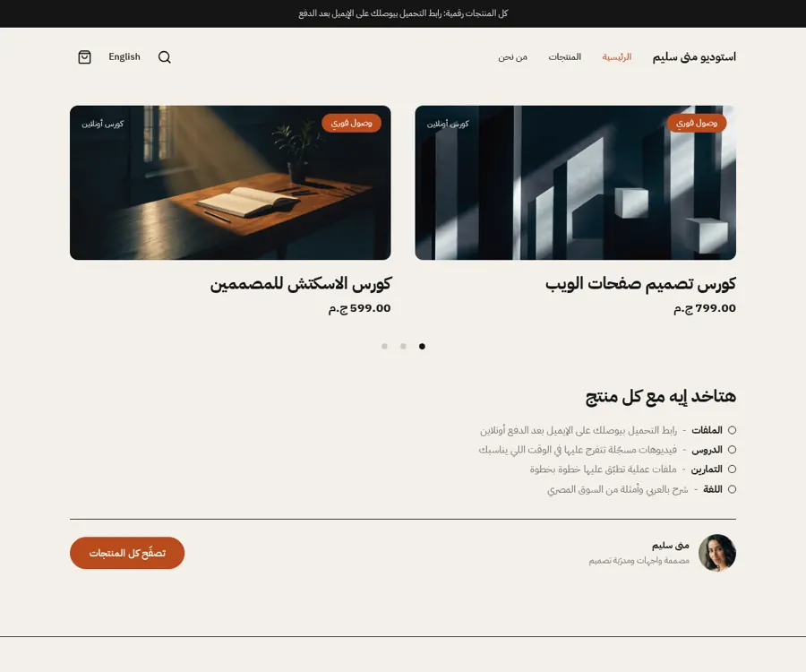
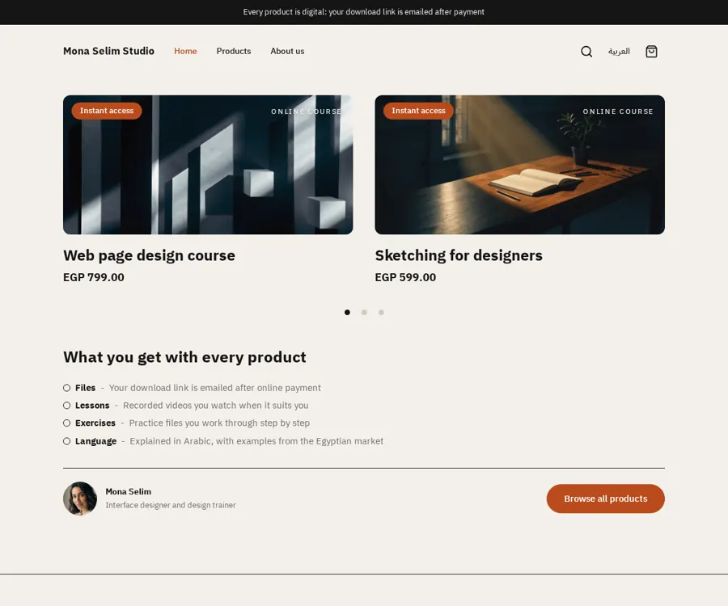
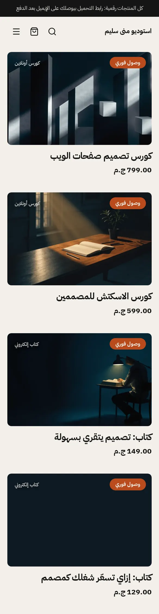
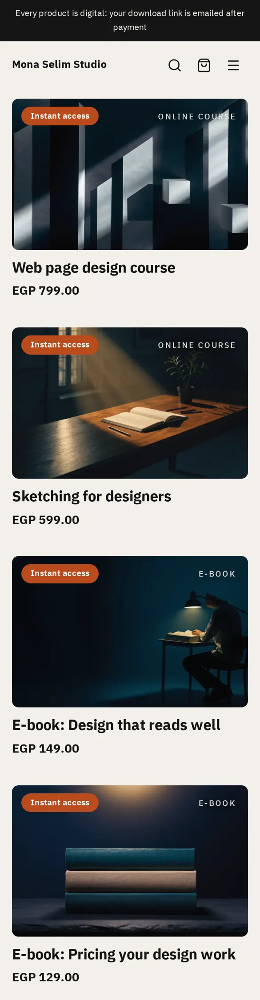
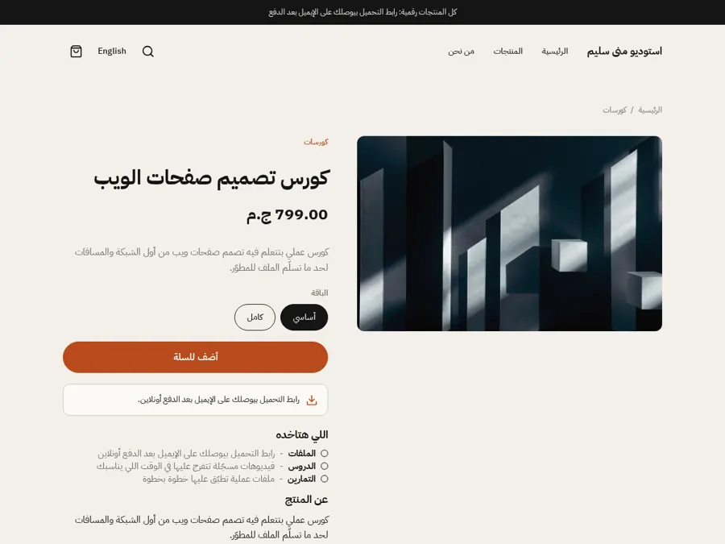
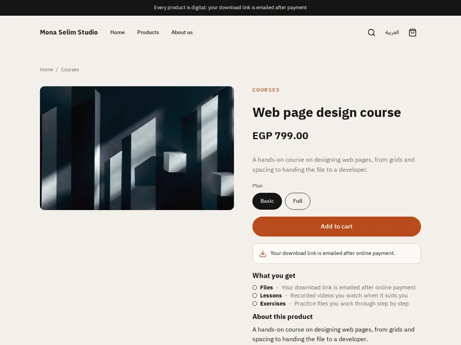
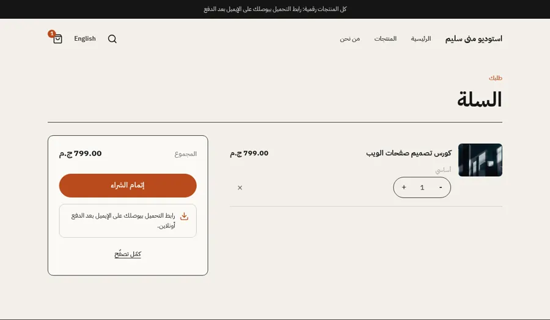
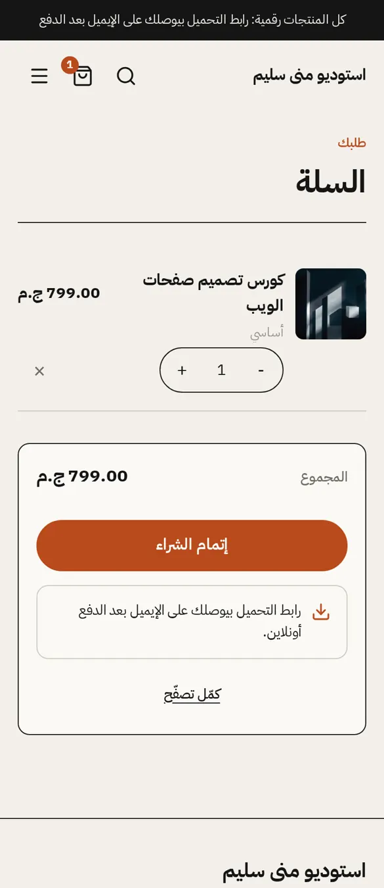

# Tutorial: Creator, an editorial store for one creator

Creator is a complete store for one person selling online courses, e-books and
templates. Warm paper background, black type, one orange accent, pill buttons
and 12 px cover images. It styles **every page type itself**: home, product (plus
a sales-page alternate for digital products), collection, search, cart, 404 and
content page, together with an editable announcement bar, header and footer.

The templates in the Sneferu SDK's default store are only a fallback for themes
that do not write a page type. Creator writes all of them, so nothing here is
borrowed from the default store.

| Mockup | Home, Arabic | Home, English |
| - | - | - |
|  |  |  |
|  |  |  |

| Product, Arabic | Product, English | Cart, Arabic | Cart, phone |
| - | - | - | - |
|  |  |  |  |

The mockup was a design brief: its Arabic is placeholder text and its prices
were in dollars. The theme keeps its look (layout, type, colours, shapes) and
uses real Arabic copy and Egyptian pounds.

## What you will learn

- how a theme covers every page type, and where each one lives
- how the header, footer and announcement bar are editable **section groups**
- how tokens in `theme.json` colour and size the whole store
- how to add a section, a block and a locale key

## Run it

```bash
sneferu dev .              # http://127.0.0.1:4100, Arabic; add /en for English
sneferu dev . --port 4304  # another port
sneferu format .           # prettier for .snf files (format --check in CI)
sneferu validate .         # every diagnostic, no files written
sneferu build .            # compile to a package
sneferu push .             # upload to your Hekana store (needs an API key)
```

Open `/products/web-page-design-course`, `/category/courses`, `/search?q=...`,
`/cart`, `/pages/about` and any unknown path for the 404. Add
`?template=product.digital` to a product to see the sales-page layout. The
sample products, collections and menus come from `.sneferu-dev/data.json`,
which is never part of the theme.

## Structure

```
creator/
  theme.json                 id, version 2.0.0, tokens (colours, fonts, radius, width)
  layout/theme.snf           skip link, the three groups, <main>
  groups/                    what a new store starts with
    announcement.json  header.json  footer.json
  templates/
    index.snf                home: covers, what you get, author
    product.snf              product: gallery on one side, details on the other
    product.digital.snf      alternate: wide cover, content left, sticky buy box
    collection.snf  search.snf  cart.snf  404.snf  page.snf
  sections/
    announcement-bar  creator-header  creator-footer       (the groups)
    covers  what-you-get  author  faq  related-products    (home and product)
    product-main  product-sales  collection-main
    search-main  cart-main  not-found  page-main
  blocks/
    menu-link  menu-sub-link  footer-column  footer-link
    social-link  contact-line  payment-method                (header and footer)
    product-title  product-price  product-excerpt  product-variants
    product-buy  product-description  product-tags  product-category
    note  block-title  get-item  faq-item                    (pages)
  snippets/                  cover (a product card), list-item, empty
  locales/ar.json en.json    small labels, identical keys
  assets/theme.css           all styling, class prefix cr-
  docs/                      screenshots used by this file
```

## How to customize

**Tokens.** Colours, the two font roles, corner radius and content width are in
`theme.json` under `tokens`. The stylesheet only reads `var(--hk-color-*)`,
`--hk-radius`, `--hk-btn-*` and `--hk-content-width`, so a merchant changes
them in the theme panel and every page follows. Extra tokens used here:
`surface` (cards), `line` (hairlines), `muted`, `on-primary`, `on-accent`.

**Sections.** The merchant adds, hides and reorders sections on each page, and
edits their text in both languages. Header, footer and announcement bar are
section groups: edit them once and every page changes. To add a section, create
`sections/<name>.snf` with markup and an `<hk-schema>`; give every setting a
bilingual label, a default and a limit. Use `"templates": [...]` to say where it
may be placed.

**Blocks.** Menu links, footer columns, social links, contact lines, payment
methods, product page rows, "what you get" items and questions are blocks. The
product page is a list of blocks (category, title, price, excerpt, variants,
buy button, note, heading, items, description, tags): reorder or remove any of
them.

**Menus.** The header and footer print the store's `main` and `footer` menus,
including dropdowns. A store without those menus shows the menu-link blocks and
footer columns instead.

**Locales.** Small words (skip link, breadcrumb, sort label, sale badge) are
keys in `locales/ar.json` and `locales/en.json`. Keep the two files identical
in keys. Everything else is a setting or a block, so there is no Arabic or
English text inside a template.

**Pages and their shape.**

| Page | Template | Main section | Notes |
| - | - | - | - |
| Home | `index` | `covers`, `what-you-get`, `author` | covers scroll sideways, two at a time, on a computer |
| Product | `product` | `product-main` | gallery, variants, buy button, note, description, questions, more products |
| Product (digital) | `product.digital` | `product-sales` | assign it to a product in the dashboard |
| Collection | `collection` | `collection-main` | sort and filters, 2 or 3 columns, pagination |
| Search | `search` | `search-main` | form, results, empty state |
| Cart | `cart` | `cart-main` | lines and summary are drawn by the cart controllers |
| 404 | `404` | `not-found` | big number, search, two suggestions |
| Page | `page` | `page-main` | readable article column |

## Notes

- No JavaScript ships with the theme. The variant picker, quantity, cart and
  gallery come from the SDK controllers; disclosure uses `<details>`.
- The layout is right to left in Arabic and uses logical CSS properties.
  Touch targets are at least 44 px.
- The seeded `what you get` rows and the product page rows are flat blocks,
  because default blocks written in a template cannot hold child blocks.

## Upgrading from 1.x to 2.0.0

Version 2.0.0 adds the missing page types, the announcement group and many new
settings. No setting, section or block that 1.3.0 used was renamed or removed
(`creator-header`, `creator-footer`, `covers`, `what-you-get`, `author`,
`get-item` keep their ids and setting names), so no migration file is needed and
saved values carry over. The footer's old fixed sentence is now the footer
section's `about_text` setting; the locale key behind it is gone, so a store that
had overridden that key sets the new setting instead.
