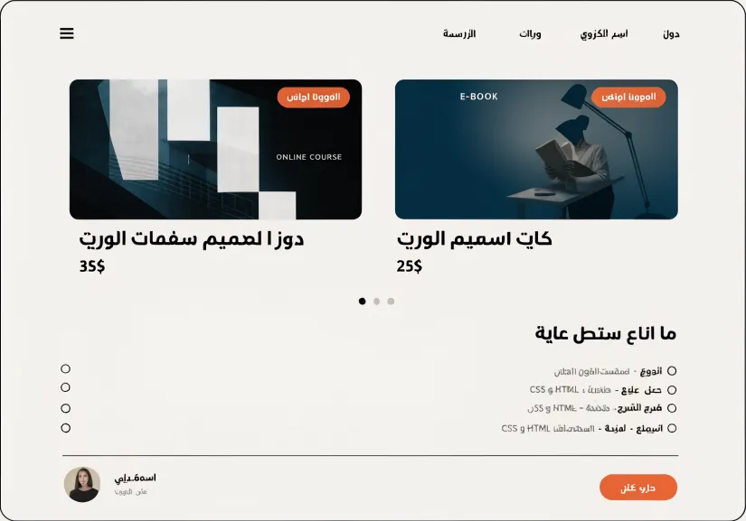
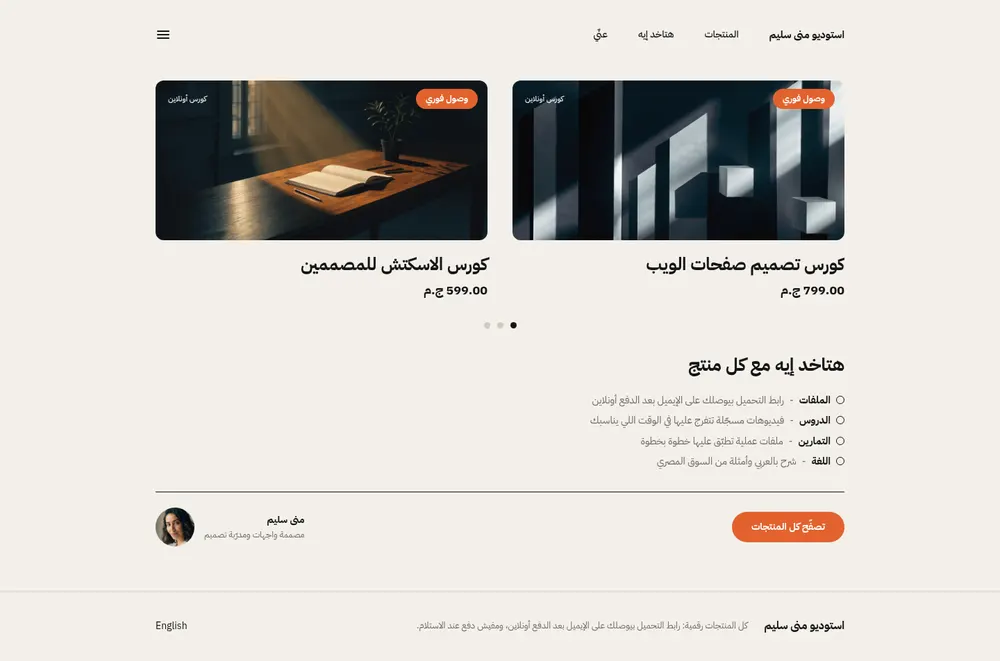
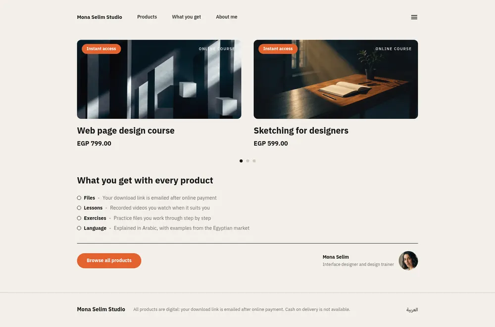
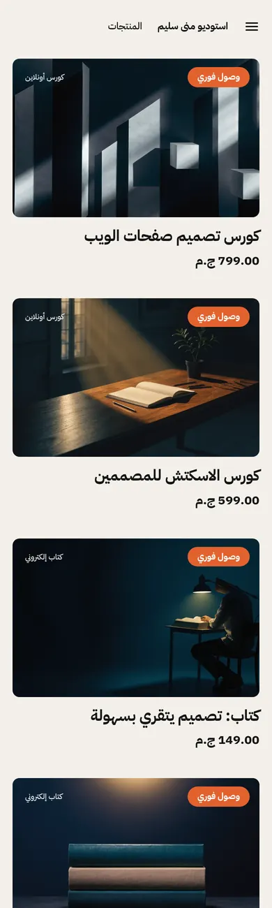
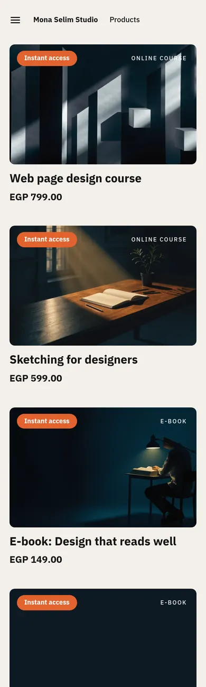

# Tutorial: Creator, an editorial store for one creator

Creator is a home page for one person selling online courses, e-books and
templates. Warm paper background, black type, one orange accent. Large cover
cards scroll sideways two at a time on a computer and stack on a phone; each
cover carries an "Instant access" badge and a label for its kind. Below: a
"what you get" checklist and an author strip with a photo and a button.

| Mockup | Live, Arabic | Live, English |
| - | - | - |
|  |  |  |
|  |  |  |

The mockup was generated as a design brief; its Arabic is placeholder text and
its prices were in dollars. Live:
[demo-creator.hekana.com](https://demo-creator.hekana.com) and
[/en](https://demo-creator.hekana.com/en).

What the theme uses: `hk-product-card` with its `badge` part (the badge and
the kind label), a CSS scroll-snap row for the carousel (no script),
`` with arguments, `collection` settings, blocks seeded by the
template, localized text settings, an `image` setting, `hk-icon` and
`hk-button`. Version 1.2.0 is built on Sneferu 0.4.

## Upgrading from 1.0

In 1.1.0 the numbered settings and locale-text fallbacks became blocks and
localized settings; values saved under 1.0 are not carried over, so the sections
start from the new defaults.

## Pages

Creator writes only the home page (`templates/index.sneferu`). The product,
collection, search, cart, content page and 404 templates come from the SDK's
default store ([page types](../../../docs/guide/16-page-types.mdx)), drawn with
Creator's tokens, fonts and layout. `assets/theme.css` restyles what the default
store would otherwise draw in its own way (the block "Cart, product, collection,
search and 404 pages"):

- the theme had no cart link: the header now has a bag icon with the item count
  next to the menu, and it opens the cart drawer;
- the accent orange is a little deeper (`#B94A1B`, was `#E2622E`) and `on-accent` is
  white, so white button text and orange links reach 4.5:1 on white and on the paper
  background;
- the link reset is `:where(.cr a)`, so the default store's buttons keep their own text colour;
- header links and the carousel dots are 44 px tall.

The header group holds the cart drawer: it opens when an item is added (a
setting of the header section) and from the cart icon.

| Page | URL in `sneferu dev` |
| - | - |
| Product | `/products/sample-2` |
| Collection | `/category/gift-cards`, `/products` |
| Search | `/search?q=card` |
| Cart | `/cart` |
| Content page | `/pages/about` |
| 404 | any other path |

## Files

```
assets/theme.css
blocks/get-item.sneferu
groups/footer.json
groups/header.json
layout/theme.sneferu
locales/ar.json
locales/en.json
sections/author.sneferu
sections/covers.sneferu
sections/creator-footer.sneferu
sections/creator-header.sneferu
sections/what-you-get.sneferu
snippets/cover.sneferu
templates/index.sneferu
theme.json
```

Next to the theme: `README.md` and `docs/` (this tutorial and its pictures),
and `.sneferu-dev/data.json` (sample data for `dev`). The CLI skips all three:
they are never checked and never pushed.

## Data it needs

| Handle | Label on the cover |
| - | - |
| `courses` | Online course |
| `ebooks` | E-book |
| `templates` | Templates |

These are the defaults of the covers section's three `collection` settings;
the merchant can pick other categories in the editor. The label on each cover
is a localized setting next to its collection, so it describes the collection
the product is listed under.

## 1. Manifest and tokens

```json title="theme.json"
{
  "id": "creator",
  "name": "Creator",
  "version": "1.2.0",
  "author": "Hekana",
  "description": "An editorial theme for one creator selling courses, e-books and templates",
  "category": "digital",
  "engine": "hk2",
  "engineCompatibility": "^2.0.0",
  "defaultLocale": "ar",
  "locales": ["ar", "en"],
  "settings": {},
  "tokens": {
    "colors": {
      "primary": "#151515",
      "secondary": "#0F1A24",
      "accent": "#B94A1B",
      "background": "#F3F0EA",
      "text": "#151515",
      "muted": "#716B64",
      "line": "#CFC8BE",
      "on-accent": "#FFFFFF"
    },
    "layout": { "contentWidth": "1040px" },
    "fonts": {
      "heading": "IBM Plex Sans Arabic",
      "body": "IBM Plex Sans Arabic"
    }
  }
}
```

`line` and `muted` are extra colour keys; the stylesheet reads them as
`var(--hk-color-line)` and `var(--hk-color-muted)`.

## 2. Layout

```html title="layout/theme.sneferu"
<div class="cr">
  <hk-section-group name="header" />
  <main><hk-slot name="content" /></main>
  <hk-section-group name="footer" />
</div>
```

The header and the footer are [section groups](../../../docs/guide/18-section-groups.mdx): the layout places
`<hk-section-group name="header" />` and `<hk-section-group name="footer" />`, `groups/header.json` and
`groups/footer.json` start them with `creator-header` and `creator-footer`, and the merchant edits them once for the
whole store. The header also holds the cart: the cart link carries `data-hk-open="cart-drawer"` and
`<hk-cart-count />`, and `<hk-cart-drawer>` lists the lines (a plain link to the cart page without JavaScript).

```html title="sections/creator-header.sneferu"
<header class="cr-header">
  <div class="cr-wrap cr-header-row">
    <nav class="cr-nav" aria-label="{{ t('nav_label') }}">
      <a class="cr-brand" href="{{ store.url }}">{{ store.name }}</a>
      <a class="cr-link" href="{{ url('/') }}#shop">{{ t('nav_shop') }}</a>
      <a class="cr-link" href="{{ url('/') }}#what">{{ t('nav_what') }}</a>
      <a class="cr-link" href="{{ url('/') }}#about">{{ t('nav_about') }}</a>
    </nav>
    <div class="cr-tools">
      <a class="cr-cart" href="{{ url('/cart') }}" data-hk-open="cart-drawer" aria-label="{{ t('cart') }}"><hk-icon
          name="shopping-bag"
          size="22"
        /><hk-cart-count /></a>
      <details class="cr-menu">
        <summary class="cr-menu-button" aria-label="{{ t('menu') }}"><hk-icon name="menu" size="22" /></summary>
        <div class="cr-menu-panel">
          <a href="{{ url('/') }}#shop">{{ t('nav_shop') }}</a>
          <a href="{{ url('/') }}#what">{{ t('nav_what') }}</a>
          <a href="{{ url('/') }}#about">{{ t('nav_about') }}</a>
          <a href="{{ url('/products') }}">{{ t('all_products') }}</a>
          <hk-locale-switch />
        </div>
      </details>
    </div>
  </div>
  <hk-cart-drawer open-on-add="{{ section.settings.drawer_on_add }}">
    <hk-cart-items />
    <hk-cart-summary />
  </hk-cart-drawer>
</header>
<hk-schema>
  {
    "name": "Header",
    "version": 1,
    "templates": ["header"],
    "settings": {
      "drawer_on_add": {
        "type": "boolean",
        "label": "Open the cart when an item is added",
        "default": true
      }
    }
  }
</hk-schema>
```


The menu button is a `<details>`/`<summary>` pair, so it opens without script.
On phones the stylesheet hides all but the store name and the first link.

## 3. The covers row

```html title="sections/covers.sneferu"
<section class="cr-covers" id="shop">
  <div class="cr-wrap">
    <h2 class="cr-hidden">{{ t('shop_heading') }}</h2>
    <div class="cr-track">
      
        
      
      
        
      
      
        
      
    </div>
    <nav class="cr-dots" aria-label="{{ t('shop_heading') }}">
      
        <a href="#course-{{ forloop.index }}" aria-label="{{ p.title }}"></a>
      
      
        <a href="#ebook-{{ forloop.index }}" aria-label="{{ p.title }}"></a>
      
      
        <a href="#template-{{ forloop.index }}" aria-label="{{ p.title }}"></a>
      
    </nav>
  </div>
</section>
<hk-schema>
  {
    "name": "Covers",
    "version": 1,
    "settings": {
      "badge": {
        "type": "text",
        "label": "Badge on every cover",
        "localized": true,
        "default": {
          "ar": "وصول فوري",
          "en": "Instant access"
        },
        "maxLength": 30
      },
      "list_1": {
        "type": "collection",
        "label": "First collection",
        "default": "courses"
      },
      "kind_1": {
        "type": "text",
        "label": "First collection: label on the cover",
        "localized": true,
        "default": {
          "ar": "كورس أونلاين",
          "en": "Online course"
        },
        "maxLength": 30
      },
      "list_2": {
        "type": "collection",
        "label": "Second collection",
        "default": "ebooks"
      },
      "kind_2": {
        "type": "text",
        "label": "Second collection: label on the cover",
        "localized": true,
        "default": {
          "ar": "كتاب إلكتروني",
          "en": "E-book"
        },
        "maxLength": 30
      },
      "list_3": {
        "type": "collection",
        "label": "Third collection",
        "default": "templates"
      },
      "kind_3": {
        "type": "text",
        "label": "Third collection: label on the cover",
        "localized": true,
        "default": {
          "ar": "قوالب",
          "en": "Templates"
        },
        "maxLength": 30
      },
      "count": {
        "type": "range",
        "label": "Products from each collection",
        "default": 6,
        "min": 1,
        "max": 12,
        "step": 1
      }
    }
  }
</hk-schema>
```

Three loops, one per `collection` setting, feed one row; each takes
`limit: section.settings.count` products. Each passes the product, the label
for its kind and a short `slot` name to the `cover` snippet:

```html title="snippets/cover.sneferu"
<article class="cr-cover" id="{{ slot }}-{{ forloop.index }}">
  <hk-product-card product="{{ p }}" class="cr-card">
    <hk-part name="badge">
      <span class="cr-flag">{{ section.settings.badge }}</span>
      <span class="cr-kind">{{ kind }}</span>
    </hk-part>
  </hk-product-card>
</article>
```

- `{{ slot }}-{{ forloop.index }}` gives every cover an id (`course-1`,
  `ebook-2`, …). The dots under the row are links to those ids, so a click
  scrolls the row to that cover.
- `forloop` inside a snippet is the loop of the caller: a snippet sees its
  arguments plus the caller's scope.
- The badge reads the section setting `badge`, a localized text with
  "Instant access" in both languages as its default.
- The badge and the label are the card's `badge` part: they render inside the
  card's link, before the image, and CSS places them over the image.

The row is CSS grid with `grid-auto-flow: column`: every cover is half the row
wide, the row scrolls sideways and snaps to each cover. On phones it becomes a
normal one-column grid, and the dots are hidden. One dot per product is
rendered and every second one is hidden, which leaves one dot per pair:

```css title="assets/theme.css (excerpt)"
/* Covers: two per view on wide screens, scroll-snapped; one per row on phones */
.cr-covers { padding-block: 36px 8px; }
.cr-track {
  display: grid; grid-auto-flow: column; grid-auto-columns: calc((100% - 36px) / 2); gap: 36px;
  overflow-x: auto; scroll-snap-type: x mandatory; scrollbar-width: none; padding-bottom: 4px;
}
.cr-track::-webkit-scrollbar { display: none; }
.cr-cover { position: relative; scroll-snap-align: start; scroll-margin-top: 24px; }
.cr-card { display: flex; flex-direction: column; text-decoration: none; color: inherit; }
.cr-card img {
  width: 100%; aspect-ratio: 2.08 / 1; object-fit: cover; display: block;
  border-radius: 12px; background: var(--hk-color-secondary);
}
.cr-card .sn-title { margin-top: 18px; font-size: 25px; font-weight: 700; line-height: 1.35; }
.cr-card .sn-price { margin-top: 6px; font-size: 18px; font-weight: 700; }
.cr-card .sn-was { font-weight: 400; color: var(--hk-color-muted); }
.cr-card:hover .sn-title { color: var(--hk-color-accent); }
.cr-flag {
  position: absolute; top: 12px; inset-inline-start: 14px;
  background: var(--hk-color-accent); color: #FFFFFF;
  font-size: 12.5px; font-weight: 600; line-height: 1; padding: 8px 14px; border-radius: 999px;
}
.cr-kind {
  position: absolute; top: 18px; inset-inline-end: 18px;
  color: #FFFFFF; font-size: 11px; font-weight: 500; letter-spacing: .14em; text-transform: uppercase; opacity: .9;
}
.cr-dots { display: flex; justify-content: center; gap: 0; margin-top: 16px; }
.cr-dots a { display: grid; place-items: center; width: 28px; height: 44px; }
.cr-dots a::after { content: ''; width: 9px; height: 9px; border-radius: 50%; background: var(--hk-color-line); }
.cr-dots a:first-child::after { background: var(--hk-color-text); }
.cr-dots a:nth-child(even) { display: none; }
```

## 4. What you get

```html title="sections/what-you-get.sneferu"
<section class="cr-what" id="what">
  <div class="cr-wrap">
    <h2 class="cr-h2">{{ section.settings.heading }}</h2>
    <div class="cr-list">
      
        <hk-block of="{{ block }}" />
      
    </div>
  </div>
</section>
<hk-schema>
  {
    "name": "What you get",
    "version": 1,
    "settings": {
      "heading": {
        "type": "text",
        "label": "Heading",
        "localized": true,
        "default": {
          "ar": "هتاخد إيه مع كل منتج",
          "en": "What you get with every product"
        },
        "maxLength": 80
      }
    },
    "blocks": {
      "allowed": ["get-item"],
      "max": 8
    }
  }
</hk-schema>
```

```html title="blocks/get-item.sneferu"
<p class="cr-item">
  <span class="cr-tick" aria-hidden="true"></span>
  <strong>{{ block.settings.term }}</strong>
  <span class="cr-dash" aria-hidden="true">-</span>
  <span>{{ block.settings.text }}</span>
</p>
<hk-schema>
  {
    "name": "What you get: item",
    "version": 1,
    "settings": {
      "term": {
        "type": "text",
        "label": "Item",
        "localized": true,
        "default": {
          "ar": "الدروس",
          "en": "Lessons"
        },
        "maxLength": 40
      },
      "text": {
        "type": "text",
        "label": "Detail",
        "localized": true,
        "default": {
          "ar": "فيديوهات مسجّلة تتفرج عليها في الوقت اللي يناسبك",
          "en": "Recorded videos you watch when it suits you"
        },
        "maxLength": 120
      }
    }
  }
</hk-schema>
```

Each item is a `get-item` block with a localized term and detail. The template
seeds four, so a new store shows the list in both languages; the merchant can
edit them or add up to eight.

## 5. The author strip

```html title="sections/author.sneferu"
<section class="cr-author" id="about">
  <div class="cr-wrap">
    <div class="cr-author-row">
      <div class="cr-person">
        
          
        
        <div>
          <p class="cr-name">{{ section.settings.name }}</p>
          <p class="cr-role">{{ section.settings.role }}</p>
        </div>
      </div>
      <hk-button label="{{ section.settings.button }}" href="{{ section.settings.link }}" class="cr-cta" />
    </div>
  </div>
</section>
<hk-schema>
  {
    "name": "Author",
    "version": 1,
    "settings": {
      "photo": {
        "type": "image",
        "label": "Photo",
        "default": "https://api.hekana.com/api/v1/uploads/file/demo/digital-themes/v1/author.webp"
      },
      "name": {
        "type": "text",
        "label": "Name",
        "localized": true,
        "default": {
          "ar": "منى سليم",
          "en": "Mona Selim"
        },
        "maxLength": 60
      },
      "role": {
        "type": "text",
        "label": "One line about you",
        "localized": true,
        "default": {
          "ar": "مصممة واجهات ومدرّبة تصميم",
          "en": "Interface designer and design trainer"
        },
        "maxLength": 100
      },
      "button": {
        "type": "text",
        "label": "Button",
        "localized": true,
        "default": {
          "ar": "تصفّح كل المنتجات",
          "en": "Browse all products"
        },
        "maxLength": 30
      },
      "link": {
        "type": "link",
        "label": "Button link",
        "default": "/products"
      }
    }
  }
</hk-schema>
```

- `photo` is an `image` setting whose default is an `https://` URL. The theme
  does not bundle the photo.
- Name, role and button text are localized settings; the button link is a
  `link` setting (default `/products`) that `hk-button` keeps in the page's
  language.
- `` drops the image when the merchant clears it.
- `hk-button` is styled through the class passed to it (`cr-cta`).

## 6. Words

```json title="locales/en.json"
{
  "nav_label": "Main menu",
  "nav_shop": "Products",
  "nav_what": "What you get",
  "nav_about": "About me",
  "menu": "Menu",
  "all_products": "All products",
  "shop_heading": "Courses, e-books and templates",
  "footer_note": "All products are digital: your download link is emailed after online payment. Cash on delivery is not available.",
  "cart": "Cart"
}
```

The Arabic file has the same keys in Egyptian Arabic. Only interface words are
left in the locale files; the copy is in settings and blocks.

## Reproduce it

```bash
npx sneferu init creator          # start from the starter theme
cd creator
# replace the starter files with the ones above, then:
npx sneferu format              # indent .sneferu, theme.json and locales
npx sneferu validate            # must print: theme creator@1.1.0 is valid
npx sneferu dev                 # http://127.0.0.1:4100, add ?locale=en for English
```

`dev` reads `.sneferu-dev/data.json` (in this folder) as sample data, so the
preview shows this store's products and the collections the sections use
(`sneferu dev --data <file>` points at another file).

To put it on a store, sign in once and push to your dev store:

```bash
npx sneferu login
npx sneferu push . --package <your-slug> --dev-store
```

The `--package` slug must equal `id` in `theme.json`, so change both to a
slug of your own; `creator` here is the slug Hekana uses for its own copy. Bump
`version` in `theme.json` before every push: a pushed version cannot be
replaced. On a live store, either create product categories with the default
handles (see "Data it needs" above) or pick the categories in the editor. During this release only the home
page (`/`, and `/en`) is rendered by the theme; product, category and cart
pages use the store's regular theme.

## Notes and limits met on the way

Version 1.0 was built on Sneferu 0.2 and worked around five SDK gaps. Version
1.1.0 uses the Sneferu 0.3 features that close them:

- Fonts: `tokens.fonts` with a catalogue font replaces `assets/fonts.css`
  (`@font-face` rules pointing at Google Fonts).
- Collections: `collection` settings, with the old handles as defaults, replace
  the handles written into the templates.
- Words: `"localized": true` settings with Arabic and English defaults replace
  empty settings printed with `default: t('…')`.
- Lists: template default blocks replace the locale-key fallback shown while a
  section had no blocks.
- Links: `url('/products')` replaces link paths in the locale files.
- Icons: `hk-icon name="menu"` replaces the inline SVG menu icon.
- Cover badge: the card's `badge` part replaces badges placed next to the card.

Still open:

- Bundled images are served from 0.3, but this theme still ships none (no new
  art was made for 1.1.0): art comes from products, inline SVG, or an `image`
  setting with an `https://` default.
- `url()` always links within the page's language; since 1.2.0 the language
  switch is `<hk-locale-switch />`, which keeps the page.
