# Tutorial: Dawa, a clean online pharmacy store

Dawa is a store theme for an online pharmacy: white ground, one teal accent and
light grey photo tiles. A pharmacy-counter hero carries an editable "send your
prescription on WhatsApp" card over its lower edge, then category tiles, a row of
products with small pill buttons and a three-point trust strip. It is right-to-left
in Arabic and left-to-right in English from the same files. Hekana has no
prescription upload, so the card is a link (a setting) to WhatsApp or the contact
page. The theme makes no medical claims; every line is editable.

The theme writes every page type itself: home, product, collection, search, cart,
404 and content page, with an announcement bar, header and footer as section groups.

| Page | Arabic, desktop | English, desktop | Arabic, phone |
| - | - | - | - |
| Home | 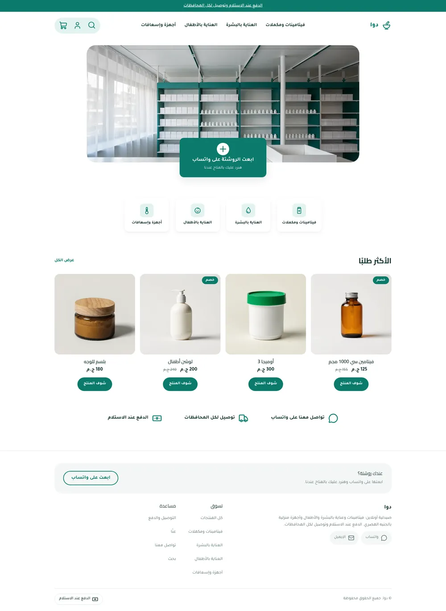 | 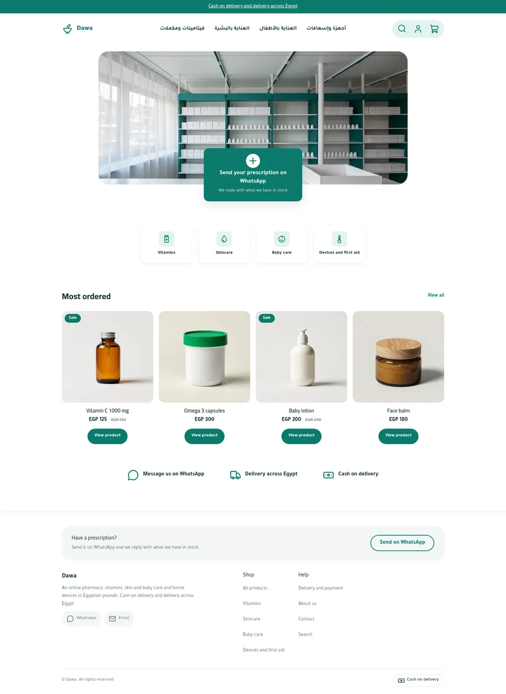 | 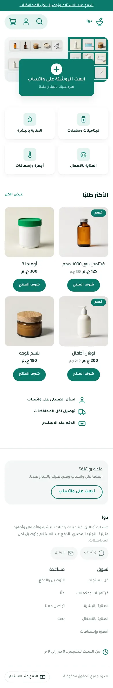 |
| Product | 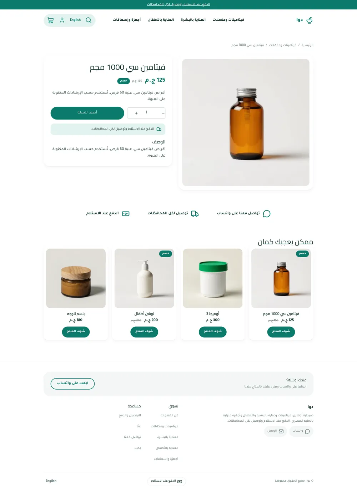 | 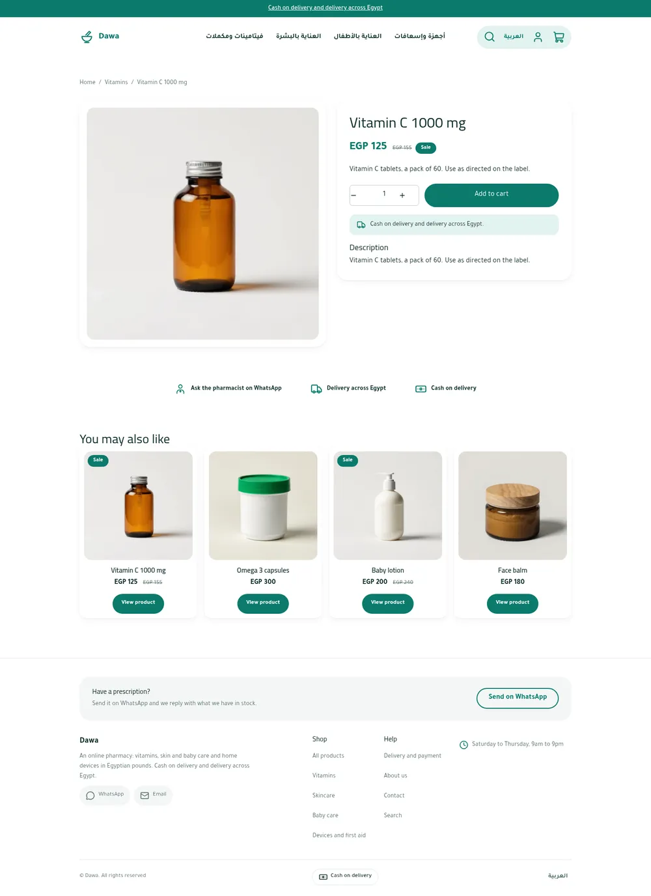 | 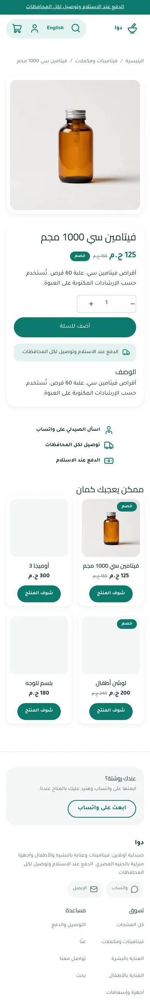 |
| Cart | 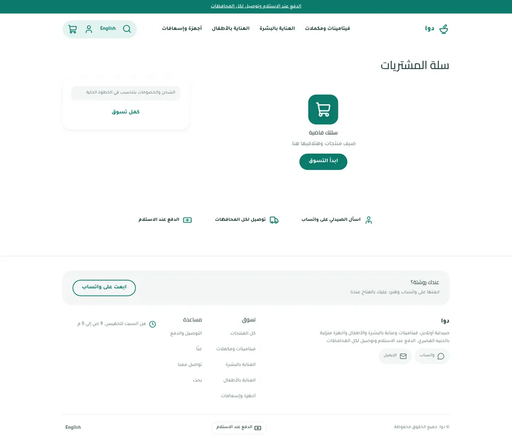 | 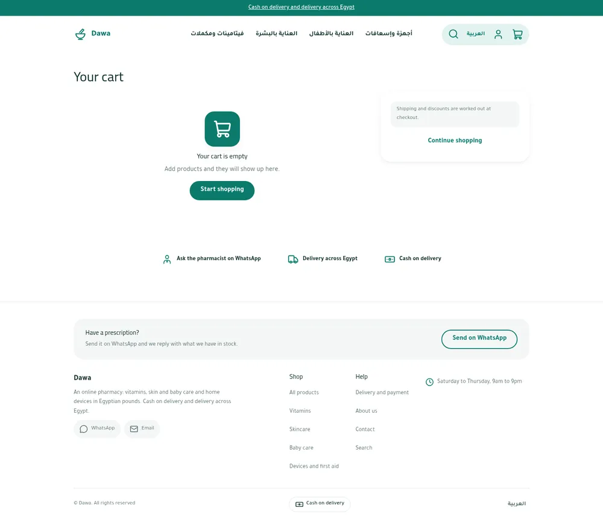 | 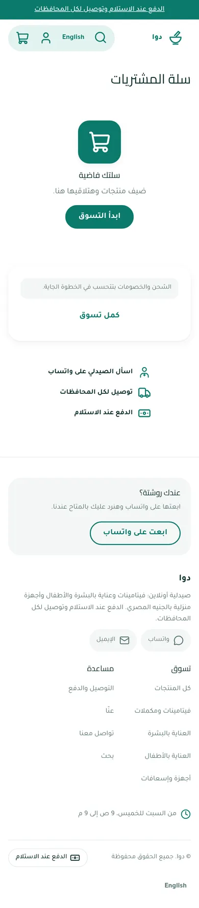 |

The design brief was this mockup (placeholder Arabic and fake logos, replaced by
real copy and a plain-text wordmark):

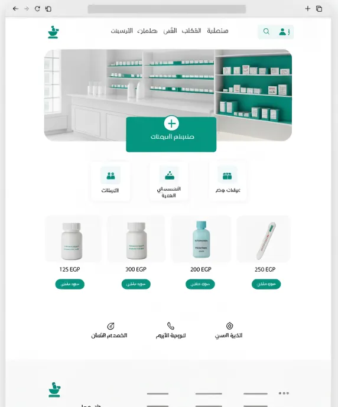 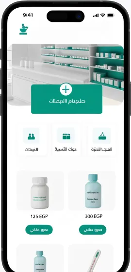

## What is in the folder

```
theme.json                 id, version, tokens (teal palette, Cairo + Tajawal), money whole
layout/theme.snf           announcement, header, <main>, footer
groups/                    announcement.json, header.json, footer.json
templates/                 index, product, collection, search, cart, 404, page
sections/                  dawa-hero, dawa-categories, dawa-products, dawa-trust,
                           header, footer, announcement-bar, product-main, related-products,
                           collection-main, search-main, cart-main, not-found, page-main
blocks/                    category-tile, trust, menu-link, footer-*, social-link,
                           contact-line, payment-method, product-*
snippets/                  product-card, price, button, glyph (inline pharmacy icons)
locales/                   ar.json, en.json (same keys)
assets/theme.css           the only stylesheet; every colour is a token
assets/hero.webp           default hero, a shelf arrangement made from product photos
```

## Excerpts

The prescription card is one link, so it needs no form:

```html
<a class="dw-rx" href="{{ url(section.settings.card_link) }}">
  <span class="dw-rx-icon"><hk-icon name="{{ section.settings.card_icon }}" size="30" /></span>
  <strong class="dw-rx-title">{{ section.settings.card_title }}</strong>
</a>
```

Pharmacy glyphs (mortar, bottle, baby, drop, thermometer, pharmacist) live in one
snippet; any other name falls through to `hk-icon`:

```html

```

## Run it

```bash
sneferu dev .
sneferu format .
sneferu validate .
```
