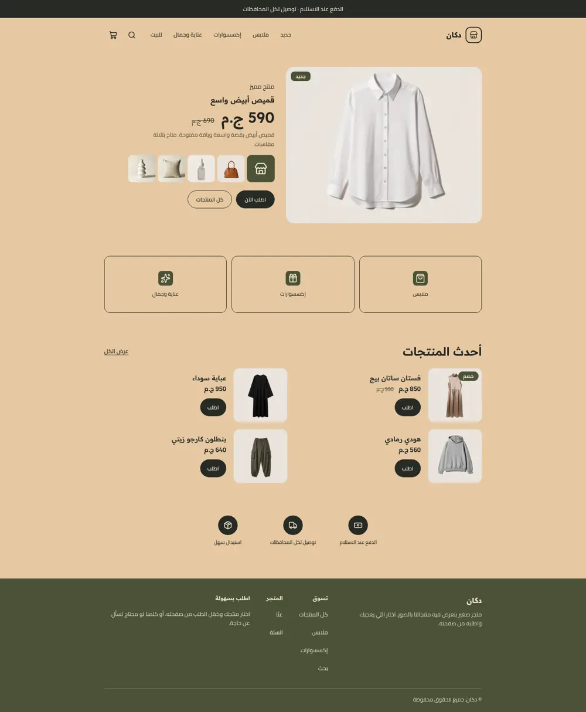
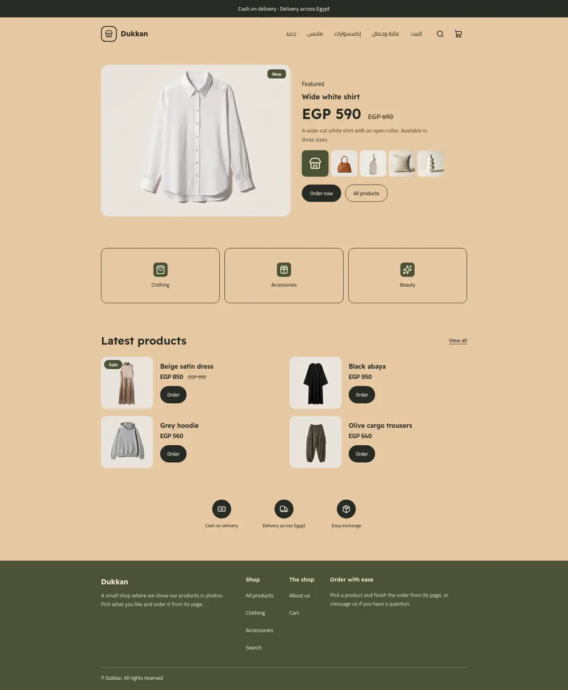
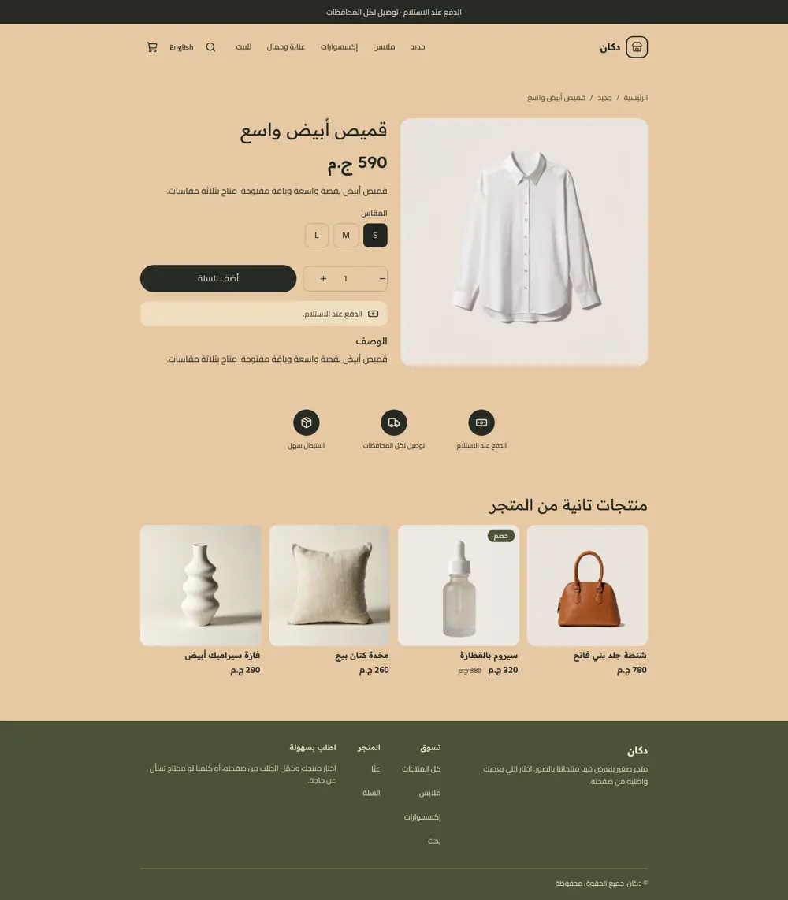
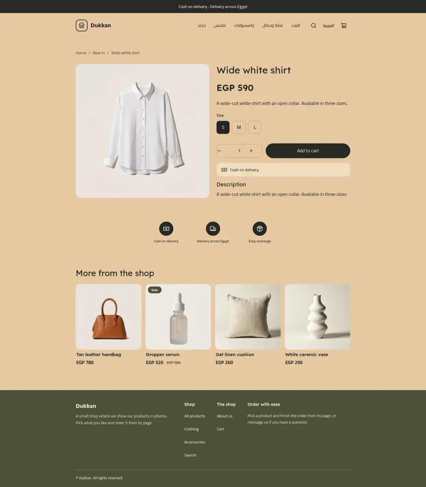
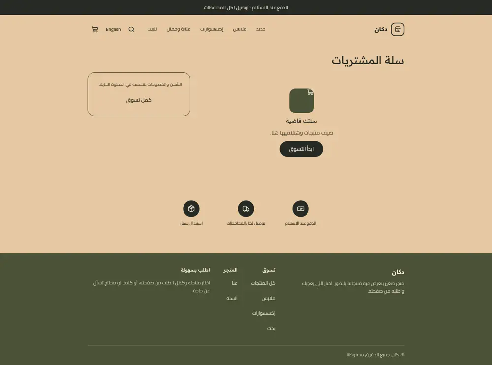
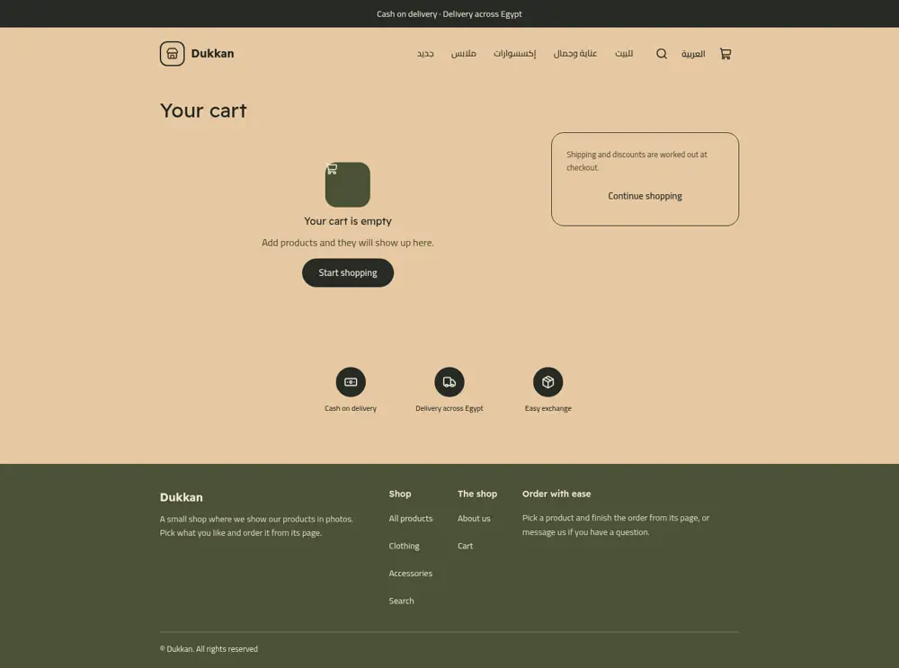
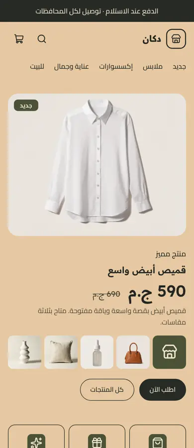
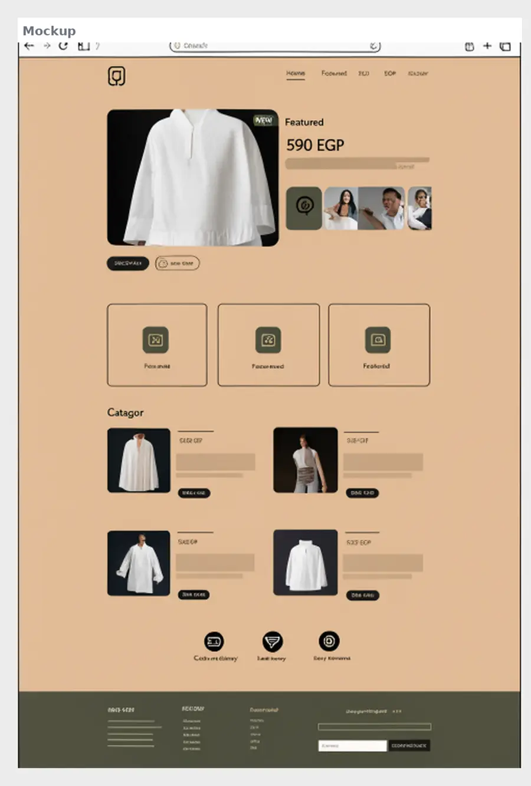
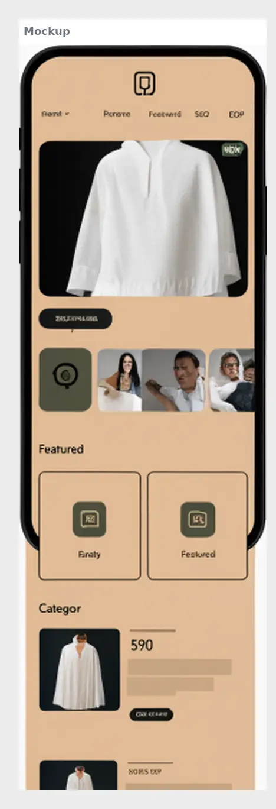

# Dukkan (دكان)

A social-seller shop theme: warm sand ground, one featured product with a large price and a photo strip, outlined category tiles, square product posts, three trust icons and an olive footer. Charcoal pill buttons, olive accents. Arabic first (RTL) with English, whole-pound prices.

Live demo store: https://demo-dukkan.hekana.com

| Page | Arabic | English |
| - | - | - |
| Home |  |  |
| Product |  |  |
| Cart |  |  |

Phone (Arabic): 

Mockup:  

## What is in the folder

- `theme.json`: sand, charcoal and olive tokens, Readex Pro + Cairo, `money.format: whole`.
- `layout/theme.snf` and `groups/`: announcement, header (logo image or mark, menu, search, cart drawer) and footer (about, link columns, social links, contact box).
- `sections/`: `dk-feature` (featured product and photo strip), `dk-tiles`, `dk-feed` (row or grid of products), `dk-trust`, plus the page sections (`product-main`, `collection-main`, `search-main`, `cart-main`, `page-main`, `not-found`, `related-products`).
- `blocks/`: `tile`, `trust`, `product-chat`, menu, footer and product blocks.
- `templates/`: all seven page types. `locales/`: `ar.json` and `en.json` with the same keys.

## Excerpts

The featured section reads the first product of a collection and uses the next ones for the strip:

```

  <a class="dk-strip-cell" href="{{ q.url }}">...</a>

```

Social, chat and contact links are link settings with empty defaults; they are hidden until the merchant fills them in.
