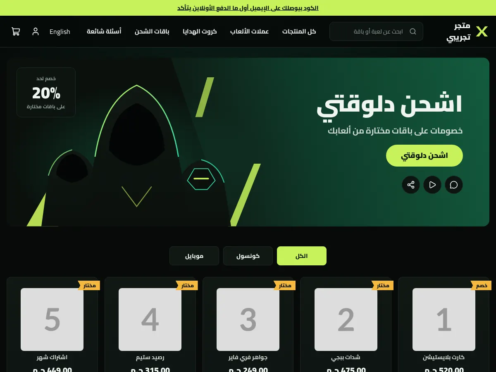
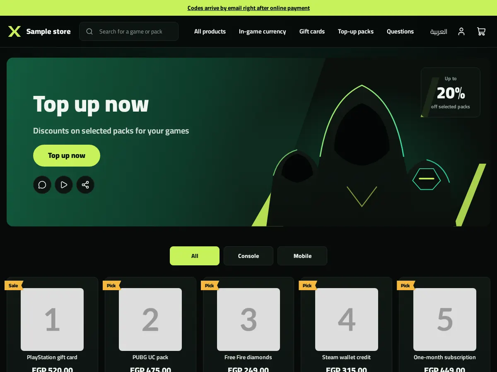
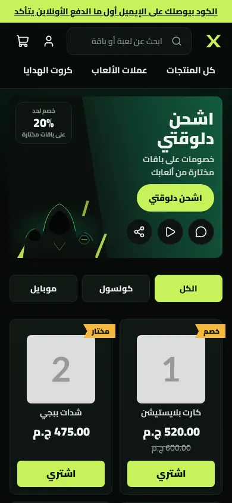
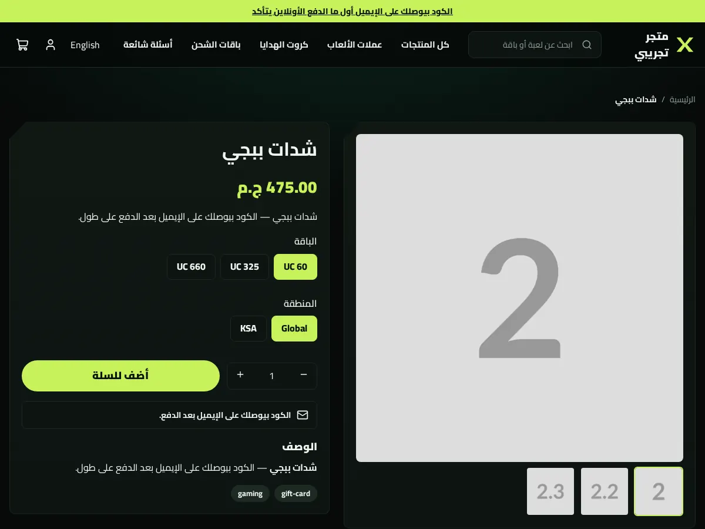
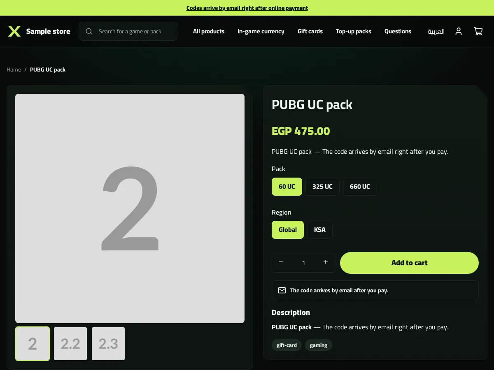
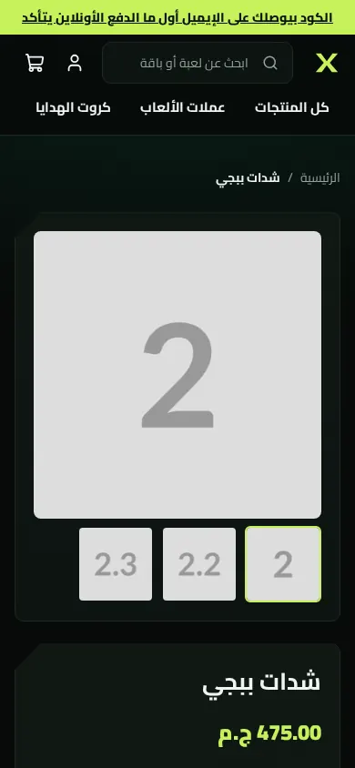
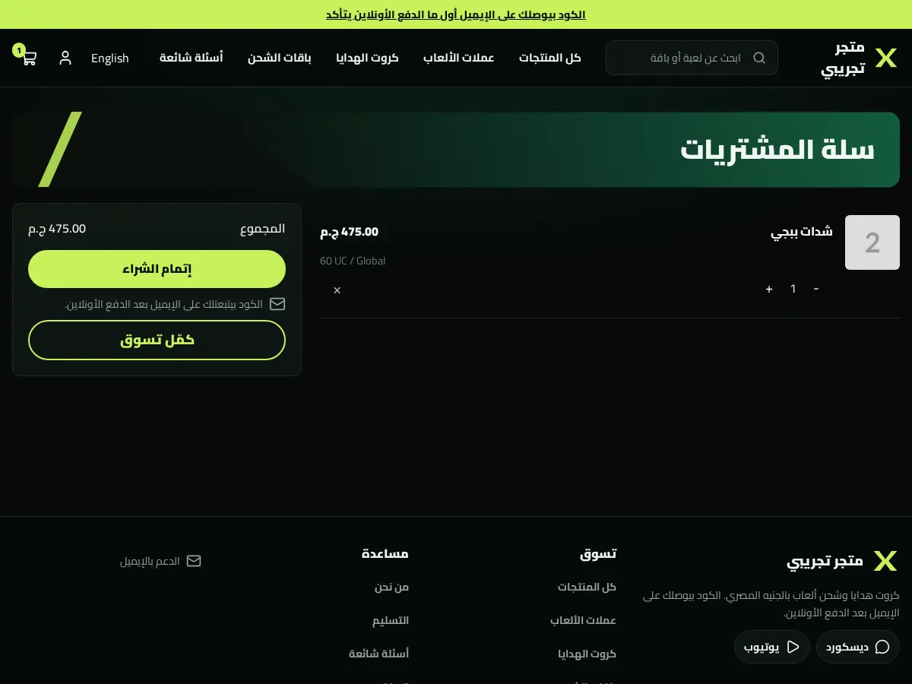
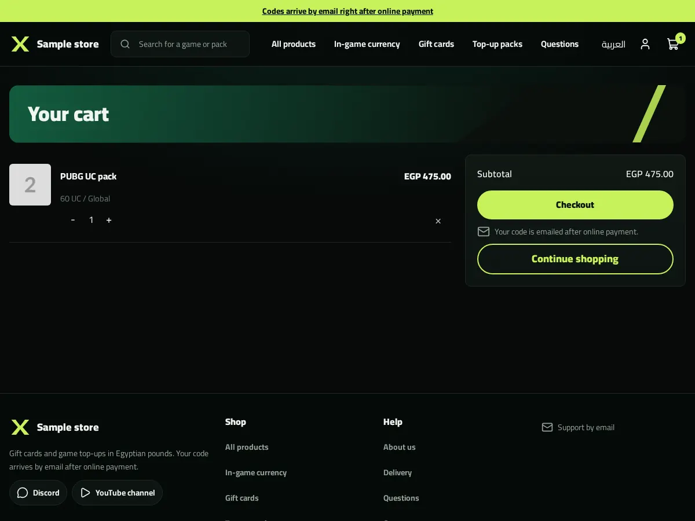
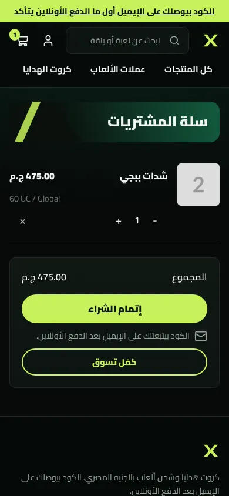

# Tutorial: Esports, a complete gaming top-up store

Esports is a full store theme for a shop that sells game currency, gift cards
and top-up packs as codes. It is black and deep green with a lime accent,
diagonal cuts, a slanted hero and top-up cards with a ribbon and a Buy button.
Every page type has its own design: home, product (plus a digital alternate),
collection, search, cart, content page and 404, with an announcement bar, a
header and a footer you edit as sections. It is right-to-left in Arabic and
left-to-right in English from the same files.

The Sneferu default store is only a fallback for page types a theme does not
write. Esports writes all of them, so no page is drawn by anything but this
folder. The folder is standalone: copy it anywhere and run it.

| Page | Arabic, desktop | English, desktop | Arabic, phone |
| - | - | - | - |
| Home |  |  |  |
| Product |  |  |  |
| Cart |  |  |  |

The design came from a mockup (`docs/mockup-desktop.webp`, `docs/mockup-phone.webp`).
Its purple ground became black and deep green, its Arabic was placeholder text,
and its hooded figures are redrawn as flat SVG silhouettes (or replaced by a
picture you upload in the hero). Social icons are neutral glyphs, not brand logos.

## Run it

```bash
npx sneferu dev .        # preview at http://127.0.0.1:4100, ?locale=en for English
npx sneferu format .     # format every file (use --check in CI)
npx sneferu validate .   # compile and check the theme
npx sneferu build .      # produce the artifact
npx sneferu push .       # publish (needs an API key)
```

Preview a product with the digital layout at `/products/sample-1?template=product.digital`.
Put your own products in `.sneferu-dev/data.json` (never pushed) to preview real names.

## What is in the folder

```
theme.json                 id, version 2.0.0, colour tokens, fonts, content width
layout/theme.snf           skip link, announcement, header, <main>, footer
groups/                    announcement.json, header.json, footer.json (first content)
templates/                 index, product, product.digital, collection, search, cart, 404, page
sections/                  esports-announcement, -header, -footer, -hero, -products, -steps, -faq,
                           -product, -related, -collection, -search, -cart, -not-found, -page
blocks/                    menu-link, menu-sub-link, footer-column, footer-link, social-link,
                           contact-line, payment-method, tab, step, faq-item, product-* (9)
snippets/                  topup-card, page-head, button, price, mark, hero-art
locales/                   ar.json, en.json (same keys)
assets/theme.css           the whole stylesheet, tokens only
docs/                      screenshots
```

## Customize

- **Tokens** (`theme.json`): `primary`, `accent` (lime), `background`, `text`, `muted`,
  plus named extras: `surface`, `line`, `ribbon`, `forest`, `glow`, `field`, `deep`,
  `void`, `on-accent`. CSS reads them as `var(--hk-color-<name>)`; there are no colour
  literals in `.css` or `.snf`. Fonts come from the curated list (Cairo).
- **Sections**: every section has labelled settings in Arabic and English. Header,
  footer and announcement colour schemes are `dark`, `forest` or `accent`. The header
  takes a logo image or the X mark, a menu (or `menu-link` blocks with dropdown
  `menu-sub-link` blocks), search, language switch, account link and the cart with a
  live count and drawer. The footer takes link columns, social links, contact lines,
  payment methods, a newsletter box and a copyright line.
- **Product page**: the `esports-product` section holds blocks (title, price, excerpt,
  variants, buy, text note, description, tags, category). Reorder or add them in the
  editor. `product.digital` is an alternate for gift codes: delivery notes, region
  note and the "how you get your code" steps.
- **Collection and search**: top-up cards, sort chips, filters, pagination, and
  empty states you can rewrite.
- **Text**: titles and copy are localized settings; interface words are in `locales/`.
  Add a key to both files.
- **Cards**: `snippets/topup-card.snf` is the one card used on every grid.

## Updating from 1.x

2.0.0 adds the pages, the announcement group and new settings. No home-page section
or setting was renamed or removed, so installs of 1.x need no migration. The
header and footer gained settings (logo, colour scheme, account link, newsletter);
the new groups start from this theme's defaults.
