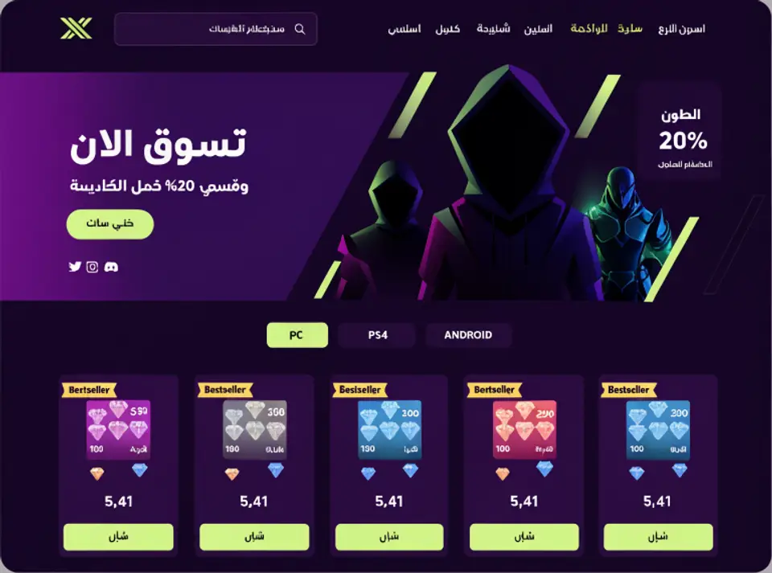
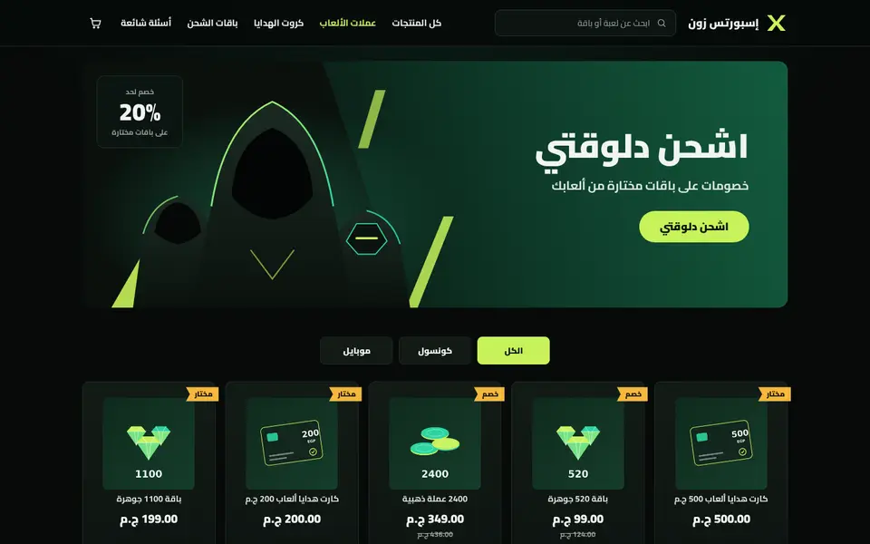
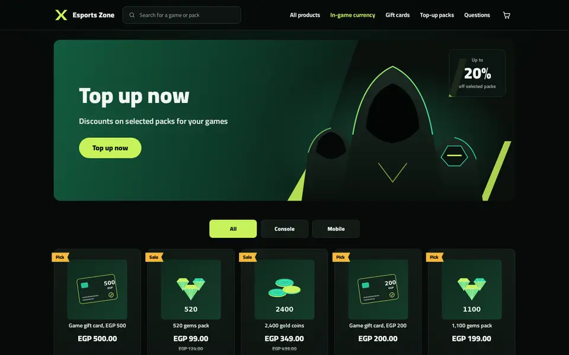
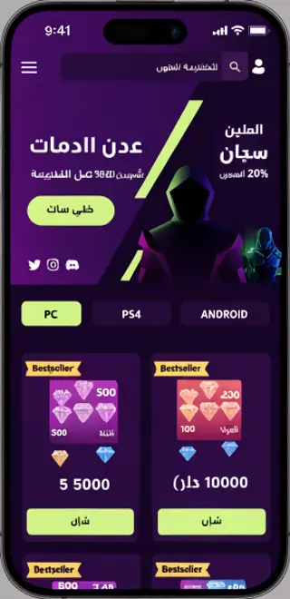
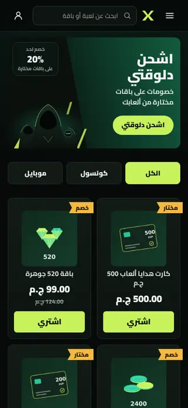
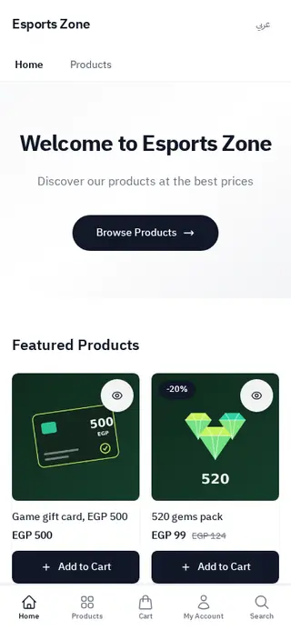

# Tutorial: Esports, a bold gaming top-up store

Esports is a home page for a shop that sells game currency, gift cards and
top-up packs as codes. It is black and deep green with a lime accent and
diagonal cuts: a header with a mark, search and navigation, a slanted hero
band with hooded figures drawn in SVG and an offer box, platform tabs, top-up
cards with a ribbon and a Buy button, three steps and a FAQ. It is
right-to-left in Arabic and left-to-right in English from the same files.

| Mockup | Live, Arabic | Live, English |
| - | - | - |
|  |  |  |
|  |  |  |

The mockup was generated as a design brief. Its Arabic is placeholder text, and
its purple ground became black and deep green; the lime accent stayed. The
hero's characters are redrawn as flat SVG silhouettes, and the social icons are
left out. Live: [demo-esports.hekana.com](https://demo-esports.hekana.com) and
[/en](https://demo-esports.hekana.com/en).

What the theme uses: plain HTML, `hk-section`, `hk-stack`, `hk-heading`,
`hk-text`, `hk-button`, `hk-icon`, `hk-search-form` and `hk-product-card` (with
a ribbon in its `badge` part and a Buy link in its `actions` part), three block
types (tab, step, question) seeded by the template, inline SVG for the mark and
the art, CSS `clip-path` for the cuts, and one stylesheet. There is no
JavaScript. Version 1.2.0 is built on Sneferu 0.4; the 0.2 workarounds it
replaced are listed in `../../GAPS-gaming.md`.

## Upgrading from 1.0

In 1.1.0 the numbered settings and locale-text fallbacks became blocks and
localized settings; values saved under 1.0 are not carried over, so the sections
start from the new defaults.

## Pages

Esports writes only the home page (`templates/index.snf`). The product,
collection, search, cart, content page and 404 templates come from the SDK's
default store ([page types](../../../docs/guide/16-page-types.mdx)), drawn with
Esports's tokens, fonts and layout. `assets/theme.css` restyles what the default
store would otherwise draw in its own way (the block "Cart, product, collection,
search and 404 pages"):

- product cards on collection and search pages use the top-up card: the dark green
  gradient, a thin line that turns lime on hover, centred title and a heavy price;
- the sale badge, the active chip and the cart count use dark text on lime;
- the cart summary, the delivery note and the cart drawer sit on the dark green surface;
- on phones the header shows the cart icon (it showed the account icon before).

The header group holds the cart drawer: it opens when an item is added (a
setting of the header section) and from the cart icon.

| Page | URL in `sneferu dev` |
| - | - |
| Product | `/products/sample-2` |
| Collection | `/category/gift-cards`, `/products` |
| Search | `/search?q=card` |
| Cart | `/cart` |
| Content page | `/pages/about` |
| 404 | any other path |

## Files

```
assets/theme.css
blocks/faq-item.snf
blocks/step.snf
blocks/tab.snf
groups/footer.json
groups/header.json
layout/theme.snf
locales/ar.json
locales/en.json
sections/esports-faq.snf
sections/esports-footer.snf
sections/esports-header.snf
sections/esports-hero.snf
sections/esports-products.snf
sections/esports-steps.snf
snippets/hero-art.snf
snippets/mark.snf
templates/index.snf
theme.json
```

Next to the theme: `README.md` and `docs/`, which the CLI skips.

## Data it needs

| What | Used by |
| - | - |
| A collection with images, some with a compare-at price: `featured` by default | the top-up cards, through the section's `collection` setting; a compare-at price turns the ribbon into "Sale" |
| Categories `gift-cards`, `game-currency`, `top-ups` | the navigation and the default tab links (each tab link is a setting) |

## 1. Start from the starter

```bash
npx sneferu init esports
cd esports
```

Delete the starter's sections and `blocks/`.

## 2. Manifest and tokens

```json title="theme.json"
{
  "id": "esports",
  "name": "Esports",
  "version": "1.2.0",
  "author": "Hekana",
  "description": "A bold gaming top-up store: black and deep green, a lime accent, diagonal cuts, a wide hero and top-up cards with ribbons.",
  "category": "gaming",
  "engine": "hk2",
  "engineCompatibility": "^2.0.0",
  "defaultLocale": "ar",
  "locales": ["ar", "en"],
  "settings": {},
  "tokens": {
    "colors": {
      "primary": "#C6F25A",
      "secondary": "#0E2A1F",
      "accent": "#C6F25A",
      "background": "#070A09",
      "text": "#F1F5F2",
      "muted": "#93A39A",
      "surface": "#101713",
      "line": "#1D2A23",
      "ribbon": "#F5B83D"
    },
    "layout": { "contentWidth": "1200px" },
    "fonts": {
      "heading": "Cairo",
      "body": "Cairo"
    }
  }
}
```

- `accent` is the lime of every button and the active tab. `secondary` is the
  deep green of the hero band. `ribbon` is the warm yellow of the card
  ribbons.

## 3. Fonts, icons and the mark

`tokens.fonts` in `theme.json` picks Cairo, a catalogue font with every weight
from 200 to 1000; Hekana serves it and sets the family, so the theme has no
font files and no `font-family` rule. The mark is the theme's own glyph:

```html title="snippets/mark.snf"
<svg class="es-mark" viewBox="0 0 32 32" width="32" height="32" aria-hidden="true">
  <path d="M3 5h7l6 8 6-8h7l-9.5 11L29 27h-7l-6-8-6 8H3l9.5-11z" fill="currentColor" />
  <path d="M10 5l6 8 6-8" fill="none" stroke="#070A09" stroke-width="1.4" />
</svg>
```

The mark is a plain SVG `X` drawn in `currentColor`. Every other icon is
`<hk-icon>` from the bundled Lucide set: `menu`, `user`, `shopping-cart`,
`credit-card`, `mail`, `gamepad-2`, `chevron-down`.

## 4. Layout: header and footer

```html title="layout/theme.snf"
<hk-section-group name="header" />
<main><hk-slot name="content" /></main>
<hk-section-group name="footer" />
```

The header and the footer are [section groups](../../../docs/guide/18-section-groups.mdx): the layout places
`<hk-section-group name="header" />` and `<hk-section-group name="footer" />`, `groups/header.json` and
`groups/footer.json` start them with `esports-header` and `esports-footer`, and the merchant edits them once for the
whole store. The header also holds the cart: the cart link carries `data-hk-open="cart-drawer"` and
`<hk-cart-count />`, and `<hk-cart-drawer>` lists the lines (a plain link to the cart page without JavaScript).

```html title="sections/esports-header.snf"
<header class="es-header">
  <hk-container>
    <div class="es-bar">
      <details class="es-menu">
        <summary aria-label="{{ t('menu') }}"><hk-icon name="menu" size="22" class="ic" /></summary>
        <nav class="es-menu-panel">
          <a href="{{ url('/products') }}">{{ t('nav_all') }}</a>
          <a href="{{ url('/category/game-currency') }}">{{ t('cat_currency') }}</a>
          <a href="{{ url('/category/gift-cards') }}">{{ t('cat_gift_cards') }}</a>
          <a href="{{ url('/category/top-ups') }}">{{ t('cat_topups') }}</a>
          <a href="{{ url('/') }}#faq">{{ t('nav_faq') }}</a>
        </nav>
      </details>
      <a class="es-logo" href="{{ url('/') }}" aria-label="{{ store.name }}">
        
        <span>{{ store.name }}</span>
      </a>
      <hk-search-form placeholder="{{ t('search_placeholder') }}" class="es-search" />
      <nav class="es-nav" aria-label="{{ t('nav_label') }}">
        <a href="{{ url('/products') }}">{{ t('nav_all') }}</a>
        <a class="is-hot" href="{{ url('/category/game-currency') }}">{{ t('cat_currency') }}</a>
        <a href="{{ url('/category/gift-cards') }}">{{ t('cat_gift_cards') }}</a>
        <a href="{{ url('/category/top-ups') }}">{{ t('cat_topups') }}</a>
        <a href="{{ url('/') }}#faq">{{ t('nav_faq') }}</a>
      </nav>
      <a class="es-icon" href="{{ url('/account') }}" aria-label="{{ t('account') }}"><hk-icon
          name="user"
          size="22"
          class="ic"
        /></a>
      <a class="es-icon" href="{{ url('/cart') }}" data-hk-open="cart-drawer" aria-label="{{ t('cart') }}"><hk-icon
          name="shopping-cart"
          size="22"
          class="ic"
        /><hk-cart-count /></a>
    </div>
  </hk-container>
  <hk-cart-drawer open-on-add="{{ section.settings.drawer_on_add }}">
    <hk-cart-items />
    <hk-cart-summary />
  </hk-cart-drawer>
</header>
<hk-schema>
  {
    "name": "Header",
    "version": 1,
    "templates": ["header"],
    "settings": {
      "drawer_on_add": {
        "type": "boolean",
        "label": "Open the cart when an item is added",
        "default": true
      }
    }
  }
</hk-schema>
```


```css title="assets/theme.css (root and header)"
/* Esports: black and deep green, lime accent, diagonal cuts. */
[data-hk-theme='esports'] {
  --es-lime: var(--hk-color-accent);
  --es-cut: 28px;
  min-height: 100vh;
  line-height: 1.6;
  background: radial-gradient(1000px 500px at 50% 0, rgba(31, 122, 85, 0.16), transparent 70%), var(--hk-color-background);
}
:where([data-hk-theme='esports'] a) { color: inherit; text-decoration: none; }
:where([data-hk-theme='esports'] h1, [data-hk-theme='esports'] h2, [data-hk-theme='esports'] p) { margin: 0; }
.ic { width: 22px; height: 22px; flex: none; }
/* Block wrappers take no room: tabs and steps lay out as before. */
[data-hk-theme='esports'] [data-hk-block] { display: contents; }
.es-h2 { font-weight: 900; }

/* Header */
.es-header { border-bottom: 1px solid var(--hk-color-line); background: rgba(7, 10, 9, 0.9); }
.es-bar { display: flex; align-items: center; gap: 20px; min-height: 76px; }
.es-logo { display: inline-flex; align-items: center; min-height: 44px; min-width: 44px; gap: 10px; color: var(--es-lime); font-weight: 900; font-size: 18px; }
.es-logo span { color: var(--hk-color-text); }
.es-mark { width: 38px; height: 38px; }
.es-search { flex: 0 1 300px; flex-wrap: nowrap; align-items: center; gap: 2px; min-height: 44px; padding-inline: 2px 14px; border-radius: 10px; border: 1px solid #2A3A31; background: #0D1411; color: var(--hk-color-muted); font-size: 14px; }
.es-search:hover, .es-search:focus-within { border-color: var(--es-lime); }
form.es-search input { min-height: 44px; padding: 0; border: 0; outline: 0; background: transparent; color: var(--hk-color-text); font-size: 14px; }
form.es-search input::placeholder { color: var(--hk-color-muted); }
form.es-search .sn-search-button { order: -1; border: 0; background: transparent; color: var(--hk-color-muted); }
form.es-search .sn-search-button .sn-icon { width: 18px; height: 18px; }
form.es-search .sn-search-button:hover { color: var(--es-lime); }
.es-nav { display: flex; gap: 26px; margin-inline-start: auto; font-weight: 700; font-size: 15px; }
.es-nav a { display: inline-flex; align-items: center; min-height: 44px; }
.es-nav a.is-hot, .es-nav a:hover { color: var(--es-lime); }
.es-icon { display: none; align-items: center; justify-content: center; width: 44px; height: 44px; }
.es-icon:last-child { display: inline-flex; }
.es-menu { position: relative; display: none; }
.es-menu summary { list-style: none; display: inline-flex; width: 44px; height: 44px; align-items: center; justify-content: center; cursor: pointer; }
.es-menu summary::-webkit-details-marker { display: none; }
.es-menu-panel { position: absolute; z-index: 20; top: 52px; inset-inline-start: 0; min-width: 220px; display: grid; padding: 8px; border-radius: 12px; background: var(--hk-color-surface); border: 1px solid var(--hk-color-line); }
.es-menu-panel a { display: flex; align-items: center; min-height: 44px; padding-inline: 12px; border-radius: 8px; font-weight: 700; }
.es-menu-panel a:hover { background: rgba(198, 242, 90, 0.08); color: var(--es-lime); }
```

- The account and cart icons are both in the markup; CSS shows the cart on
  desktop and the account icon on phones, as in the two mockup frames.
- `.es-nav a.is-hot` is the one highlighted link, in lime.
- The search field is `<hk-search-form class="es-search">`, a form that sends
  the shopper to the search page; CSS moves its button before the input
  (`order: -1`) so the magnifier sits at the start, as in the mockup.
- Every internal link goes through `url()`, so English pages link to English
  pages.

## 5. Hero: a slanted band and SVG art

```html title="sections/esports-hero.snf"
<hk-section padding-y="24" mobile-padding-y="12" class="es-hero-wrap">
  <div class="es-hero">
    <div class="es-hero-copy">
      <hk-heading
        text="{{ section.settings.title }}"
        level="h1"
        size="56"
        tablet-size="44"
        mobile-size="28"
        class="es-hero-title"
      />
      <hk-text text="{{ section.settings.subtitle }}" size="20" mobile-size="14" class="es-hero-sub" />
      <hk-button label="{{ section.settings.button }}" href="{{ section.settings.button_link }}" class="es-cta" />
    </div>
    <div class="es-hero-art">
      
    </div>
    
      <div class="es-offer">
        <span class="es-offer-top">{{ t('offer_top') }}</span>
        <strong class="es-offer-num">{{ section.settings.offer_percent }}%</strong>
        <span class="es-offer-bottom">{{ t('offer_bottom') }}</span>
      </div>
    
  </div>
</hk-section>
<hk-schema>
  {
    "name": "Esports hero",
    "version": 1,
    "settings": {
      "title": {
        "type": "text",
        "label": "Title",
        "localized": true,
        "default": {
          "ar": "اشحن دلوقتي",
          "en": "Top up now"
        },
        "maxLength": 40
      },
      "subtitle": {
        "type": "text",
        "label": "Subtitle",
        "localized": true,
        "default": {
          "ar": "خصومات على باقات مختارة من ألعابك",
          "en": "Discounts on selected packs for your games"
        },
        "maxLength": 80
      },
      "button": {
        "type": "text",
        "label": "Button",
        "localized": true,
        "default": {
          "ar": "اشحن دلوقتي",
          "en": "Top up now"
        },
        "maxLength": 24
      },
      "button_link": {
        "type": "link",
        "label": "Button link",
        "default": "/products"
      },
      "show_offer": {
        "type": "boolean",
        "label": "Show the offer box",
        "default": true
      },
      "offer_percent": {
        "type": "number",
        "label": "Offer percent",
        "default": 20,
        "min": 1,
        "max": 90
      }
    }
  }
</hk-schema>
```

```html title="snippets/hero-art.snf"
<svg class="es-art" viewBox="0 0 520 340" preserveAspectRatio="xMidYMax meet" aria-hidden="true">
  <defs>
    <linearGradient id="es-rim" x1="0" y1="0" x2="1" y2="1">
      <stop offset="0" stop-color="#C6F25A" />
      <stop offset="1" stop-color="#2DD4A3" />
    </linearGradient>
    <radialGradient id="es-glow" cx="0.5" cy="0.55" r="0.5">
      <stop offset="0" stop-color="#1F7A55" stop-opacity="0.55" />
      <stop offset="1" stop-color="#1F7A55" stop-opacity="0" />
    </radialGradient>
    <linearGradient id="es-body" x1="0" y1="0" x2="0" y2="1">
      <stop offset="0" stop-color="#1A2A22" />
      <stop offset="1" stop-color="#0A110D" />
    </linearGradient>
  </defs>
  <ellipse cx="260" cy="200" rx="250" ry="160" fill="url(#es-glow)" />
  <polygon points="40,340 92,250 104,340" fill="#C6F25A" opacity="0.9" />
  <polygon points="446,340 498,214 512,214 462,340" fill="#C6F25A" opacity="0.85" />
  <polygon points="380,120 404,40 418,40 394,120" fill="#C6F25A" opacity="0.7" />
  <g class="es-fig es-fig-left">
    <path d="M70 340 L84 238 Q96 196 132 186 Q168 196 180 238 L196 340 Z" fill="url(#es-body)" />
    <path d="M100 236 Q104 200 132 194 Q160 200 164 236 Q148 250 132 252 Q116 250 100 236 Z" fill="#050806" />
    <path d="M84 238 Q96 196 132 186" fill="none" stroke="url(#es-rim)" stroke-width="2" opacity="0.8" />
  </g>
  <g class="es-fig es-fig-right">
    <path d="M330 340 L346 252 Q358 214 392 206 Q426 214 438 252 L452 340 Z" fill="url(#es-body)" />
    <path
      d="M364 248 L378 224 L406 224 L420 248 L404 266 L380 266 Z"
      fill="#0B1310"
      stroke="#2DD4A3"
      stroke-width="1.6"
    />
    <path d="M378 244 h28" stroke="#C6F25A" stroke-width="3" stroke-linecap="round" />
    <path d="M438 252 Q426 214 392 206" fill="none" stroke="#2DD4A3" stroke-width="2" opacity="0.9" />
  </g>
  <g class="es-fig es-fig-main">
    <path d="M150 340 L178 200 Q196 86 262 56 Q328 86 346 200 L374 340 Z" fill="url(#es-body)" />
    <path d="M206 186 Q210 112 262 92 Q314 112 318 186 Q296 214 262 218 Q228 214 206 186 Z" fill="#030504" />
    <path d="M178 200 Q196 86 262 56 Q328 86 346 200" fill="none" stroke="url(#es-rim)" stroke-width="2.4" />
    <path d="M232 260 L262 300 L292 260" fill="none" stroke="#C6F25A" stroke-width="2" opacity="0.6" />
  </g>
</svg>
```

```css title="assets/theme.css (hero)"
/* Hero: a slanted band, copy on the start side, art and offer box on the end side */
.es-hero { position: relative; display: grid; grid-template-columns: 1fr 1.15fr; align-items: center; min-height: 400px; overflow: hidden; border-radius: 16px; isolation: isolate; }
.es-hero::before { content: ''; position: absolute; inset: 0; z-index: -1; background: linear-gradient(105deg, #135C3F 0%, #0E3A29 38%, #0A1712 70%, #070A09 100%); clip-path: polygon(0 0, 66% 0, 54% 100%, 0 100%); }
[dir='rtl'] .es-hero::before { background: linear-gradient(255deg, #135C3F 0%, #0E3A29 38%, #0A1712 70%, #070A09 100%); clip-path: polygon(100% 0, 34% 0, 46% 100%, 100% 100%); }
.es-hero::after { content: ''; position: absolute; inset: 0; z-index: -2; background: #0A100D; }
.es-hero-copy { display: grid; gap: 18px; justify-items: start; padding: 48px 64px; }
.es-hero-title { font-weight: 900; line-height: 1.15; }
.es-hero-sub { color: #DDE7E0; font-weight: 700; }
.sn-btn.es-cta { display: inline-flex; align-items: center; justify-content: center; min-height: 52px; padding-inline: 34px; margin-top: 8px; border: 0; border-radius: 999px; background: var(--es-lime); color: #0A120C; font-weight: 900; font-size: 18px; text-decoration: none; }
.sn-btn.es-cta:hover { filter: brightness(1.06); }
.es-hero-art { align-self: end; height: 100%; display: flex; align-items: flex-end; justify-content: center; }
.es-art { width: 100%; max-width: 640px; height: auto; display: block; }
.es-offer { position: absolute; top: 24px; inset-inline-end: 24px; display: grid; justify-items: center; gap: 0; padding: 16px 24px; border-radius: 12px; background: rgba(13, 22, 18, 0.88); border: 1px solid #22332A; text-align: center; }
.es-offer-top, .es-offer-bottom { font-size: 12px; color: var(--hk-color-muted); font-weight: 700; }
.es-offer-num { font-size: 40px; font-weight: 900; line-height: 1.2; color: var(--hk-color-text); }
```

- The band is a `::before` layer cut with `clip-path: polygon(…)`. The
  polygon and the gradient are mirrored for `[dir='rtl']`, so the green side
  is always behind the text.
- The figures are three paths each, filled with a dark gradient and edged with
  a lime-to-teal "rim light" stroke; the lime slashes are polygons.
- The offer box is shown only when `show_offer` is on, and its number is the
  `offer_percent` setting. The words around it come from the locale files.
- Title, subtitle and button text are `"localized": true` settings with an
  Arabic and an English default; the button link is a `link` setting.

## 6. Tabs and top-up cards

```html title="sections/esports-products.snf"
<hk-section padding-y="24" mobile-padding-y="16" class="es-products">
  <nav class="es-tabs" aria-label="{{ t('platforms') }}">
    
      <hk-block of="{{ block }}" />
    
  </nav>
  
    <div class="es-grid">
      
        <hk-product-card product="{{ p }}" class="es-card">
          <hk-part name="badge">
            <span
              class="es-ribbon"
            >{{ t('ribbon_sale') }}{{ t('ribbon_pick') }}</span>
          </hk-part>
          <hk-part name="actions">
            <a class="es-buy" href="{{ p.url }}" aria-hidden="true" tabindex="-1">{{ t('buy') }}</a>
          </hk-part>
        </hk-product-card>
      
    </div>
  
    <p class="es-empty">{{ t('empty_products') }}</p>
  
</hk-section>
<hk-schema>
  {
    "name": "Top-up cards",
    "version": 1,
    "settings": {
      "list": {
        "type": "collection",
        "label": "Collection",
        "default": "featured"
      },
      "count": {
        "type": "range",
        "label": "Products",
        "default": 10,
        "min": 2,
        "max": 20,
        "step": 1
      }
    },
    "blocks": {
      "allowed": ["tab"],
      "max": 6
    }
  }
</hk-schema>
```

```html title="blocks/tab.snf"
<a class="es-tab" href="{{ url(block.settings.link) }}">{{ block.settings.label }}</a>
<hk-schema>
  {
    "name": "Tab",
    "version": 1,
    "settings": {
      "label": {
        "type": "text",
        "label": "Label",
        "localized": true,
        "default": {
          "ar": "الكل",
          "en": "All"
        },
        "maxLength": 20
      },
      "link": {
        "type": "link",
        "label": "Link",
        "default": "/products"
      }
    }
  }
</hk-schema>
```

```css title="assets/theme.css (tabs and cards)"
/* Platform tabs */
.es-tabs { display: flex; justify-content: center; gap: 10px; margin-bottom: 28px; }
.es-tab { display: inline-flex; align-items: center; justify-content: center; min-width: 120px; min-height: 46px; padding-inline: 24px; border-radius: 8px; background: #121A16; border: 1px solid #1F2C25; font-weight: 800; font-size: 14px; }
.es-tab:hover { border-color: var(--es-lime); }
.es-tabs > [data-hk-block]:first-child .es-tab { background: var(--es-lime); border-color: var(--es-lime); color: #0A120C; }

/* Top-up cards */
.es-grid { display: grid; grid-template-columns: repeat(5, minmax(0, 1fr)); gap: 16px; }
.es-card.sn-product-card-wrap { position: relative; display: flex; flex-direction: column; gap: 10px; padding: 26px 12px 12px; border-radius: 10px; background: linear-gradient(180deg, #121B16, #0D1310); border: 1px solid var(--hk-color-line); }
.es-card:hover { border-color: rgba(198, 242, 90, 0.5); }
.es-ribbon { position: absolute; top: 8px; inset-inline-start: -6px; z-index: 1; padding: 2px 14px 2px 10px; font-size: 12px; font-weight: 900; color: #1A1305; background: var(--hk-color-ribbon); clip-path: polygon(0 0, 100% 0, 88% 50%, 100% 100%, 0 100%); }
[dir='rtl'] .es-ribbon { padding: 2px 10px 2px 14px; clip-path: polygon(0 0, 100% 0, 100% 100%, 0 100%, 12% 50%); }
.es-card .sn-product-card { display: flex; flex-direction: column; align-items: center; gap: 6px; text-align: center; }
.es-card img { width: 78%; aspect-ratio: 1 / 1; object-fit: cover; border-radius: 8px; }
.es-card .sn-title { font-size: 14px; font-weight: 700; line-height: 1.4; color: #DDE7E0; }
.es-card .sn-price { font-size: 20px; font-weight: 900; }
.es-card .sn-was { display: block; font-size: 12px; font-weight: 600; color: var(--hk-color-muted); }
.es-buy { margin-top: auto; display: flex; align-items: center; justify-content: center; min-height: 44px; border-radius: 6px; background: var(--es-lime); color: #0A120C; font-weight: 900; }
.es-buy:hover { filter: brightness(1.06); }
.es-empty { color: var(--hk-color-muted); text-align: center; }
```

- The ribbon is the card's `badge` part (inside the link, before the image)
  and the Buy link its `actions` part (after the link). With an `actions` part
  the card renders inside `<div class="sn-product-card-wrap es-card">`, so
  `es-card` styles the whole tile.
- The ribbon says "Sale" when `p.compare_at > p.price`, otherwise "Pick".
- The loop is `limit: section.settings.count`, a `range` setting (default 10),
  over `collection(section.settings.list)`.
- The tabs are `tab` blocks; the first is the lime one
  (`.es-tabs > [data-hk-block]:first-child .es-tab`).
- The ribbon notch is a `clip-path`, mirrored for right-to-left.

## 7. Steps and FAQ

```html title="sections/esports-steps.snf"
<hk-section padding-y="48" mobile-padding-y="32" class="es-steps">
  <hk-stack gap="24">
    <hk-heading text="{{ section.settings.heading }}" level="h2" size="32" mobile-size="22" class="es-h2" />
    <div class="es-step-list">
      
        <hk-block of="{{ block }}" />
      
    </div>
  </hk-stack>
</hk-section>
<hk-schema>
  {
    "name": "How to redeem",
    "version": 1,
    "settings": {
      "heading": {
        "type": "text",
        "label": "Heading",
        "localized": true,
        "default": {
          "ar": "إزاي تستلم الكود",
          "en": "How you get your code"
        },
        "maxLength": 60
      }
    },
    "blocks": {
      "allowed": ["step"],
      "max": 4
    }
  }
</hk-schema>
```

```html title="blocks/step.snf"
<div class="es-step">
  <span class="es-step-icon"><hk-icon name="{{ block.settings.icon }}" size="22" class="ic" /></span>
  <span class="es-step-n"></span>
  <strong class="es-step-title">{{ block.settings.title }}</strong>
  <span class="es-step-text">{{ block.settings.text }}</span>
</div>
<hk-schema>
  {
    "name": "Step",
    "version": 1,
    "settings": {
      "icon": {
        "type": "select",
        "label": "Icon",
        "options": ["credit-card", "wallet", "mail", "gamepad-2", "trophy", "zap", "key", "shield-check"],
        "default": "credit-card"
      },
      "title": {
        "type": "text",
        "label": "Title",
        "localized": true,
        "default": {
          "ar": "اختار وادفع أونلاين",
          "en": "Pick and pay online"
        },
        "maxLength": 60
      },
      "text": {
        "type": "text",
        "label": "Text",
        "localized": true,
        "default": {
          "ar": "اختار الكارت والقيمة، وادفع أونلاين.",
          "en": "Choose the card and the amount, then pay online."
        },
        "maxLength": 140
      }
    }
  }
</hk-schema>
```

```html title="sections/esports-faq.snf"
<hk-section padding-y="48" mobile-padding-y="32" class="es-faq">
  <div id="faq" class="es-faq-wrap">
    <hk-heading text="{{ section.settings.heading }}" level="h2" size="28" mobile-size="20" class="es-h2" />
    
      <hk-block of="{{ block }}" />
    
  </div>
</hk-section>
<hk-schema>
  {
    "name": "FAQ",
    "version": 1,
    "settings": {
      "heading": {
        "type": "text",
        "label": "Heading",
        "localized": true,
        "default": {
          "ar": "أسئلة شائعة",
          "en": "Questions"
        },
        "maxLength": 60
      }
    },
    "blocks": {
      "allowed": ["faq-item"],
      "max": 12
    }
  }
</hk-schema>
```

```html title="blocks/faq-item.snf"

  <details class="es-faq-item">
    <summary>{{ block.settings.question }}<hk-icon name="chevron-down" class="ic" /></summary>
    <p>{{ block.settings.answer }}</p>
  </details>

<hk-schema>
  {
    "name": "Question",
    "version": 1,
    "settings": {
      "question": {
        "type": "text",
        "label": "Question",
        "localized": true,
        "default": {
          "ar": "الكود بيوصل إمتى؟",
          "en": "When does the code arrive?"
        },
        "maxLength": 120
      },
      "answer": {
        "type": "textarea",
        "label": "Answer",
        "localized": true,
        "default": {
          "ar": "بعد ما الدفع الأونلاين يتأكد، الكود بيتبعت أوتوماتيك على الإيميل اللي كتبته في الطلب.",
          "en": "Once your online payment is confirmed, the code is sent automatically to the email on your order."
        },
        "maxLength": 600
      }
    }
  }
</hk-schema>
```

```css title="assets/theme.css (steps, FAQ, footer)"
/* Steps */
.es-step-list { counter-reset: es-step; margin: 0; padding: 0; display: grid; grid-template-columns: repeat(3, minmax(0, 1fr)); gap: 16px; }
.es-step { counter-increment: es-step; position: relative; display: grid; gap: 6px; padding: 24px; background: var(--hk-color-surface); border: 1px solid var(--hk-color-line); clip-path: polygon(0 0, calc(100% - var(--es-cut)) 0, 100% var(--es-cut), 100% 100%, 0 100%); }
.es-step-icon { display: inline-flex; width: 44px; height: 44px; align-items: center; justify-content: center; border-radius: 8px; background: rgba(198, 242, 90, 0.1); color: var(--es-lime); }
.es-step-n::before { content: counter(es-step, decimal-leading-zero); }
.es-step-n { position: absolute; top: 16px; inset-inline-end: 36px; font-size: 32px; font-weight: 900; color: rgba(198, 242, 90, 0.18); }
.es-step-title { font-size: 18px; font-weight: 900; }
.es-step-text { color: var(--hk-color-muted); font-size: 15px; }

/* FAQ */
.es-faq-wrap { max-width: 860px; margin-inline: auto; display: grid; gap: 10px; scroll-margin-top: 24px; }
.es-faq-wrap > h2 { margin-bottom: 8px; }
.es-faq-item { background: var(--hk-color-surface); border: 1px solid var(--hk-color-line); border-radius: 8px; }
.es-faq-item[open] { border-color: rgba(198, 242, 90, 0.4); }
.es-faq-item summary { list-style: none; display: flex; align-items: center; justify-content: space-between; gap: 12px; min-height: 52px; padding: 12px 18px; cursor: pointer; font-weight: 800; }
.es-faq-item summary::-webkit-details-marker { display: none; }
.es-faq-item summary .ic { width: 18px; height: 18px; color: var(--es-lime); transition: transform 0.15s; }
.es-faq-item[open] summary .ic { transform: rotate(180deg); }
.es-faq-item p { padding: 0 18px 16px; color: var(--hk-color-muted); }

/* Footer */
.es-footer { margin-top: 24px; padding-block: 36px 24px; border-top: 1px solid var(--hk-color-line); }
.es-footer-row { display: flex; justify-content: space-between; gap: 24px; flex-wrap: wrap; }
.es-footer-brand { display: grid; gap: 10px; max-width: 420px; }
.es-footer-brand p { color: var(--hk-color-muted); font-size: 14px; }
.es-footer-links { display: flex; flex-wrap: wrap; gap: 4px 22px; }
.es-footer-links a { display: inline-flex; align-items: center; min-height: 44px; font-size: 14px; font-weight: 700; color: var(--hk-color-muted); }
.es-footer-links a:hover { color: var(--es-lime); }
.es-copy { margin-top: 16px; font-size: 13px; color: var(--hk-color-muted); }

@media (max-width: 1023px) {
  .es-nav { display: none; }
  .es-search { flex: 1; margin-inline-start: auto; }
  .es-grid { grid-template-columns: repeat(3, minmax(0, 1fr)); }
  .es-hero-copy { padding: 32px; }
}
@media (max-width: 639px) {
  .es-bar { gap: 8px; min-height: 64px; }
  .es-menu { display: block; }
  .es-logo span { display: none; }
  .es-mark { width: 30px; height: 30px; }
  .es-search { min-height: 44px; font-size: 13px; padding-inline: 0 10px; }
  form.es-search input { font-size: 13px; }
  .es-icon:last-child { display: inline-flex; }
  .es-hero { min-height: 230px; grid-template-columns: 1.15fr 1fr; border-radius: 12px; }
  .es-hero-copy { padding: 22px 14px; gap: 8px; }
  .sn-btn.es-cta { min-height: 44px; padding-inline: 18px; font-size: 14px; }
  .es-offer { top: 10px; inset-inline-end: 10px; padding: 6px 10px; }
  .es-offer-num { font-size: 20px; }
  .es-offer-top, .es-offer-bottom { font-size: 10px; }
  .es-tabs { gap: 8px; }
  .es-tab { flex: 1; min-width: 0; padding-inline: 8px; }
  .es-grid { grid-template-columns: repeat(2, minmax(0, 1fr)); gap: 12px; }
  .es-step-list { grid-template-columns: 1fr; }
```

The step cards have one corner cut off with `clip-path`, the same diagonal as
the hero. Steps and questions are blocks; the step number is a CSS counter
(`counter(es-step, decimal-leading-zero)` prints `01`, `02`, `03`).

## 8. Locale files

```json title="locales/en.json"
{
  "menu": "Menu",
  "cart": "Cart",
  "nav_all": "All products",
  "nav_faq": "Questions",
  "platforms": "Platforms",
  "cat_gift_cards": "Gift cards",
  "cat_currency": "In-game currency",
  "cat_topups": "Top-up packs",
  "empty_products": "No products here yet.",
  "footer_about": "Gift cards and game top-ups in Egyptian pounds. Your code arrives by email after online payment.",
  "footer_links": "Store links",
  "account": "My account",
  "nav_label": "Store sections",
  "search_placeholder": "Search for a game or pack",
  "offer_top": "Up to",
  "offer_bottom": "off selected packs",
  "ribbon_sale": "Sale",
  "ribbon_pick": "Pick",
  "buy": "Buy",
  "search": "Search"
}
```

`locales/ar.json` has the same keys, with the words in Egyptian Arabic. The
copy a merchant may change (hero text, tabs, steps, questions) is in localized
settings and blocks, not here.

## 9. The page and the phone layout

```html title="templates/index.snf (excerpt)"
<hk-sections />
<hk-schema>
  {
    "sections": [
      { "type": "esports-hero" },
      {
        "type": "esports-products",
        "blocks": [
          {"type": "tab", "settings": {"label": {"ar": "الكل", "en": "All"}, "link": "/products"}},
          … 2 more
        ]
      },
      {
        "type": "esports-steps",
        "blocks": [
          {"type": "step", "settings": {"icon": "credit-card", "title": {"ar": "اختار وادفع أونلاين", "en": "Pick and pay online"}, "text": {"ar": "اختار الكارت والقيمة، وادفع أونلاين.", "en": "Choose the card and the amount, then pay online."}}},
          … 2 more
        ]
      },
      {
        "type": "esports-faq",
        "blocks": [
          {"type": "faq-item", "settings": {"question": {"ar": "الكود بيوصل إمتى؟", "en": "When does the code arrive?"}, "answer": {"ar": "بعد ما الدفع الأونلاين يتأكد، الكود بيتبعت أوتوماتيك على الإيميل اللي كتبته في الطلب.", "en": "Once your online payment is confirmed, the code is sent automatically to the email on your order."}}},
          … 4 more
        ]
      }
    ]
  }
</hk-schema>
```

```css title="assets/theme.css (tablet and phone)"
@media (max-width: 1023px) {
  .es-nav { display: none; }
  .es-search { flex: 1; margin-inline-start: auto; }
  .es-grid { grid-template-columns: repeat(3, minmax(0, 1fr)); }
  .es-hero-copy { padding: 32px; }
}
@media (max-width: 639px) {
  .es-bar { gap: 8px; min-height: 64px; }
  .es-menu { display: block; }
  .es-logo span { display: none; }
  .es-mark { width: 30px; height: 30px; }
  .es-search { min-height: 44px; font-size: 13px; padding-inline: 0 10px; }
  form.es-search input { font-size: 13px; }
  .es-icon:last-child { display: inline-flex; }
  .es-hero { min-height: 230px; grid-template-columns: 1.15fr 1fr; border-radius: 12px; }
  .es-hero-copy { padding: 22px 14px; gap: 8px; }
  .sn-btn.es-cta { min-height: 44px; padding-inline: 18px; font-size: 14px; }
  .es-offer { top: 10px; inset-inline-end: 10px; padding: 6px 10px; }
  .es-offer-num { font-size: 20px; }
  .es-offer-top, .es-offer-bottom { font-size: 10px; }
  .es-tabs { gap: 8px; }
  .es-tab { flex: 1; min-width: 0; padding-inline: 8px; }
  .es-grid { grid-template-columns: repeat(2, minmax(0, 1fr)); gap: 12px; }
  .es-step-list { grid-template-columns: 1fr; }
```

## 10. Check, preview and push

1. `npx sneferu format`
2. `npx sneferu validate` prints `✔ theme esports@1.1.0 is valid`.
3. `npx sneferu dev`, then `?locale=en`, then a window under 640 px.
4. Change `id` in `theme.json` to a slug of your own, then
   `npx sneferu push . --package <your-slug> --dev-store`.
