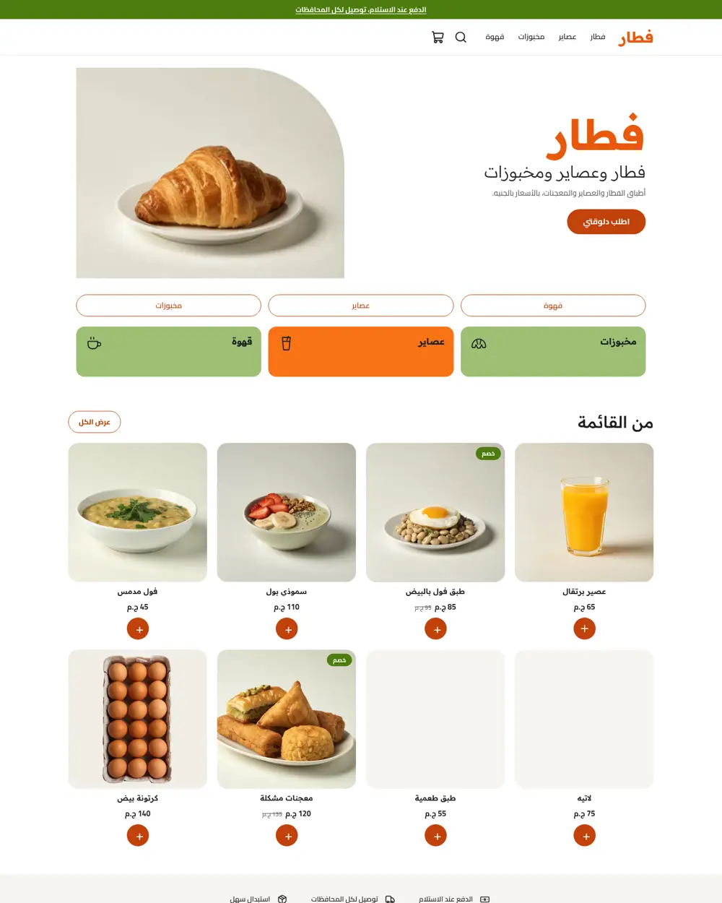
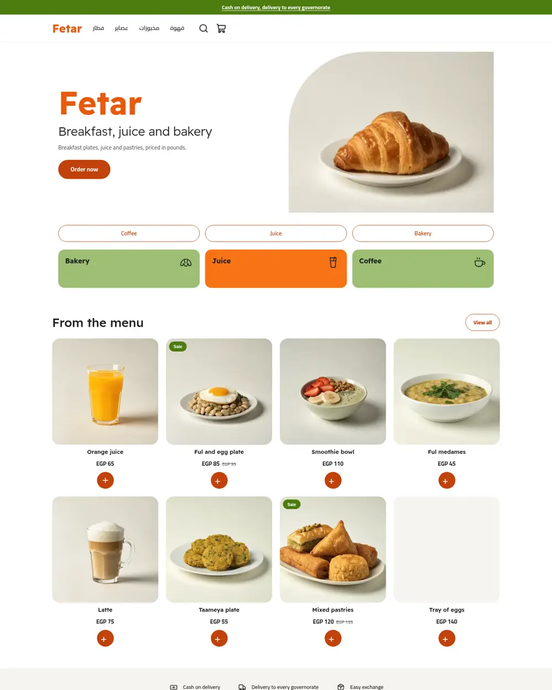
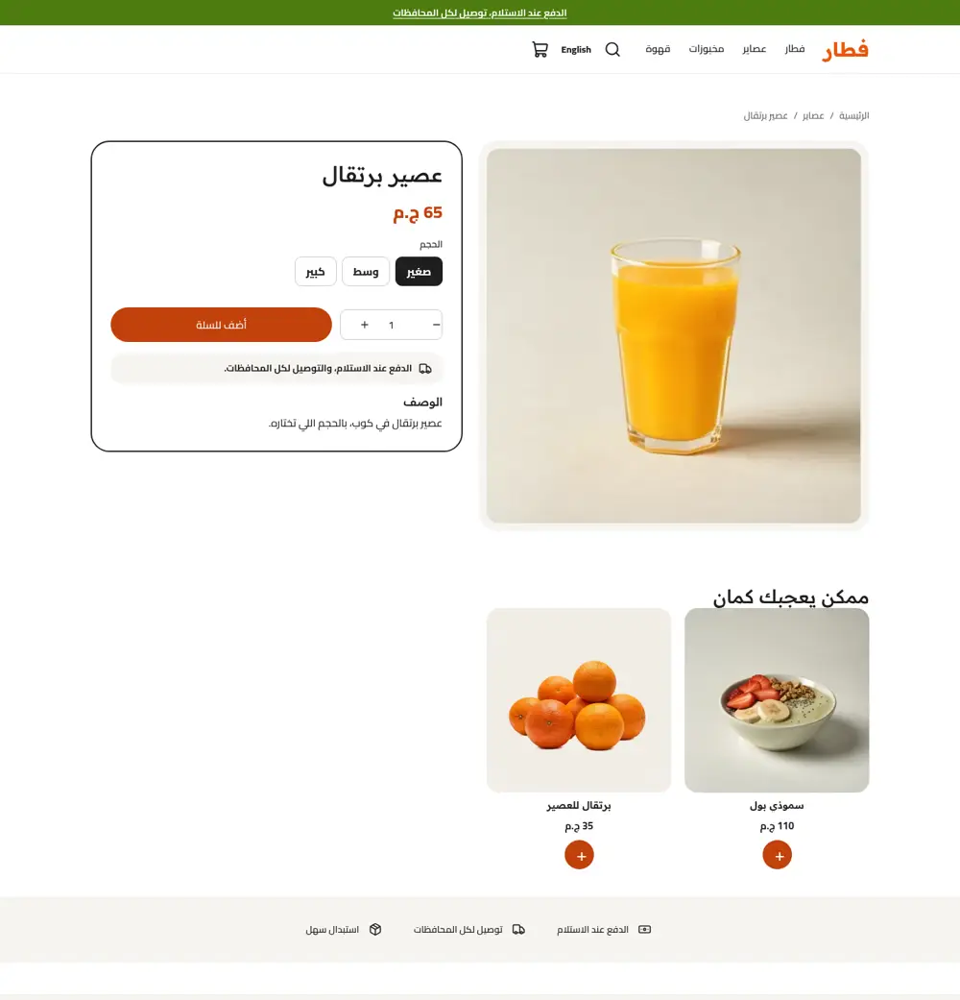
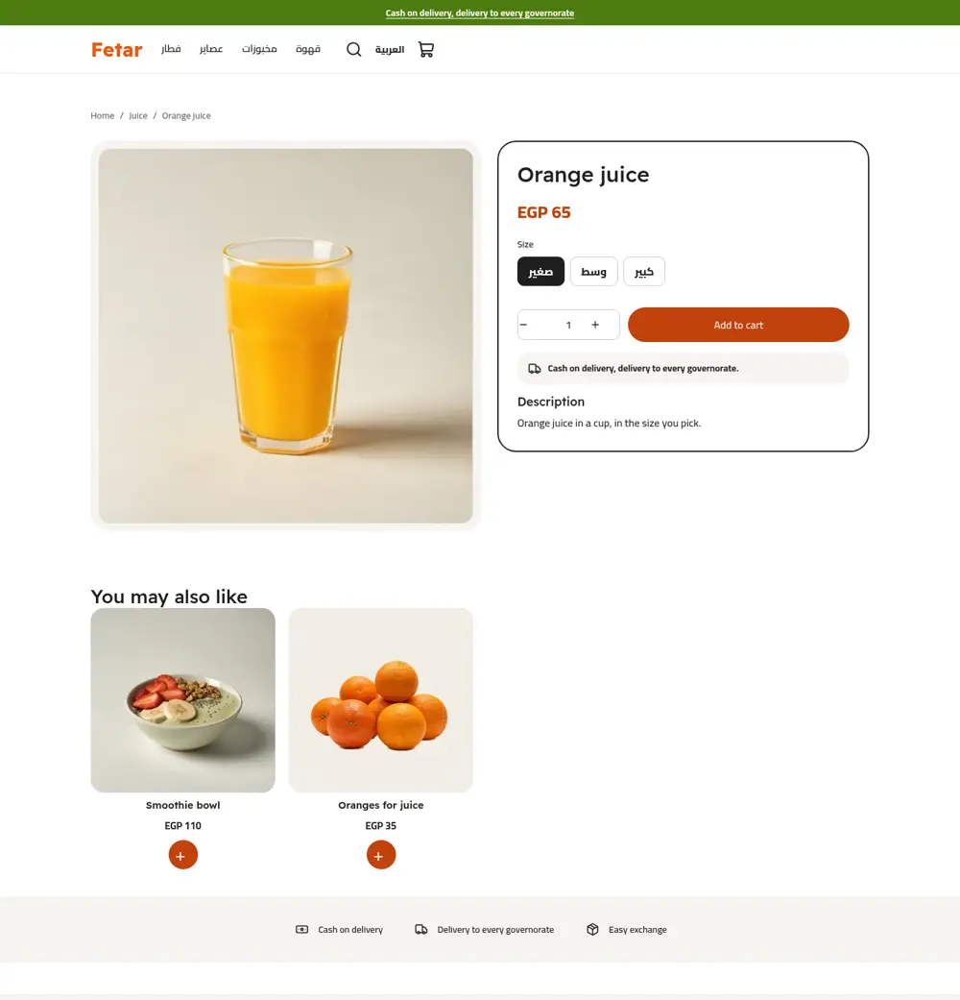
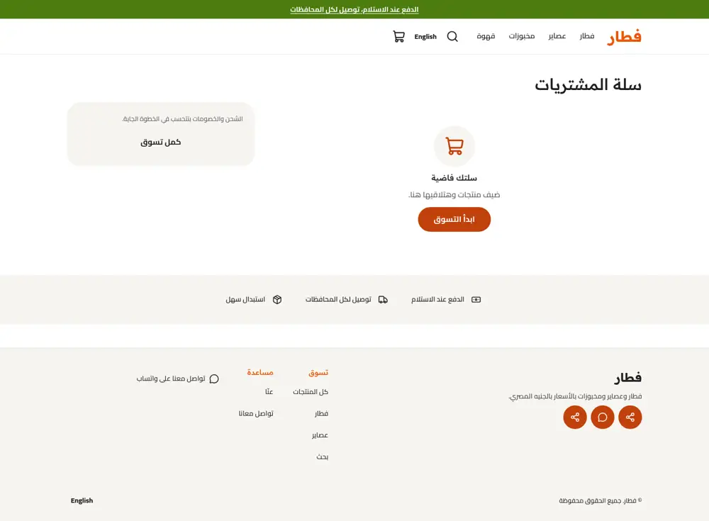
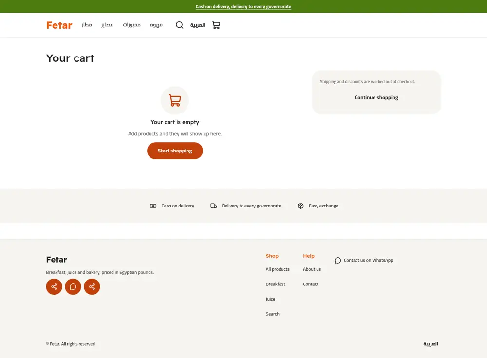
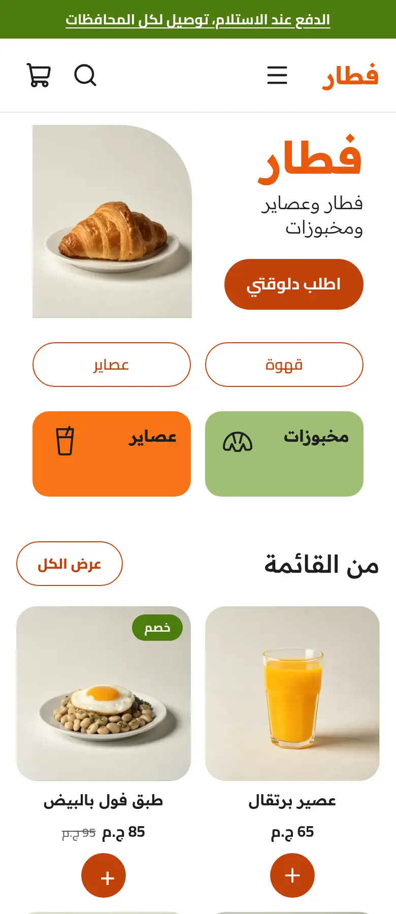
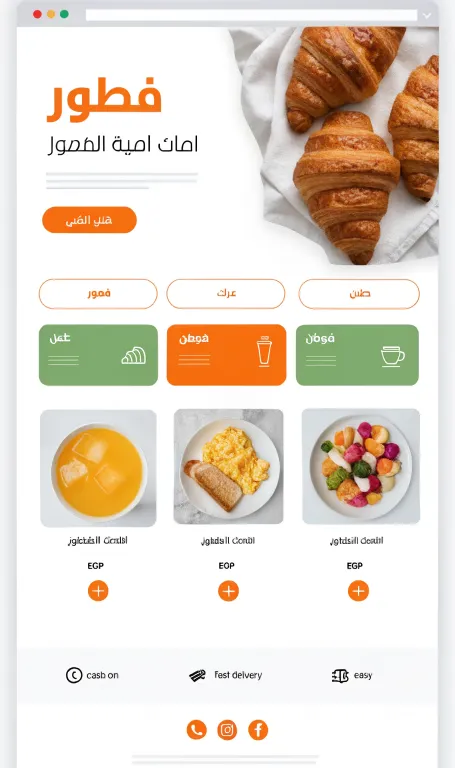
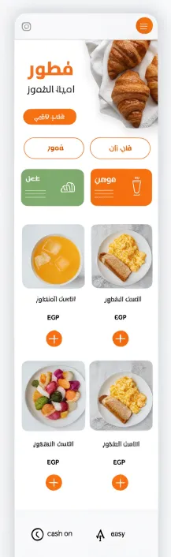

# Fetar (فطار)

A breakfast, bakery and juice bar store theme for Sneferu: white with citrus orange and leaf green, a split hero with a photo and one large rounded corner, category pills and colour cards, menu cards with a round quick add, and a trust strip. Category `cafe`, Arabic first with English, whole-pound prices.

| | Arabic | English |
| - | - | - |
| Home |  |  |
| Product |  |  |
| Cart |  |  |

Phone: 

Mockup:  

## What is in the folder

- `theme.json`: tokens (orange, leaf green, soft grey), fonts Readex Pro and Cairo, `money.format: whole`.
- `layout/theme.snf`, `groups/` (announcement, header, footer), `templates/` for all seven page types.
- `sections/`: `hero`, `category-pills`, `category-cards`, `featured-products`, `trust-strip`, the page mains, `header`, `footer`.
- `snippets/product-card.snf`: the menu card with the round quick add (plus icon links to the product when it has options).
- `snippets/glyph.snf`: four inline line drawings for the colour cards.
- `assets/theme.css`: all colours come from tokens (`var(--hk-color-*)`).

## Notes

- Card style is a setting: `plain`, `line` (bordered), `tint` (soft grey).
- The header holds the menu twice (desktop bar and a `details` menu on small screens) because `menu()` needs a section setting and cannot run inside a snippet.
- The quick add button hides its label with CSS and draws a plus; the label stays as the accessible name.
