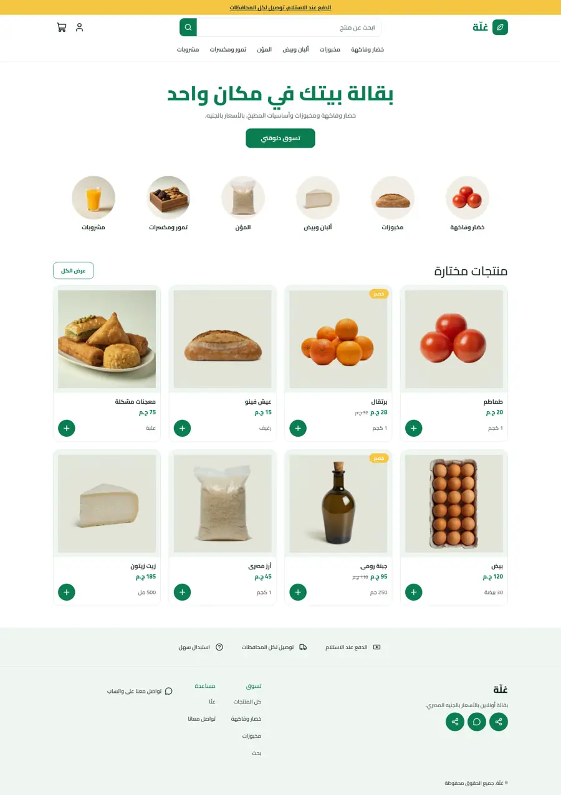
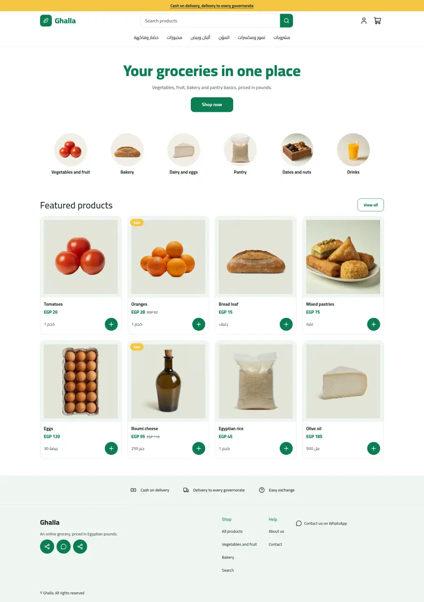
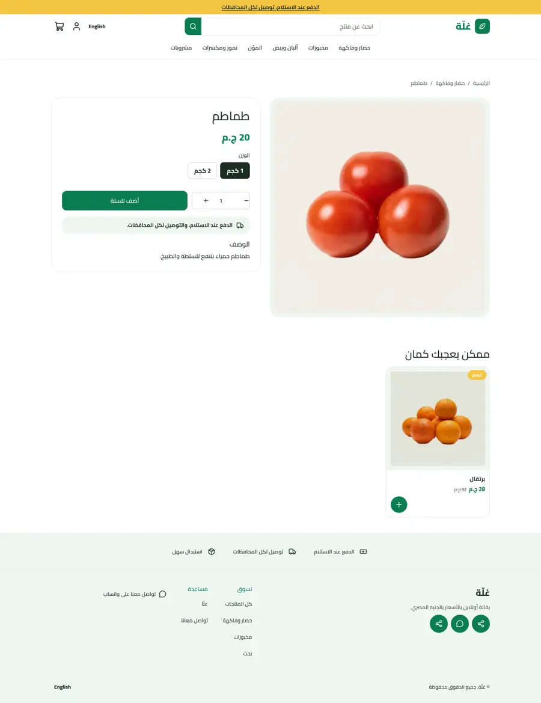
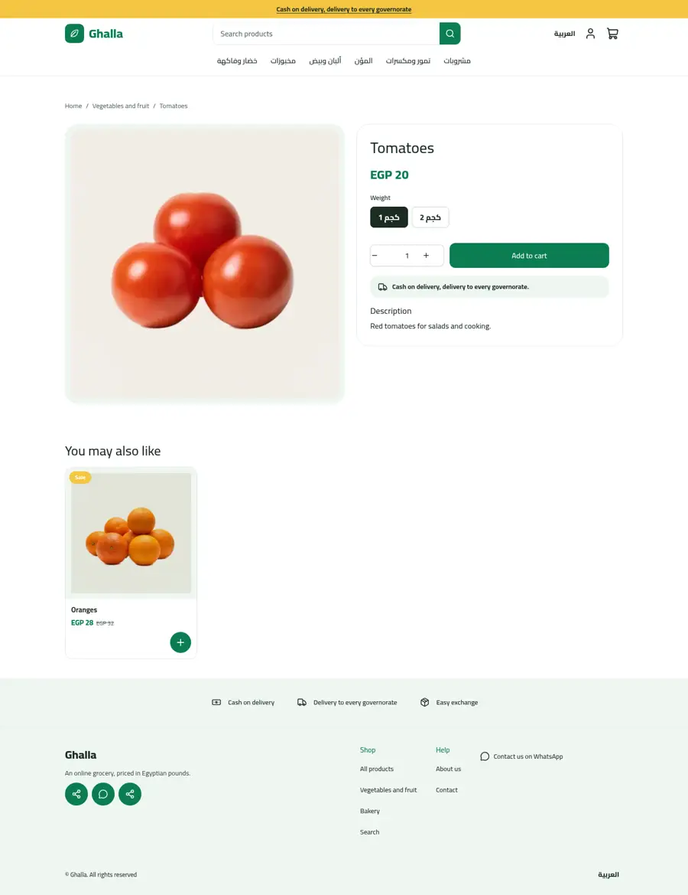
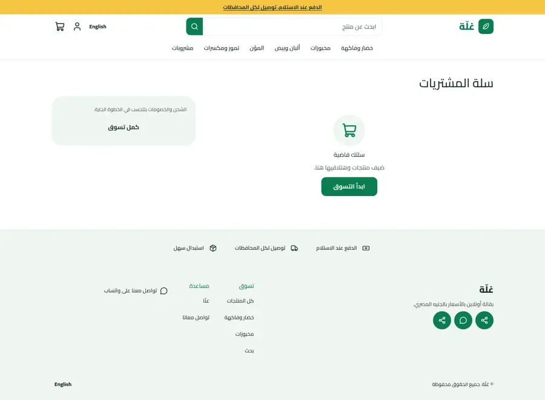
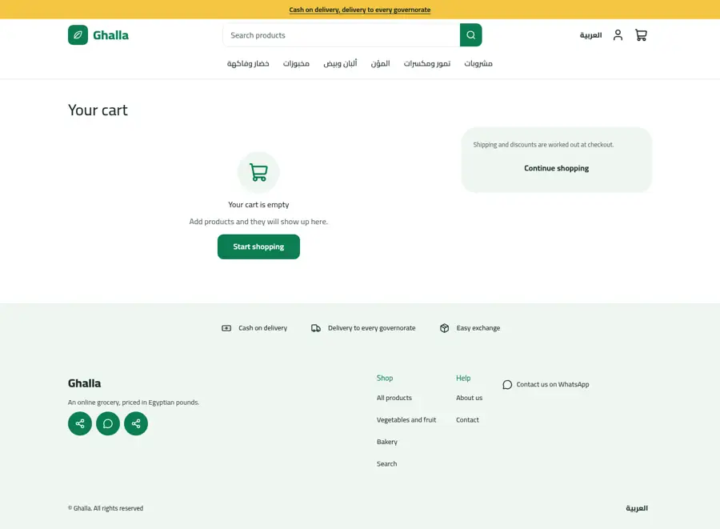
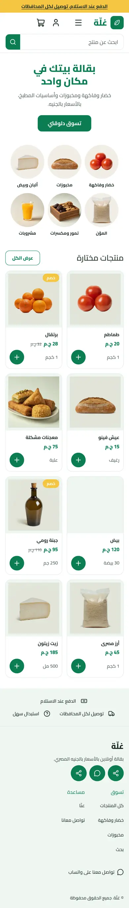
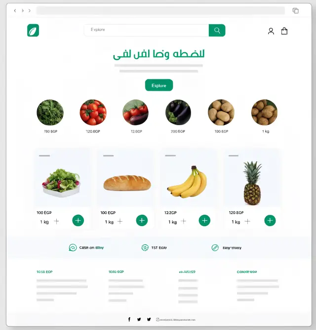
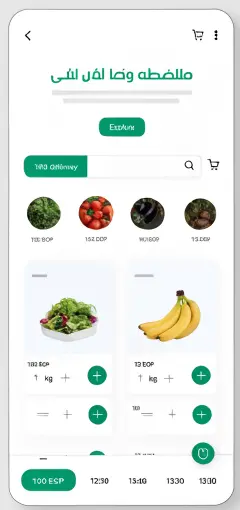

# Ghalla (غلّة)

A fresh-market grocery theme: white and leaf green with a warm yellow accent, a centred hero, round category photos, product cards on soft green tiles with a weight label and a round add button, and a trust strip. Arabic first, English included, money in whole pounds.

| | Arabic | English |
| - | - | - |
| Home |  |  |
| Product |  |  |
| Cart |  |  |
| Phone |  | |

Mockup:  

## What is in the folder

- `theme.json`: tokens (leaf green `primary`, deep green `secondary`, yellow `accent`), Cairo, `money.format: whole`.
- `layout/`, `groups/`: announcement, header (leaf mark, search bar, category row, cart drawer) and footer groups.
- `sections/`, `blocks/`, `snippets/`: hero, `category-circles` with `category-circle` blocks, featured products, trust strip, plus product, collection, search, cart, page and 404 sections.
- `templates/`: all seven page types with seeded default sections.

## Excerpt: the weight label

Product cards link to the product page. The label shows the first option value when the card data carries options:

```
<span class="gh-weight">{{ product.options[0].values[0] }}</span>
```
