# Tutorial: Halo, a bright silver jewelry store

Halo is a full store theme for a shop that sells plain silver jewelry: white and
light stone grounds, soft-black type, a wide banner, rounded category tiles and
product cards, and a quiet feature strip. Arabic (right-to-left) and English
come from the same files.

The theme writes **every page type itself**: home, product, collection, search,
cart, 404 and content page, with an announcement bar, header and footer as
editable section groups.

| Page | Arabic, desktop | English, desktop | Arabic, phone |
| - | - | - | - |
| Home | 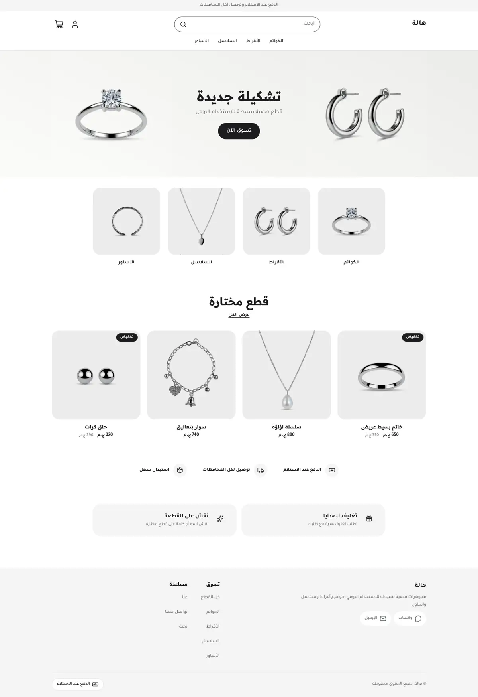 | 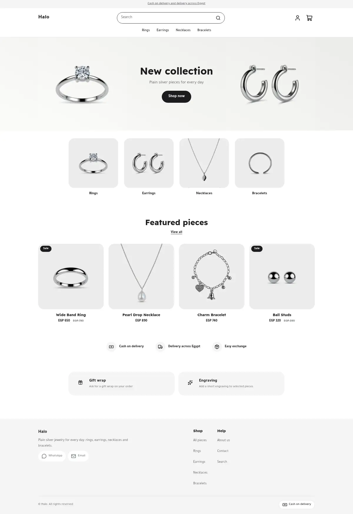 | 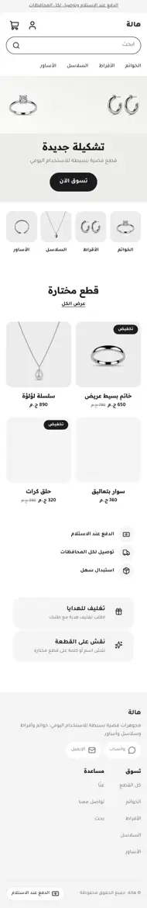 |
| Product | 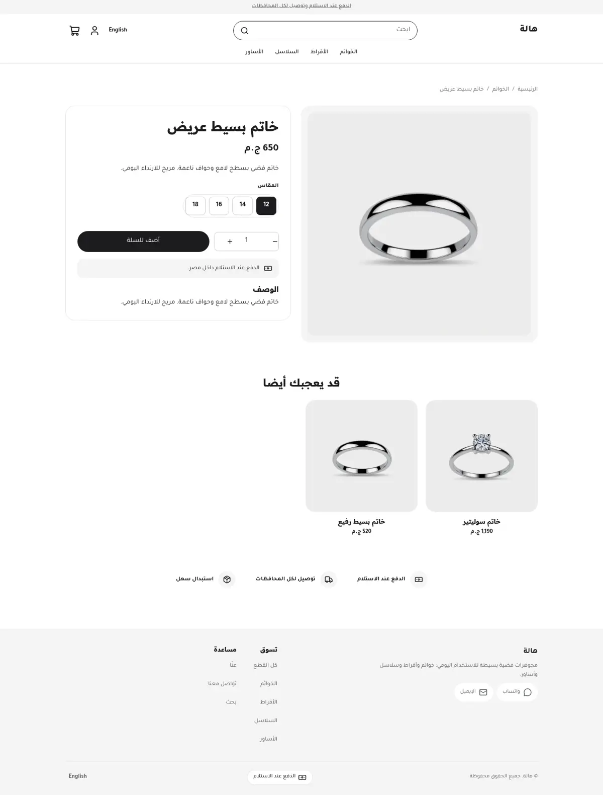 | 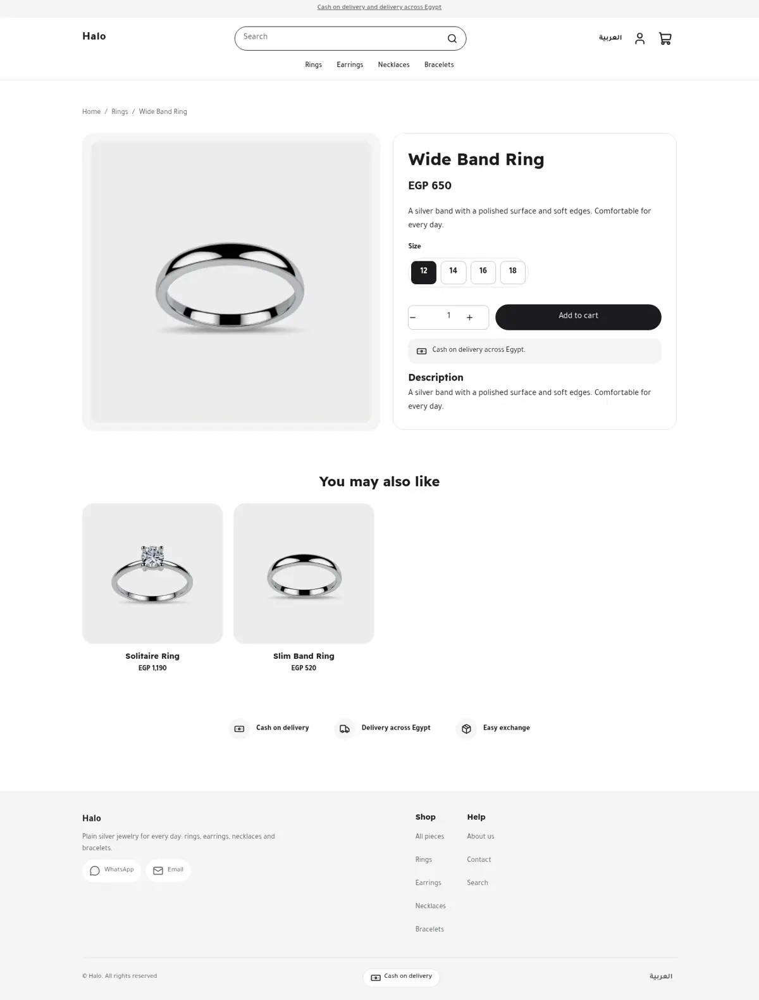 | 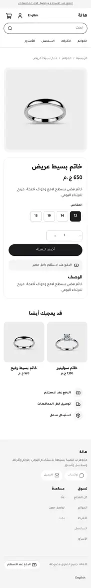 |
| Cart | 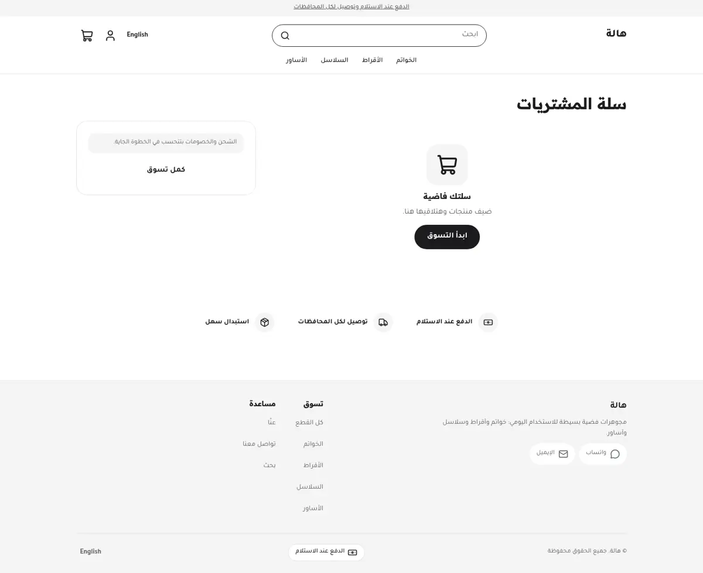 | 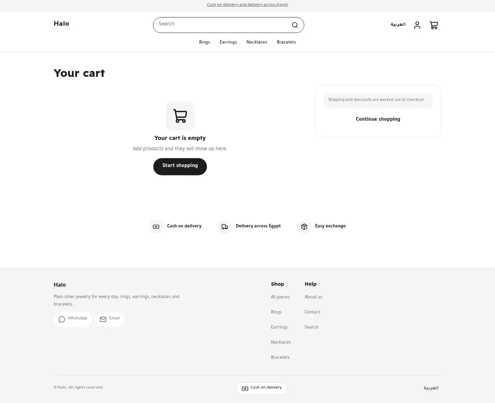 | 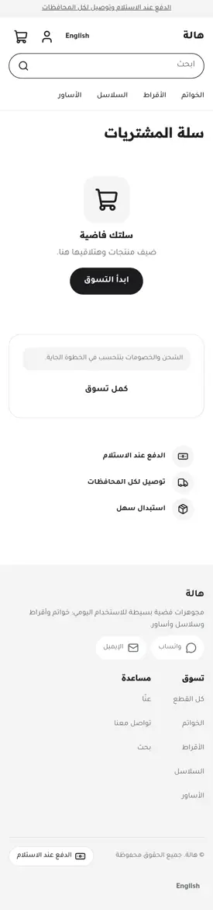 |

The design brief was this mockup (placeholder text and a fake logo, replaced by a
plain-text wordmark):

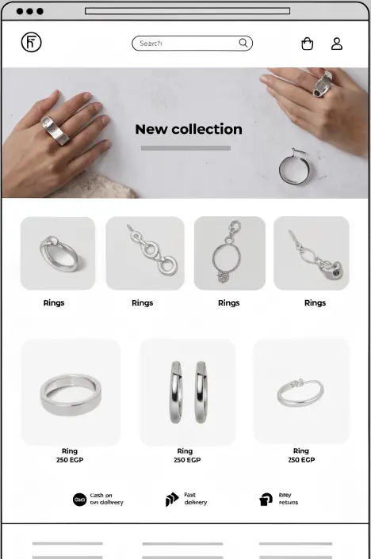 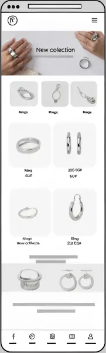

## What is in the folder

```
theme.json        id, version, tokens (white, stone, silver, soft black), money "whole"
layout/           announcement, header, <main>, footer
groups/           announcement.json, header.json, footer.json
templates/        index, product, collection, search, cart, 404, page
sections/         hero (banner), category-tiles, featured-products, feature-strip,
                  header, footer, product-main, related-products, collection-main,
                  search-main, cart-main, not-found, page-main, announcement-bar
blocks/           tile, feature, menu-link, footer-column, product-* blocks, ...
assets/theme.css  every colour is a token: var(--hk-color-<key>)
```

## Excerpts

The banner image, heading and button are all settings:

```
<hk-heading text="{{ section.settings.title }}" level="h1" size="40" mobile-size="26" />
```

Related products use the host-filled collection, with a fallback that skips the
current product:

```
 ...  ... 
```

The category tiles and the feature strip are blocks seeded in the home template,
so a new store is never empty.
