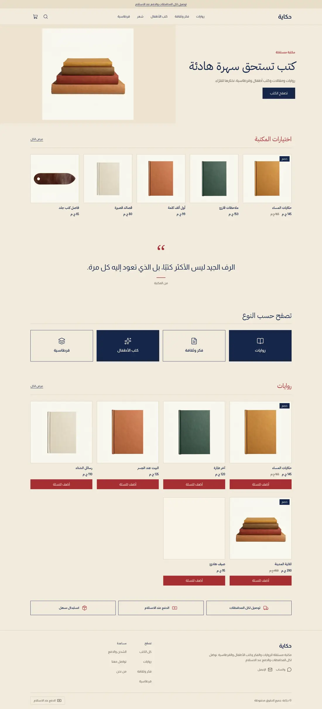
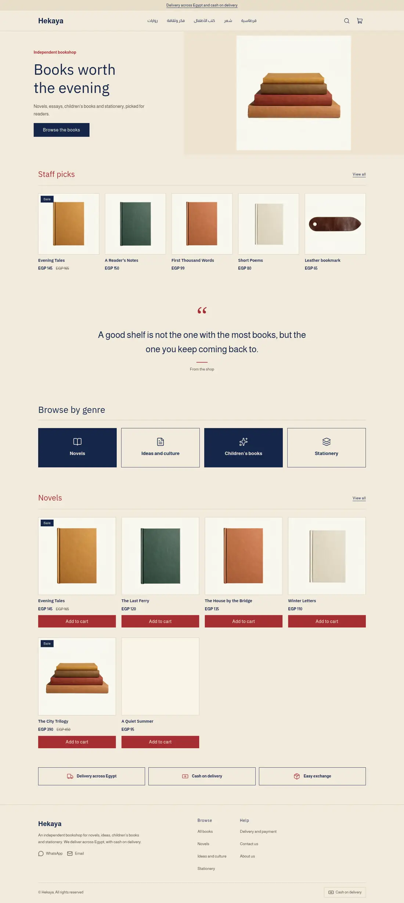
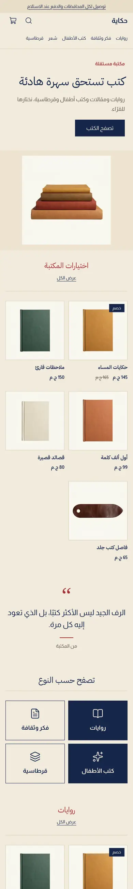
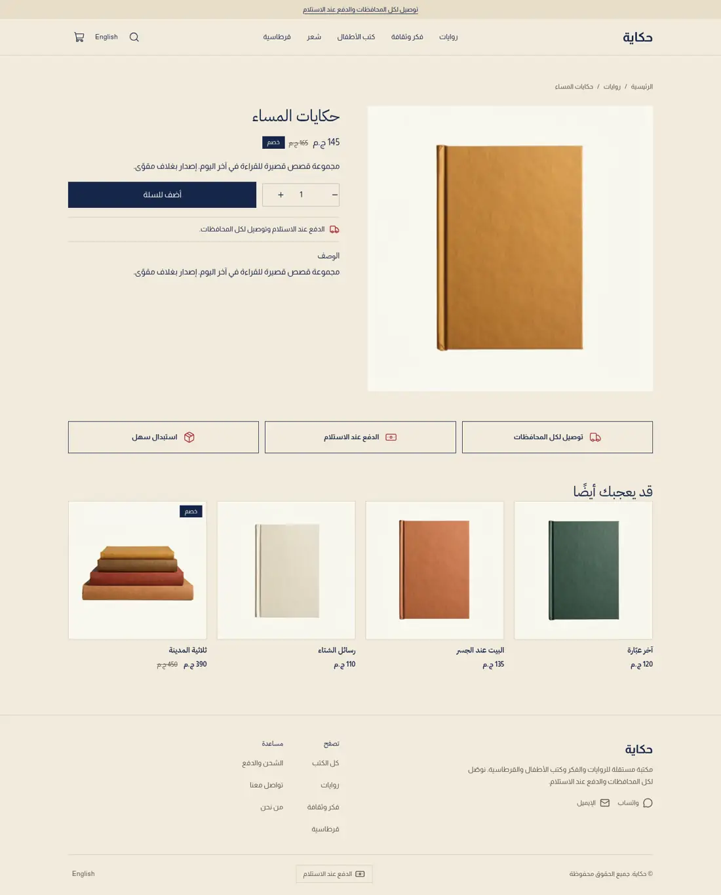
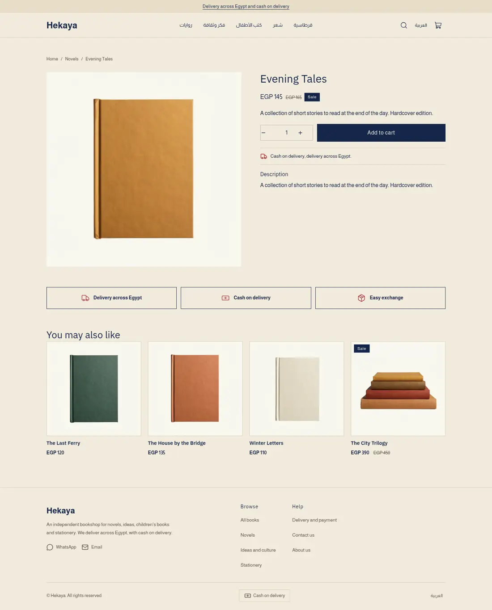
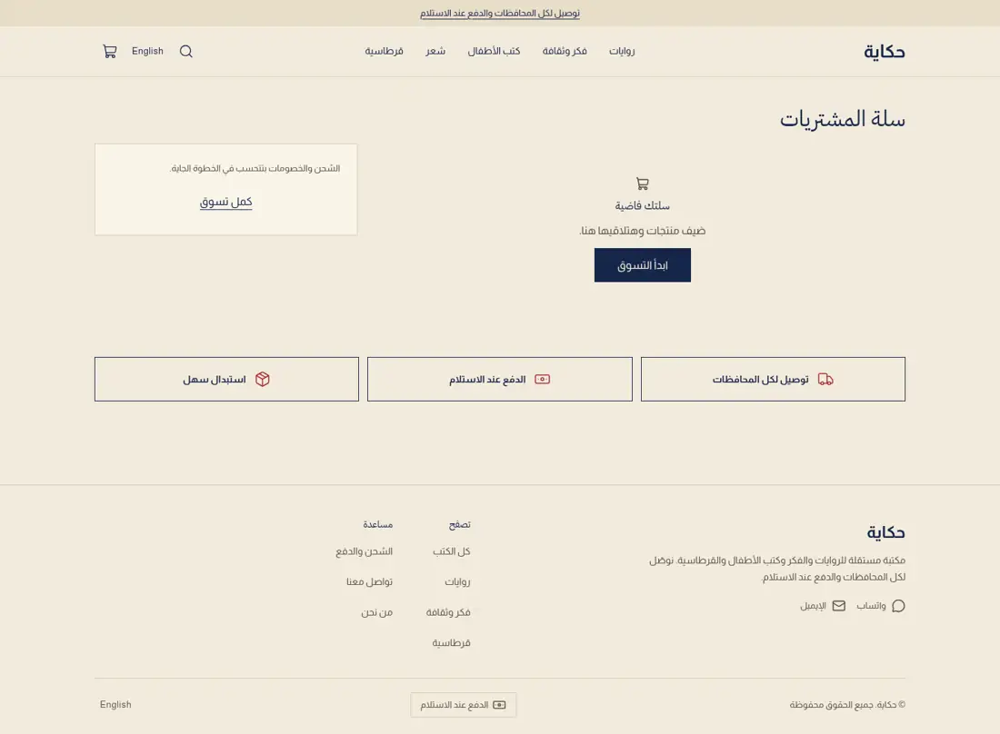
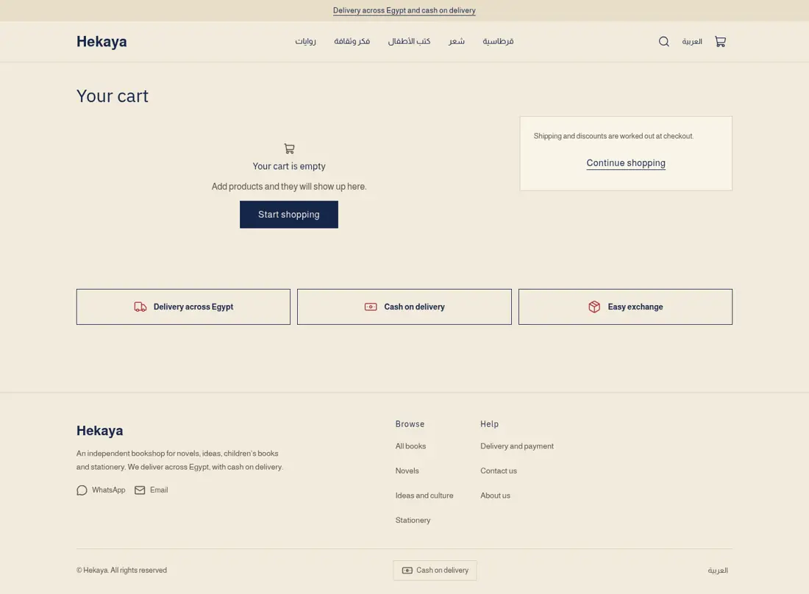
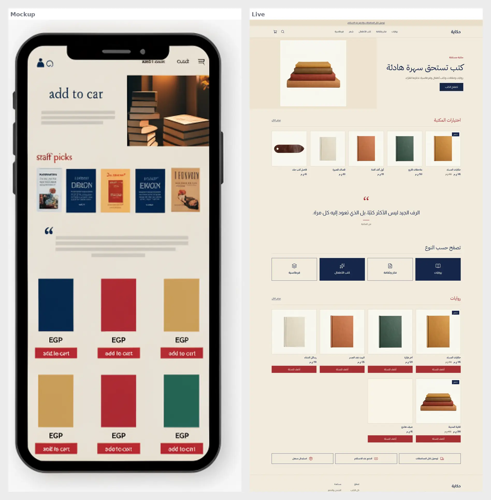
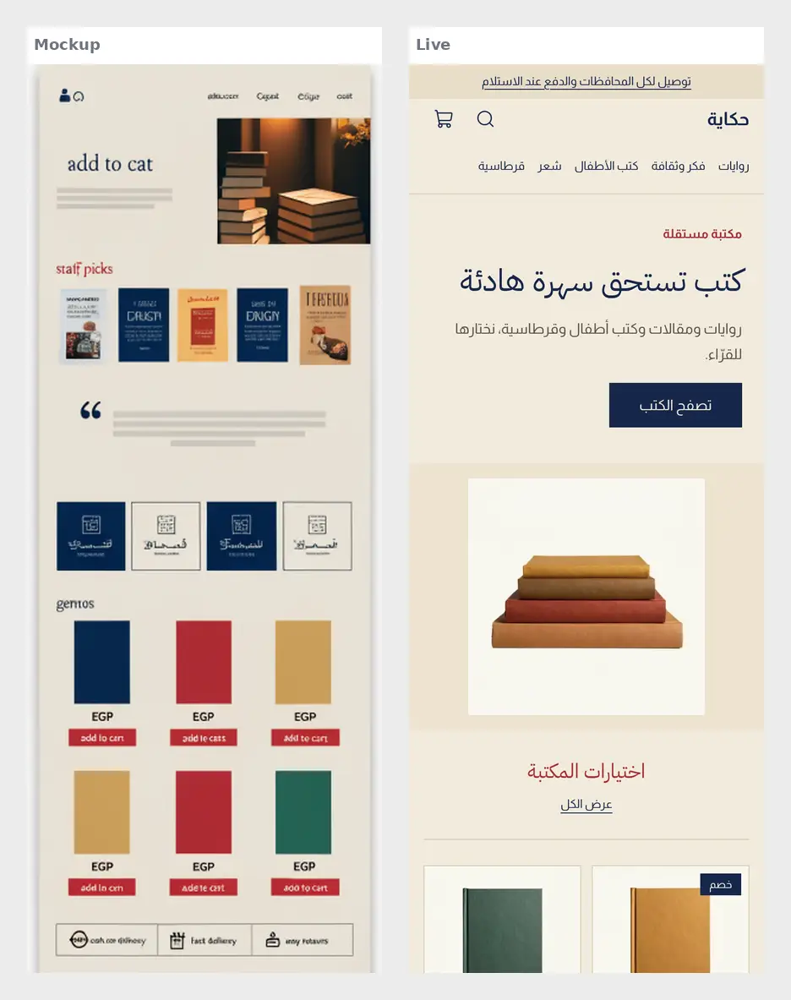

# Tutorial: Hekaya, a bookshop editorial store

Hekaya is a full store theme for an independent bookshop: paper cream ground, ink
navy headings, brick red accents, a split reading-corner hero, a staff picks row
of covers, a large pull quote, genre tiles and a grid of books with an add to cart
button. Right-to-left in Arabic and left-to-right in English from the same files.

It writes every page type itself: home, product, collection, search, cart, 404 and
content page, with an announcement bar, header and footer as editable sections.

| Page | Arabic, desktop | English, desktop | Arabic, phone |
| - | - | - | - |
| Home |  |  |  |
| Product |  |  | |
| Cart |  |  | |

The design brief (placeholder Arabic and fake titles, replaced by real copy):

 

## What is in the folder

- `theme.json`: tokens (paper, ink navy, brick red, mustard, forest), fonts, whole-pound money.
- `layout/theme.snf` and `groups/`: announcement, header and footer.
- `sections/`: `hero`, `featured-products` (staff picks and the book grid), `quote`, `genres`, `trust-strip`, plus the page sections.
- `blocks/genre.snf`: one tile, with a `tone` select (navy, outline, brick, forest).
- `snippets/product-card.snf`: cover card with an optional add to cart button.
- `locales/`: the same keys in `ar.json` and `en.json`.

## Excerpt: the card button

```

  <a class="hy-card-view" href="{{ product.url }}">{{ t('view_book') }}</a>

  <hk-add-to-cart product="{{ product }}" quantity="false" />

```

Books with options send the shopper to the product page to pick one; simple books add straight to the cart.
