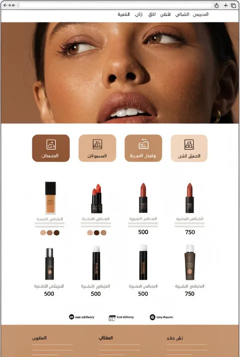
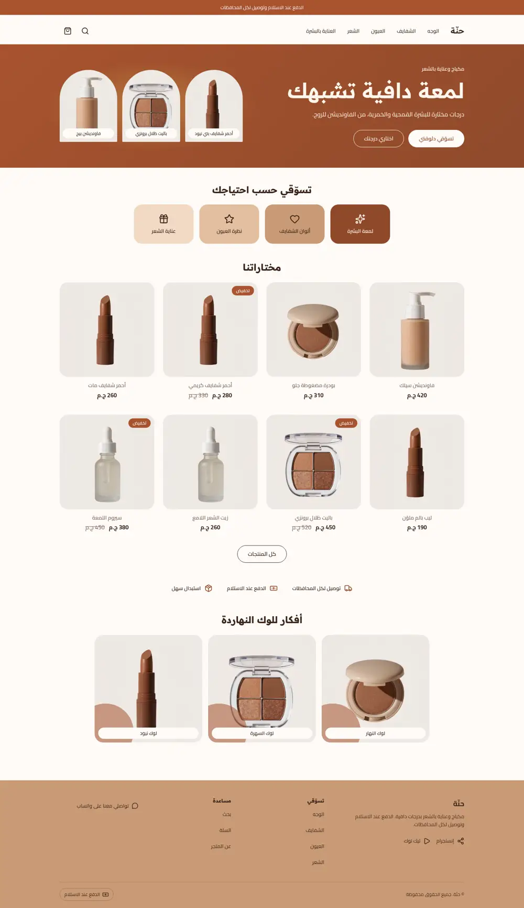
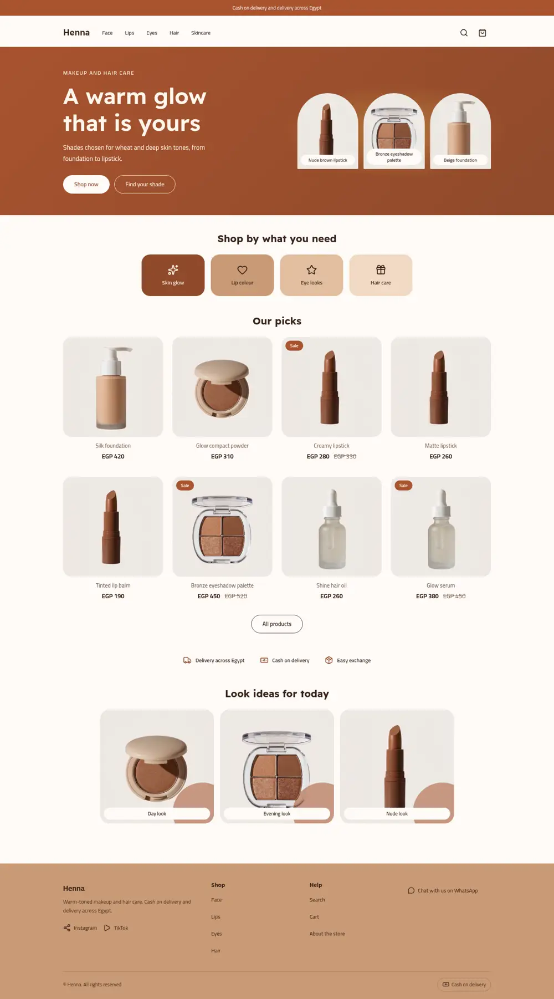
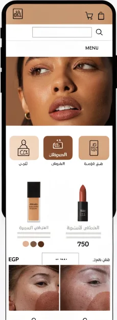
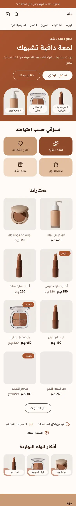
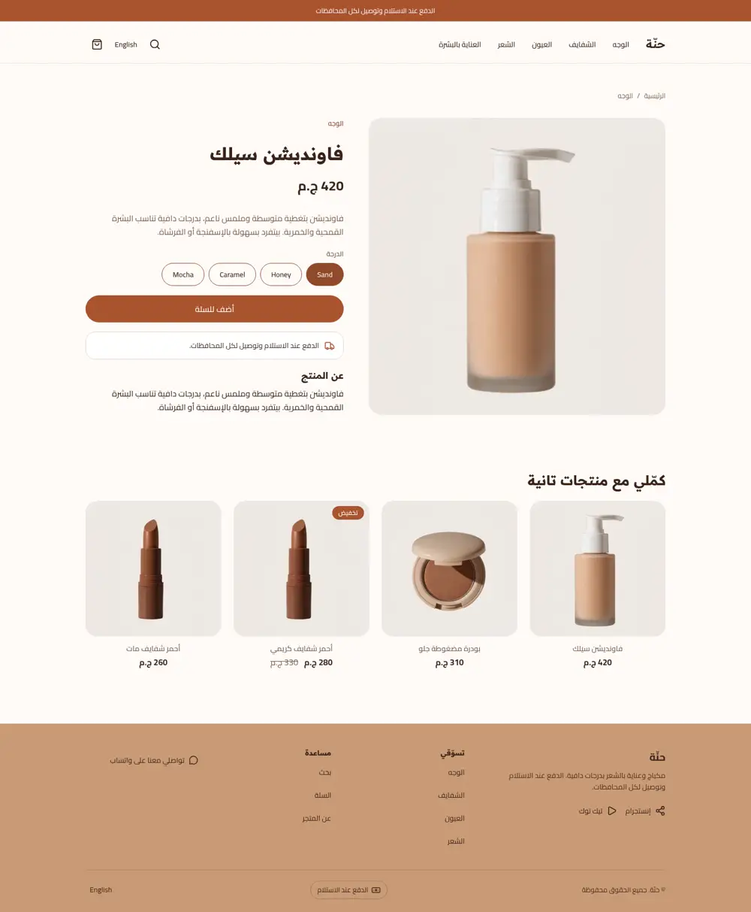
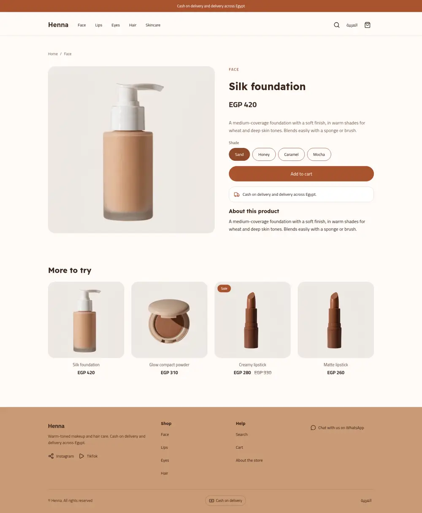
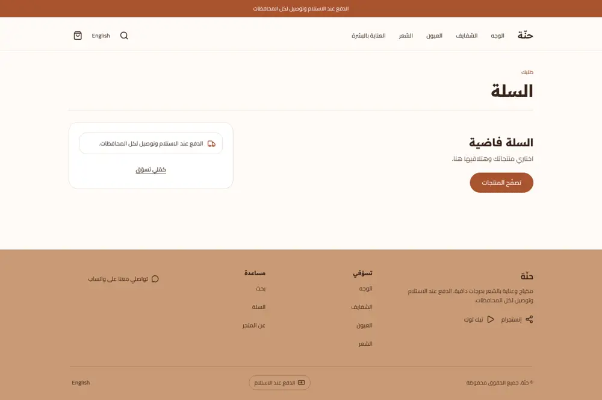
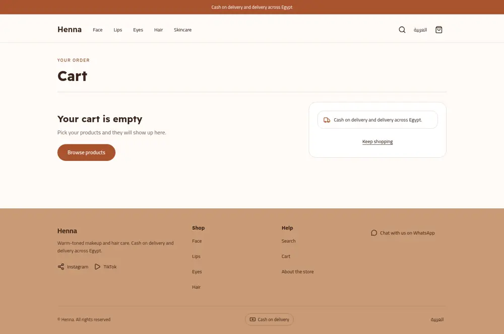

# Tutorial: Henna, a warm glow makeup store

Henna is a makeup and hair care store: terracotta, sand and bronze on a cream
ground, round shade swatches under every product, shop-by-concern tiles and a
look-ideas strip. It writes **every page type itself**: home, product,
collection, search, cart, 404 and content page, with an editable announcement
bar, header and footer.

| Mockup | Home, Arabic | Home, English |
| - | - | - |
|  |  |  |
|  |  | |

| Product, Arabic | Product, English | Cart, Arabic | Cart, English |
| - | - | - | - |
|  |  |  |  |

The mockup was a design brief: its Arabic is placeholder text and its photo is
a face close-up. The theme keeps the look and uses real Arabic copy, Egyptian
pounds and product photos. The hero takes an optional photo setting; without
one it shows up to three product arches over a terracotta gradient.

## What you will learn

- how a hero can switch between a photo and block-driven product arches
- how shade swatches are drawn in CSS from a product's first option (no photos)
- how concern tiles and a look strip are blocks with a colour select
- how tokens in `theme.json` colour the whole store

## Run it

```bash
sneferu dev . --port 4208   # Arabic; add ?locale=en for English
sneferu format .
sneferu validate .
```

Sample data lives in `.sneferu-dev/data.json` and is never part of the theme.

## What is in the folder

```
henna/
  theme.json            tokens: primary/accent terracotta, sand, clay, tan, bronze, gold
  layout/theme.snf      skip link, the three groups, <main>
  groups/               announcement, header, footer defaults
  templates/            index product collection search cart page 404
  sections/             hero concerns shelf trust-strip look-strip + page sections
  blocks/               hero-shot concern trust-item look-item + product blocks
  snippets/card.snf     product card with swatches
  locales/              ar.json en.json (same keys)
  assets/theme.css
```

## Swatches from options

```

  <p class="hn-swatches" role="list" aria-label="{{ t('shades') }}">
    <span class="hn-sw" role="listitem" title="{{ v }}"></span>
  </p>

```

Each dot is tinted by its position (`.hn-sw:nth-child(n)`) from the sand-to-bronze
tokens, so any product with a first option gets a light-to-deep row.
