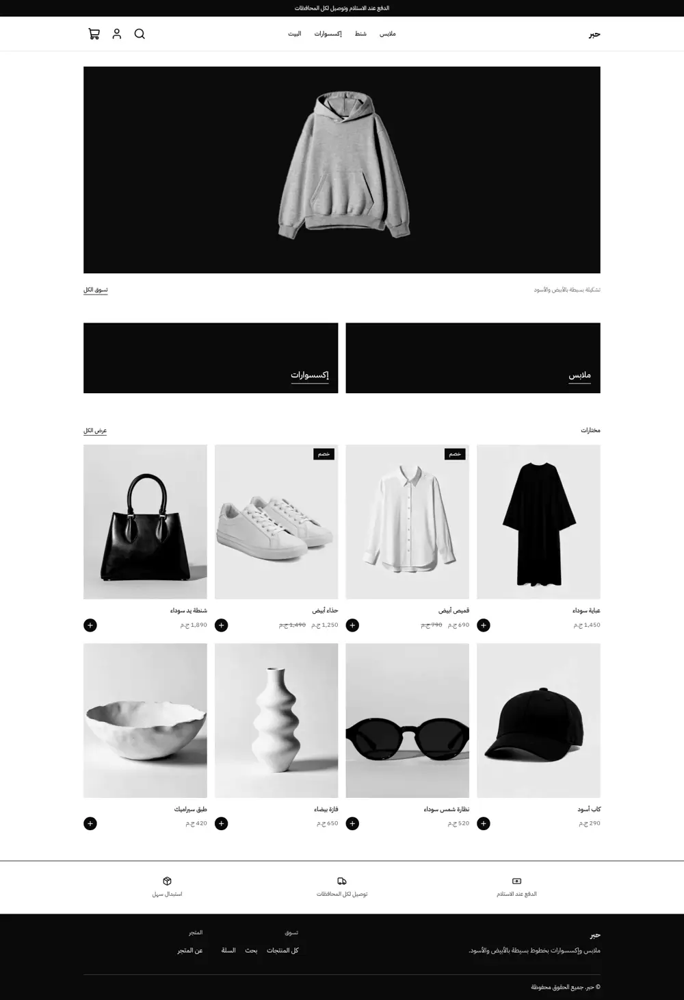
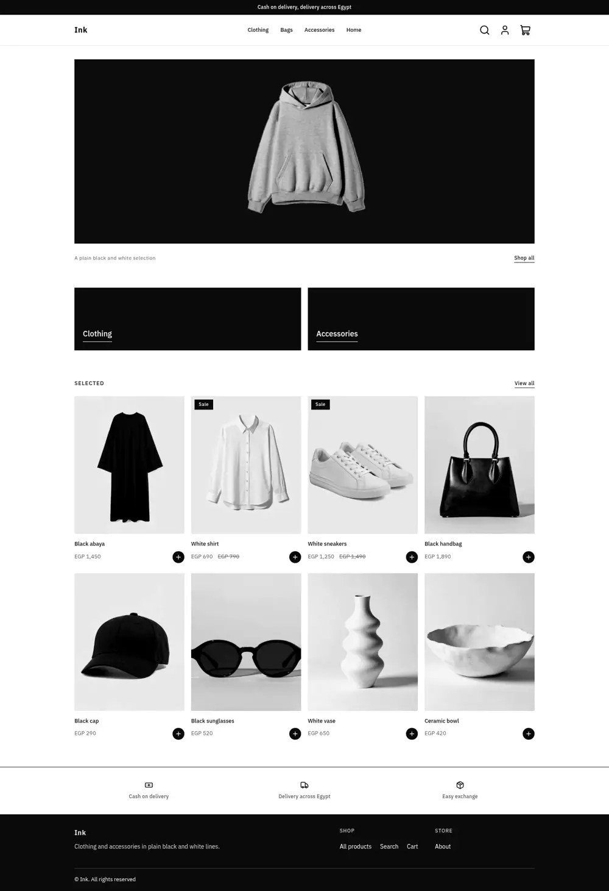
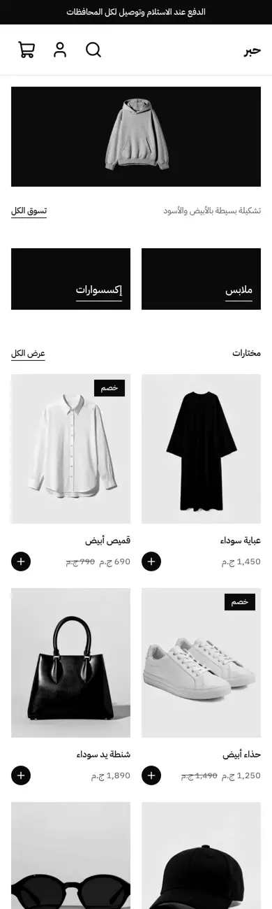
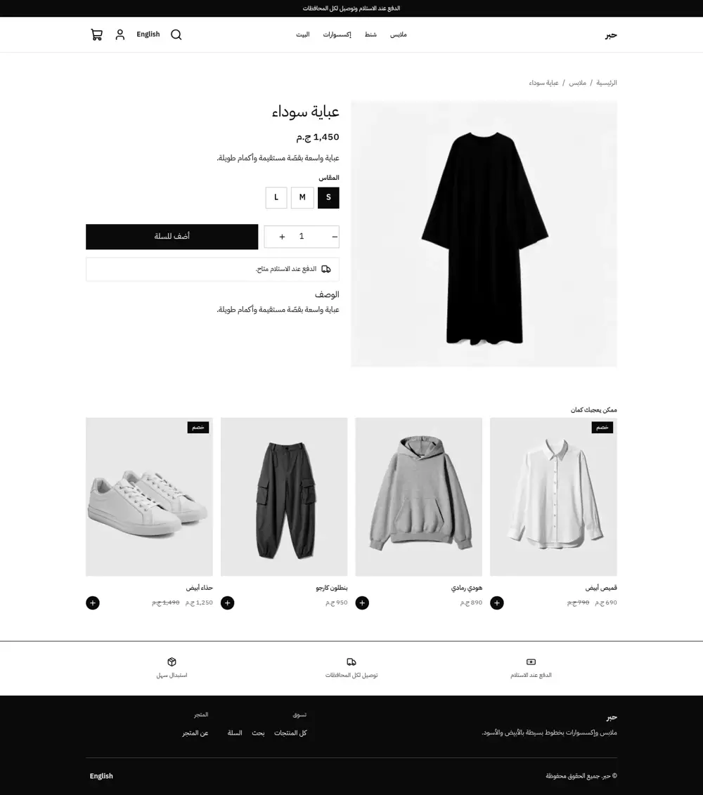
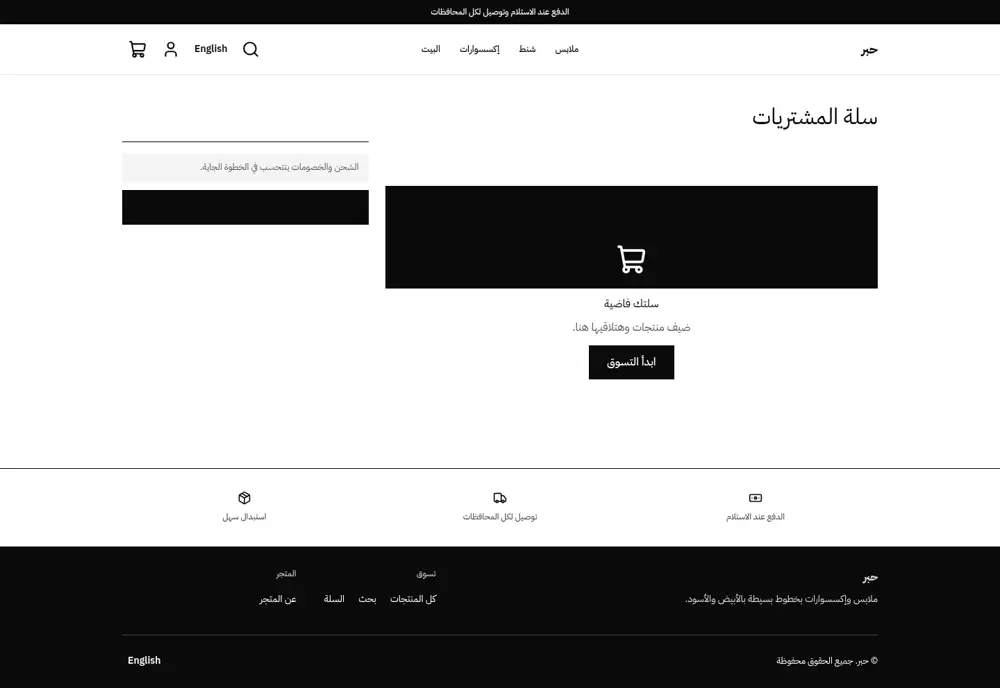
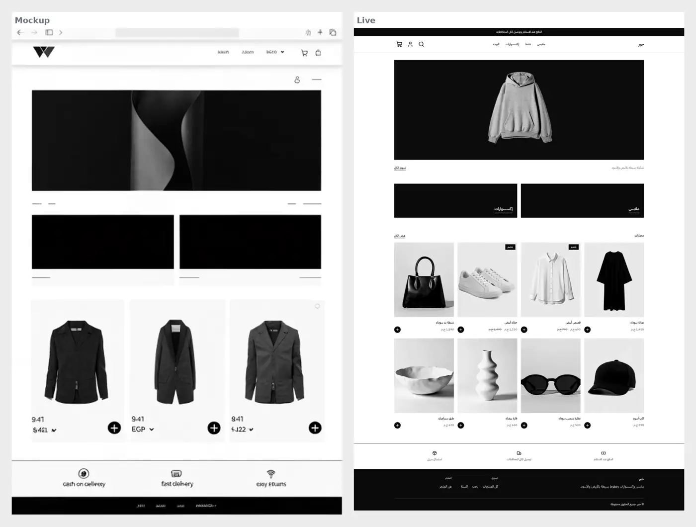
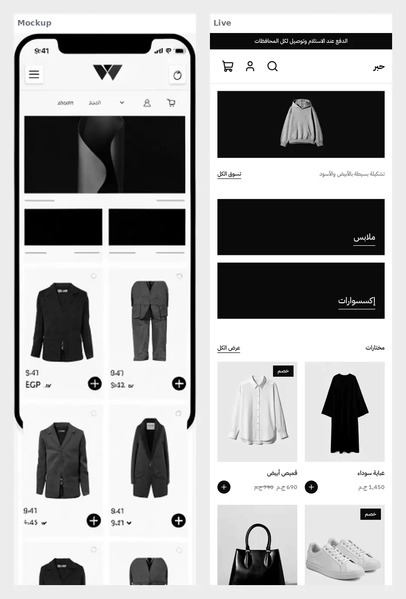

# Ink: a pure monochrome store

Ink is a plain black, white and light grey store for clothing and accessories: one wide hero photo,
two black category tiles, a four-column product grid on light grey photo tiles, a three-point info strip
and a black footer. Square corners, thin lines, no shadows. Right-to-left in Arabic, left-to-right in English.

| Home (ar) | Home (en) | Home (phone) | Product (ar) | Cart (ar) |
| - | - | - | - | - |
|  |  |  |  |  |

Mockup and live side by side:  

## What is in the folder

```
theme.json            id ink, tokens (monochrome), money format whole
layout/theme.snf      announcement, header, main, footer
groups/               announcement, header, footer defaults
templates/            index, product, collection, search, cart, page, 404
sections/             hero, tiles, product-grid, trust-strip, header, footer, announcement-bar,
                      product-main, related-products, collection-main, search-main, cart-main,
                      page-main, not-found
blocks/               tile, trust, menu-link, footer-column, footer-link, social-link, contact-line, product-*
snippets/             product-card, price, button
assets/theme.css      every colour is a token; logical properties only
```

## Notes

- Product cards link to the product page; the black plus is a visual cue inside the link.
- The hero image is a setting. Replace it with any wide photo; leave the caption empty to hide it.
- Contact and social blocks without a link do not render.
- Related products use the host `related` collection and skip the current product.
