# Tutorial: Ivory, an editorial womenswear store

Ivory is a full store theme for a fashion shop: a warm ivory ground, near-black
type, hairline dividers, square edges and one camel accent. The home page is a
split campaign hero (text on ivory, photo to the edge), an asymmetric lookbook
(one tall image, two small), a row of tall 3:4 product cards with small prices and
a three-icon trust strip. Right-to-left in Arabic and left-to-right in English
from the same files.

The theme writes **every page type itself**: home, product, collection, search,
cart, 404 and content page, with announcement, header and footer groups.

| Page | Arabic, desktop | English, desktop | Arabic, phone |
| - | - | - | - |
| Home | 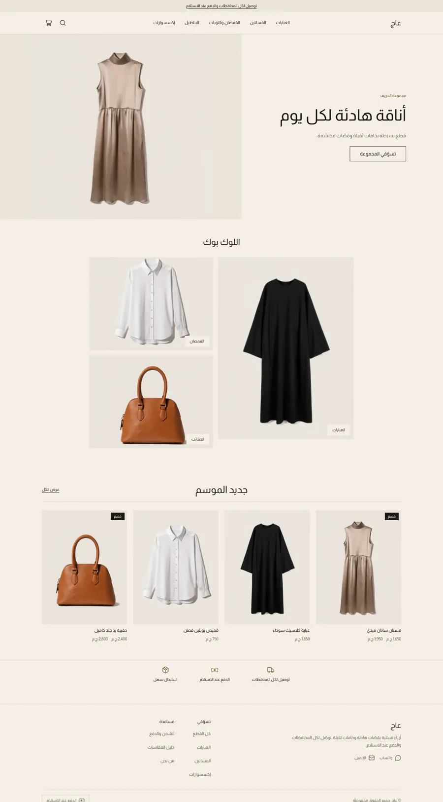 | 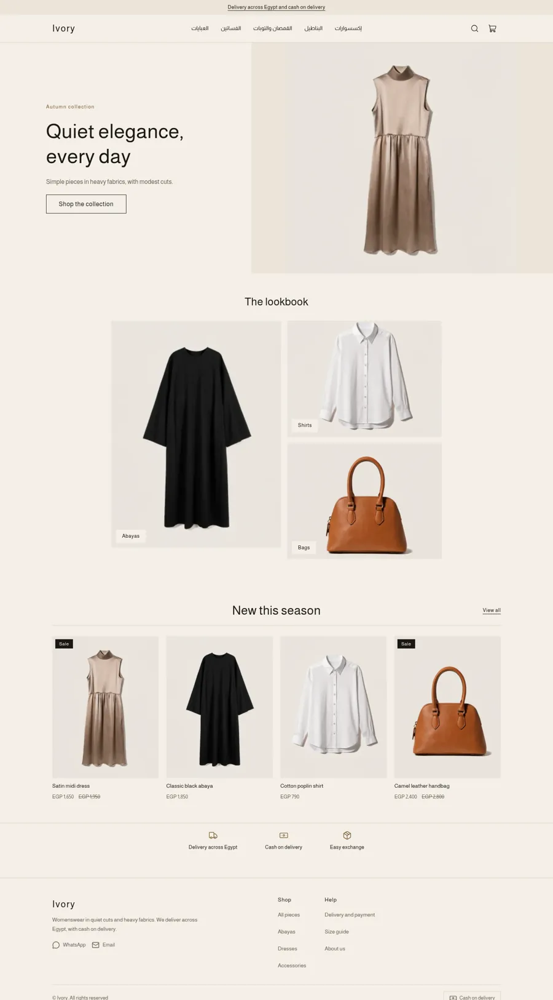 | 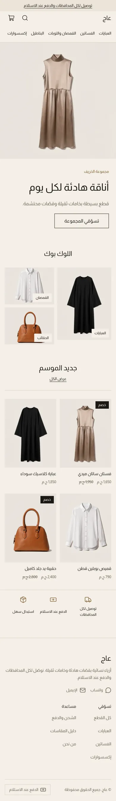 |
| Product | 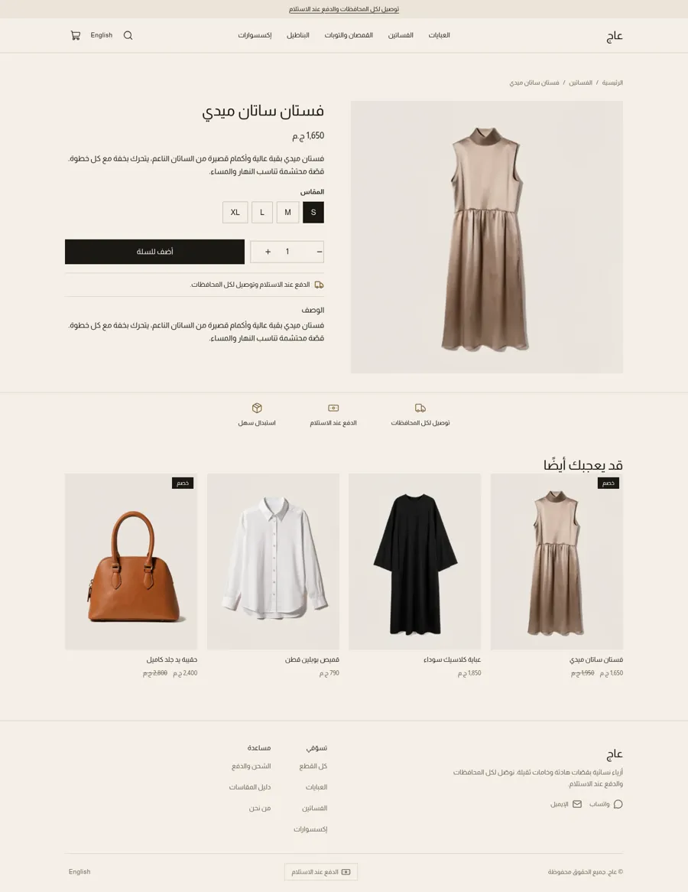 | 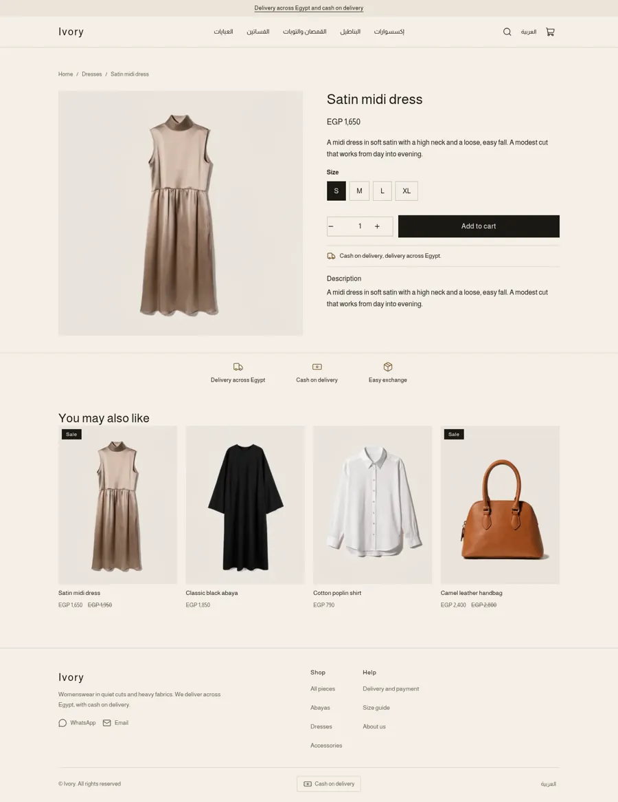 | 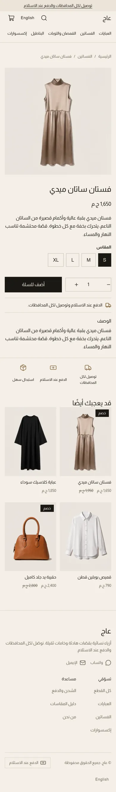 |
| Cart | 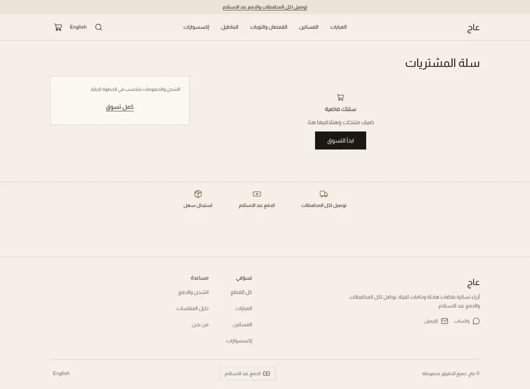 | 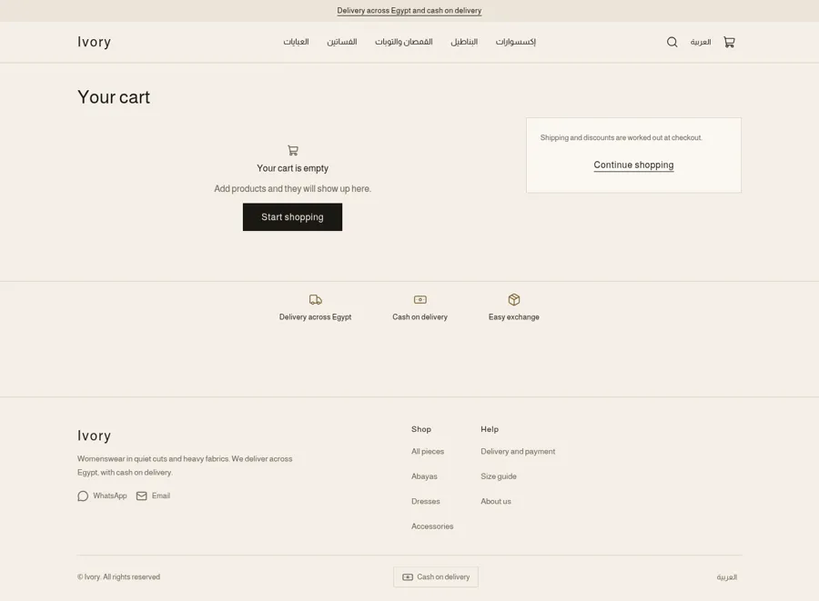 | 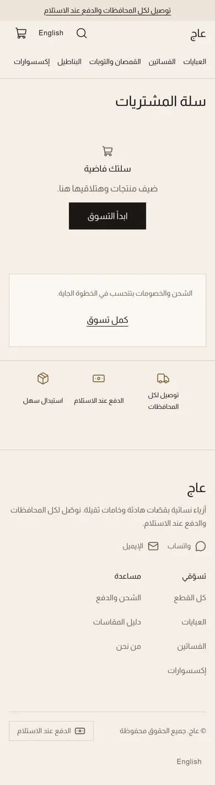 |

The design brief was this mockup (placeholder Arabic and fake logo, replaced by a
plain-text wordmark):

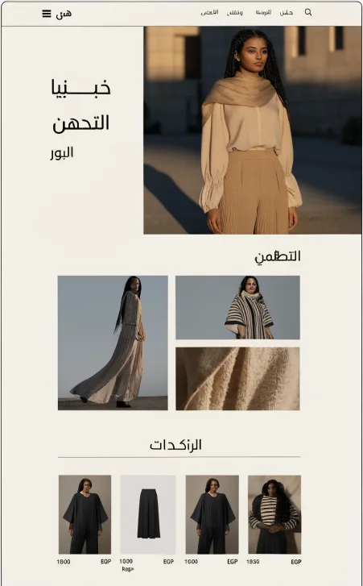 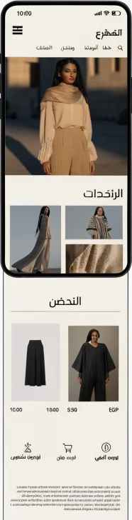

## What is in the folder

```
theme.json                 id, version, tokens (ivory, ink, camel)
layout/theme.snf           announcement, header, <main>, footer
groups/                    announcement.json, header.json, footer.json
templates/                 index, product, collection, search, cart, 404, page
sections/                  announcement-bar, header, footer, hero, lookbook, trust-strip,
                           featured-products, product-main, related-products,
                           collection-main, search-main, cart-main, not-found, page-main
blocks/                    look, trust, menu-link, menu-sub-link, footer-column, footer-link,
                           social-link, contact-line, payment-method, product-* blocks
snippets/                  product-card, price, button
locales/                   ar.json, en.json (same keys)
assets/theme.css           the only stylesheet; every colour is a token
docs/                      screenshots
```

## Run it

```bash
sneferu dev .         # /en for English
sneferu format .
sneferu validate .
```

## Annotated excerpts

The lookbook is a section that holds `look` blocks; CSS makes the first one tall.
Blocks are wrapped by the runtime, so the rule targets the wrapper:

```css
.iv-look { aspect-ratio: 4 / 3; }
[data-hk-block]:first-child > .iv-look { grid-row: 1 / span 2; aspect-ratio: 3 / 4; }
```

The hero image is an `image` setting; the template seeds a hosted photo so a new
store is never empty. Bundled `asset_url()` images are avoided in this theme
(see the report: asset requests failed on the demo store).

Product cards are plain by default (`card_style: plain`, `image_ratio: 3/4`): no
shadow, a soft ground behind the photo, a small title and a muted price.
