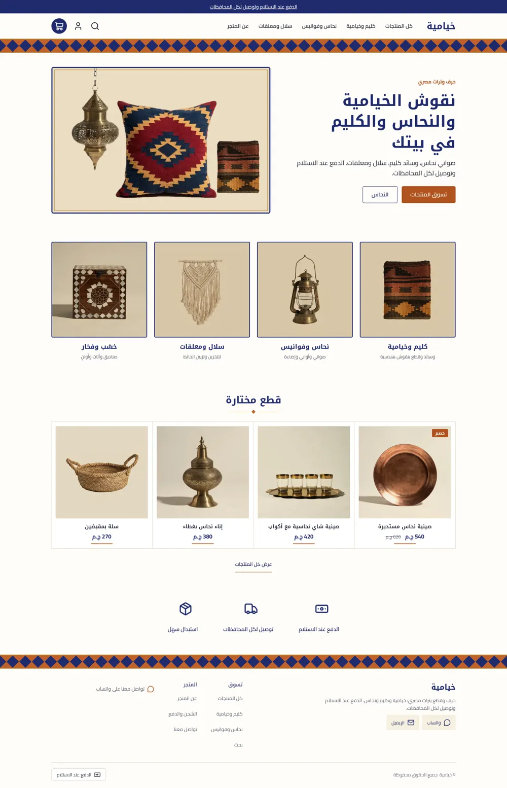
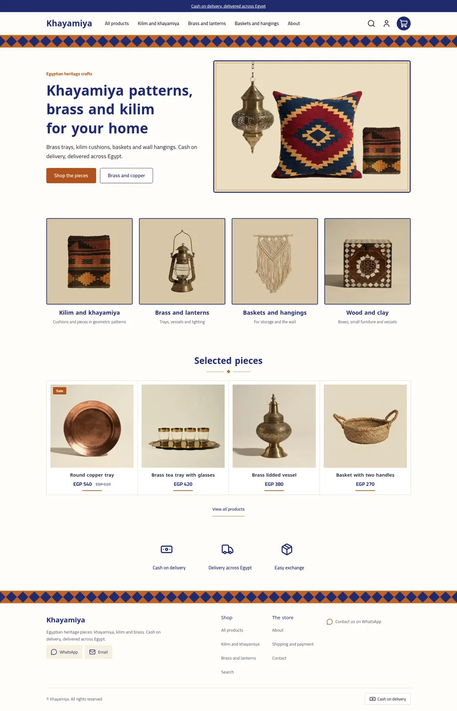
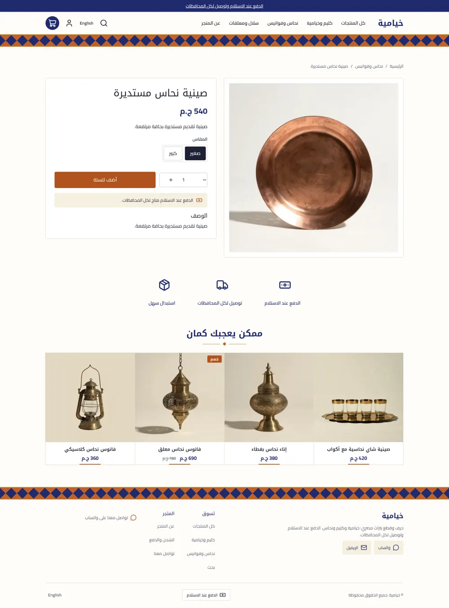
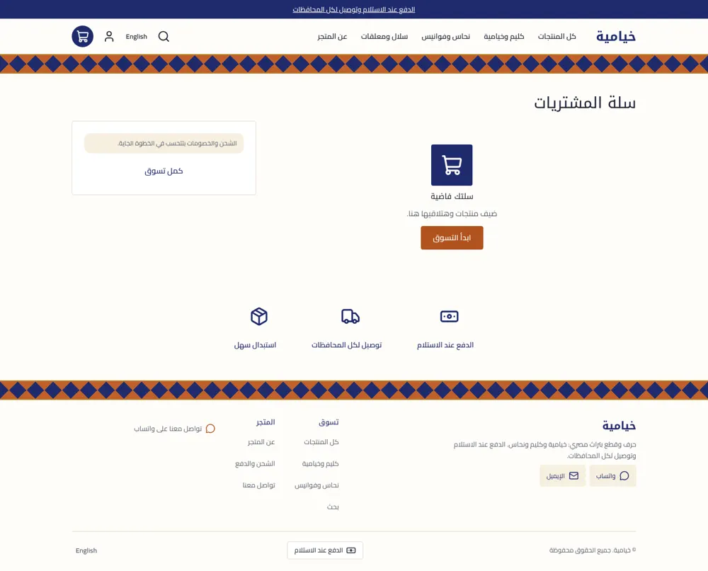
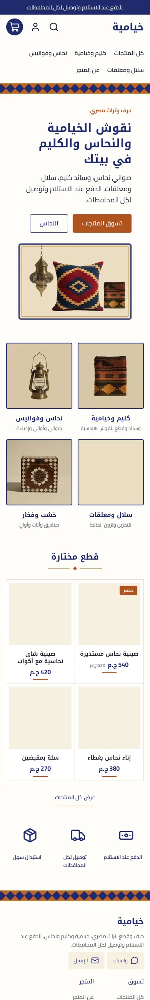
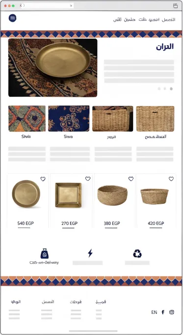
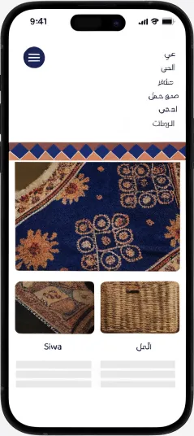

# Khayamiya

A store theme for Egyptian heritage crafts. Indigo, rust, sand and brass; a khayamiya diamond band (pure CSS gradients) under the header and above the footer; a photo hero; photo category tiles with a name and a short line; joined bordered product cards; a three-icon strip. Arabic first, English second, whole-pound EGP.

| | Arabic | English |
| - | - | - |
| Home |  |  |
| Product |  | |
| Cart |  | |
| Phone |  | |

The design it follows:  

## What is in the folder

- `theme.json`: tokens (indigo `primary`, rust `accent`, plus `indigo`, `rust`, `brass`, `sand`), fonts, `money.format: whole`.
- `layout/theme.snf` and `groups/`: announcement, header (logo image or text wordmark, nav, search, cart as an indigo circle), footer.
- `sections/`, `blocks/`, `snippets/`: hero, category tiles (photo blocks), featured products, trust strip, and the main section of each page type.
- `templates/`: all seven page types, each seeded with default sections.
- `assets/theme.css`: the band is four `linear-gradient`s on one element; all colours are `var(--hk-color-*)`.

## The band

```css
.kh-band { background-color: var(--hk-color-indigo);
  background-image: linear-gradient(135deg, var(--hk-color-rust) 25%, transparent 25%), /* four corner triangles */
                    linear-gradient(225deg, ...), linear-gradient(315deg, ...), linear-gradient(45deg, ...);
  background-size: 36px 36px; }
```

Each tile leaves an indigo diamond in the middle. The header and footer each have a `show_band` setting.
