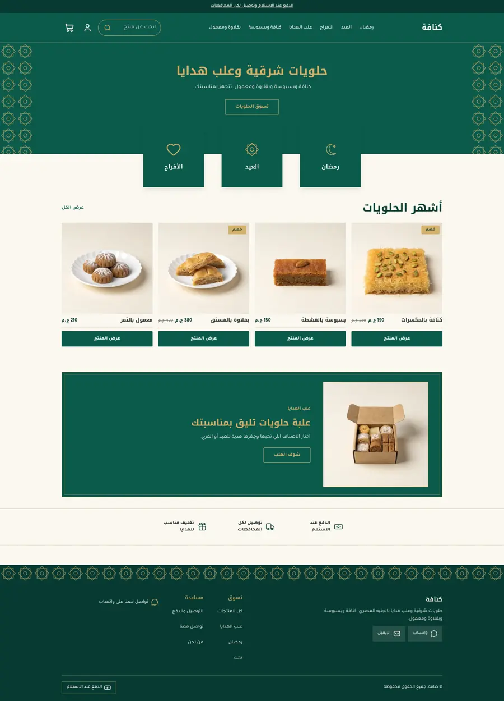
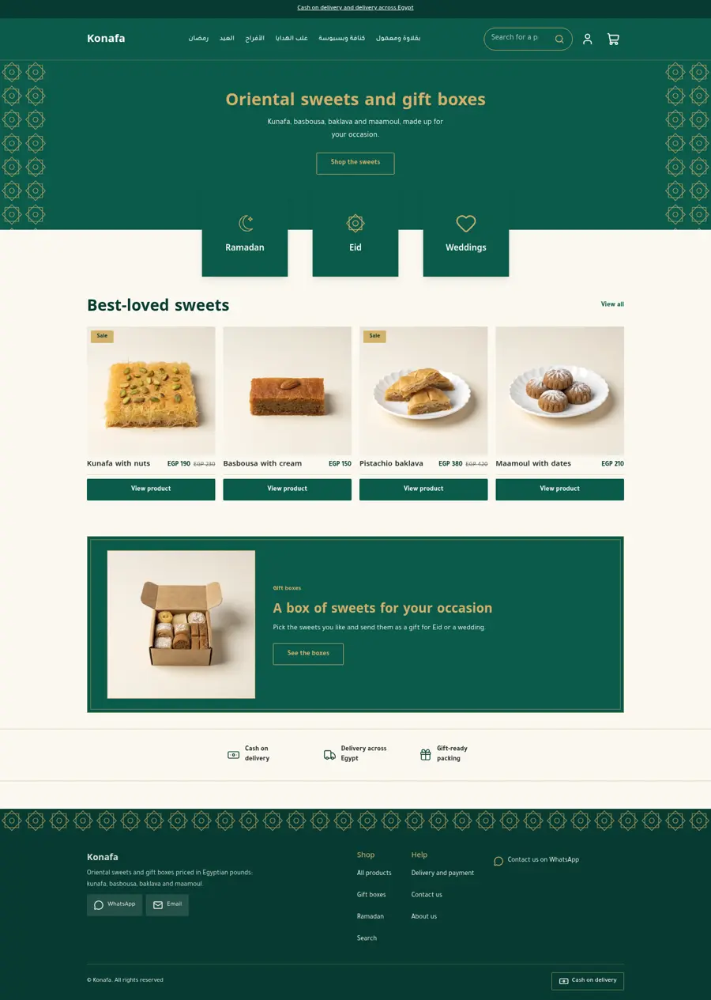
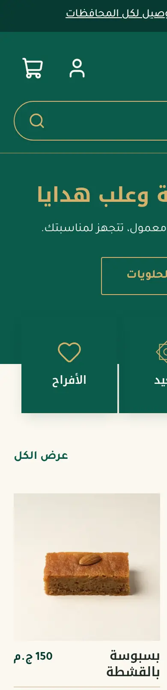
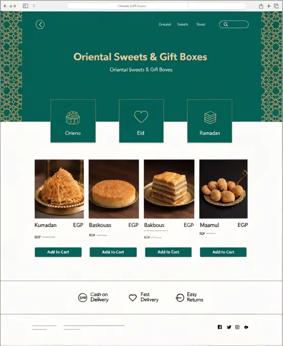
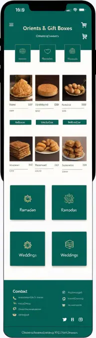

# Tutorial: Konafa, an oriental sweets and gift box store

Konafa is a full store theme for a shop that sells oriental sweets and gift
boxes: kunafa, basbousa, baklava and maamoul. It is deep emerald and gold on
cream, with a geometric Islamic border (an eight-point star drawn as inline SVG
in two snippets), emerald occasion tiles that overlap the hero band, flat
square product cards, a gift-box banner and a ruled trust strip. It is
right-to-left in Arabic and left-to-right in English from the same files.

The theme writes every page type itself: home, product, collection, search,
cart, 404 and content page, with an announcement bar, header and footer as
editable sections.

| Page | Arabic, desktop | English, desktop | Arabic, phone |
| - | - | - | - |
| Home |  |  |  |

The design brief was a mockup with placeholder text and a fake logo, replaced
here by a plain wordmark and real copy:

 

## What is in the folder

```
theme.json                 id, version, tokens (emerald, gold, cream), money format whole
layout/theme.snf           announcement, header, <main>, footer
groups/                    announcement.json, header.json, footer.json
templates/                 index, product, collection, search, cart, 404, page
sections/                  hero, kn-occasions, kn-gift, kn-trust, featured-products, header, footer, ...
blocks/                    tile (occasion), trust, menu-link, footer-*, product-* ...
snippets/                  product-card, price, glyph (crescent, star, box), geo-v, geo-h (the border)
assets/theme.css           the only stylesheet; every colour is a token
```

## Excerpts

The border is two inline SVG snippets, coloured with `currentColor` from a token
(no image, no colour literal in the CSS):

```css
.kn-geo { position: absolute; inset-block: 0; width: 96px; overflow: hidden; color: var(--kn-gold); }
```

Occasion tiles are blocks with an icon select that also offers the custom
glyphs `crescent`, `star8` and `box`:

```

```
