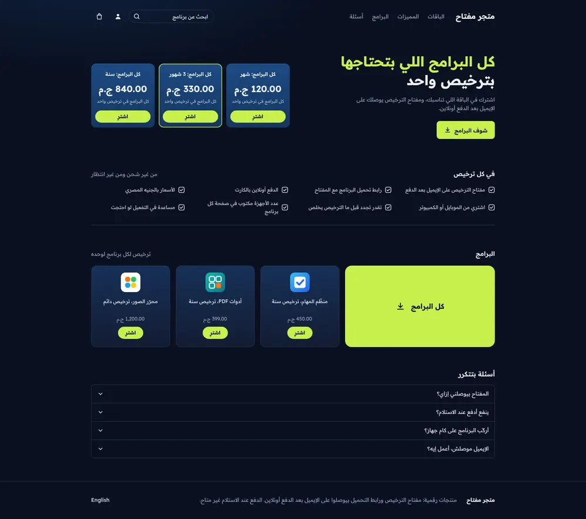
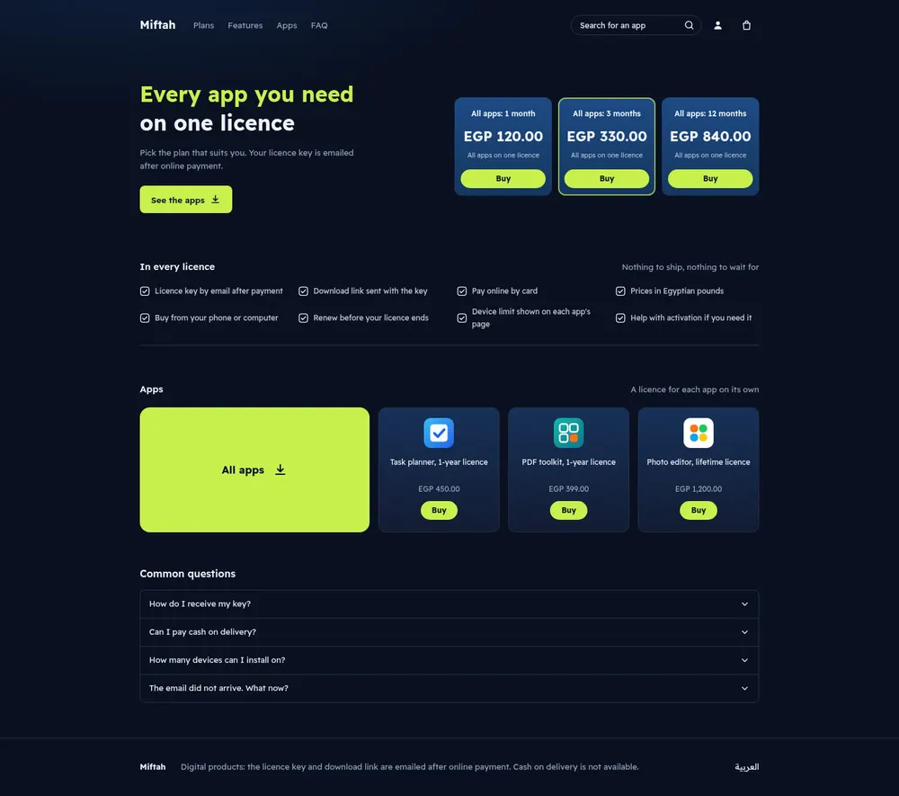
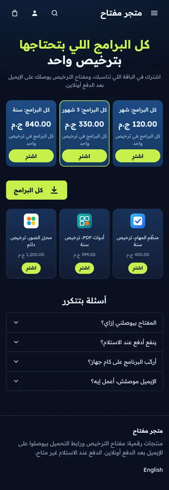
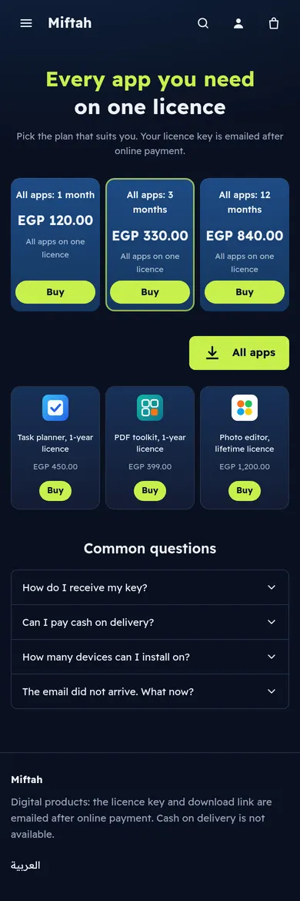

# Tutorial: License, a dark store for software licences

License is a home page for a shop that sells software licences and
subscriptions. Deep navy, blue plan cards and one lime accent. The hero puts a
two-line heading next to three plan cards; under it come a feature checklist,
the apps (a large "All apps" tile and three app cards) and a FAQ accordion.

| Mockup | Live, Arabic | Live, English |
| - | - | - |
|  |  |  |
|  |  |  |

The mockup was generated as a design brief; its Arabic is placeholder text,
and its violet plan cards were replaced with blue. The Arabic page mirrors the
mockup so it reads right to left. Live:
[demo-license.hekana.com](https://demo-license.hekana.com) and
[/en](https://demo-license.hekana.com/en).

What the theme uses: plan cards built from real products with `hk-price`, a
`data-*` attribute set from an expression, `hk-product-card` with a Buy link in
its `actions` part, `collection` settings, `hk-search-form`, `hk-icon`,
`<details>` for the FAQ, localized settings and blocks seeded by the template.
Version 1.2.0 is built on Sneferu 0.4.

## Upgrading from 1.0

In 1.1.0 the numbered settings and locale-text fallbacks became blocks and
localized settings; values saved under 1.0 are not carried over, so the sections
start from the new defaults.

## Pages

License writes only the home page (`templates/index.sneferu`). The product,
collection, search, cart, content page and 404 templates come from the SDK's
default store ([page types](../../../docs/guide/16-page-types.mdx)), drawn with
License's tokens, fonts and layout. `assets/theme.css` restyles what the default
store would otherwise draw in its own way (the block "Cart, product, collection,
search and 404 pages"):

- product cards on collection and search pages use the app card: the blue tier
  gradient on navy with a thin line;
- the link reset is `:where(.ls a)`, so the default store's lime buttons keep dark text;
- the sale badge, the active chip and the cart count use dark text on lime;
- the cart summary, the delivery note and the cart drawer sit on the secondary navy;
- header links, icons, the search field and the app "Buy" buttons are 44 px tall.

The header group holds the cart drawer: it opens when an item is added (a
setting of the header section) and from the cart icon.

| Page | URL in `sneferu dev` |
| - | - |
| Product | `/products/sample-2` |
| Collection | `/category/gift-cards`, `/products` |
| Search | `/search?q=card` |
| Cart | `/cart` |
| Content page | `/pages/about` |
| 404 | any other path |

## Files

```
assets/theme.css
blocks/faq-item.sneferu
blocks/feature.sneferu
groups/footer.json
groups/header.json
layout/theme.sneferu
locales/ar.json
locales/en.json
sections/apps.sneferu
sections/faq.sneferu
sections/features.sneferu
sections/license-footer.sneferu
sections/license-header.sneferu
sections/plans-hero.sneferu
snippets/glyph.sneferu
templates/index.sneferu
theme.json
```

Next to the theme: `README.md` and `docs/` (this tutorial and its pictures),
and `.sneferu-dev/data.json` (sample data for `dev`). The CLI skips all three:
they are never checked and never pushed.

## Data it needs

| Handle | Used by |
| - | - |
| `bundles` | the three plan cards (first three products, in store order) |
| `apps` | the app cards (three by default) |

Both are defaults of `collection` settings (`plans` in the hero, `list` in the
apps section); the merchant can pick other categories in the editor.

## 1. Manifest and tokens

```json title="theme.json"
{
  "id": "license",
  "name": "License",
  "version": "1.2.0",
  "author": "Hekana",
  "description": "A dark theme for software licences, subscriptions and digital tools",
  "category": "digital",
  "engine": "hk2",
  "engineCompatibility": "^2.0.0",
  "defaultLocale": "ar",
  "locales": ["ar", "en"],
  "settings": {},
  "tokens": {
    "colors": {
      "primary": "#0A1122",
      "secondary": "#121C33",
      "accent": "#C8F04D",
      "background": "#0A1122",
      "text": "#EEF2F8",
      "muted": "#97A3B9",
      "tier": "#1D4A84",
      "tier-deep": "#15365F",
      "line": "#26324B"
    },
    "layout": { "contentWidth": "1040px" },
    "fonts": {
      "heading": "Readex Pro",
      "body": "Readex Pro"
    }
  }
}
```

`tier` and `tier-deep` are the two blues of the plan cards. Keeping them as
tokens makes the "no violet" rule a one-line check.

## 2. Layout

```html title="layout/theme.sneferu"
<div class="ls">
  <hk-section-group name="header" />
  <main><hk-slot name="content" /></main>
  <hk-section-group name="footer" />
</div>
```

The header and the footer are [section groups](../../../docs/guide/18-section-groups.mdx): the layout places
`<hk-section-group name="header" />` and `<hk-section-group name="footer" />`, `groups/header.json` and
`groups/footer.json` start them with `license-header` and `license-footer`, and the merchant edits them once for the
whole store. The header also holds the cart: the cart link carries `data-hk-open="cart-drawer"` and
`<hk-cart-count />`, and `<hk-cart-drawer>` lists the lines (a plain link to the cart page without JavaScript).

```html title="sections/license-header.sneferu"
<header class="ls-header">
  <div class="ls-wrap ls-header-row">
    <details class="ls-menu">
      <summary class="ls-icon-link" aria-label="{{ t('menu') }}"><hk-icon name="menu" class="ls-icon" /></summary>
      <div class="ls-menu-panel">
        <a href="{{ url('/') }}#plans">{{ t('nav_plans') }}</a>
        <a href="{{ url('/') }}#apps">{{ t('nav_apps') }}</a>
        <a href="{{ url('/') }}#faq">{{ t('nav_faq') }}</a>
        <a href="{{ t('href_other_locale') }}">{{ t('other_locale') }}</a>
      </div>
    </details>
    <a class="ls-logo" href="{{ store.url }}">{{ store.name }}</a>
    <nav class="ls-nav" aria-label="{{ t('nav_label') }}">
      <a href="{{ url('/') }}#plans">{{ t('nav_plans') }}</a>
      <a href="{{ url('/') }}#features">{{ t('nav_features') }}</a>
      <a href="{{ url('/') }}#apps">{{ t('nav_apps') }}</a>
      <a href="{{ url('/') }}#faq">{{ t('nav_faq') }}</a>
    </nav>
    <div class="ls-tools">
      <hk-search-form placeholder="{{ t('search') }}" class="ls-search" />
      <a class="ls-icon-link" href="{{ url('/account') }}" aria-label="{{ t('account') }}"><hk-icon
          name="user"
          size="18"
          class="ls-icon"
        /></a>
      <a class="ls-icon-link" href="{{ url('/cart') }}" data-hk-open="cart-drawer" aria-label="{{ t('cart') }}"><hk-icon
          name="shopping-bag"
          size="18"
          class="ls-icon"
        /><hk-cart-count /></a>
    </div>
  </div>
  <hk-cart-drawer open-on-add="{{ section.settings.drawer_on_add }}">
    <hk-cart-items />
    <hk-cart-summary />
  </hk-cart-drawer>
</header>
<hk-schema>
  {
    "name": "Header",
    "version": 1,
    "templates": ["header"],
    "settings": {
      "drawer_on_add": {
        "type": "boolean",
        "label": "Open the cart when an item is added",
        "default": true
      }
    }
  }
</hk-schema>
```


The search box is `<hk-search-form class="ls-search">`, a form that sends the
shopper to the store's search page, styled like the mockup's pill field; on
phones only its button shows. Account and cart are icon links with `hk-icon`.
Links go through `url()`; only the language switch keeps its target in the
locale files (`href_other_locale`).

## 3. Hero and plan cards

```html title="sections/plans-hero.sneferu"
<section class="ls-hero" id="plans">
  <div class="ls-wrap ls-hero-row">
    <div class="ls-hero-copy">
      <h1 class="ls-h1">
        <span class="ls-accent">{{ section.settings.line1 }}</span>
        <span>{{ section.settings.line2 }}</span>
      </h1>
      <p class="ls-lead">{{ section.settings.text }}</p>
      <a class="ls-btn ls-btn-sm" href="#apps">
        <span>{{ section.settings.button }}</span>
        <hk-icon name="download" size="18" stroke="2.5" class="ls-icon" />
      </a>
    </div>
    <div class="ls-tiers">
      
        <a class="ls-tier" href="{{ p.url }}" data-best="{{ forloop.index == 2 }}">
          <span class="ls-tier-name">{{ p.title }}</span>
          <hk-price amount="{{ p.price }}" compare-at="{{ p.compare_at }}" class="ls-tier-price" />
          <span class="ls-tier-note">{{ section.settings.tier_note }}</span>
          <span class="ls-tier-buy">{{ t('buy') }}</span>
        </a>
      
    </div>
  </div>
</section>
<hk-schema>
  {
    "name": "Plans hero",
    "version": 1,
    "settings": {
      "line1": {
        "type": "text",
        "label": "Heading, first line",
        "localized": true,
        "default": {
          "ar": "كل البرامج اللي بتحتاجها",
          "en": "Every app you need"
        },
        "maxLength": 60
      },
      "line2": {
        "type": "text",
        "label": "Heading, second line",
        "localized": true,
        "default": {
          "ar": "بترخيص واحد",
          "en": "on one licence"
        },
        "maxLength": 60
      },
      "text": {
        "type": "textarea",
        "label": "Text",
        "localized": true,
        "default": {
          "ar": "اشترك في الباقة اللي تناسبك، ومفتاح الترخيص يوصلك على الإيميل بعد الدفع أونلاين.",
          "en": "Pick the plan that suits you. Your licence key is emailed after online payment."
        },
        "maxLength": 200
      },
      "button": {
        "type": "text",
        "label": "Button",
        "localized": true,
        "default": {
          "ar": "شوف البرامج",
          "en": "See the apps"
        },
        "maxLength": 30
      },
      "plans": {
        "type": "collection",
        "label": "Plans (the first three; the second is highlighted)",
        "default": "bundles"
      },
      "tier_note": {
        "type": "text",
        "label": "Line under each plan price",
        "localized": true,
        "default": {
          "ar": "كل البرامج في ترخيص واحد",
          "en": "All apps on one licence"
        },
        "maxLength": 60
      }
    }
  }
</hk-schema>
```

- The plans are products in the collection picked in the `plans` setting
  (default `bundles`), so their names, prices and links come from the store,
  not from settings. The loop keeps `limit: 3`: the design is three cards with
  the middle one highlighted.
- The heading, text, button and the line under each price are localized
  settings with Arabic and English defaults.
- `data-best="{{ forloop.index == 2 }}"` prints `true` on the middle card. A
  comparison inside `{{ }}` prints `true` or `false`, and the CSS outlines the
  card whose attribute is `true`:

```css title="assets/theme.css (excerpt)"
.ls-tier {
  display: flex; flex-direction: column; align-items: center; text-align: center; gap: 6px; padding: 16px 10px 12px;
  border-radius: 12px; background: linear-gradient(180deg, var(--hk-color-tier), var(--hk-color-tier-deep));
  box-shadow: inset 0 1px 0 rgb(255 255 255 / .08);
}
.ls-tier[data-best="true"] { outline: 2px solid color-mix(in srgb, var(--hk-color-accent) 70%, transparent); outline-offset: -2px; }
.ls-tier-name { font-size: 12px; font-weight: 600; }
.ls-tier-price { display: flex; flex-direction: column; align-items: center; margin-block: 8px 2px; }
.ls-tier-price .sn-now { font-size: 22px; font-weight: 700; line-height: 1.2; }
```

- `hk-price` prints the amount with the currency and two decimals
  (`EGP 120.00`, `120.00 ج.م`).

The button and card links need their text colour set with enough weight to
beat the general link rule, or the text inherits the light page colour:

```css title="assets/theme.css (excerpt)"
:where(.ls a) { color: inherit; text-decoration: none; }
/* Text on lime is always the dark background colour (beats the link rule above). */
.ls a.ls-btn, .ls a.ls-all, .ls a.ls-app-buy { color: var(--hk-color-background); }
```

## 4. Features

```html title="sections/features.sneferu"
<section class="ls-features" id="features">
  <div class="ls-wrap">
    <div class="ls-head">
      <h2 class="ls-h2">{{ section.settings.heading }}</h2>
      <p class="ls-side">{{ section.settings.side }}</p>
    </div>
    <div class="ls-feature-grid">
      
        <hk-block of="{{ block }}" />
      
    </div>
  </div>
</section>
<hk-schema>
  {
    "name": "Features",
    "version": 1,
    "settings": {
      "heading": {
        "type": "text",
        "label": "Heading",
        "localized": true,
        "default": {
          "ar": "في كل ترخيص",
          "en": "In every licence"
        },
        "maxLength": 60
      },
      "side": {
        "type": "text",
        "label": "Side note",
        "localized": true,
        "default": {
          "ar": "من غير شحن ومن غير انتظار",
          "en": "Nothing to ship, nothing to wait for"
        },
        "maxLength": 80
      }
    },
    "blocks": {
      "allowed": ["feature"],
      "max": 12
    }
  }
</hk-schema>
```

Each feature is a block with one localized line; the template seeds eight,
and the merchant can have up to twelve. The check box in front is the theme's
own glyph (`snippets/glyph.sneferu`): the icon set's `check` has no box.

## 5. Apps

```html title="sections/apps.sneferu"
<section class="ls-apps" id="apps">
  <div class="ls-wrap">
    <div class="ls-head">
      <h2 class="ls-h2">{{ section.settings.heading }}</h2>
      <p class="ls-side">{{ section.settings.side }}</p>
    </div>
    <div class="ls-apps-grid">
      <a class="ls-all" href="{{ url('/products') }}">
        <span>{{ t('all_apps') }}</span>
        <hk-icon name="download" size="18" stroke="2.5" class="ls-icon" />
      </a>
      
        <hk-product-card product="{{ p }}" class="ls-app">
          <hk-part name="actions">
            <a class="ls-app-buy" href="{{ p.url }}" aria-hidden="true" tabindex="-1">{{ t('buy') }}</a>
          </hk-part>
        </hk-product-card>
      
    </div>
  </div>
</section>
<hk-schema>
  {
    "name": "Apps",
    "version": 1,
    "settings": {
      "heading": {
        "type": "text",
        "label": "Heading",
        "localized": true,
        "default": {
          "ar": "البرامج",
          "en": "Apps"
        },
        "maxLength": 60
      },
      "side": {
        "type": "text",
        "label": "Side note",
        "localized": true,
        "default": {
          "ar": "ترخيص لكل برنامج لوحده",
          "en": "A licence for each app on its own"
        },
        "maxLength": 80
      },
      "list": {
        "type": "collection",
        "label": "Collection",
        "default": "apps"
      },
      "count": {
        "type": "range",
        "label": "Apps",
        "default": 3,
        "min": 1,
        "max": 9,
        "step": 1
      }
    }
  }
</hk-schema>
```

`hk-product-card` gives the icon, name and price as one link. The "Buy" chip
under it is the card's `actions` part: a second link to the same product,
hidden from screen readers so the product is announced once. With an `actions`
part the card renders inside `<div class="sn-product-card-wrap ls-app">`, so
`ls-app` styles the whole tile. The number of apps is a `range` setting.

## 6. FAQ

```html title="sections/faq.sneferu"
<section class="ls-faq" id="faq">
  <div class="ls-wrap">
    <h2 class="ls-h2">{{ section.settings.heading }}</h2>
    <div class="ls-faq-list">
      
        <hk-block of="{{ block }}" />
      
    </div>
  </div>
</section>
<hk-schema>
  {
    "name": "FAQ",
    "version": 1,
    "settings": {
      "heading": {
        "type": "text",
        "label": "Heading",
        "localized": true,
        "default": {
          "ar": "أسئلة بتتكرر",
          "en": "Common questions"
        },
        "maxLength": 60
      }
    },
    "blocks": {
      "allowed": ["faq-item"],
      "max": 12
    }
  }
</hk-schema>
```

```html title="blocks/faq-item.sneferu"
<details class="ls-faq-item">
  <summary>
    <span>{{ block.settings.question }}</span>
    <hk-icon name="chevron-down" size="16" class="ls-chevron" />
  </summary>
  <p>{{ block.settings.answer }}</p>
</details>
<hk-schema>
  {
    "name": "Question",
    "version": 1,
    "settings": {
      "question": {
        "type": "text",
        "label": "Question",
        "localized": true,
        "default": {
          "ar": "المفتاح بيوصلني إزاي؟",
          "en": "How do I receive my key?"
        },
        "maxLength": 120
      },
      "answer": {
        "type": "textarea",
        "label": "Answer",
        "localized": true,
        "default": {
          "ar": "بعد ما الدفع أونلاين يتم، بيوصلك إيميل فيه مفتاح الترخيص ورابط التحميل.",
          "en": "Once your online payment goes through, you get an email with the licence key and the download link."
        },
        "maxLength": 600
      }
    }
  }
</hk-schema>
```

Each question is a block and a `<details>` element, so it opens and closes
without script; the template seeds four. The rounded first and last rows are
picked through the block wrappers: `.ls-faq [data-hk-block]:first-child > .ls-faq-item`.
The chevron turns with `.ls-faq-item[open] .ls-chevron { transform: rotate(180deg); }`.
The answers state only what is true for digital products on Hekana: the key
and the download link arrive by email after online payment, and there is no
cash on delivery.

## 7. Phones

```css title="assets/theme.css (excerpt)"
/* Phones: centred hero, three small plan cards in a row, three small app cards */
@media (max-width: 639px) {
  .ls-wrap { padding-inline: 14px; }
  .ls-header { padding-block: 10px; }
  .ls-header-row { gap: 8px; }
  .ls-search { width: 40px; padding: 0; justify-content: center; border: 0; }
  form.ls-search input { display: none; }
  form.ls-search .sn-search-button { color: var(--hk-color-text); }
  .ls-hero { padding-block: 24px 28px; }
  .ls-hero-row { grid-template-columns: 1fr; gap: 26px; }
  .ls-hero-copy { text-align: center; display: flex; flex-direction: column; align-items: center; }
  .ls-h1 { font-size: 27px; }
  .ls-lead { margin: 10px 0 0; font-size: 12px; }
  .ls-hero-copy .ls-btn { display: none; }
  .ls-tiers { gap: 7px; }
  .ls-tier { padding: 12px 6px 10px; }
```

## 8. Words

```json title="locales/en.json"
{
  "nav_label": "Main menu",
  "nav_plans": "Plans",
  "nav_features": "Features",
  "nav_apps": "Apps",
  "nav_faq": "FAQ",
  "menu": "Menu",
  "search": "Search for an app",
  "account": "My account",
  "cart": "Cart",
  "href_other_locale": "/",
  "other_locale": "العربية",
  "buy": "Buy",
  "all_apps": "All apps",
  "footer_note": "Digital products: the licence key and download link are emailed after online payment. Cash on delivery is not available."
}
```

The Arabic file has the same keys in Egyptian Arabic. Only interface words are
left in the locale files; the copy is in settings and blocks.

## Reproduce it

```bash
npx @hekana/sneferu init license          # start from the starter theme
cd license
# replace the starter files with the ones above, then:
npx @hekana/sneferu format              # indent .sneferu, theme.json and locales
npx @hekana/sneferu validate            # must print: theme license@1.1.0 is valid
npx @hekana/sneferu dev                 # http://127.0.0.1:4100, add ?locale=en for English
```

`dev` reads `.sneferu-dev/data.json` (in this folder) as sample data, so the
preview shows this store's products and the collections the sections use
(`sneferu dev --data <file>` points at another file).

To put it on a store, sign in once and push to your dev store:

```bash
npx @hekana/sneferu login
npx @hekana/sneferu push . --package <your-slug> --dev-store
```

The `--package` slug must equal `id` in `theme.json`, so change both to a
slug of your own; `license` here is the slug Hekana uses for its own copy. Bump
`version` in `theme.json` before every push: a pushed version cannot be
replaced. On a live store, either create product categories with the default
handles (see "Data it needs" above) or pick the categories in the editor. During this release only the home
page (`/`, and `/en`) is rendered by the theme; product, category and cart
pages use the store's regular theme.

## Notes and limits met on the way

Version 1.0 was built on Sneferu 0.2 and worked around five SDK gaps. Version
1.1.0 uses the Sneferu 0.3 features that close them:

- Fonts: `tokens.fonts` with a catalogue font replaces `assets/fonts.css`
  (`@font-face` rules pointing at Google Fonts).
- Collections: `collection` settings, with the old handles as defaults, replace
  the handles written into the templates.
- Words: `"localized": true` settings with Arabic and English defaults replace
  empty settings printed with `default: t('…')`.
- Lists: template default blocks replace the locale-key fallback shown while a
  section had no blocks.
- Links: `url('/products')` replaces link paths in the locale files.
- Icons: `hk-icon` replaces the inline SVG set (only the boxed check stays).
- Search: `hk-search-form` replaces a link styled as a field.
- App cards: the card's `actions` part replaces the wrapper around the card.

Still open:

- Bundled images are served from 0.3, but this theme still ships none (no new
  art was made for 1.1.0): art comes from products, inline SVG, or an `image`
  setting with an `https://` default.
- `url()` always links within the page's language, so the language switch
  keeps its target in the locale files (`href_other_locale`).
