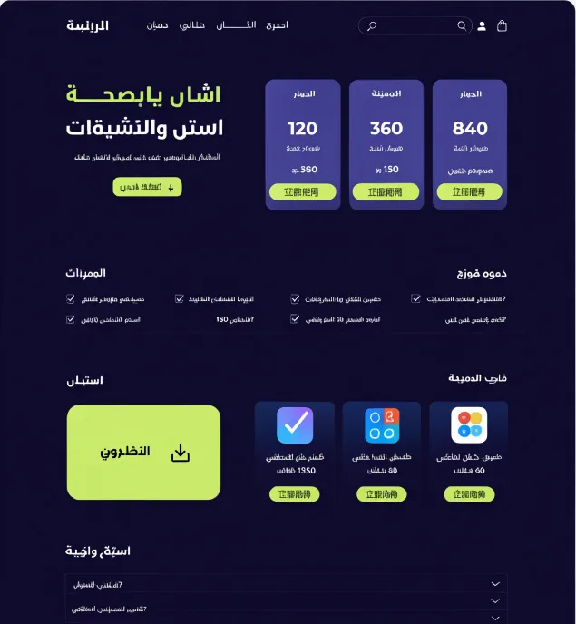
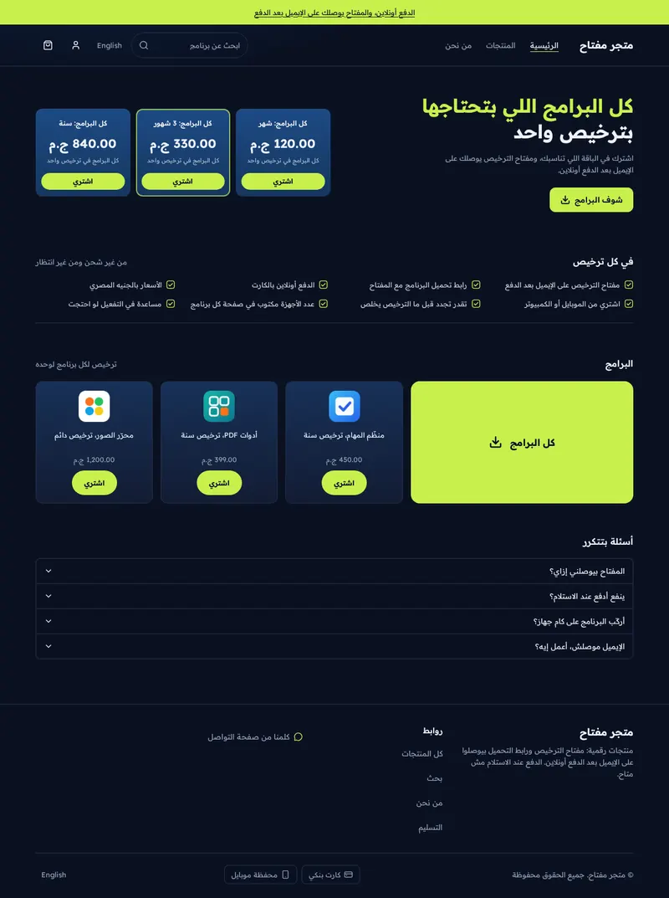
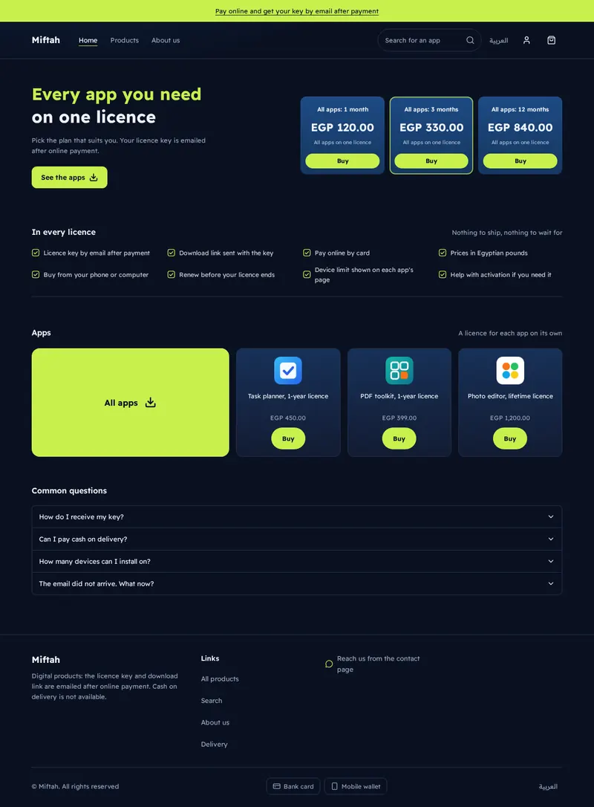
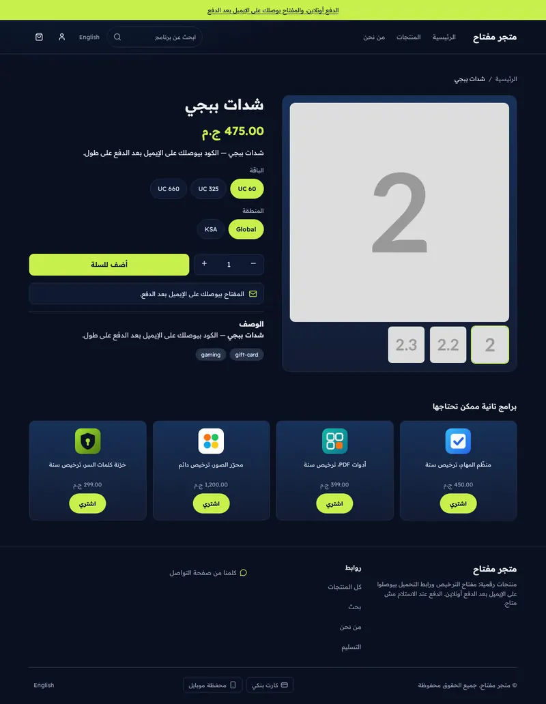
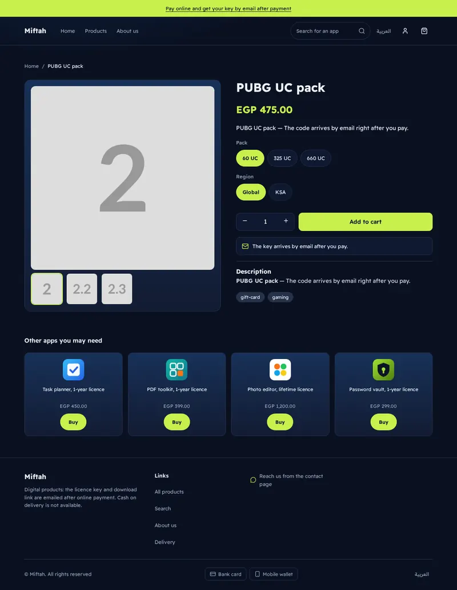
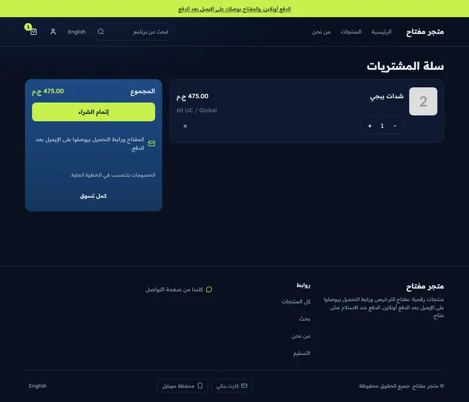
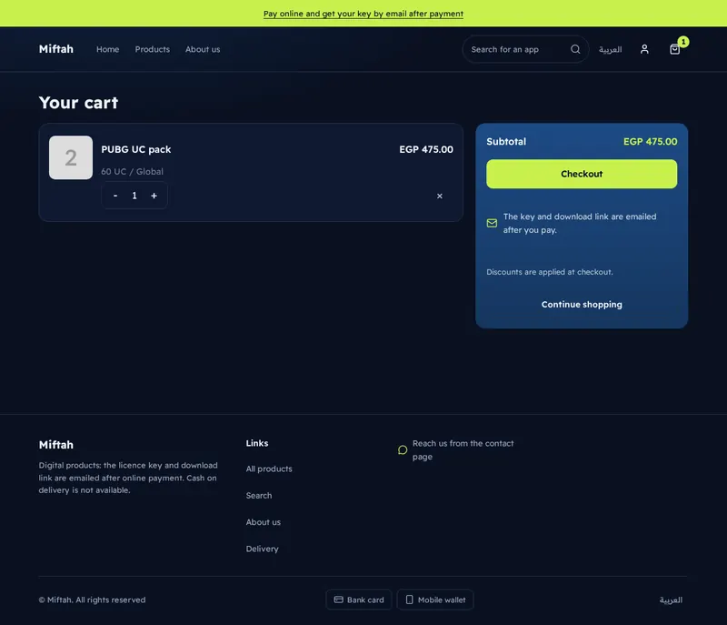
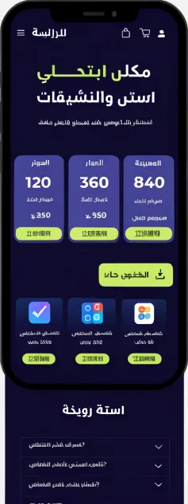
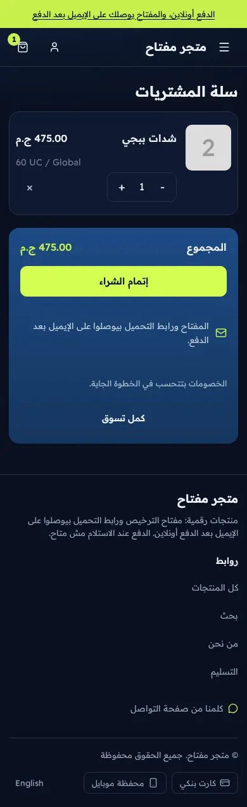

# Tutorial: License, a complete dark store for software licences

License is a full store theme for a shop that sells software licences,
subscriptions and digital tools: deep navy, blue plan cards and one lime accent,
set in Readex Pro. It draws **every page type itself**: home, product (plus a
`product.digital` alternate), collection, search, cart, 404 and content pages,
with its own announcement bar, header and footer. The SDK's default store is only
a fallback for themes that skip a page; License overrides all of them.

| | Arabic | English |
| - | - | - |
| Mockup |  | |
| Home |  |  |
| Product |  |  |
| Cart |  |  |

On a phone (390 px):

| Mockup | Home | Product | Cart |
| - | - | - | - |
|  |  |  |  |

The mockup is a design brief; its Arabic is placeholder text and its violet plan
cards became blue. The Arabic pages read right to left, and every layout rule uses
logical properties, so `/en` mirrors correctly.

## Run it

```bash
sneferu dev .                # http://127.0.0.1:4100, sample data in .sneferu-dev/data.json
sneferu format .             # normalise .snf and .json files (add --check in CI)
sneferu validate .           # schema, locales, settings
sneferu build .              # produce the package
sneferu push .               # upload to your store
```

Useful dev URLs: `/`, `/products/sample-2`, `/products/sample-2?template=product.digital`,
`/category/apps`, `/search?q=card`, `/cart`, `/pages/about`, any other path for the 404.
Add `/en` or `?locale=en` for English.

## What is in the folder

```
theme.json                 tokens, fonts, version 2.0.2
layout/theme.snf           announcement, header, <main>, footer
groups/                    announcement.json, header.json, footer.json (the default sections and blocks)
templates/                 index, product, product.digital, collection, search, cart, 404, page
sections/                  announcement-bar, license-header, license-footer,
                           plans-hero, features, apps, faq, steps,
                           product-main, related-products, collection-main,
                           search-main, cart-main, not-found, page-main
blocks/                    menu-link, menu-sub-link, footer-column, footer-link,
                           social-link, payment-method, contact-line,
                           feature, faq-item, step,
                           product-title, -price, -excerpt, -variants, -buy,
                           -description, -tags, -category, -text, -fact
snippets/                  app-card, price, empty-state, glyph
locales/                   ar.json, en.json (same keys)
assets/theme.css           all styling, class prefix ls-
docs/                      screenshots
```

## Customize

**Tokens** (`theme.json`). Colours: `background`, `secondary`, `surface`, `line`,
`tier` and `tier-deep` (the blue plan cards), `accent` (lime), `on-accent`
(text on lime), `text`, `muted`. The CSS only ever reads `var(--hk-color-<token>)`,
so changing a token restyles every page. Also `radius.md`, `layout.contentWidth`
and the fonts (heading and body).

**Sections and blocks.** Every page is a list of sections; every section has
settings (colour scheme, columns, padding, texts) and many have blocks you can add,
remove and reorder in the editor:

- Header: logo image or text, menu (or menu-link blocks with dropdown sub-links),
  search, language switch, account link, cart with live count and cart drawer, colour
  scheme, sticky.
- Footer: about text, newsletter box, link-column blocks, social-link, contact-line and
  payment-method blocks, copyright line, language switch.
- Product page: gallery plus blocks for title, price, summary, variant picker, buy
  button, note, fact rows, checklist items (the `feature` block), description, tags
  and category. Add steps, FAQ and related apps below.
- Collection and search: columns, sort, filters, empty-state texts.
- Cart: summary position, delivery note, labels, empty-cart texts.

Sections that belong to one page declare it (`"templates": ["product"]`), so the
editor only offers them there.

**Language.** Texts that a merchant edits are localized settings; fixed interface
words (Buy, Menu, Sort by) live in `locales/ar.json` and `locales/en.json`, which must
keep identical keys. Nothing is hardcoded in the templates.

**Rules this theme keeps.** No colour literals in CSS or templates, no purple or pink,
44 px touch targets, no JavaScript beyond the SDK controllers (cart, variant picker,
quantity, gallery), `<details>` for the menu, the FAQ and filters.

## Migrating from 1.x

2.0.0 adds pages and settings; it renames nothing on the home page. The home sections
(`plans-hero`, `features`, `apps`, `faq`) and their blocks keep their ids and setting
names, and the header and footer keep `menu` and `drawer_on_add`, so the home needs no
migration. `migrations/1.2.0-2.0.2.json` renames the borrowed `hk-*` page sections and blocks to this theme's own. New settings start from their defaults. The header and footer now also carry
blocks (menu links, link columns, payment methods); stores that already customised the
1.3 header or footer keep their saved values and see the new settings with defaults.
