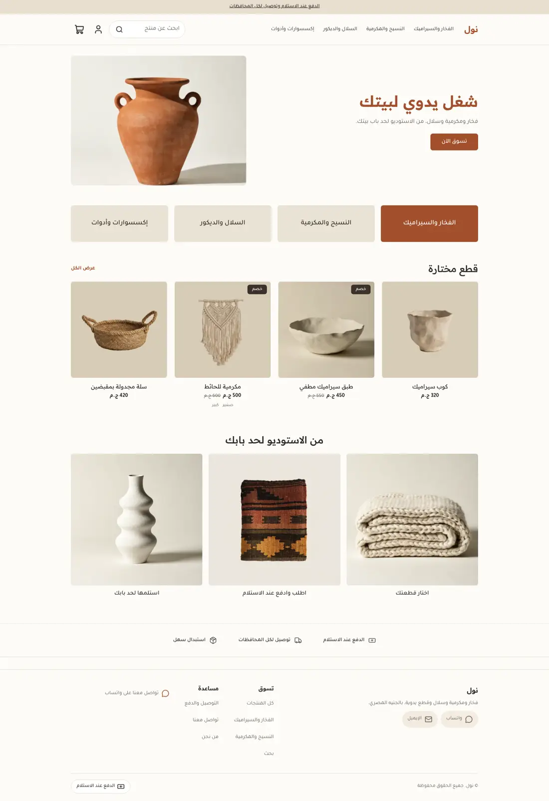
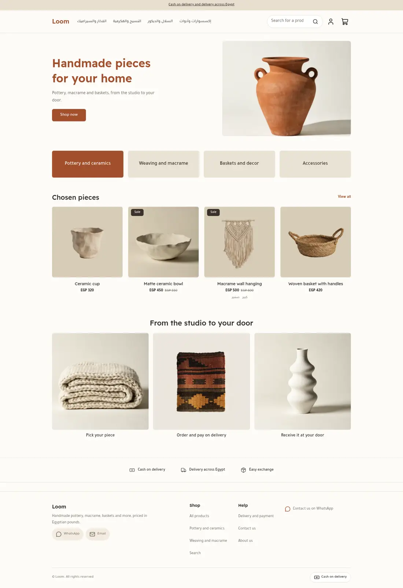
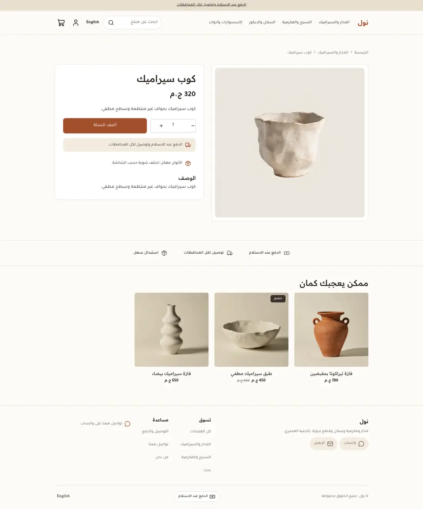
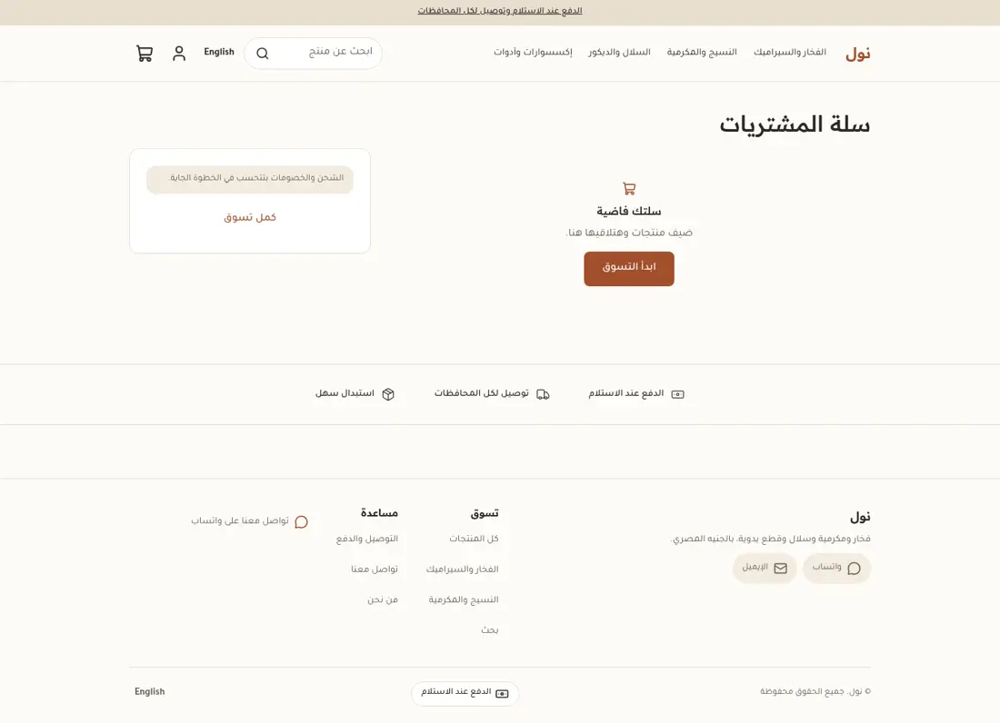
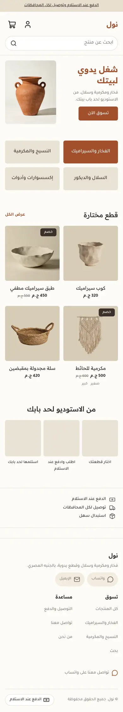
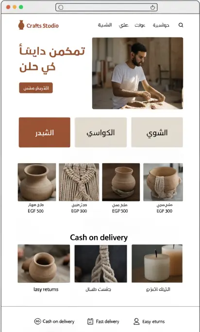
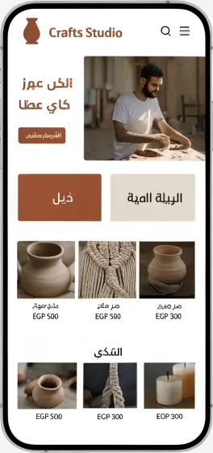

# Loom (نول)

A handmade craft studio theme for the Sneferu SDK: terracotta and linen with olive, a text-and-photo hero, wide category tiles with one filled in clay, quiet product cards, a three-step strip with photos and a ruled trust strip. Arabic first (RTL) with English.

| | Arabic | English |
| - | - | - |
| Home |  |  |
| Product |  | |
| Cart |  | |
| Phone |  | |

Design direction (the mockup this was built from):  

## What is in the folder

- `theme.json`: tokens (clay, linen, olive, charcoal), fonts, `money.format: whole`, category `handmade`.
- `layout/theme.snf`: skip link, announcement, header, `main`, footer groups.
- `sections/`: `hero` (heading, text, button, one photo), `loom-categories` (`category-tile` blocks), `featured-products`, `loom-steps` (`step` blocks), `loom-trust`, and one main section per page type.
- `blocks/category-tile.snf`: a text tile; the `tone` select (`plain` or `filled`) becomes a class, so no inline styles.
- `snippets/product-card.snf`: centred name and price; the card links to the product page.
- `templates/`: all seven page types, each with default sections.
- `assets/theme.css`: colours only through `var(--hk-color-*)` tokens.

## Excerpt: a filled tile without inline styles

```
<a class="loom-cat loom-cat-{{ block.settings.tone }}" href="{{ url(block.settings.link) }}">
```

```
.loom-cat-filled { background: var(--loom-wood); color: var(--hk-color-surface); }
```
