# Tutorial: Mashrabiya, a home decor store in modern Egyptian heritage style

Mashrabiya is a full store theme for a shop that sells home decor with an Egyptian
character: brass and copper, kilim cushions, carved wood. It is deep teal and brass
on warm paper. The hero and the footer carry a lattice pattern, the category tiles
are teal with a thin brass inner frame, and product cards are sand tiles with quiet
text. It is right-to-left in Arabic and left-to-right in English from the same files.

This theme writes **every page type itself**: home, product, collection, search,
cart, 404 and content page, with an announcement bar, header and footer as editable
sections.

| Page | Arabic, desktop | English, desktop | Arabic, phone |
| - | - | - | - |
| Home | 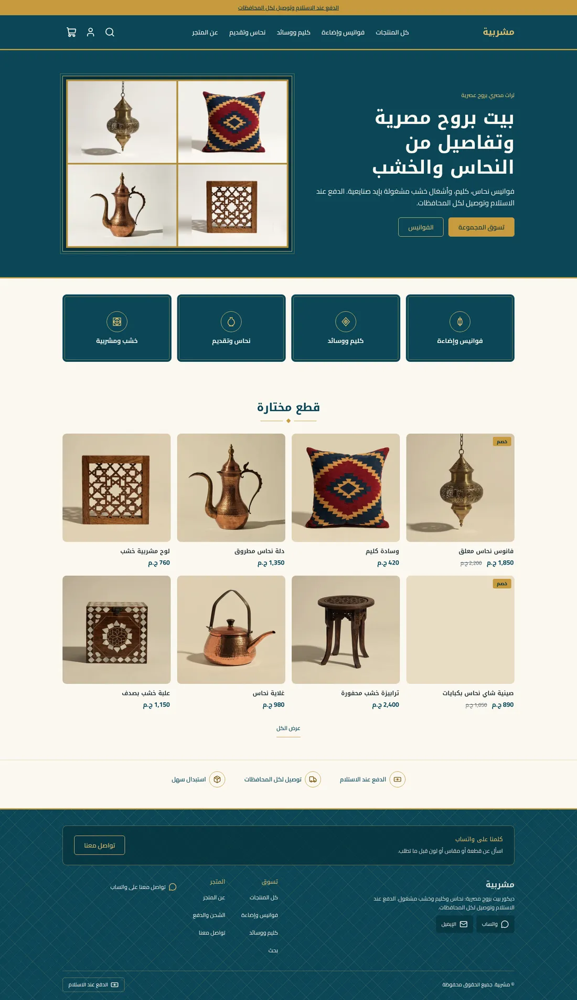 | 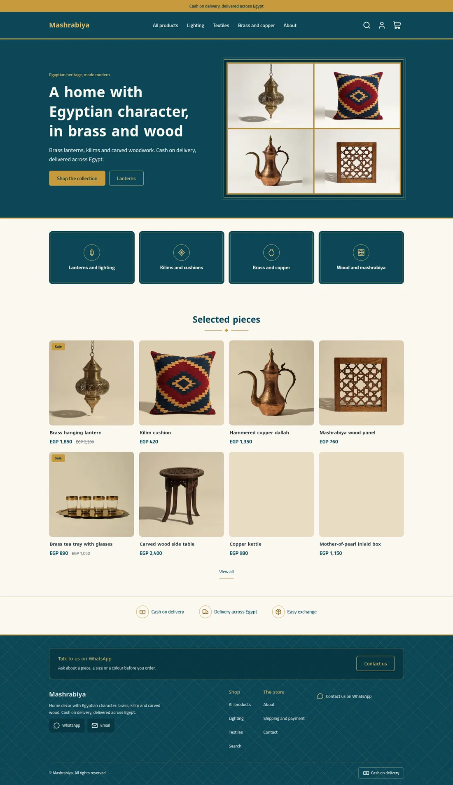 | 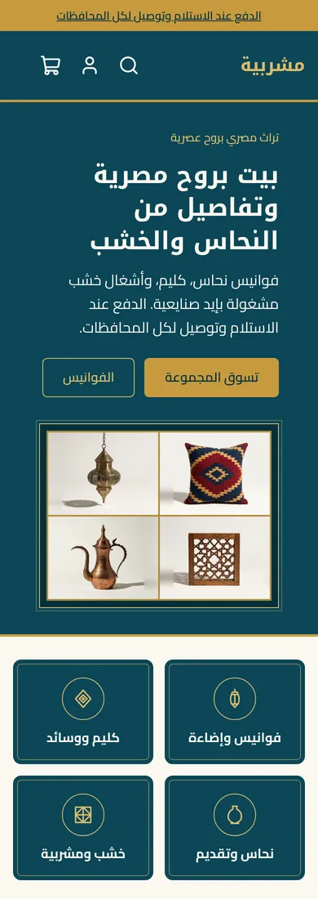 |
| Product | 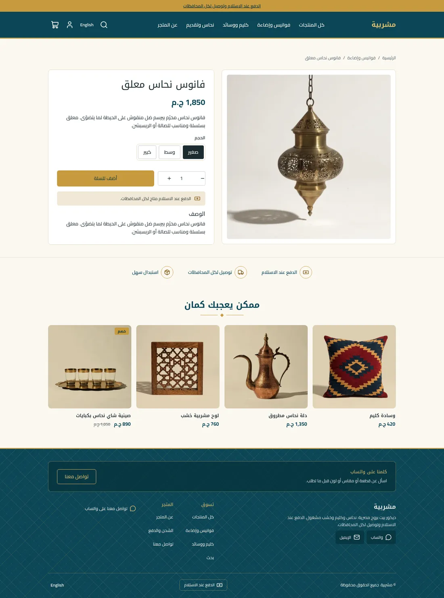 | 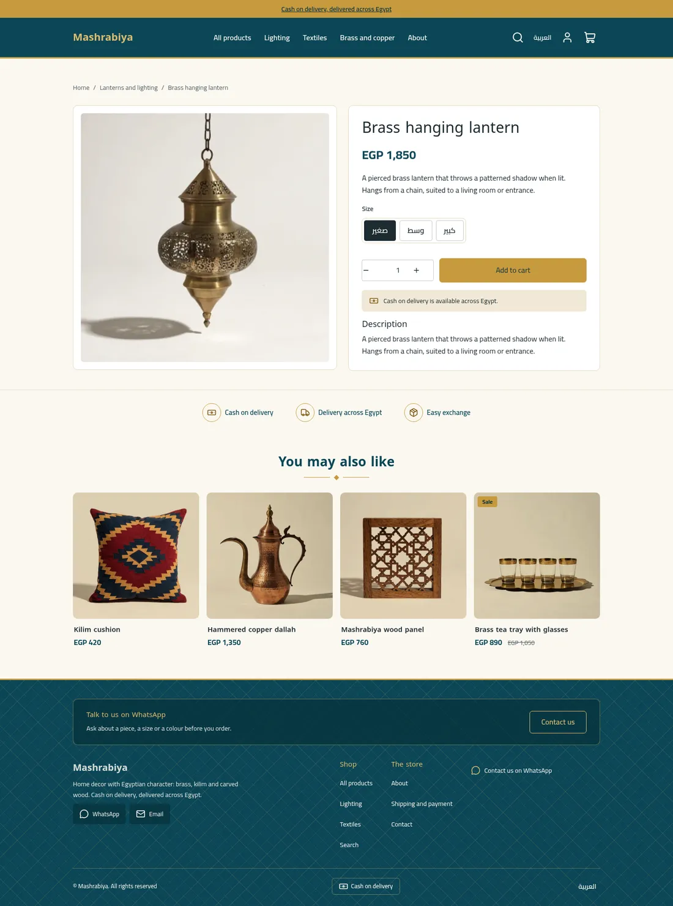 | 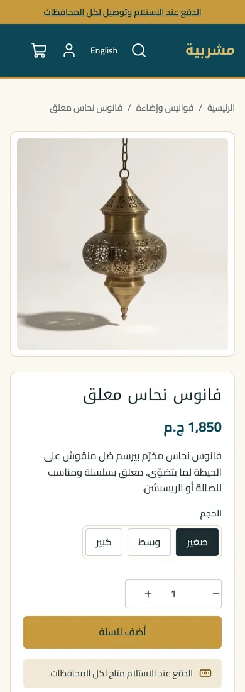 |
| Cart | 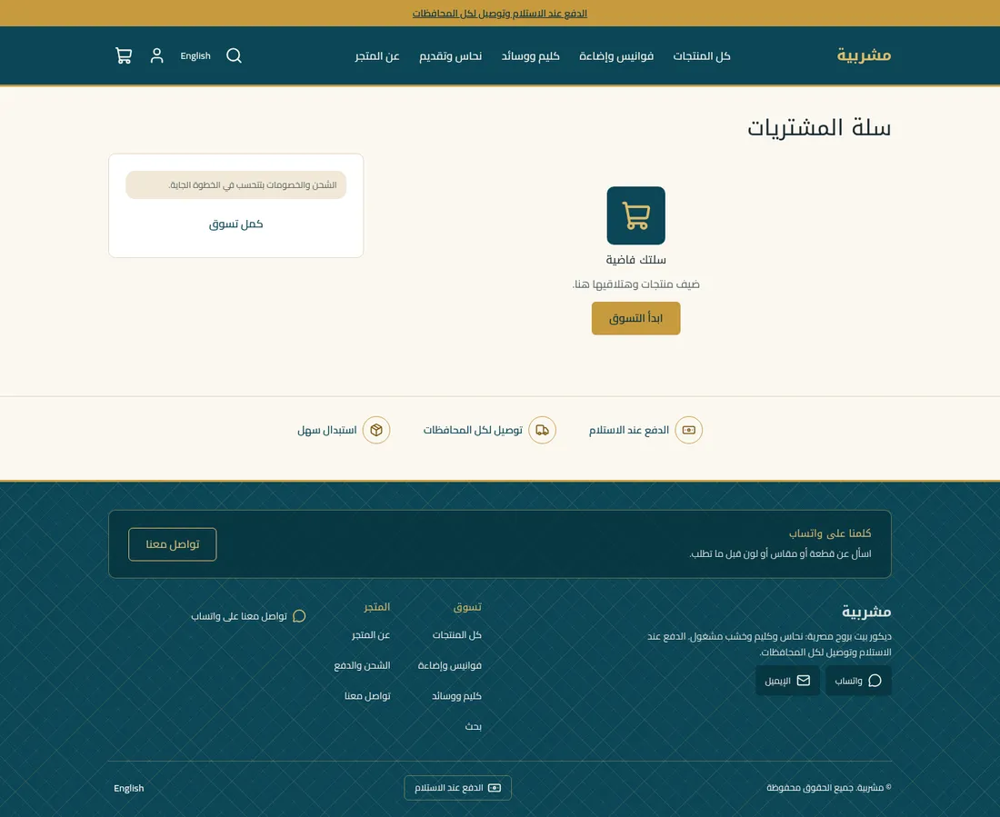 | 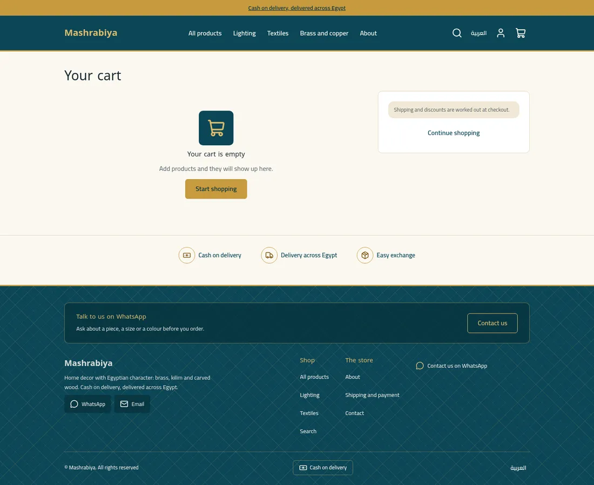 | 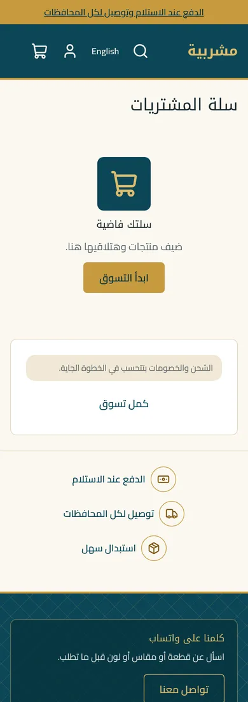 |

The design brief was this mockup (placeholder Arabic and a fake logo, which the theme
replaces with real copy and a plain-text wordmark):

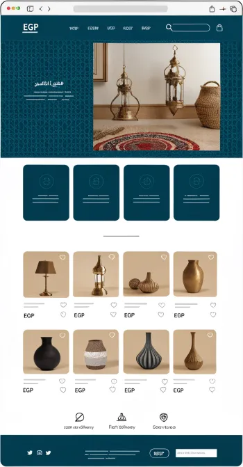 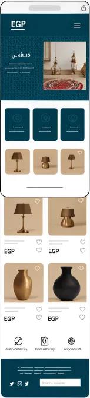

## What is in the folder

```
theme.json                 id, version, tokens (teal, brass, sand), fonts, money: whole
layout/theme.snf           announcement, header, <main>, footer
groups/                    announcement.json, header.json, footer.json
templates/                 index, product, collection, search, cart, 404, page
sections/                  announcement-bar, header, footer, hero, category-tiles,
                           featured-products, trust-strip, product-main, related-products,
                           collection-main, search-main, cart-main, not-found, page-main
blocks/                    menu-link, menu-sub-link, footer-column, footer-link, social-link,
                           contact-line, payment-method, category-tile, trust, chip,
                           product-* (title, price, excerpt, variants, buy, text, description,
                           tags, category)
snippets/                  product-card, price, button, glyph (lantern, kilim, vessel,
                           lattice icons), ornament (the diamond divider)
locales/                   ar.json, en.json (same keys)
assets/theme.css           the only stylesheet; every colour is a token
```

## Run it

```bash
sneferu dev .
sneferu format .
sneferu validate .
```

## Excerpts

**The lattice is CSS, not an image.** The platform strips `url(data:...)` from CSS, so
the pattern is two crossing `repeating-linear-gradient`s and a ring gradient at the
crossings, drawn in a brass token at low strength:

```css
.mb-hero {
  background-image:
    radial-gradient(circle at 50% 50%, transparent 0 5px, color-mix(in srgb, var(--hk-color-brass-light) 34%, transparent) 5px 6px, transparent 6px),
    repeating-linear-gradient(45deg, transparent 0 20px, color-mix(in srgb, var(--hk-color-brass-light) 22%, transparent) 20px 21px),
    repeating-linear-gradient(-45deg, transparent 0 20px, color-mix(in srgb, var(--hk-color-brass-light) 22%, transparent) 20px 21px);
}
```

**Category tiles are blocks with a custom icon set.** The four Egyptian glyphs live in
`snippets/glyph.snf` as inline SVG; any other icon name falls back to `hk-icon`:

```snf

  

  <hk-icon name="{{ block.settings.icon }}" class="ic" />

```

**Related products skip the page's own product** and are capped with a CSS class, so
the row is never dominated by the item you are looking at:

```snf

  

```
