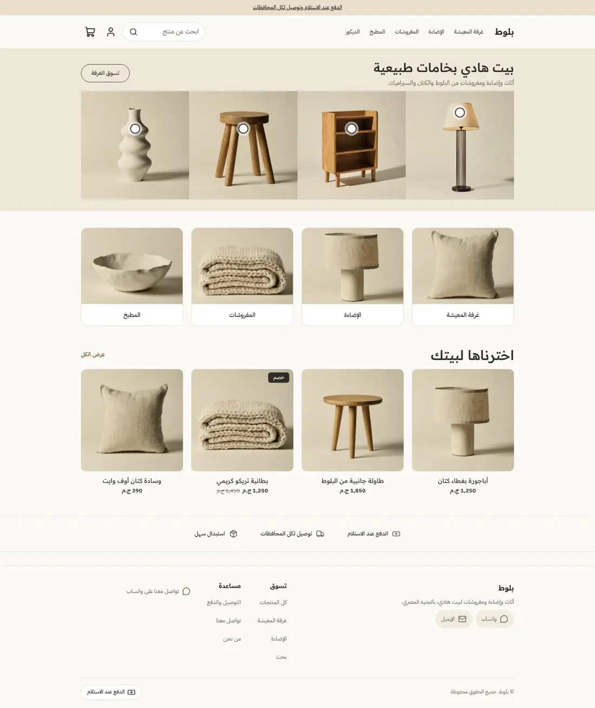
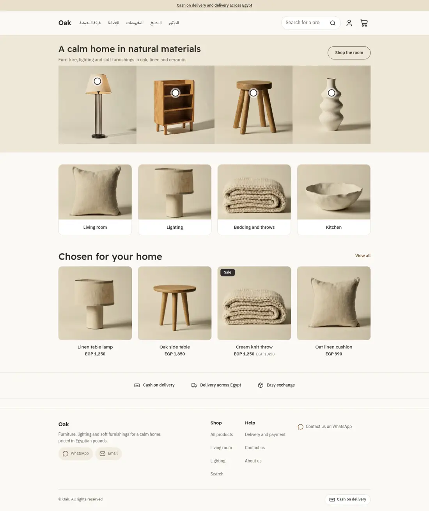
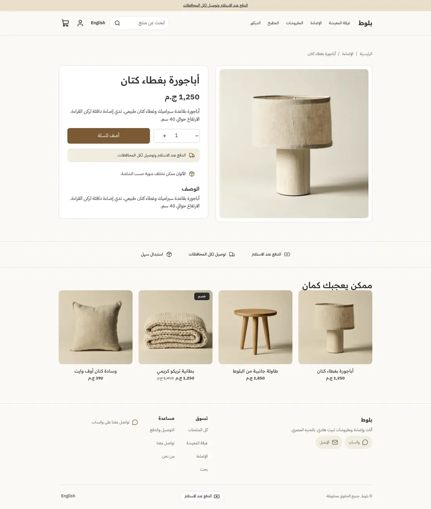
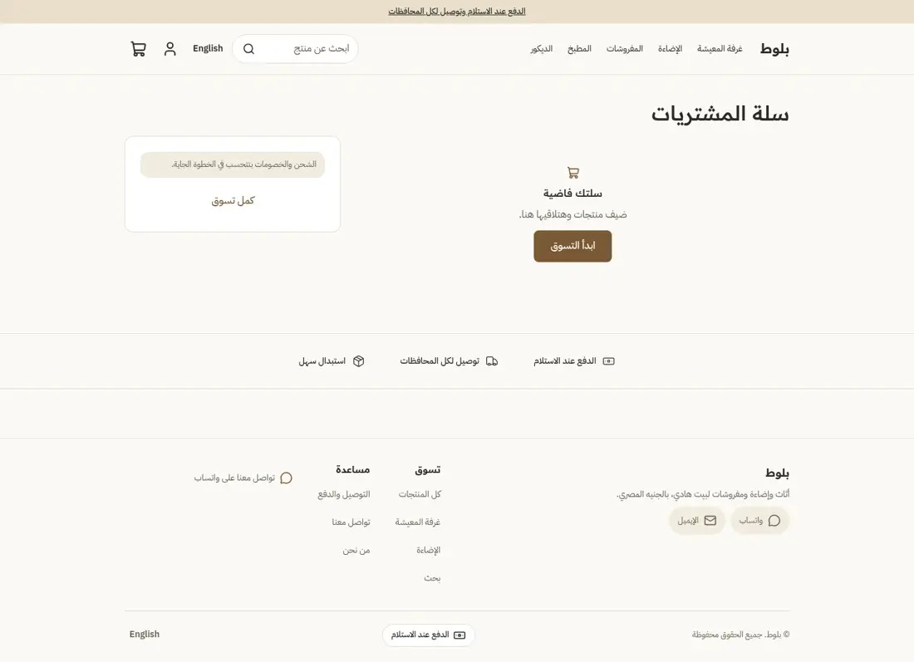
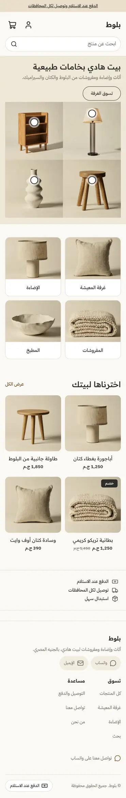
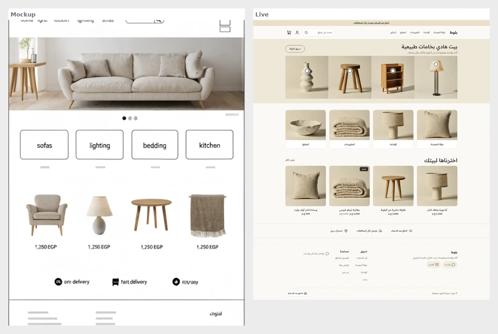
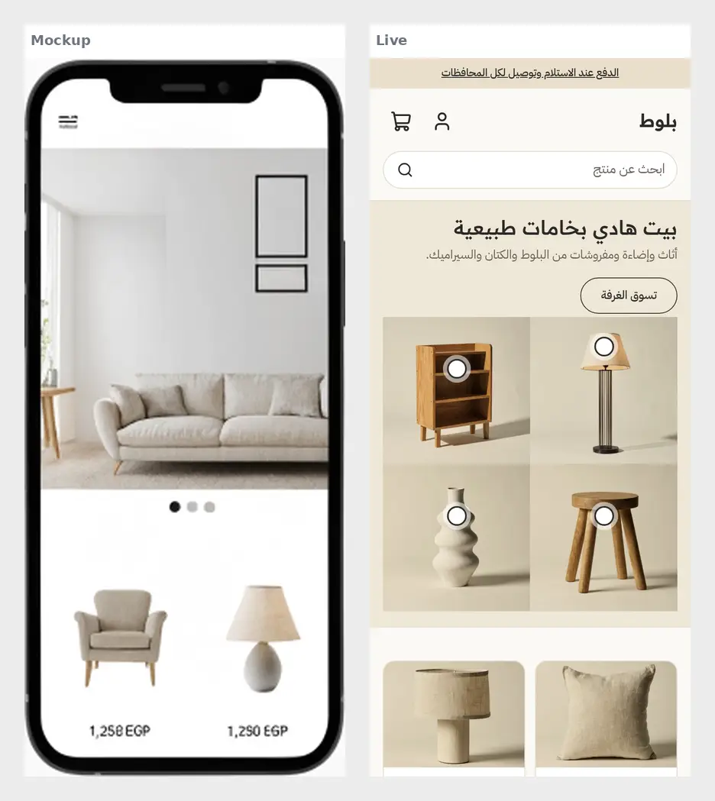

# Oak (بلوط)

A warm Scandinavian home and furniture theme for the Sneferu SDK: oat, linen and light oak with charcoal text, a room-piece hero with shop-the-room dots, photo category tiles, quiet centred product cards and a three-point trust strip. Arabic first (RTL) with English.

| | Arabic | English |
| - | - | - |
| Home |  |  |
| Product |  | |
| Cart |  | |
| Phone |  | |

Design direction (the mockup this was built from):  

## What is in the folder

- `theme.json`: tokens (oat, linen, oak, charcoal), fonts, `money.format: whole`, category `home`.
- `layout/theme.snf`: skip link, announcement, header, `main`, footer groups.
- `sections/`: `hero` (heading row plus `scene-item` blocks), `oak-categories` (`category-tile` blocks), `featured-products`, `oak-trust`, and one main section per page type.
- `blocks/scene-item.snf`: a photo with an optional dot linking to a product. The dot position is two selects (`dot_x`, `dot_y`), turned into classes, so no inline styles.
- `snippets/product-card.snf`: centred name and price; option values appear only when the platform supplies `product.options`.
- `templates/`: all seven page types, each with default sections.
- `assets/theme.css`: colours only through `var(--hk-color-*)` tokens.

## Excerpt: a dot without inline styles

```
<div class="oak-scene-item oak-x-{{ block.settings.dot_x }} oak-y-{{ block.settings.dot_y }}">
```

```
.oak-y-35 .oak-dot { inset-block-start: calc(35% - 22px); }
```
