# Tutorial: Odda, a friendly home-improvement store

Odda is a full store theme for a shop that sells paint, plumbing parts, electrical
supplies, hand tools and fixings. It is white with warm orange price tags and a
slate-blue accent: three photo panels under the header, big icon category tiles,
a product grid with orange price tags, project-idea cards with captions, a grey
trust strip and a how-to strip. It is right-to-left in Arabic and left-to-right
in English from the same files.

The theme writes **every page type itself**: home, product, collection, search,
cart, 404 and content page, with an announcement bar, header and footer as
editable section groups.

| Page | Arabic, desktop | English, desktop | Arabic, phone |
| - | - | - | - |
| Home | 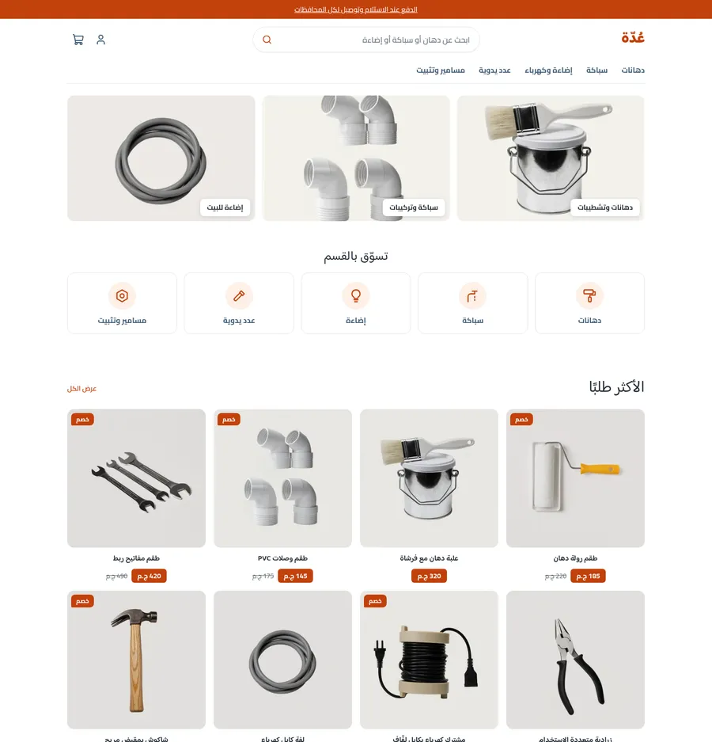 | 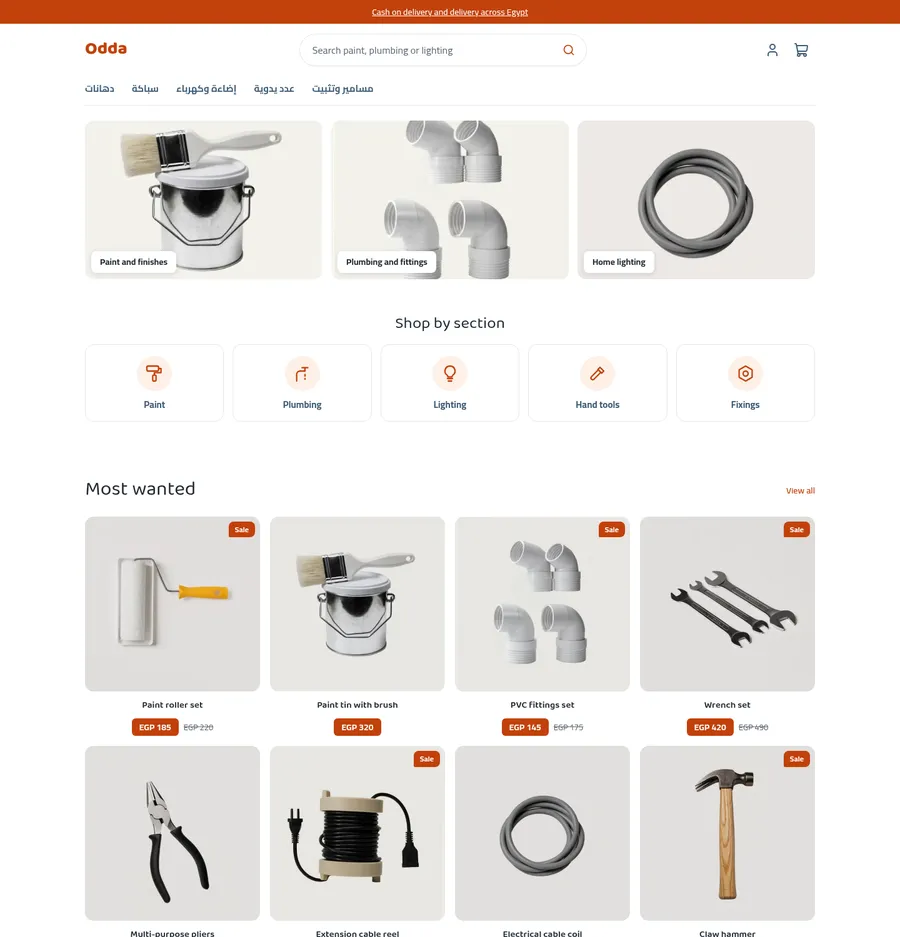 | 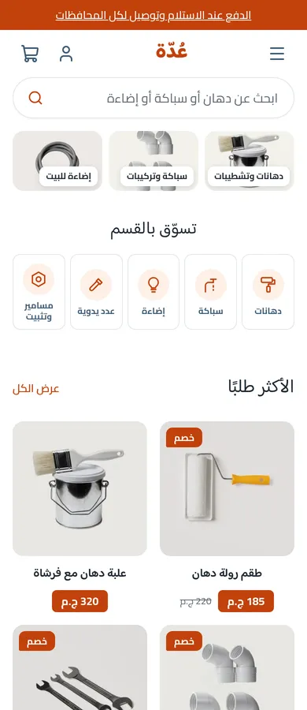 |
| Product | 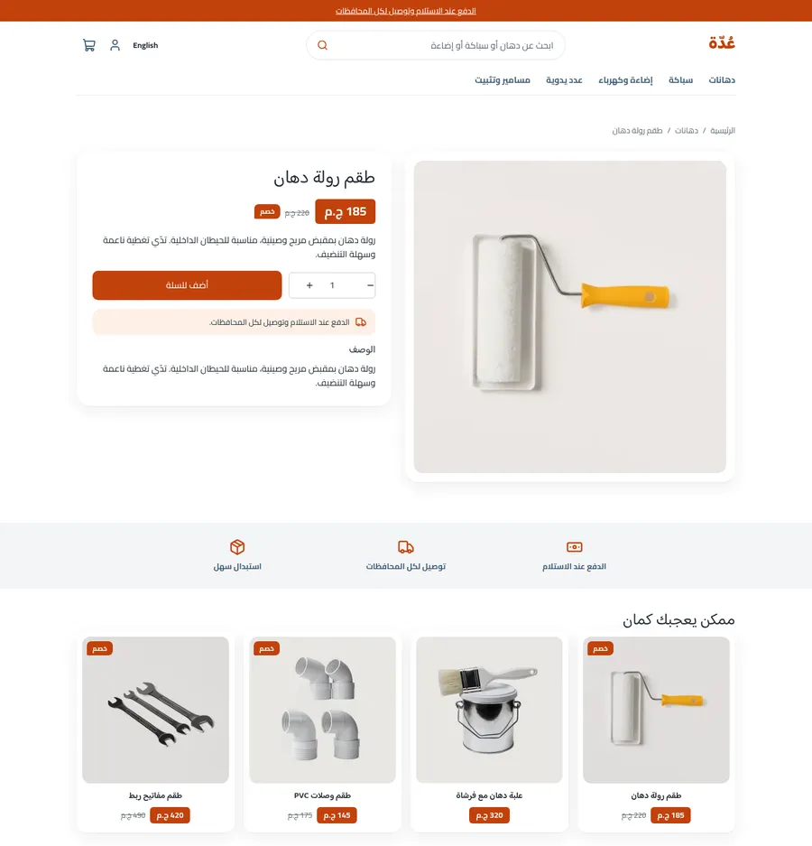 | 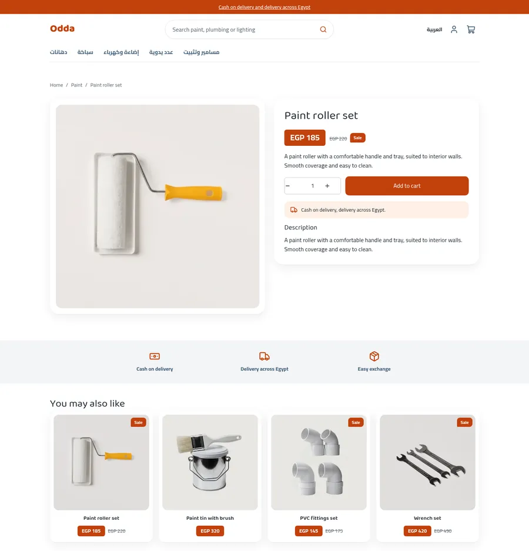 | 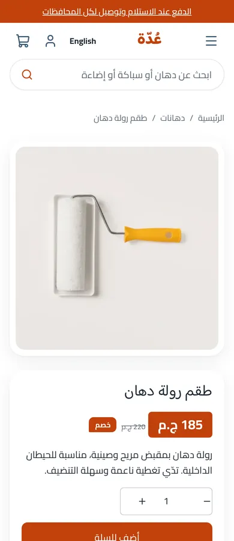 |
| Cart | 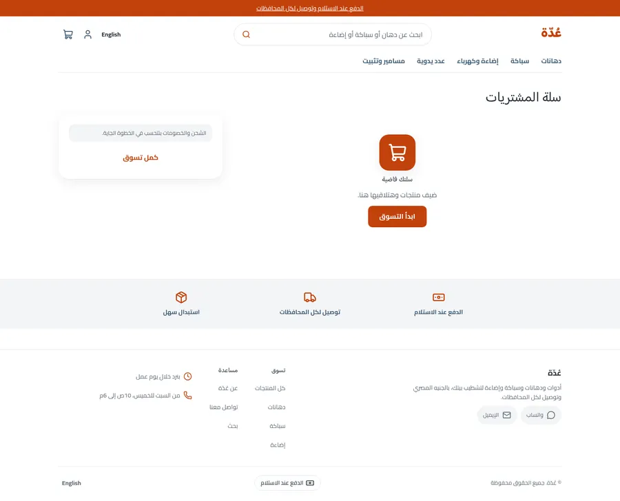 | 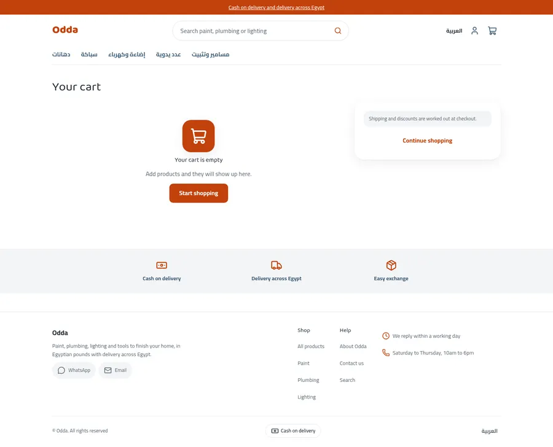 | 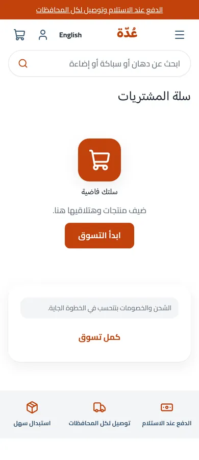 |

The design brief was this mockup (placeholder Arabic and fake logos, which Odda
replaces with real copy and a plain wordmark):

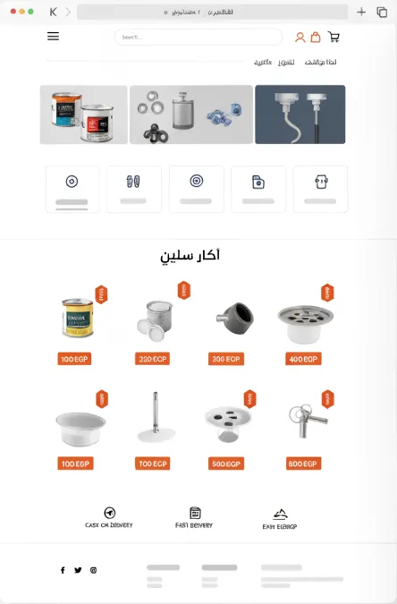 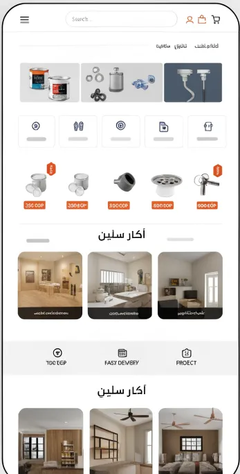

## What is in the folder

```
theme.json                 id, version, tokens (orange primary, slate secondary)
layout/theme.snf           announcement, header, <main>, footer
groups/                    announcement.json, header.json, footer.json
templates/                 index, product, collection, search, cart, 404, page
sections/                  announcement-bar, header, footer, product-main, related-products,
                           collection-main, search-main, cart-main, not-found, page-main,
                           featured-products, odda-panels, -tiles, -projects, -trust, -howto
blocks/                    menu-link, footer-column, footer-link, social-link, contact-line,
                           payment-method, product-*, panel, tile, project, trust, howto-step, chip
snippets/                  product-card, price, button, glyph (inline SVG icons)
locales/                   ar.json, en.json (same keys)
assets/theme.css           the only stylesheet; every colour is a token
```

## Run it

```bash
sneferu dev .         # http://127.0.0.1:4100, /en for English
sneferu format .
sneferu validate .
```

## Excerpts

Icons the SDK set lacks (paint roller, tap, bulb, hammer, nut) are inline SVG in
`snippets/glyph.snf`, chosen by a `select` setting on the tile block:

```
<span class="od-tile-icon"></span>
```

The price tag is plain CSS on the stable `sn-now` class, so every product card,
the product page and the related row share it:

```
.od-card .sn-now { background: var(--hk-color-primary); color: var(--hk-color-on-accent, #fff); border-radius: 6px; }
```
