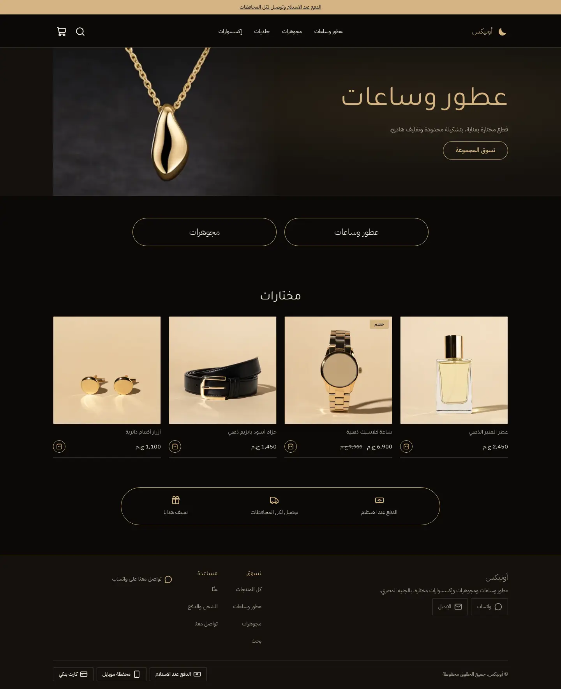
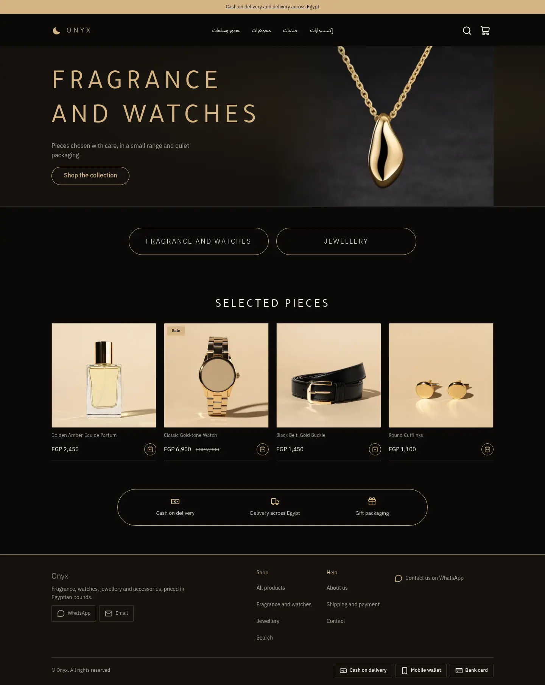
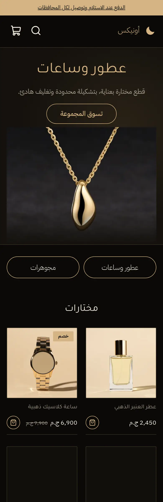
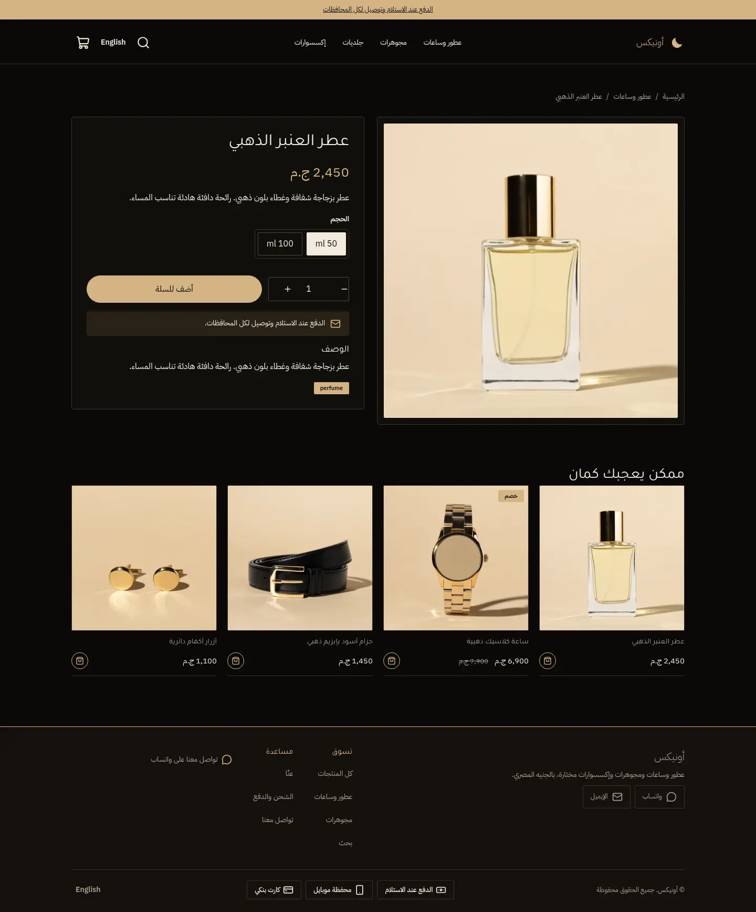
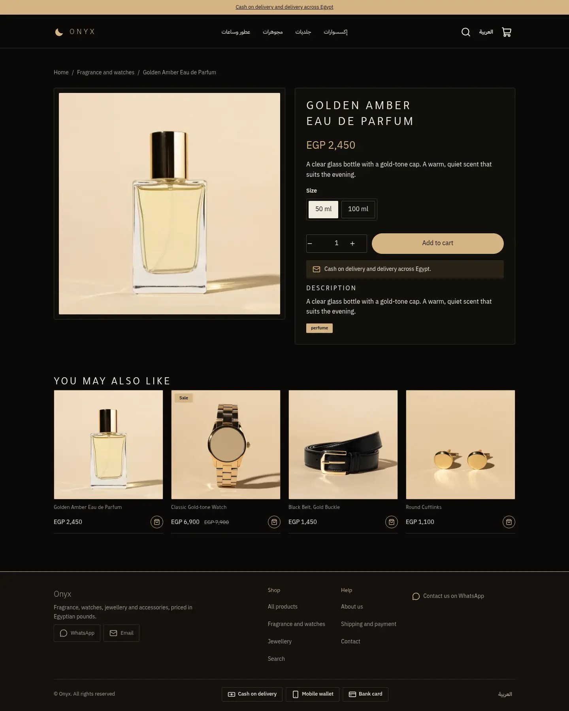
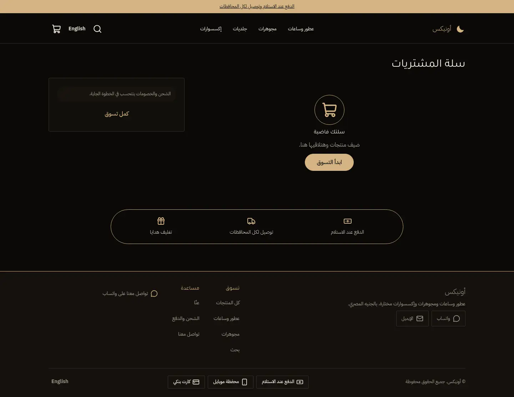
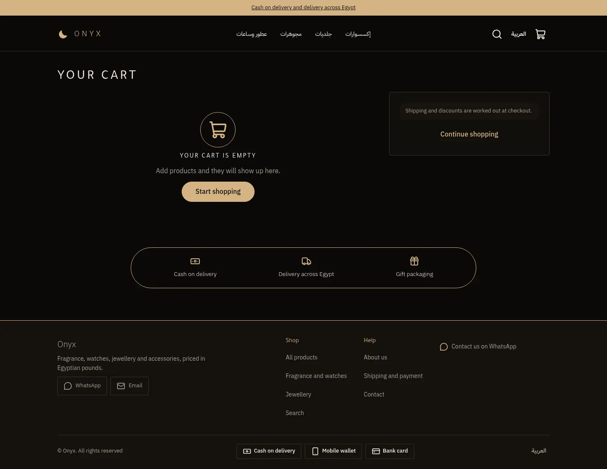
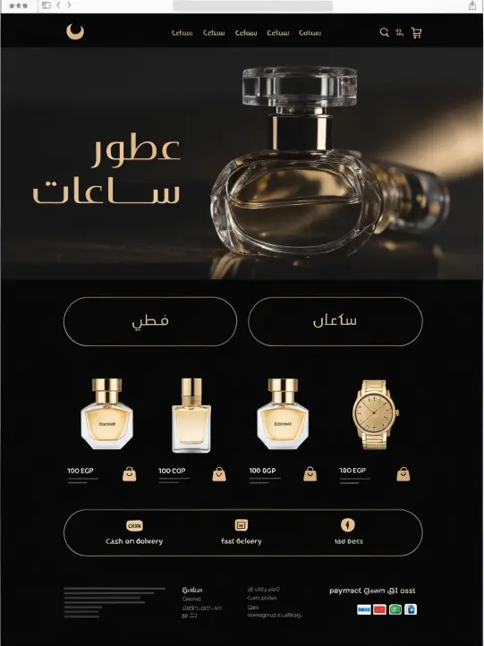
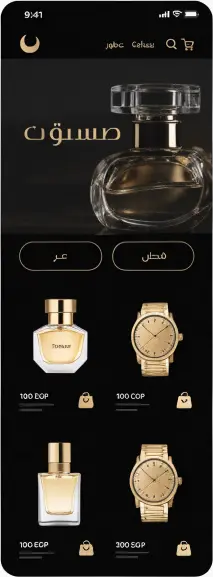

# Tutorial: Onyx, a black and champagne luxury store

Onyx is a full store theme for a small shop selling fragrance, watches, jewellery
and fine accessories. It is near-black with one champagne-gold accent: a centred
menu with a crescent mark, a wide hero with a photo fading into the dark, two large
outlined category pills, flat image tiles with a price and a bag mark, and a trust
strip inside a gold-ringed pill. It is right-to-left in Arabic and left-to-right in
English from the same files.

The theme writes **every page type itself**: home, product, collection, search,
cart, 404 and content page, with announcement bar, header and footer as editable
section groups.

| Page | Arabic, desktop | English, desktop | Arabic, phone |
| - | - | - | - |
| Home |  |  |  |
| Product |  |  | |
| Cart |  |  | |

The design brief was this mockup (placeholder Arabic and fake logos, replaced here
by real copy and a plain-text wordmark):

 

## What is in the folder

```
theme.json        id onyx, version, tokens (colours, fonts), money: whole
layout/theme.snf  announcement, header, <main>, footer
groups/           announcement.json, header.json, footer.json
templates/        index, product, collection, search, cart, 404, page
sections/         hero, onyx-pills, onyx-trust, featured-products, product-main,
                  related-products, collection-main, search-main, cart-main,
                  not-found, page-main, announcement-bar, header, footer
blocks/           pill, trust, menu-link, footer-column, footer-link, product-* ...
snippets/         product-card, price, button
assets/theme.css  all colours through var(--hk-color-*)
```

## Excerpts

The home page is four sections, each editable:

```
{ "sections": [ { "type": "hero" }, { "type": "onyx-pills", "blocks": [ … ] },
  { "type": "featured-products", "settings": { "collection": "featured", "limit": 4 } },
  { "type": "onyx-trust", "blocks": [ … ] } ] }
```

The hero image fades into the page with a CSS mask, so any dark product photo works:

```css
.on-hero-media img { mask-image: linear-gradient(to right, transparent 0, black 38%); }
```

Headings are weight 300; wide letter-spacing applies to English only
(`:lang(en)`), because spacing breaks Arabic letter joining.
