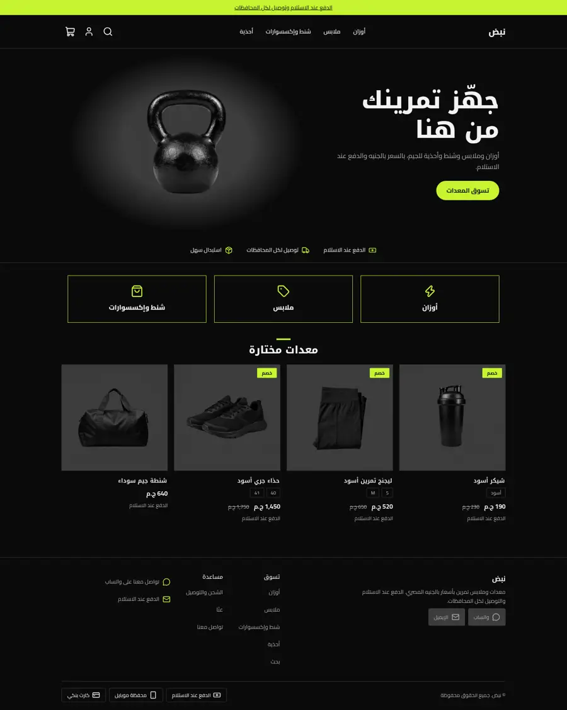
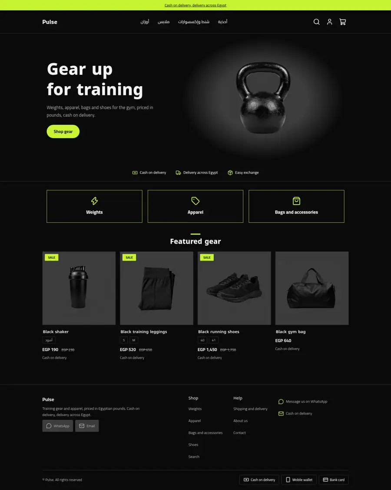
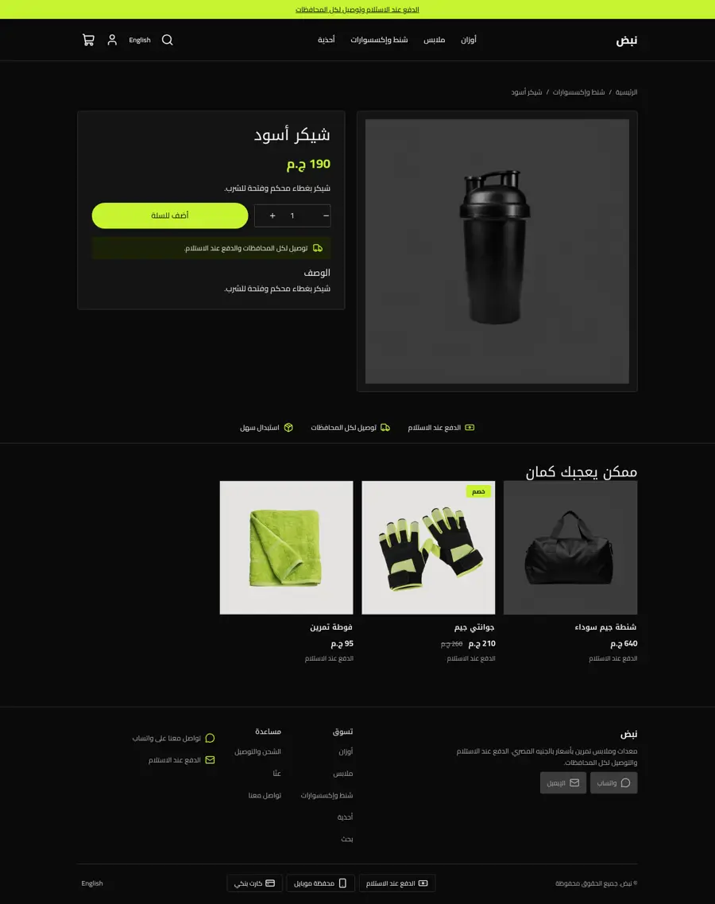
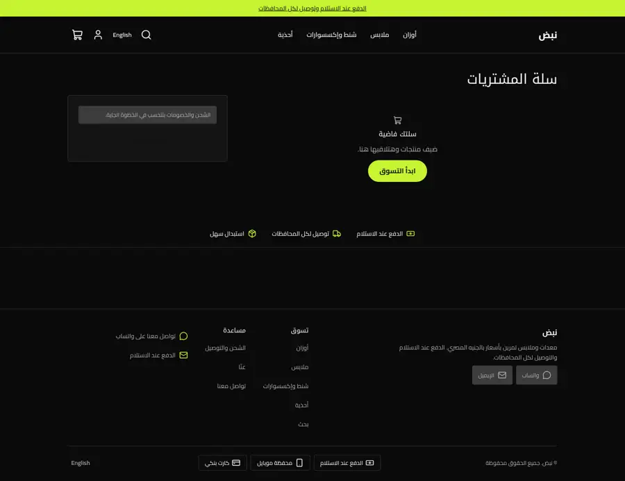
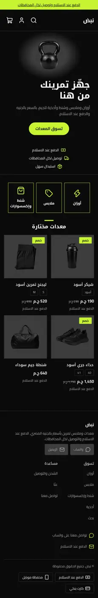
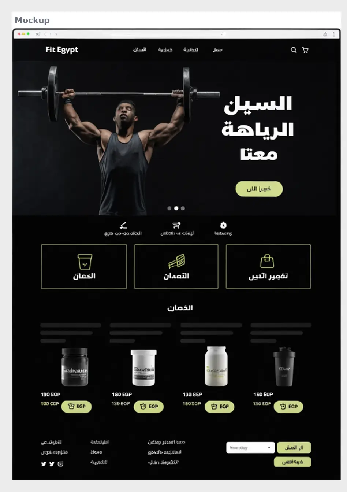

# Pulse

A dark performance gym store theme for the Sneferu SDK: black and charcoal with one lime accent, a framed gear photo hero, outlined icon tiles and charcoal photo cards, on every page.

| Home (ar) | Home (en) | Product (ar) |
| - | - | - |
|  |  |  |

| Cart (ar) | Phone (ar) | Mockup |
| - | - | - |
|  |  |  |

## What is in the folder

- `theme.json`: tokens (lime accent on black, `soft` is the charcoal photo ground), whole-pound money.
- `sections/`: `pulse-hero`, `pulse-trust`, `pulse-goals` (icon tiles), `pulse-products`, plus header, footer, collection, product, cart, search, page and 404 sections.
- `groups/`: announcement, header, footer.
- `templates/`: all seven page types.
