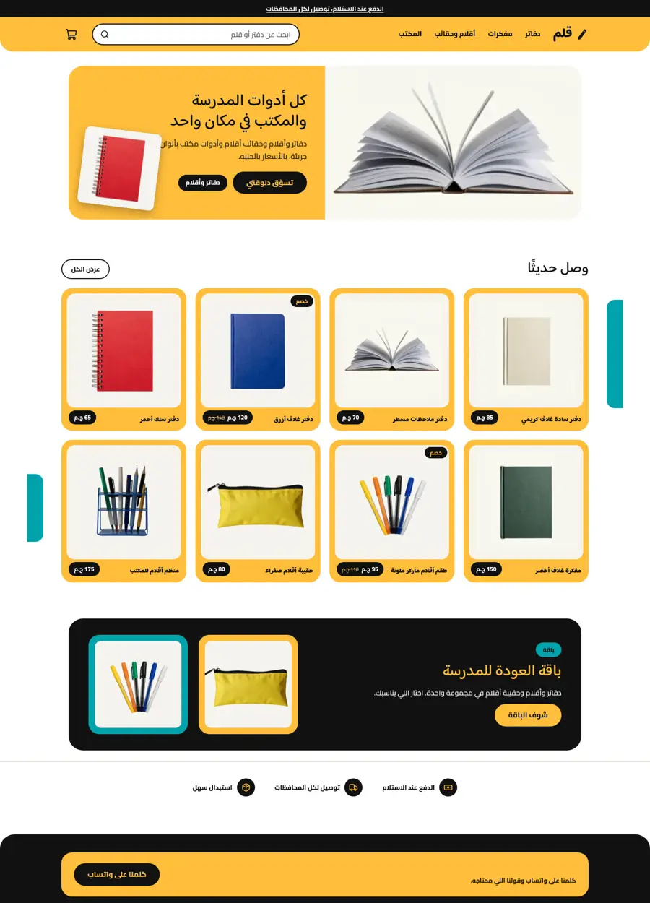
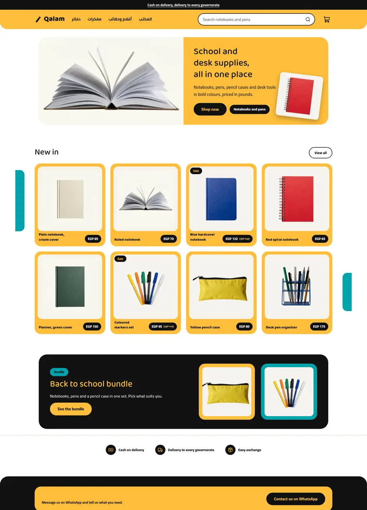
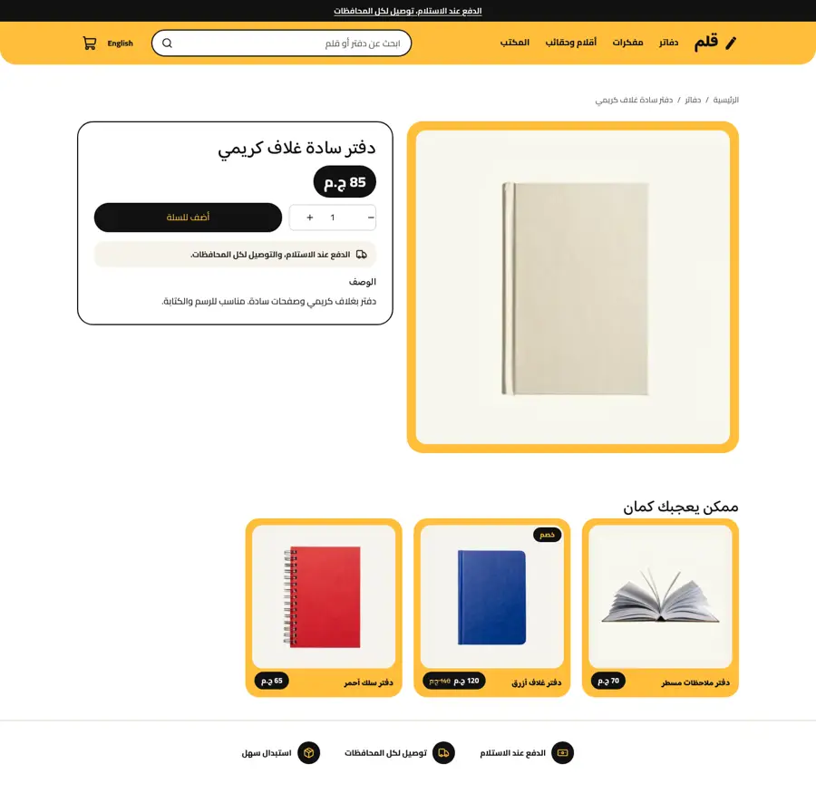
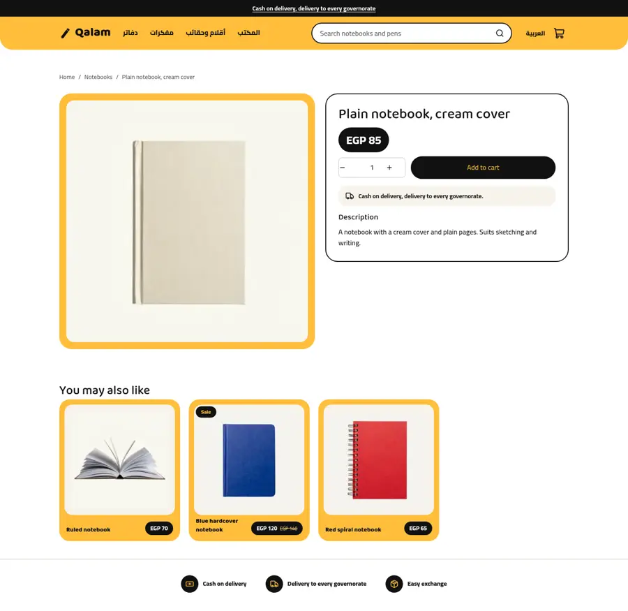
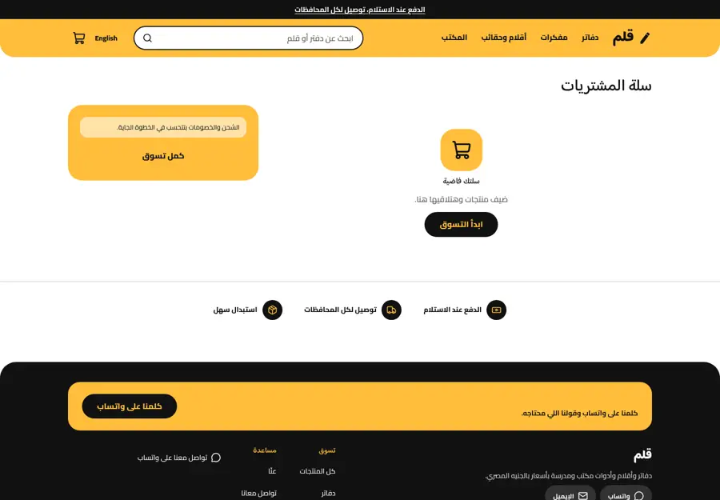
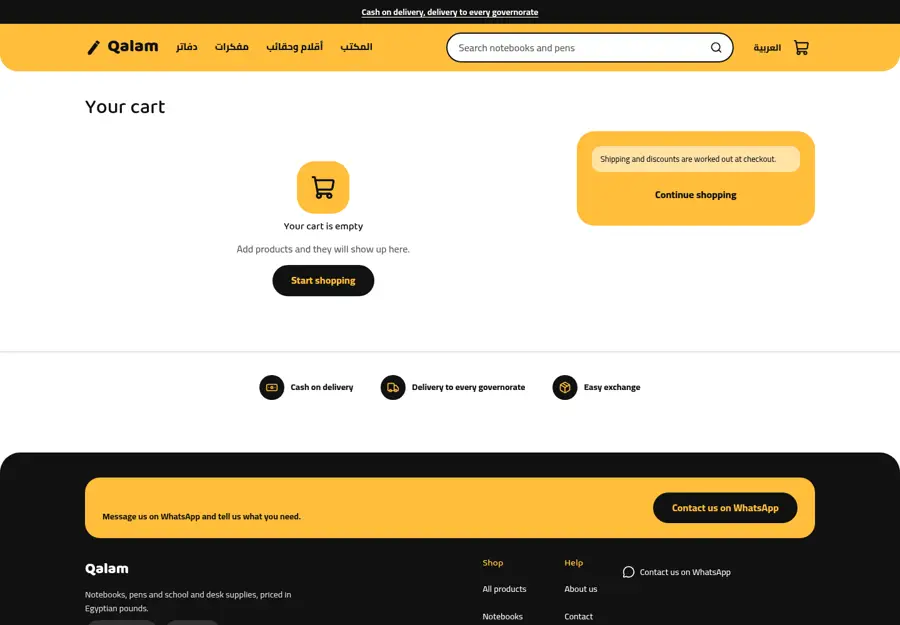
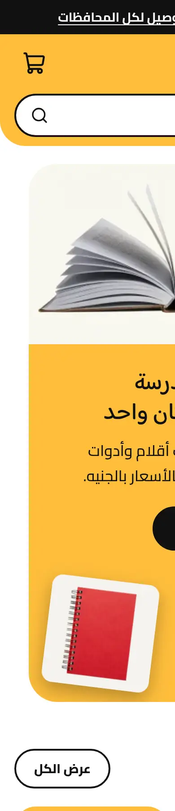
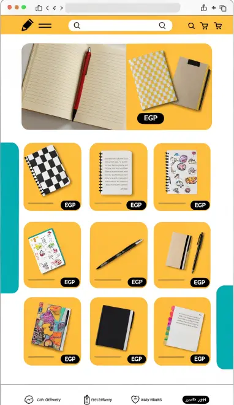
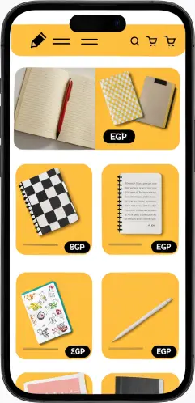

# Qalam (قلم)

A stationery and school supplies store theme for Sneferu: sunny yellow and black, rounded yellow product cards with a black price pill, a split hero (photo and yellow panel), a bundle banner and a trust strip. Category `books`, Arabic first with English, whole-pound prices.

| | Arabic | English |
| - | - | - |
| Home |  |  |
| Product |  |  |
| Cart |  |  |

Phone: 

Mockup:  

## What is in the folder

- `theme.json`: tokens (yellow, black, teal), fonts Baloo Bhaijaan 2 and Cairo, `money.format: whole`.
- `layout/theme.snf`, `groups/` (announcement, header, footer), `templates/` for all seven page types.
- `sections/`: `hero`, `featured-products`, `bundle`, `trust-strip`, the page mains, `header`, `footer`.
- `snippets/product-card.snf`: the yellow card with the black price pill.
- `assets/theme.css`: all colours come from tokens (`var(--hk-color-*)`).

## Notes

- Card style is a setting: `sun` (yellow), `paper` (white with border), `outline`.
- The header holds the menu twice (desktop bar and a `details` menu on small screens) because `menu()` needs a section setting and cannot run inside a snippet.
- The teal side tabs beside the featured grid are decoration shown only on wide screens.
