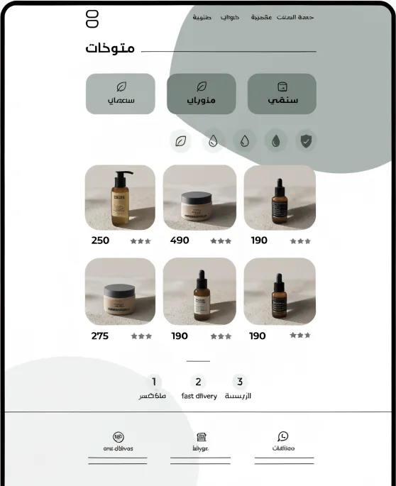
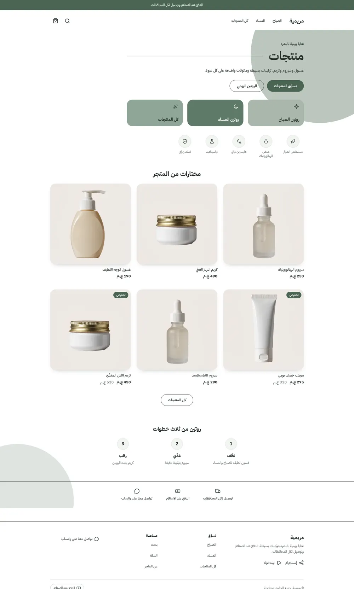
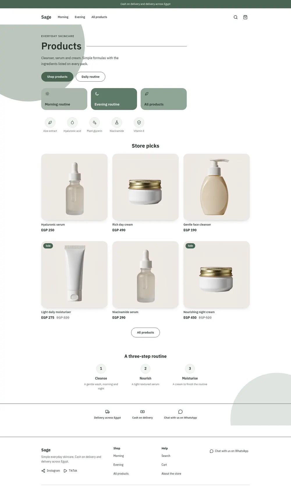
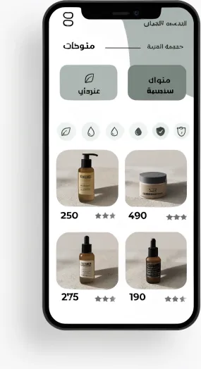
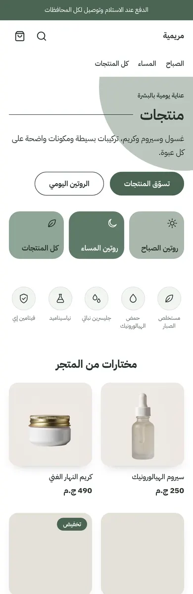
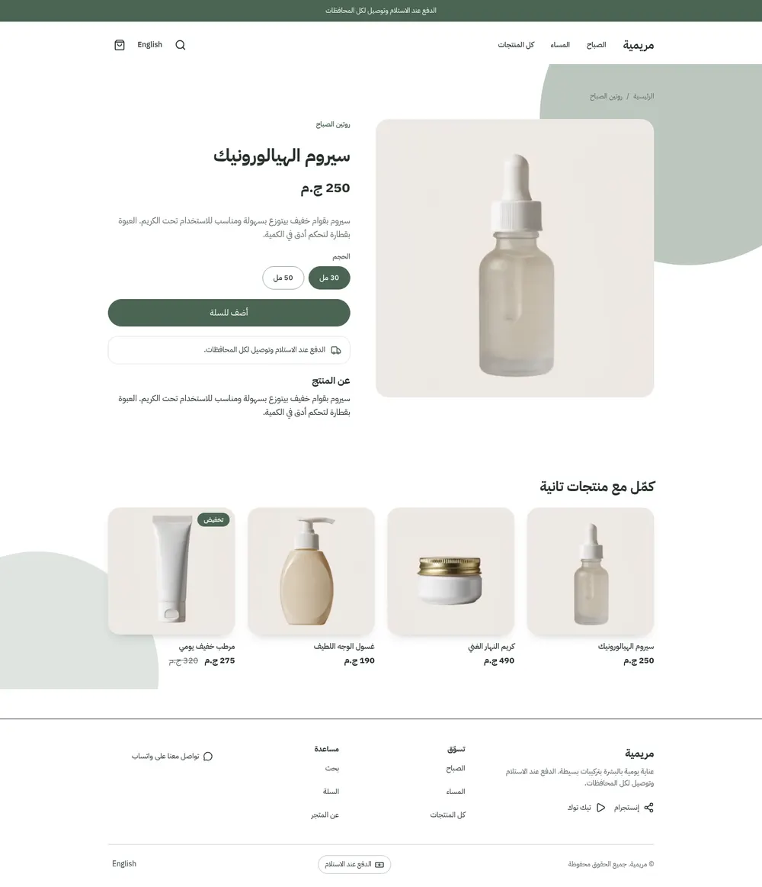
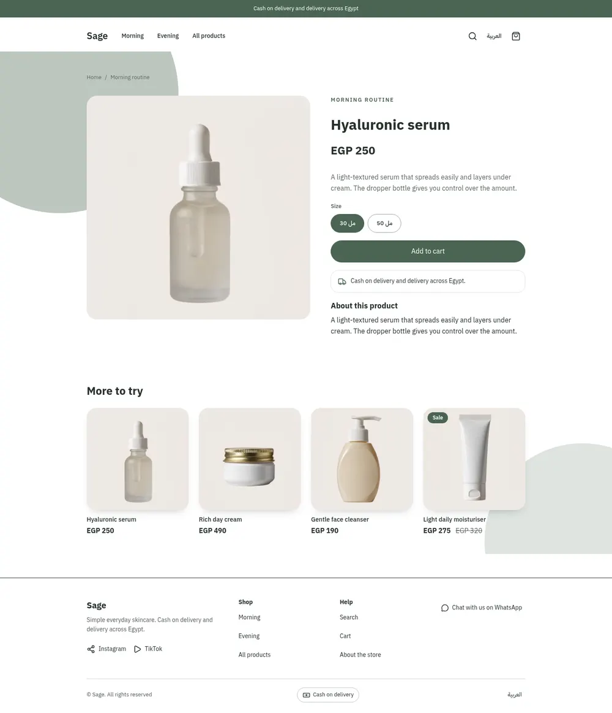
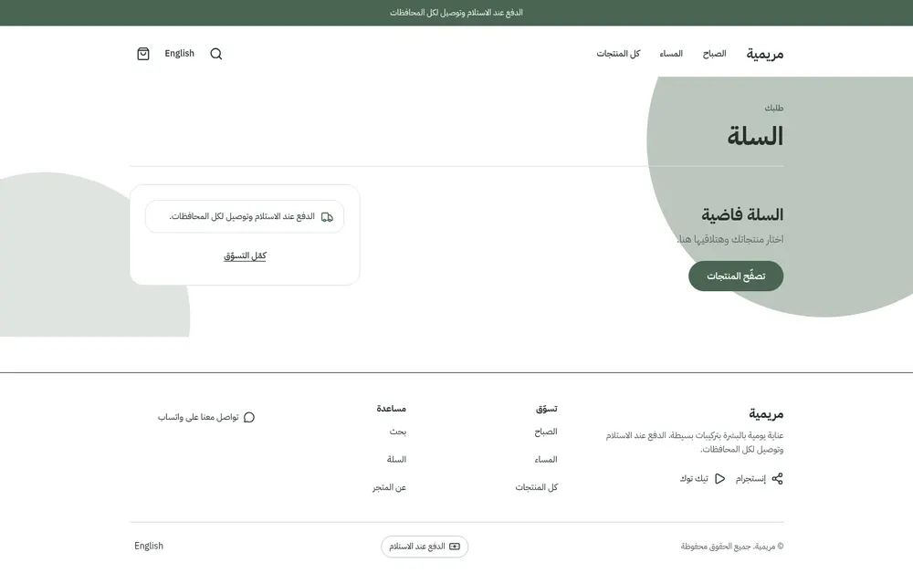
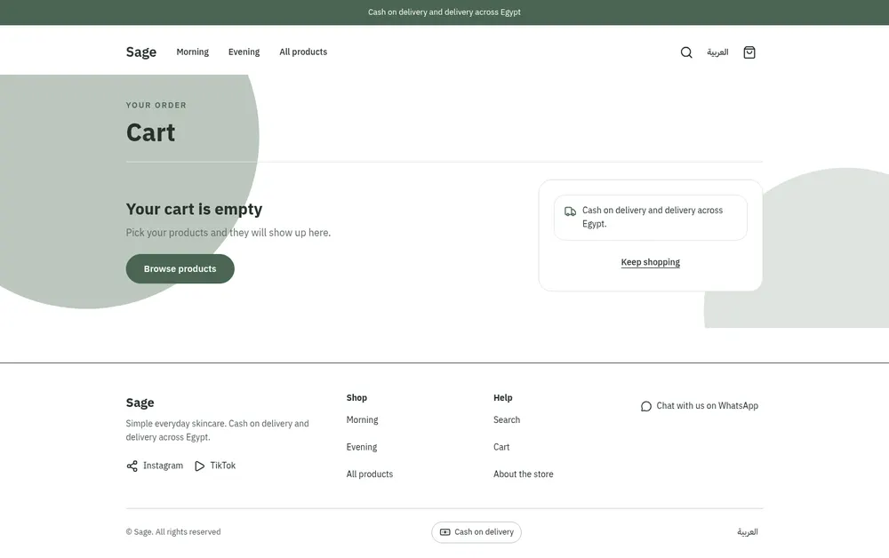

# Tutorial: Sage, a clinical skincare store

Sage is a skincare store: a white and mint ground, sage green tiles, a row of
ingredient glyphs, stone product plates and a three-step routine. It writes
**every page type itself**: home, product, collection, search, cart, 404 and
content page, with an editable announcement bar, header and footer.

| Mockup | Home, Arabic | Home, English |
| - | - | - |
|  |  |  |
|  |  | |

| Product, Arabic | Product, English | Cart, Arabic | Cart, English |
| - | - | - | - |
|  |  |  |  |

The mockup was a design brief: its Arabic is placeholder text and its star
ratings have no data behind them. The theme keeps the layout and uses real
Arabic copy, Egyptian pounds and product photos. Cards show the product's first
option (for example the size) where the mockup showed stars.

## What you will learn

- how a heading with a hairline rule and two large background circles are plain CSS on `<main>`
- how inline SVG glyphs live in one snippet and are picked from a `select` setting
- how a numbered routine is drawn by a CSS counter, so blocks need no number setting
- how tokens in `theme.json` colour the whole store

## Run it

```bash
sneferu dev . --port 4207   # Arabic; add ?locale=en for English
sneferu format .
sneferu validate .
```

## What is in the folder

```
sage/
  theme.json            tokens: primary/accent sage, sage-mid, sage-deep, stone, mint
  layout/theme.snf      skip link, the three groups, <main>
  groups/               announcement, header, footer defaults
  templates/            index product collection search cart page 404
  sections/             hero tiles ingredients shelf routine trust-strip + page sections
  blocks/               tile ingredient step trust-item + product blocks
  snippets/             card.snf (with option chips) glyph.snf (inline SVG set)
  locales/              ar.json en.json (same keys)
  assets/theme.css
```

## Numbered steps without a setting

```
.sg-steps { counter-reset: sgstep; }
.sg-step { counter-increment: sgstep; }
.sg-step-no::before { content: counter(sgstep); }
```

Add or reorder step blocks in the editor and the circles renumber themselves.
