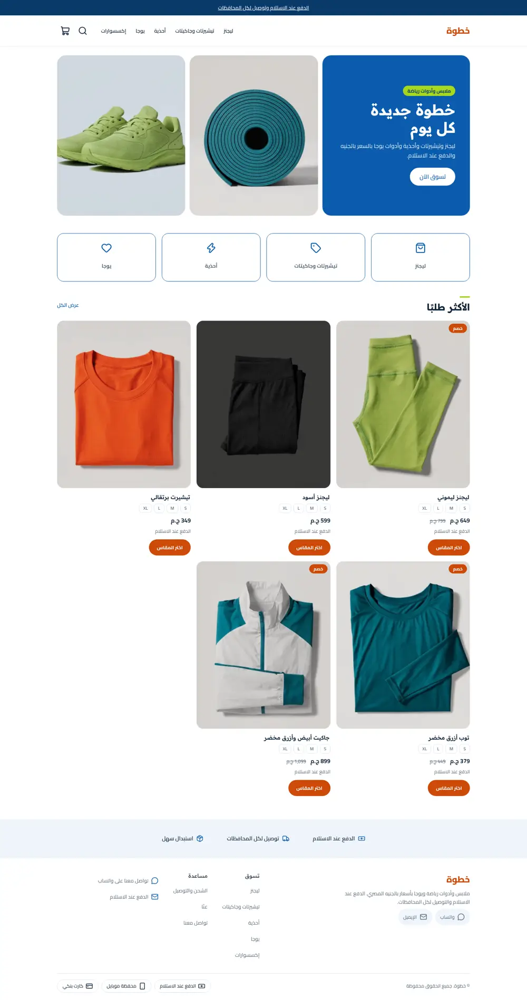
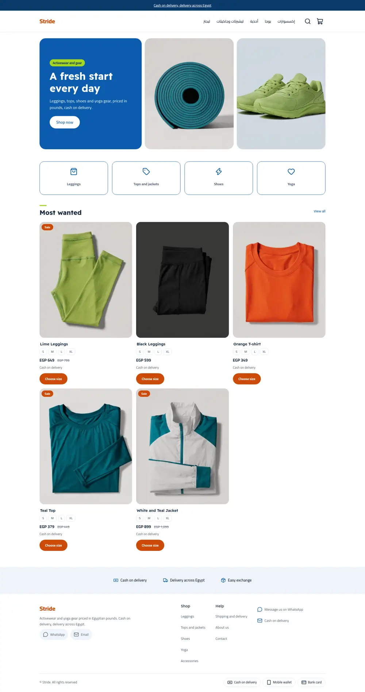
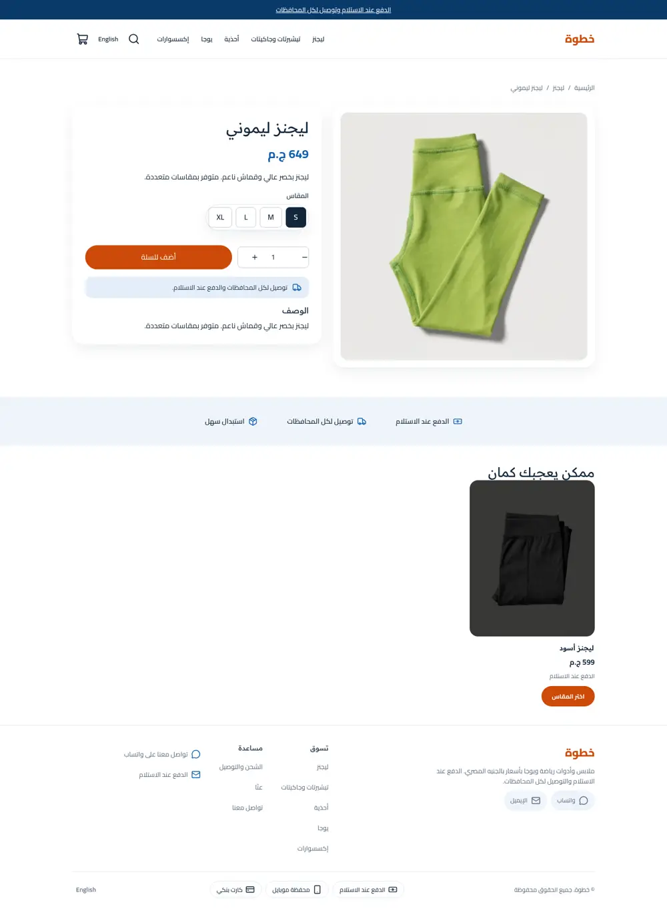
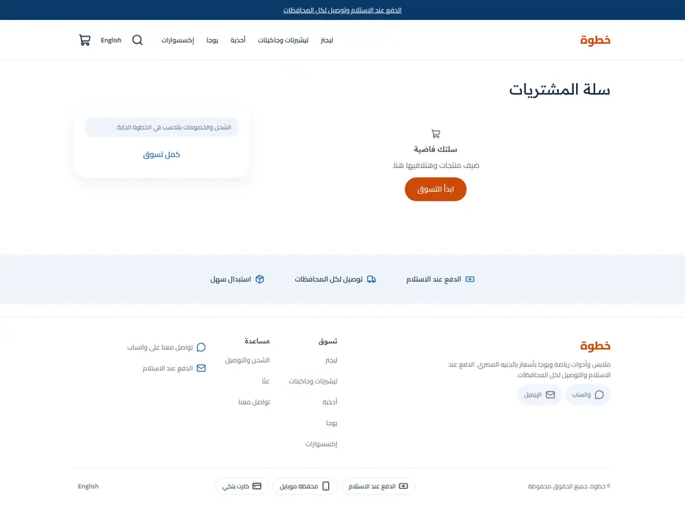
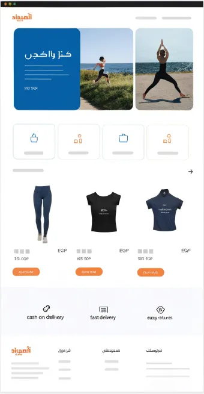

# Stride

A bright activewear and yoga store theme for the Sneferu SDK: white ground, an ocean-blue hero panel beside two photo tiles, orange pill buttons, icon category cards, a three-column product grid with size chips, and a soft trust band. Arabic first, English included.

| Home (ar) | Home (en) | Product (ar) | Cart (ar) | Phone (ar) |
| - | - | - | - | - |
|  |  |  |  |  |

The mockup it was built from:

| Mockup desktop | Mockup phone |
| - | - |
|  |  |

## What is in the folder

- `sections/stride-hero`, `stride-categories` (+ `category-tile` block), `stride-products`, `stride-trust`: the home page.
- `sections/header`, `footer`, `announcement-bar` with `groups/*.json`.
- `sections/product-main`, `collection-main`, `search-main`, `cart-main`, `page-main`, `not-found`, `related-products` with a template each.
- `snippets/product-card`: card with size chips (guarded on `product.options`) and an orange call to action.
- `assets/theme.css`: token-only colours (`var(--hk-color-*)`).

## Notes

- Tokens: primary ocean blue, accent orange, extra `lime`, `teal`, `photo` for the grey photo ground.
- Category cards take a `tone` select (primary or accent). Related rows use `collection('related')`.
- Money is `whole`; fonts come from the catalogue (Readex Pro headings, Cairo body).
