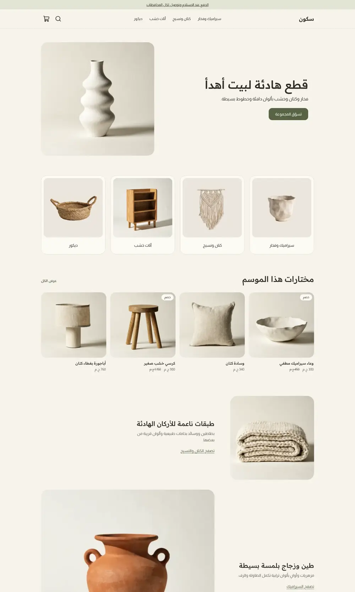
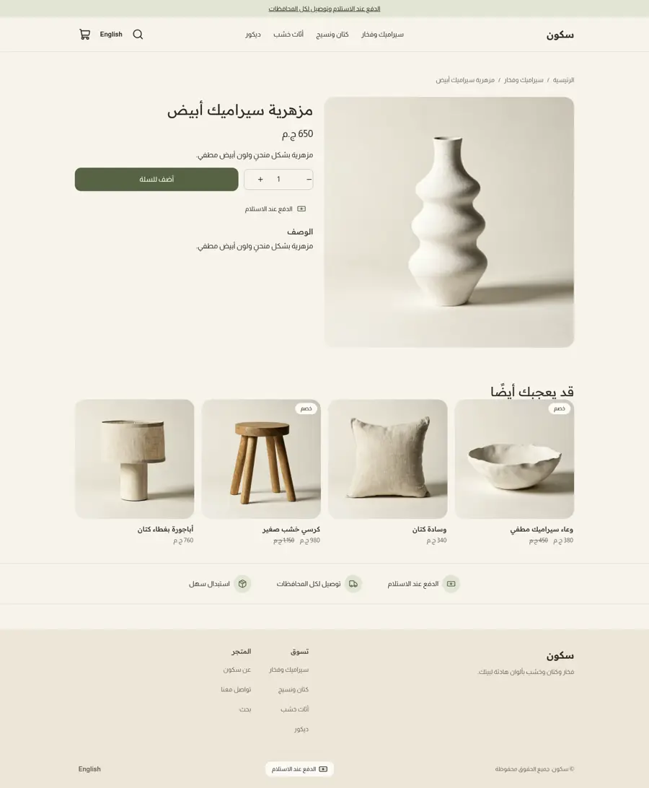
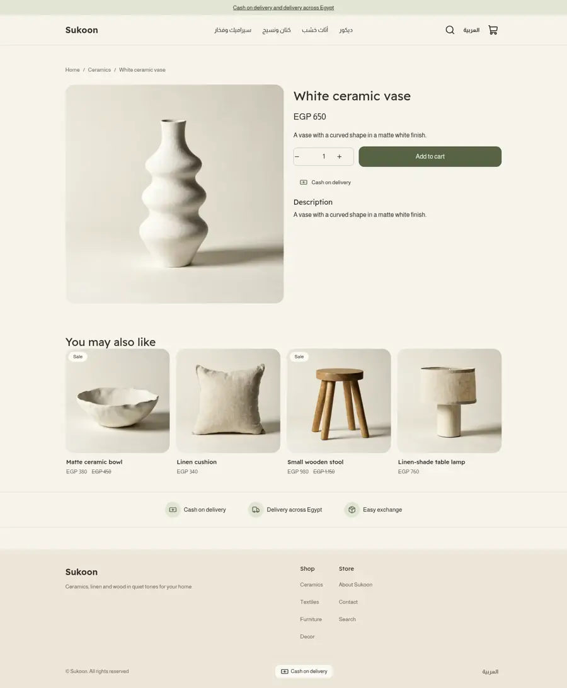
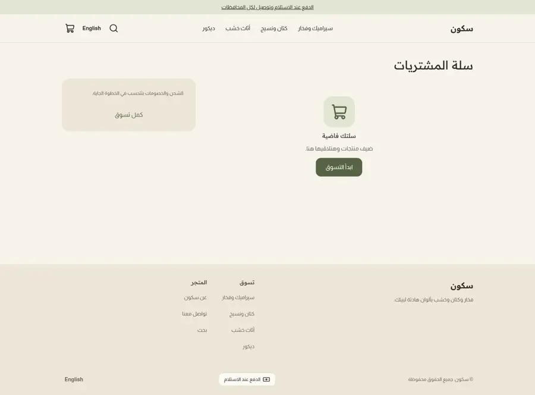
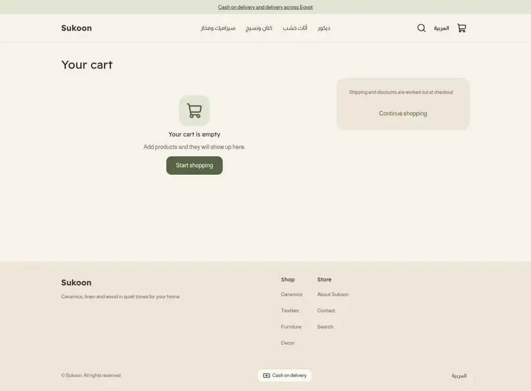
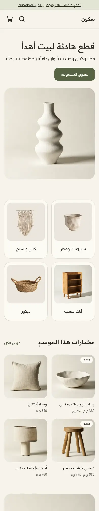

# Sukoon

A soft minimal home store theme for Sneferu: warm off-white and sand ground, a muted olive accent, rounded photo tiles, a quiet hero, category tiles, a calm product row and story blocks that alternate photo and text. Arabic first (RTL) with English.

| Page | Arabic | English |
| - | - | - |
| Home |  | |
| Product |  |  |
| Cart |  |  |
| Phone |  | |

## What is in the folder

- `theme.json`: tokens (olive primary, sage and sand extras), Readex Pro and Almarai, whole-pound money.
- `layout/`, `groups/`: announcement, header (logo image or store name, menu, search, cart drawer) and footer (store name, link columns, payment line).
- `sections/`: `hero`, `sk-tiles` (category tiles), `featured-products`, `sk-story`, `sk-trust`, plus the page sections.
- `blocks/`, `snippets/`, `templates/` for all seven page types, `locales/` ar and en.

## Excerpt: a block that renders only when it has a link

```

  <a class="sk-social" href="{{ url(block.settings.url) }}" aria-label="{{ block.settings.label }}">…</a>

```

Empty footer social and contact blocks therefore leave no dead line.
