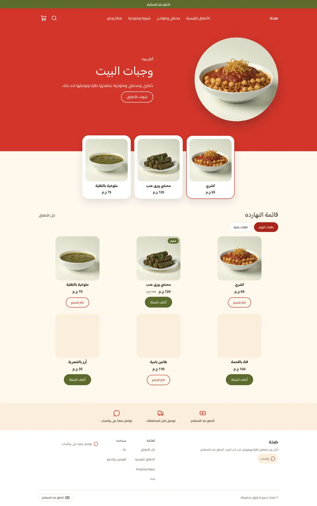
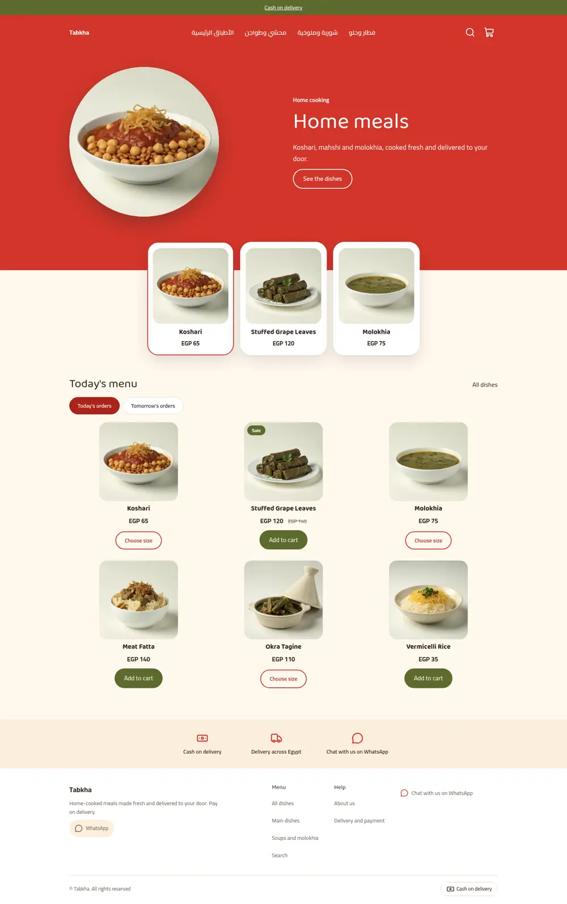
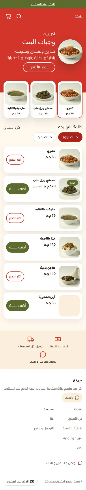
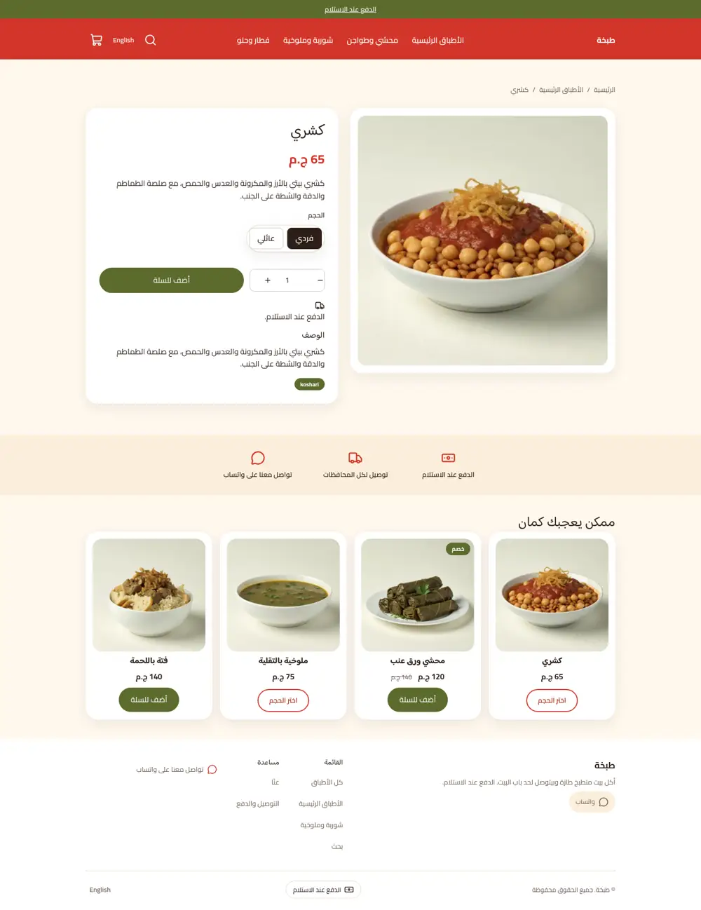
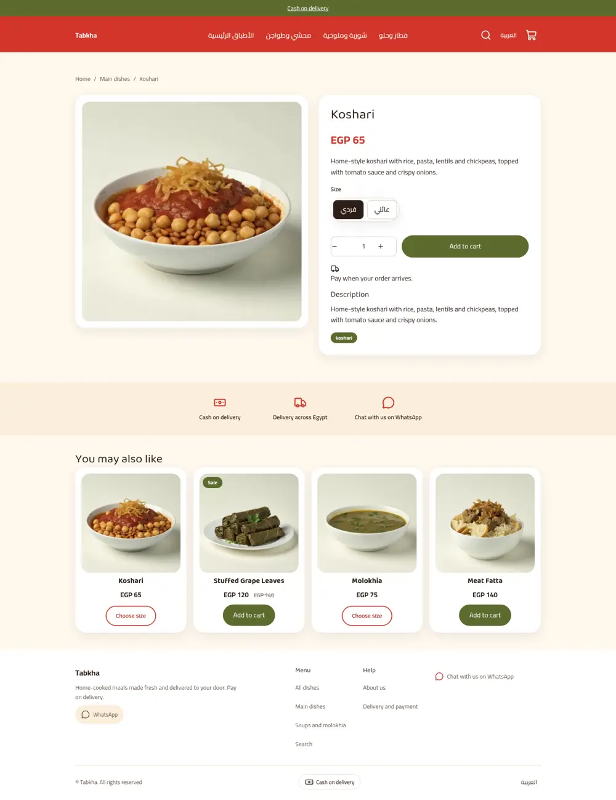
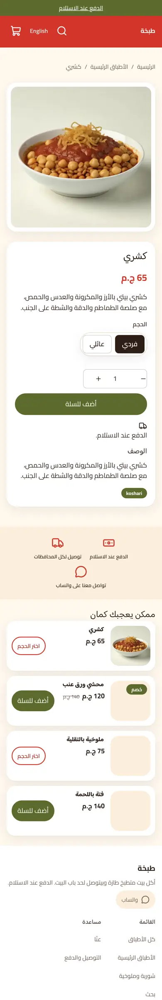
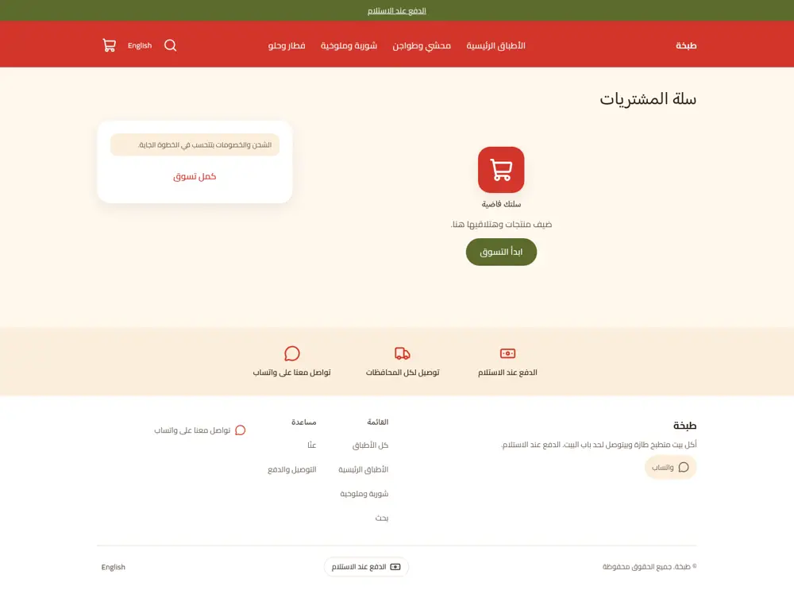
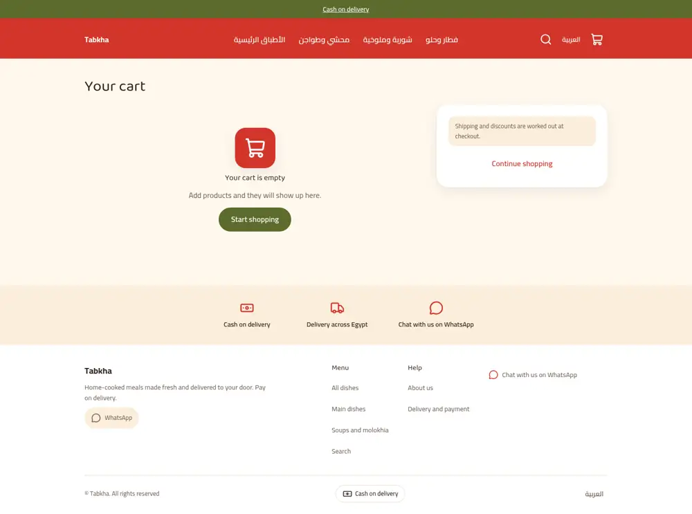
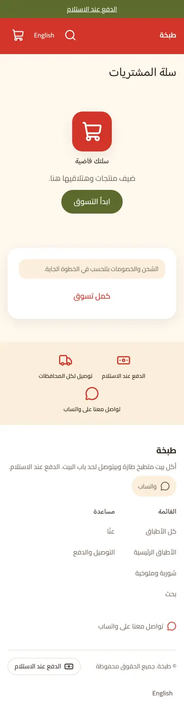

# Tabkha (طبخة)

A fresh home-kitchen food store theme for Sneferu: tomato red and cream with olive accents, a bold red hero, a row of picks overlapping the hero edge, today's menu as rounded dish cards with quick add buttons, and a calm trust strip. Phones turn the cards into list rows.

| Page | Desktop ar | Desktop en | Phone ar |
| - | - | - | - |
| Home |  |  |  |
| Product |  |  |  |
| Cart |  |  |  |

Mockup: `docs/mockup-desktop.webp`, `docs/mockup-phone.webp`.

## What is in the folder

- `theme.json`: tokens (tomato primary, olive secondary, cream background, Baloo Bhaijaan 2 headings, Cairo body), `money.format: whole`.
- `sections/hero.snf`, `tk-picks.snf`, `tk-menu.snf`, `tk-trust.snf`: the home page. `blocks/day-tab.snf` is an editable chip row (no time slots are promised).
- `snippets/product-card.snf`: dish card with option chips (guarded by `product.options`) and a quick add button; products with variants link to the product page instead.
- Cart, collection, search, product, page and 404 sections, plus the header, footer and announcement groups.

## Excerpt

```

  <hk-button label="{{ t('choose_option') }}" href="{{ product.url }}" variant="outline" size="sm" />

  <hk-add-to-cart product="{{ product }}" label="{{ t('quick_add') }}" quantity="false" />

```
