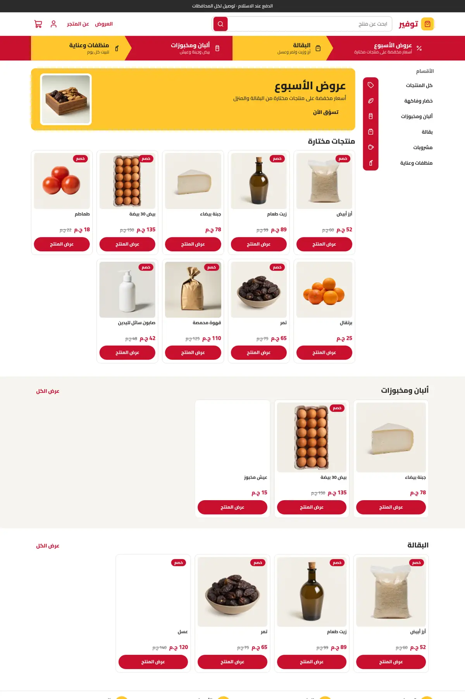
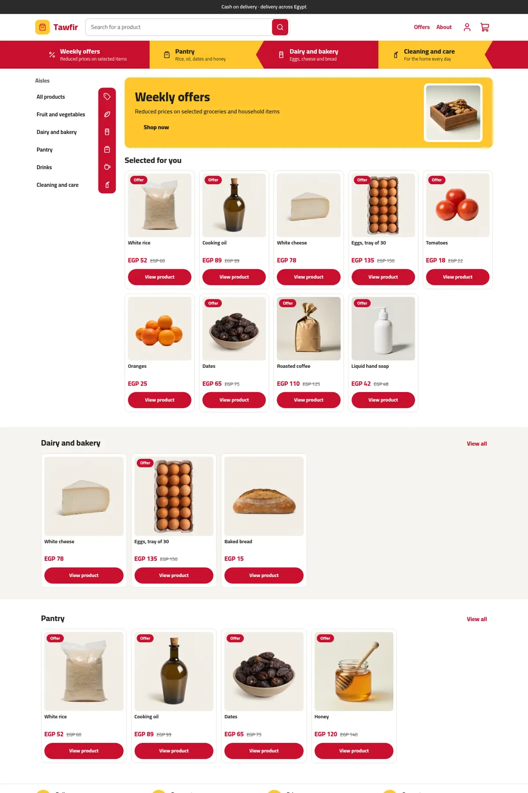
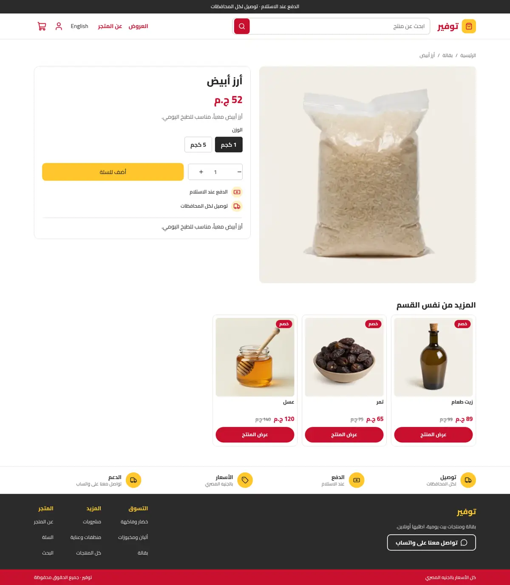
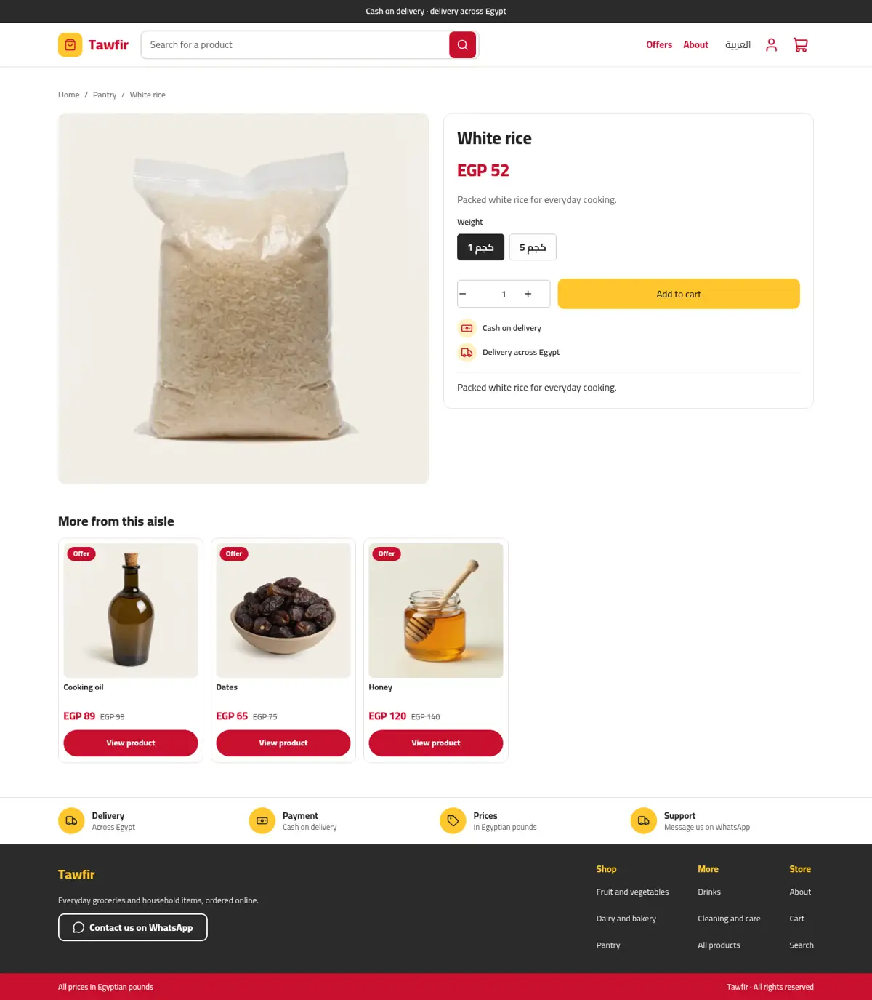
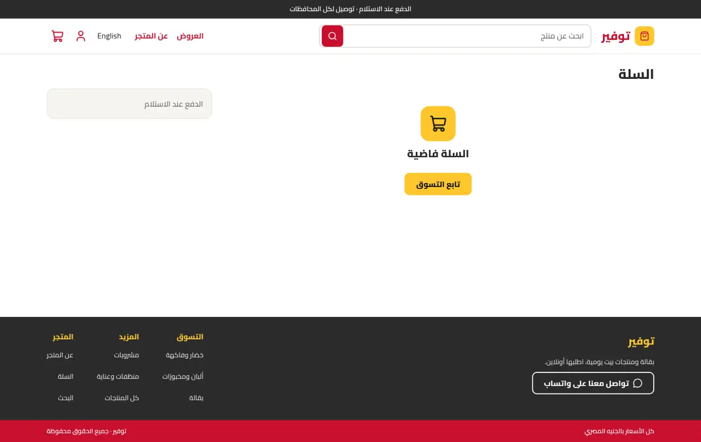
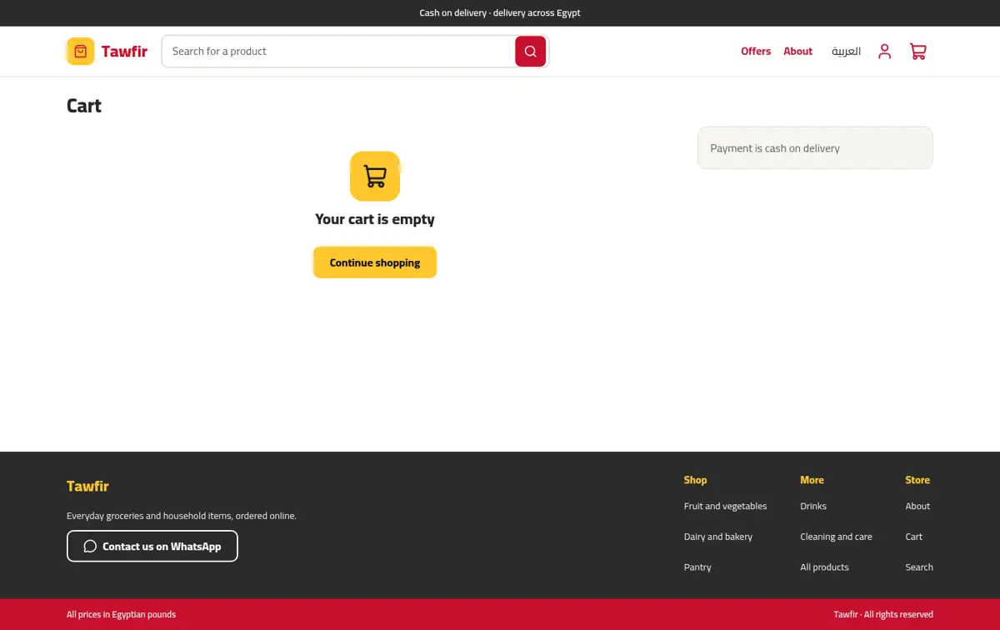
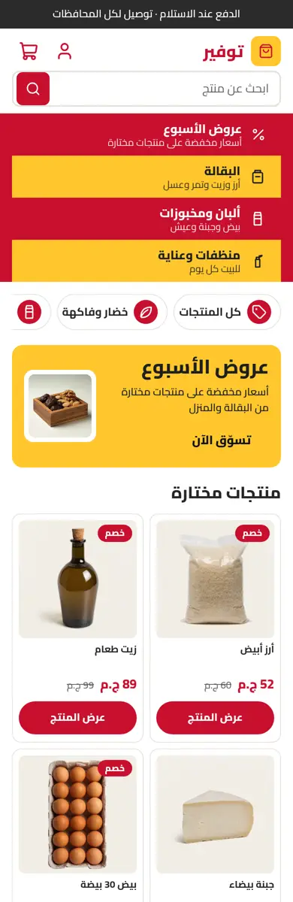
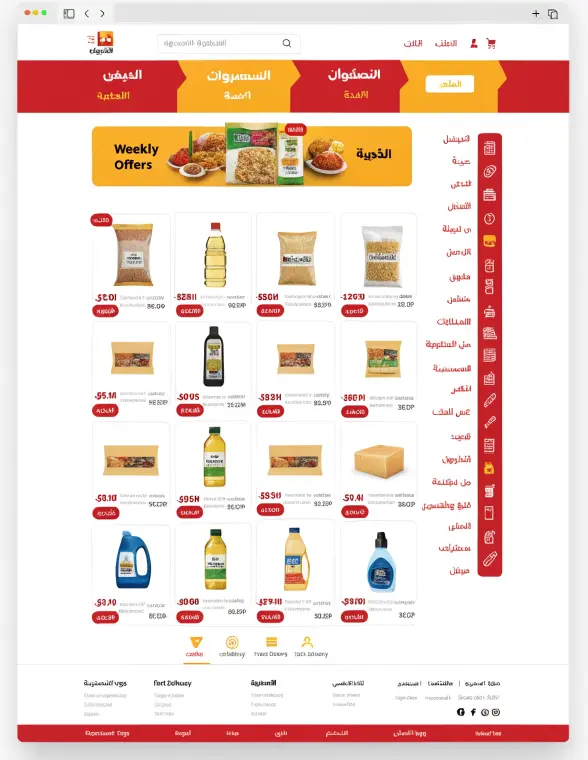
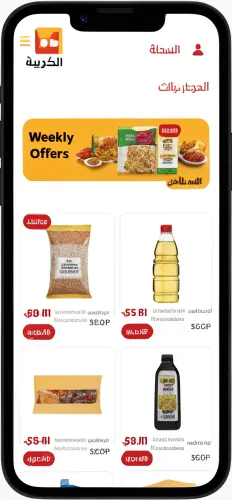

# Tawfir (توفير)

A dense discount supermarket theme for Sneferu: a red and yellow chevron band, an aisle rail with icons, a weekly-offers banner, tight product grids and a trust strip. Discount badges appear only where a product has a compare-at price.

| Page | Arabic | English |
| - | - | - |
| Home |  |  |
| Product |  |  |
| Cart |  |  |

Phone: 

Mockup:  

## What is in the folder

- `theme.json`: tokens (red, yellow, dark grey, white), Cairo, whole-pound prices.
- `layout/`, `groups/`: announcement, header and footer groups.
- `sections/`: `tw-steps` (chevron band), `tw-shop` (aisles + banner + grid), `tw-shelf`, `tw-trust`, plus one main section per page type.
- `blocks/`, `snippets/`: step, aisle, trust, footer column; the product card and aisle glyphs.
- `templates/`: index, product, collection, search, cart, page, 404.

## Notes

Product cards link to the product page. The chevron shape flips with `dir` through a `tw-dir-<dir>` class. Aisle glyphs not in the `hk-icon` set are inline SVG in `snippets/glyph.snf`.
