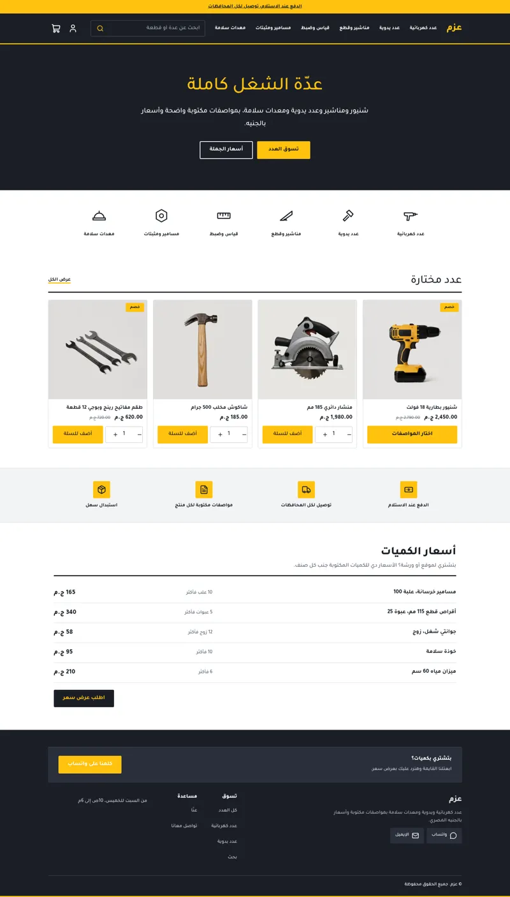
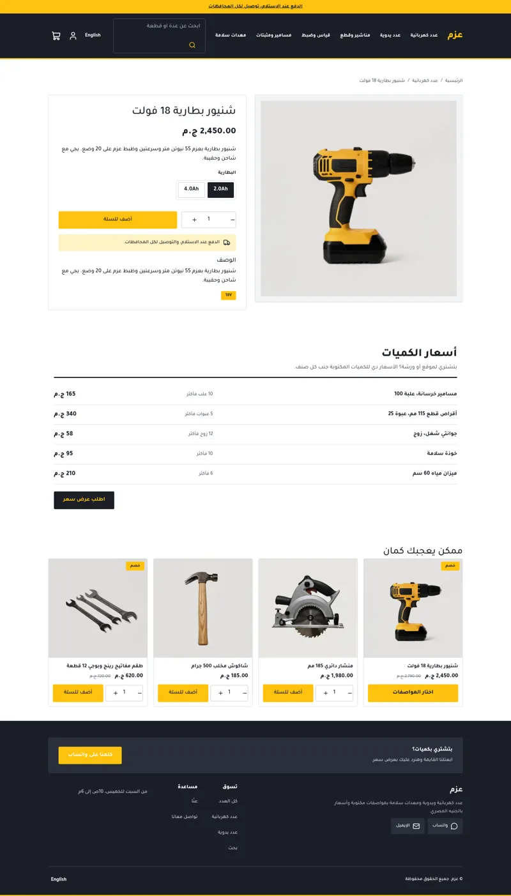
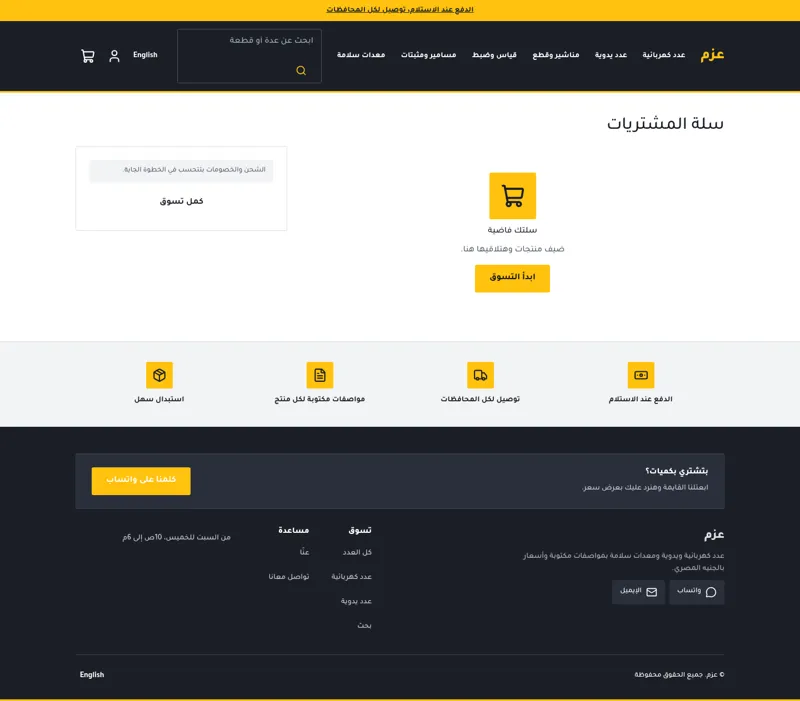
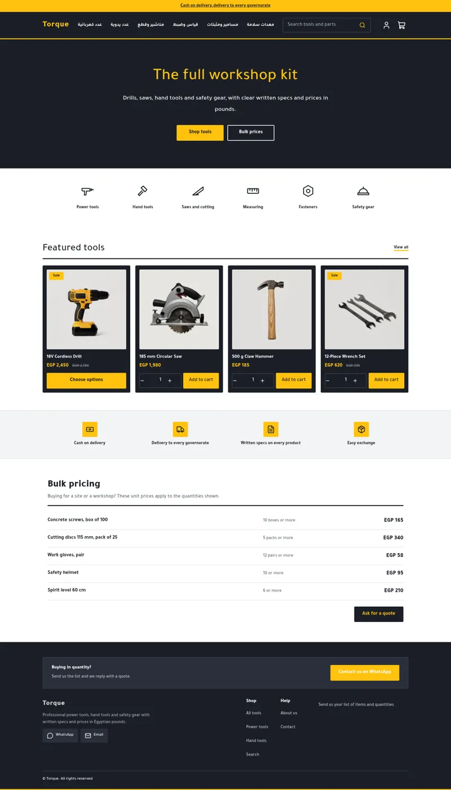
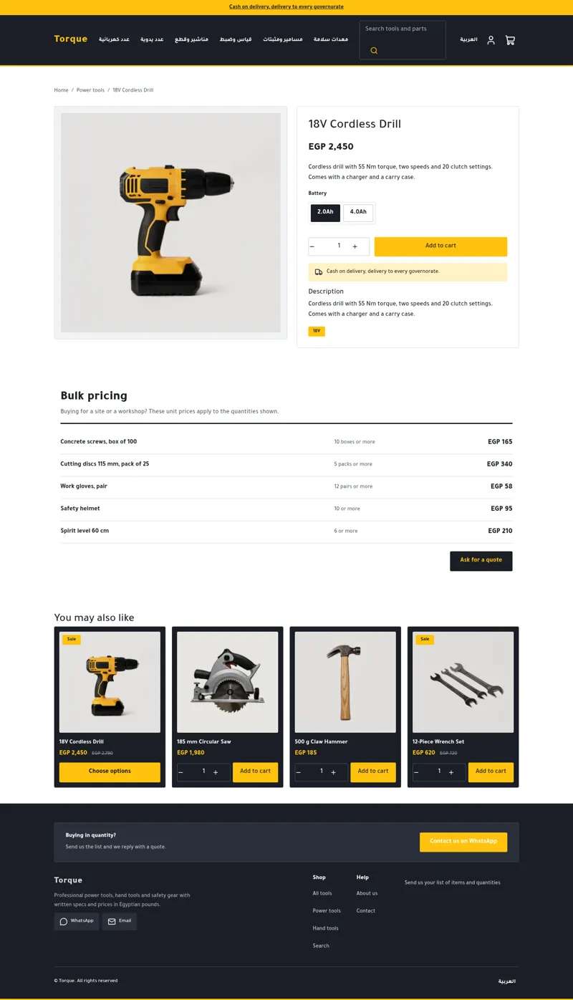
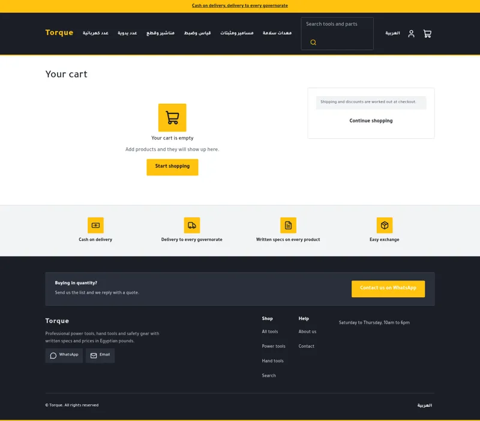
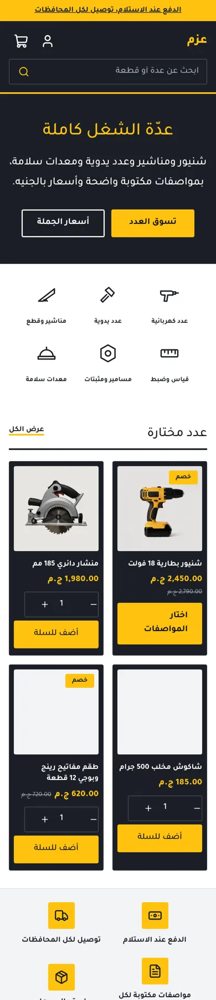
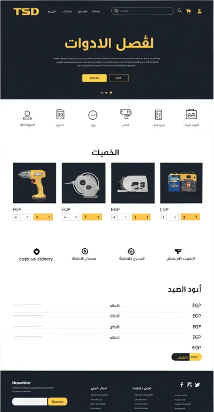
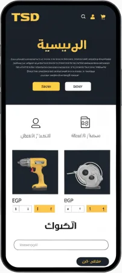

# Tutorial: Torque, a professional tools and hardware store

Torque is a full store theme for a tools and hardware shop: charcoal and safety
yellow, flat square cards, a category icon row, quantity and add buttons on every
card, a trust strip and a bulk price table. Arabic first (RTL) with English.

| Home | Product | Cart |
| - | - | - |
|  |  |  |
|  |  |  |
|  | | |

The design it follows:  

## What is in the folder

```
theme.json            tokens: charcoal, safety yellow, Tajawal, 4px radius
layout/theme.snf      skip link, announcement, header, content slot, footer
groups/               header, footer, announcement: first content
templates/            index product collection search cart page 404
sections/             hero, categories, featured-products, trust-strip,
                      bulk-pricing, product-main, collection-main, ...
blocks/               category-tile, tier, trust, menu-link, footer-link, ...
snippets/             product-card (qty + add), glyph (tool icons), price, button
assets/theme.css      the look, scoped to [data-hk-theme='torque']
locales/              ar.json, en.json: same keys
```

## Excerpts

The card shows the quantity and add button for simple products and a link to the
options for products with variants:

```

  <hk-button label="{{ t('choose_options') }}" href="{{ product.url }}" variant="solid" size="sm" />

  <hk-add-to-cart product="{{ product }}" />

```

The bulk table is a section of `tier` blocks; the price is a number setting printed
with `{{ block.settings.price | money: 'whole', 'major' }}`.

Tool icons the Sneferu icon set lacks (drill, hammer, saw, ruler, nut, helmet) are
inline SVG in `snippets/glyph.snf`, picked by the `icon` setting of `category-tile`.
