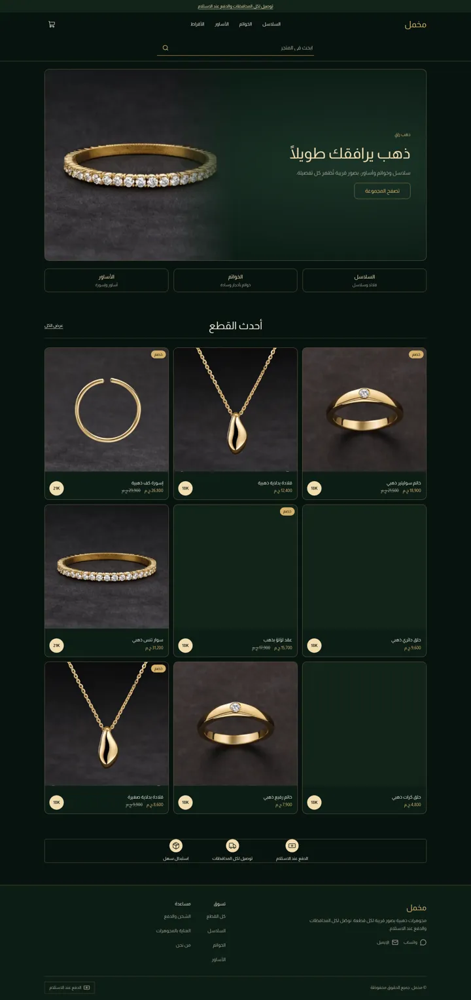
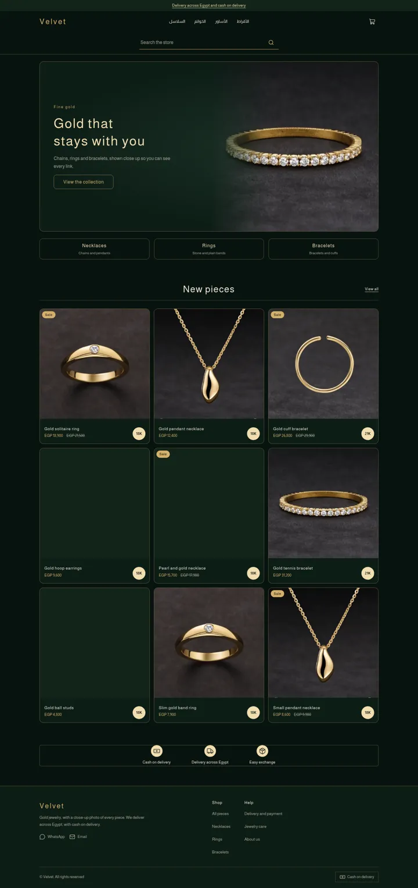
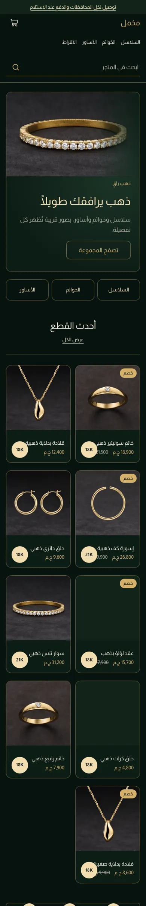
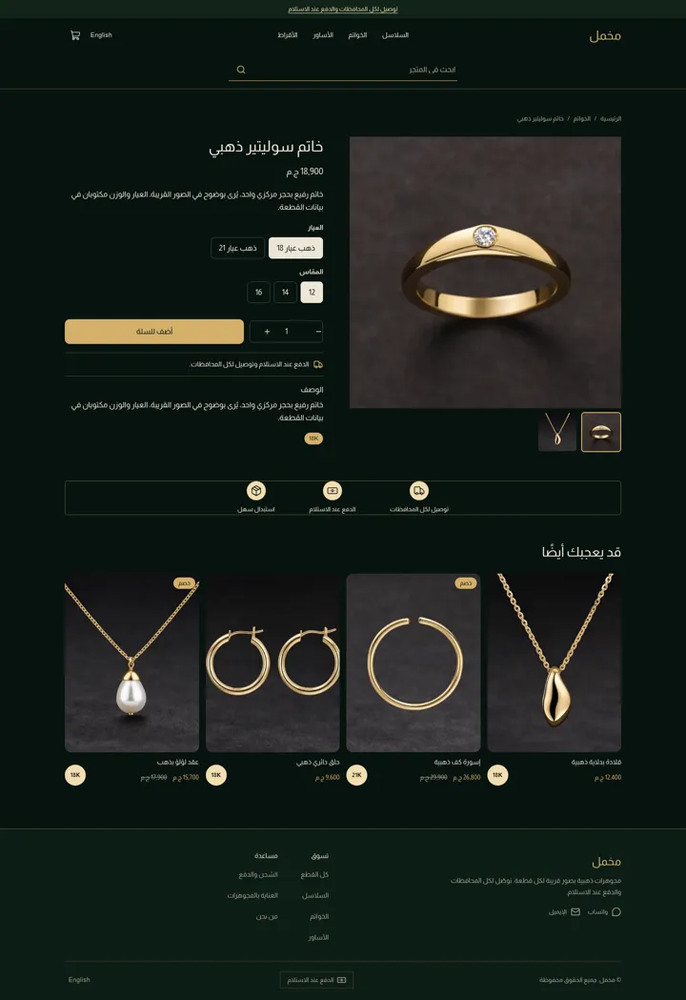
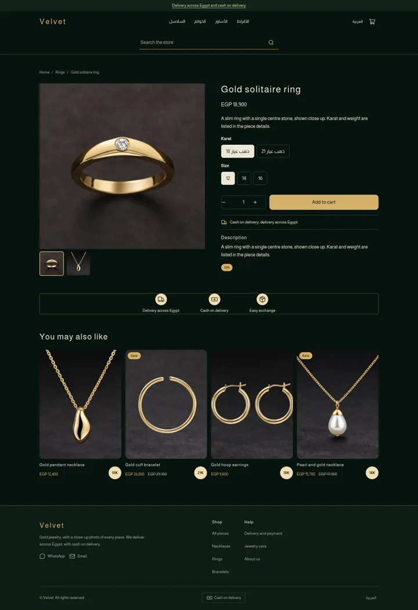
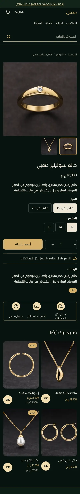
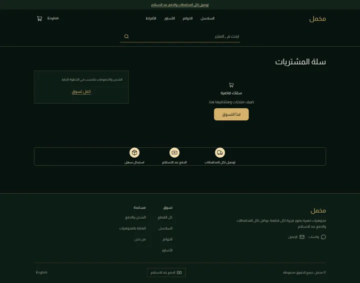
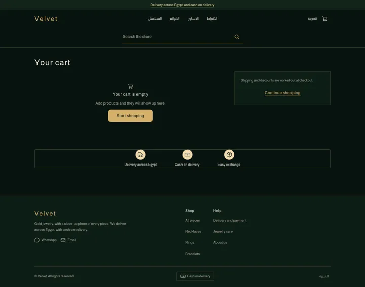
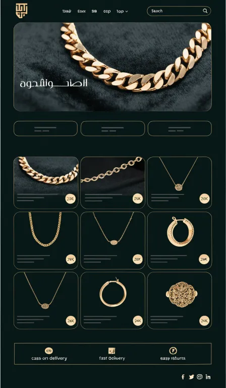
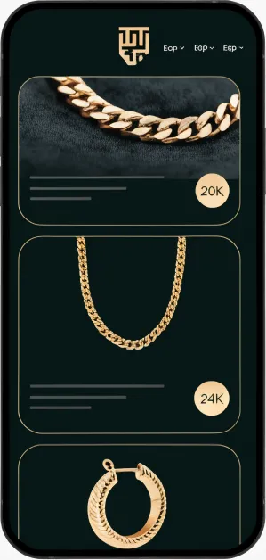

# Tutorial: Velvet, a dark gold jewelry store

Velvet is a full store theme for a fine-jewelry shop: forest-green and black
grounds, thin gold hairlines, a rounded hero card with the photo fading into the
text, three outlined category links, a three-column grid of rounded cards with a
round gold karat chip (the product's first tag) and a boxed three-icon trust strip.
Right-to-left in Arabic and left-to-right in English from the same files.

The theme writes **every page type itself**: home, product, collection, search,
cart, 404 and content page, with announcement, header and footer groups.

| Page | Arabic, desktop | English, desktop | Arabic, phone |
| - | - | - | - |
| Home |  |  |  |
| Product |  |  |  |
| Cart |  |  |  |

The design brief was this mockup (placeholder Arabic and fake logo, replaced by a
plain-text wordmark):

 

## What is in the folder

```
theme.json                 id, version, tokens (forest, black, gold, gold-soft)
layout/theme.snf           announcement, header, <main>, footer
groups/                    announcement.json, header.json, footer.json
templates/                 index, product, collection, search, cart, 404, page
sections/                  announcement-bar, header, footer, hero, collection-chips, trust-strip,
                           featured-products, product-main, related-products,
                           collection-main, search-main, cart-main, not-found, page-main
blocks/                    chip-link, trust, menu-link, footer-*, social-link, product-* blocks
snippets/                  product-card, price, button
locales/                   ar.json, en.json (same keys)
assets/theme.css           the only stylesheet; every colour is a token
docs/                      screenshots
```

## Run it

```bash
sneferu dev .
sneferu format .
sneferu validate .
```

## Annotated excerpts

The karat chip is the product's first tag, so merchants edit it like any tag:

```
<span class="vl-karat">{{ tag }}</span>
```

Gold hairlines are one token mixed with transparency, never a colour literal:

```css
--vl-gold-line: 1px solid color-mix(in srgb, var(--hk-color-accent) 45%, transparent);
```
