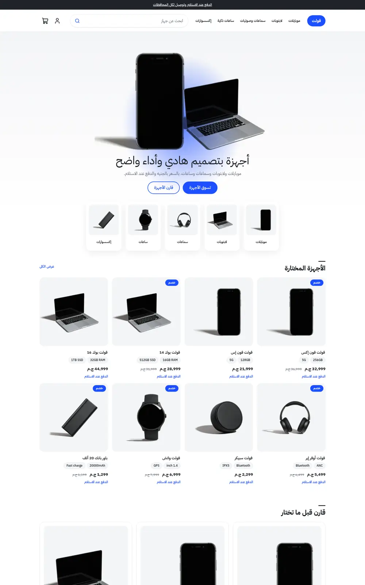
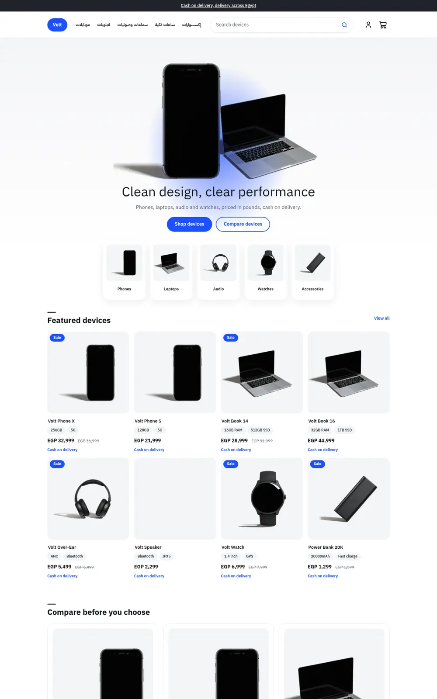
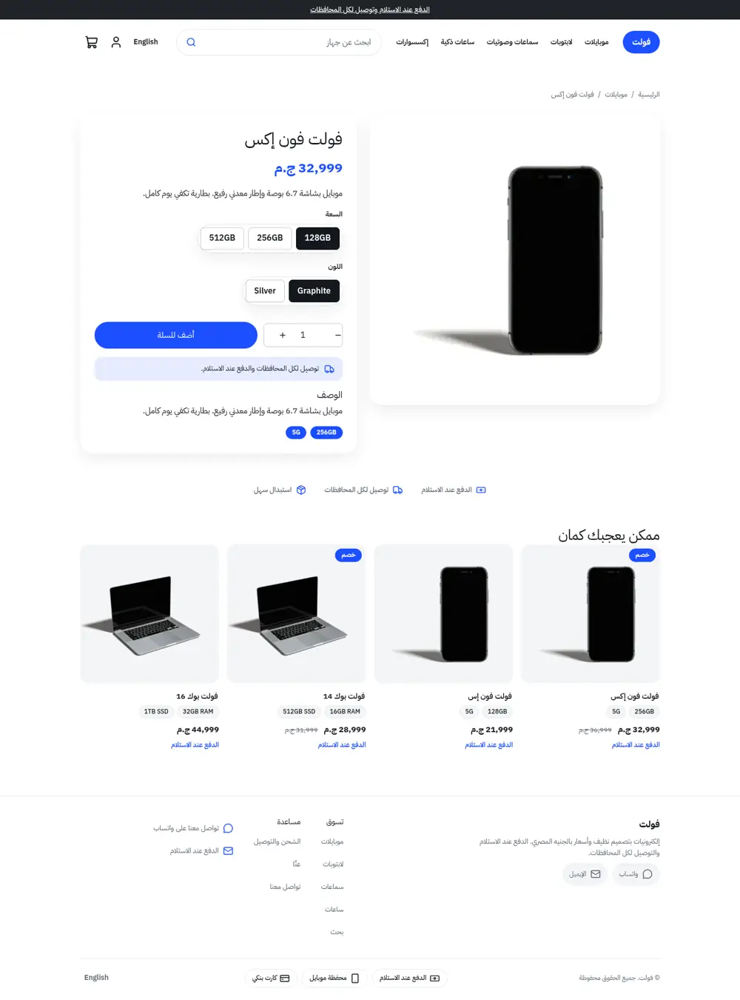
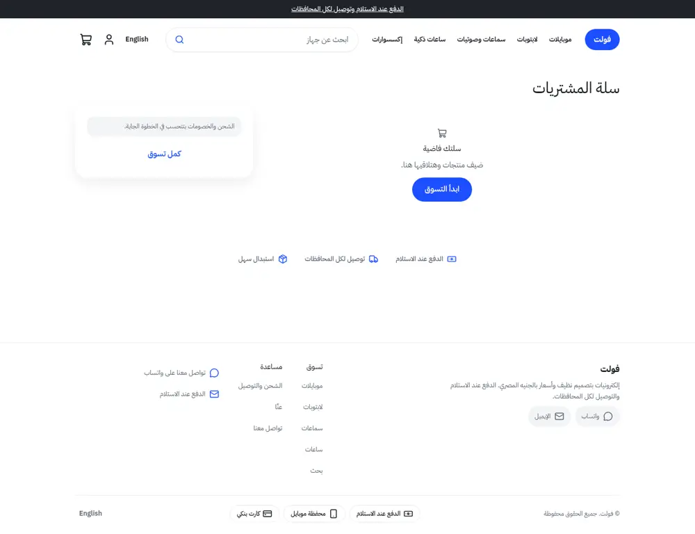
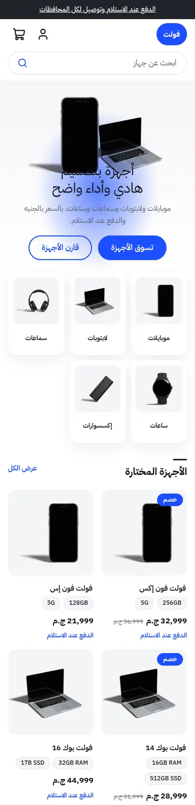
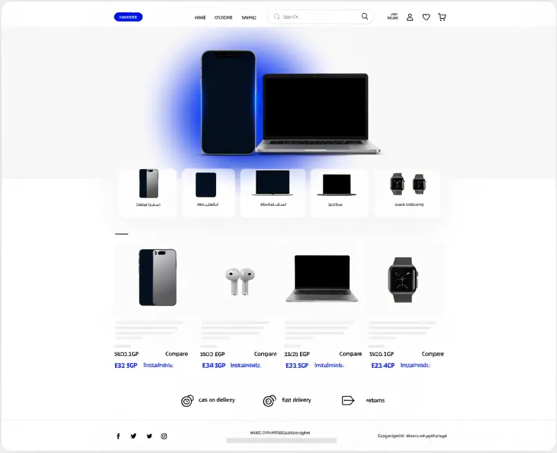

# Volt

A clean premium electronics store theme for the Sneferu SDK: white and graphite with one electric-blue accent, a product render hero with a blue glow, overlapping category tiles, spec-chip product cards and a side-by-side compare row. Arabic first, English included.

| Home (ar) | Home (en) | Product (ar) |
| - | - | - |
|  |  |  |

| Cart (ar) | Phone (ar) | Mockup |
| - | - | - |
|  |  |  |

## What is in the folder

- `sections/volt-hero`, `volt-categories` (+ `category-tile` block), `volt-products`, `volt-compare`, `volt-trust`: the home page.
- `snippets/product-card`: spec chips come from product tags and option values (option chips only show once the platform passes options to list cards); the line under the price is an editable setting, not an instalment promise.
- `templates/`: all seven page types. `groups/`: announcement, header, footer.

## Excerpt

```snf

  <ul class="vt-specs"><li class="vt-spec">{{ tag }}</li></ul>

```
