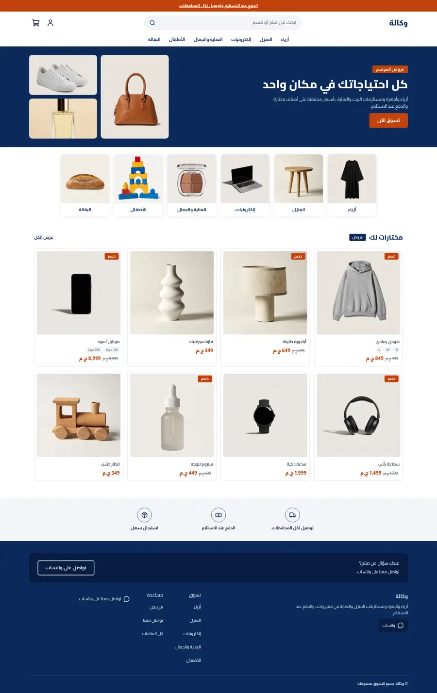
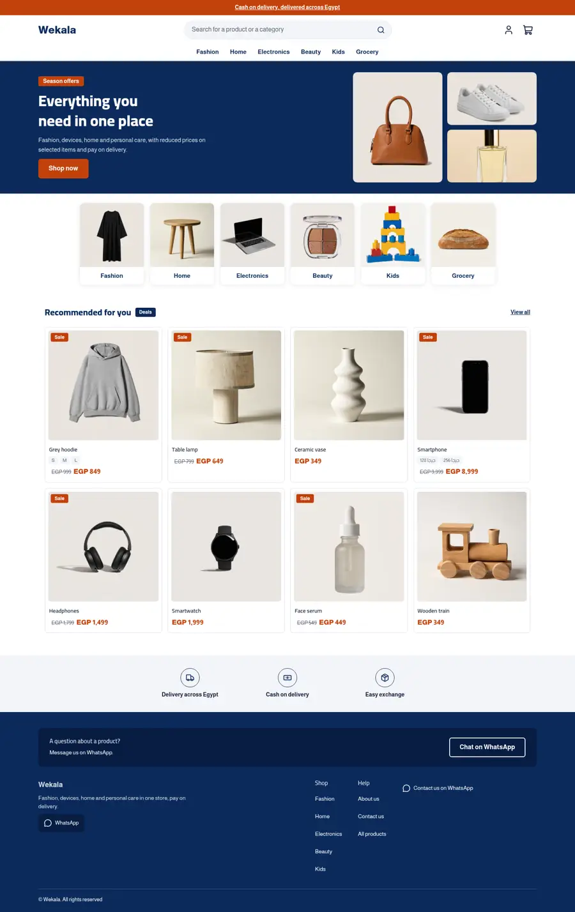
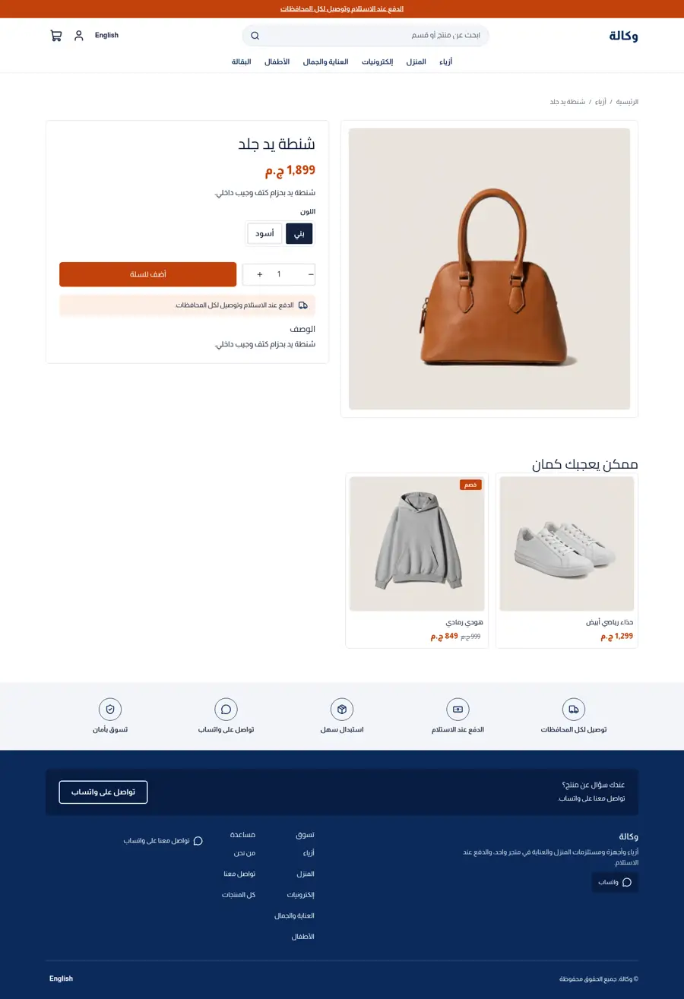
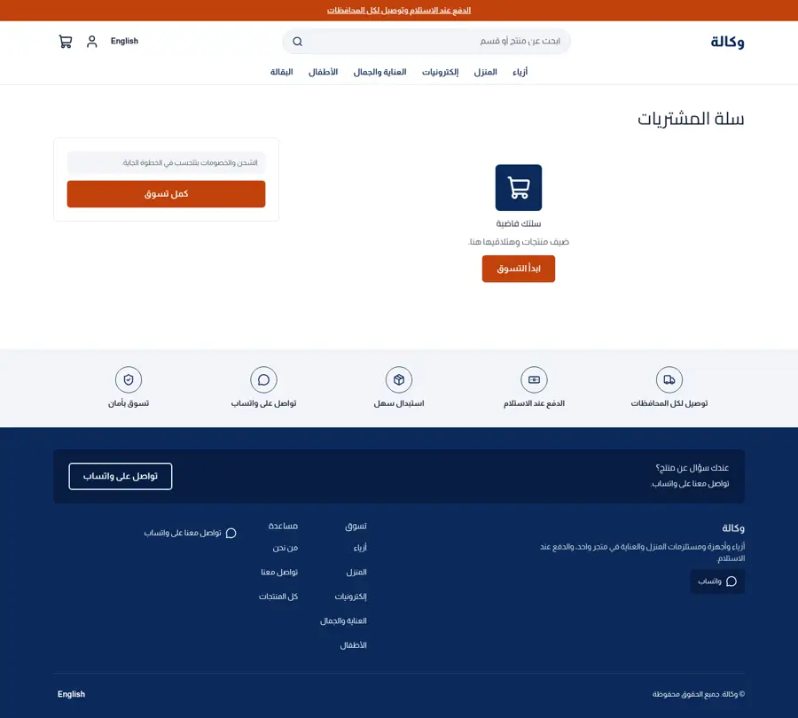
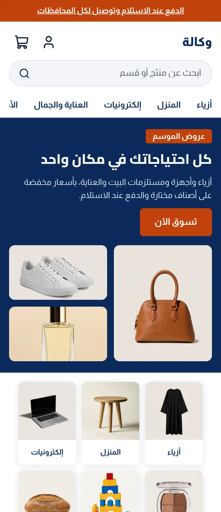

# Tutorial: Wekala, a department store theme

Wekala is a full store theme for a shop that sells across many categories: fashion, home,
electronics, beauty, kids and grocery. White and navy with one orange accent, a navy hero
banner with a three-photo collage, photo category tiles, a deals row with sale badges and a
grey trust band.

| Home (ar) | Home (en) | Product (ar) | Cart (ar) | Home phone (ar) |
| - | - | - | - | - |
|  |  |  |  |  |

The mockup it follows: `docs/mockup-desktop.webp`, `docs/mockup-phone.webp`.

## What is in the folder

```
theme.json                  tokens (navy, orange), fonts (Cairo, Almarai), money: whole
layout/theme.snf            skip link, announcement, header, content, footer
groups/                     header, footer, announcement
sections/banner-hero        heading, text, button and three image settings
sections/category-tiles     photo tiles (tile blocks with an image setting)
sections/deals-grid         heading, small tag and a product grid from any collection
sections/trust-strip        icon strip on a grey band (trust blocks)
sections/*-main             product, collection, search, cart, page, 404
snippets/product-card       card: photo, sale badge, title, option chips, price
```

## The hero collage

The three photos are image settings with editable alt text; clear the first one and the
collage hides itself with `:has()`.

```
.wk-collage:not(:has(.wk-collage-1)) { display: none; }
```

## Sale badge

Sneferu has no arithmetic filters, so the badge says "Sale" (a locale key) rather than a
percentage; `hk-price` still shows the struck-through compare-at price.
